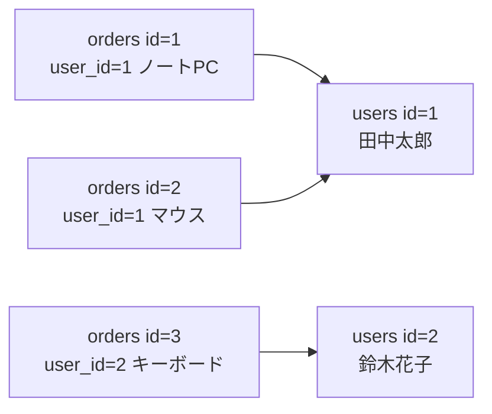
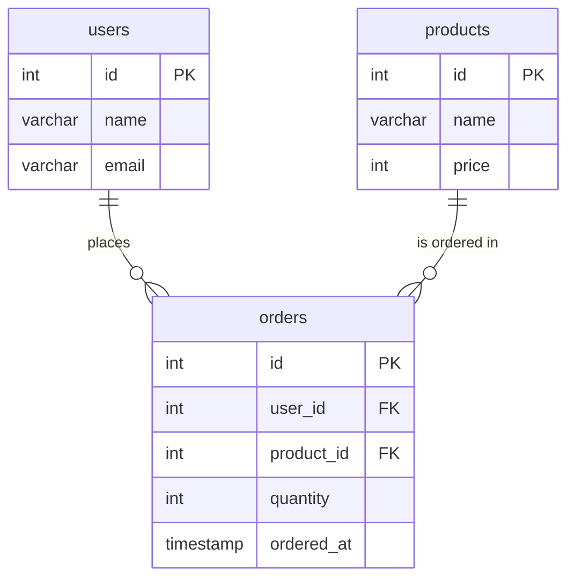
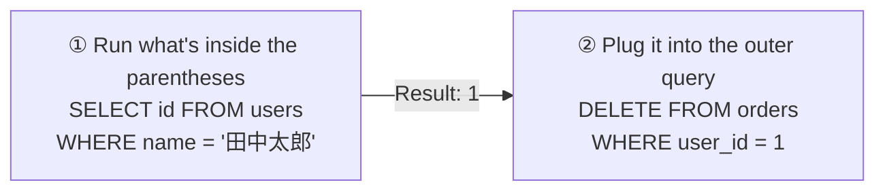

# Lesson 09 | Table Relationships and JOIN — Combining Data from Multiple Tables

> 🇯🇵 Original (Japanese version): [20260728_資料.md](<../../../1年生_データ設計とアプリ開発/前期/20260728/20260728_資料.md>) <!-- original-ja-link -->

## Today's Goals
- You can explain why we split data into separate tables (normalization)
- You understand the idea of foreign keys
- You can join tables with INNER JOIN / LEFT JOIN

---

[About Relational Databases](../20260721/リレーショナルデータベース入門.md)

## 1. Why Split Data into Separate Tables?

Bad example: cramming everything into one table

```
orders table (bad example)
id │ user_name │ user_email         │ product_name │ price
───┼───────────┼────────────────────┼──────────────┼───────
 1 │ 田中太郎  │ tanaka@example.com │ ノートPC     │ 98000
 2 │ 田中太郎  │ tanaka@example.com │ マウス       │  3200
 3 │ 鈴木花子  │ suzuki@example.com │ キーボード   │  8500
```

**Problems:**
- 田中太郎's information is duplicated in 2 rows (if the email changes, every row has to be updated)
- The data can easily become inconsistent

**Solution: Split the data into separate tables and link them with foreign keys (normalization)**

---

## 2. Foreign Keys

**users table**

| id | name | email |
|----|------|-------|
| 1 | 田中太郎 | tanaka@... |
| 2 | 鈴木花子 | suzuki@... |

**orders table**

| id | user_id | product | price |
|----|---------|---------|-------|
| 1 | 1 | ノートPC | 98000 |
| 2 | 1 | マウス | 3200 |
| 3 | 2 | キーボード | 8500 |

`orders.user_id` refers to `users.id`. This is called a "foreign key."



---

## 3. Creating Tables and Setting Up Foreign Keys

```sql
USE school_db;

-- users table
CREATE TABLE users (
    id    INT AUTO_INCREMENT PRIMARY KEY,
    name  VARCHAR(100) NOT NULL,
    email VARCHAR(255) NOT NULL UNIQUE
);

-- products table
CREATE TABLE products (
    id    INT AUTO_INCREMENT PRIMARY KEY,
    name  VARCHAR(100) NOT NULL,
    price INT NOT NULL
);

-- orders table (linked with foreign keys)
CREATE TABLE orders (
    id         INT AUTO_INCREMENT PRIMARY KEY,
    user_id    INT NOT NULL,
    product_id INT NOT NULL,
    quantity   INT NOT NULL DEFAULT 1,
    ordered_at TIMESTAMP DEFAULT CURRENT_TIMESTAMP,
    
    -- Foreign key constraints (to maintain referential integrity)
    FOREIGN KEY (user_id)    REFERENCES users(id),
    FOREIGN KEY (product_id) REFERENCES products(id)
);

-- Test data
INSERT INTO users (name, email) VALUES
    ('田中太郎', 'tanaka@example.com'),
    ('鈴木花子', 'suzuki@example.com'),
    ('山田次郎', 'yamada@example.com');

INSERT INTO products (name, price) VALUES
    ('ノートPC', 98000),
    ('マウス', 3200),
    ('キーボード', 8500);

INSERT INTO orders (user_id, product_id, quantity) VALUES
    (1, 1, 1),  -- Tanaka orders 1 ノートPC
    (1, 2, 2),  -- Tanaka orders 2 マウス
    (2, 3, 1),  -- Suzuki orders 1 キーボード
    (3, 1, 1),  -- Yamada orders 1 ノートPC
    (2, 1, 1);  -- Suzuki orders 1 ノートPC
```

Here is a diagram of how the 3 tables are related. orders refers to both users and products through foreign keys.



---

[The Difference Between INNER JOIN and LEFT JOIN](./JOIN入門.md)

## 4. INNER JOIN — Join Only the Data That Exists in Both Tables

```sql
-- Join user information to orders
SELECT
    orders.id,
    users.name    AS ユーザー名,
    users.email,
    orders.quantity
FROM orders
INNER JOIN users ON orders.user_id = users.id;

-- Join 3 tables (orders + users + products)
SELECT
    orders.id,
    users.name      AS ユーザー名,
    products.name   AS 商品名,
    products.price  AS 単価,
    orders.quantity AS 数量,
    products.price * orders.quantity AS 合計金額
FROM orders
INNER JOIN users    ON orders.user_id    = users.id
INNER JOIN products ON orders.product_id = products.id
ORDER BY orders.id;
```

---

## 5. LEFT JOIN — Include Every Row from the Left Table

```sql
-- When you want to show users who haven't ordered yet, too
SELECT
    users.name,
    COUNT(orders.id) AS 注文数
FROM users
LEFT JOIN orders ON users.id = orders.user_id
GROUP BY users.id, users.name;

-- Users with 0 orders are shown too
-- With INNER JOIN, only users who have orders would be shown
```

### 5-1. Going Further: Finding "Only" the Users Who Haven't Ordered Yet

When you join with LEFT JOIN, if there is no matching row on the right side (orders), those columns become `NULL`. You can use this behavior to narrow the results down to "only the rows that didn't match."

```sql
SELECT users.name, users.email
FROM users
LEFT JOIN orders ON users.id = orders.user_id
WHERE orders.id IS NULL;
```

**How it works:**
1. `LEFT JOIN` keeps every user (for people with no orders, the orders columns become `NULL`)
2. `WHERE orders.id IS NULL` narrows it down to only "the rows that didn't match orders"
   → In other words, only "the people who have never ordered" remain

You can't use this pattern with `INNER JOIN` (because rows that don't match never appear in the results in the first place). "LEFT JOIN + `IS NULL`" is a useful standard pattern to remember.

---

## 6. Combining with Aggregation

```sql
-- Total purchase amount for each user
SELECT
    users.name AS ユーザー名,
    COUNT(orders.id) AS 注文件数,
    SUM(products.price * orders.quantity) AS 合計金額
FROM users
INNER JOIN orders    ON users.id          = orders.user_id
INNER JOIN products  ON orders.product_id = products.id
GROUP BY users.id, users.name
ORDER BY 合計金額 DESC;
```

---

## 7. HAVING — Filtering "After" Aggregation

`WHERE` filters rows **before** they are aggregated, but `HAVING` filters the results **after** they are aggregated with `GROUP BY`.

```sql
-- Show only users whose total amount is 100000 yen or more
SELECT
    users.name AS ユーザー名,
    SUM(products.price * orders.quantity) AS 合計金額
FROM users
INNER JOIN orders   ON users.id          = orders.user_id
INNER JOIN products ON orders.product_id = products.id
GROUP BY users.id, users.name
HAVING SUM(products.price * orders.quantity) >= 100000;
```

**The difference between WHERE and HAVING:**

| | When it filters | What you can use |
|---|---|---|
| `WHERE` | **Before** aggregating with `GROUP BY` | The raw columns of each row (such as `orders.quantity`) |
| `HAVING` | **After** aggregating with `GROUP BY` | Aggregate results such as `SUM()` and `COUNT()` |

You write them in the order `SELECT ... FROM ... WHERE ... GROUP BY ... HAVING ... ORDER BY`, but they are actually processed in the order `WHERE` → `GROUP BY` → `HAVING` → `ORDER BY`. Remember: "`HAVING SUM(...) >= 100000` is OK, but `WHERE SUM(...) >= 100000` is not (the rows haven't been aggregated yet, so SUM doesn't exist yet)."

---

## 8. Subqueries — Writing a SELECT Inside a SELECT

When you run an `INSERT` or `DELETE`, sometimes you don't know the `id` of the row you need. In that case, a **subquery**, which uses the result of a `SELECT` directly as a condition, comes in handy.

```sql
-- Example: you want to use the id of "田中太郎" as a condition, but you don't know what number it is

-- ① Not a bad approach, but it takes 2 steps
SELECT id FROM users WHERE name = '田中太郎';  -- Result: 1
DELETE FROM orders WHERE user_id = 1;          -- Manually enter the 1 returned by the query

-- ② With a subquery, you can write it in one statement
DELETE FROM orders
WHERE user_id = (SELECT id FROM users WHERE name = '田中太郎');
```

Think of it like this: the `SELECT` inside the `( )` runs first and turns into a single value (here, the `id`), which is then plugged into the outer `WHERE user_id = (here)`. It's easier to understand if you think of it as "read what's inside the parentheses first."



```sql
-- An example of using it the same way with INSERT
INSERT INTO orders (user_id, product_id, quantity)
VALUES (
    (SELECT id FROM users WHERE name = '田中太郎'),
    (SELECT id FROM products WHERE name = 'USBハブ'),
    3
);
```

---

## Summary

| Concept | Description |
|------|------|
| Foreign key | A column that refers to the primary key of another table |
| INNER JOIN | Joins only the data that exists in both tables |
| LEFT JOIN | Joins every row of the left table + the matching rows of the right table |
| `ON tableA.col = tableB.col` | The join condition |
| LEFT JOIN + `WHERE ... IS NULL` | A standard pattern for finding only the rows that have no match in the right table (unmatched rows) |
| `WHERE` | Filters rows before aggregation |
| `HAVING` | Filters results after aggregating with `GROUP BY` |
| Subquery `(SELECT ...)` | Embeds the result of a `SELECT` as a condition or value in another SQL statement |

---

## Coming Up Next (Lesson 10)

For our SQL exercises, you'll work with an order management database yourself.  
You'll tackle practical problems that combine SELECT / INSERT / UPDATE / DELETE / JOIN.

<!-- nav:start -->

---

📎 See also → [Introduction to JOIN](JOIN入門.md)

| ⬅️ Previous | 🗺️ Overview | Next ➡️ |
|:--|:--:|--:|
| [Starting the Todo Management App](../20260723/Todo管理アプリ起動する流れ.md) | [Course Material Overview](../../README.md) | [07/28 SQL Exercises](20260728_演習.md) |

<!-- nav:end -->