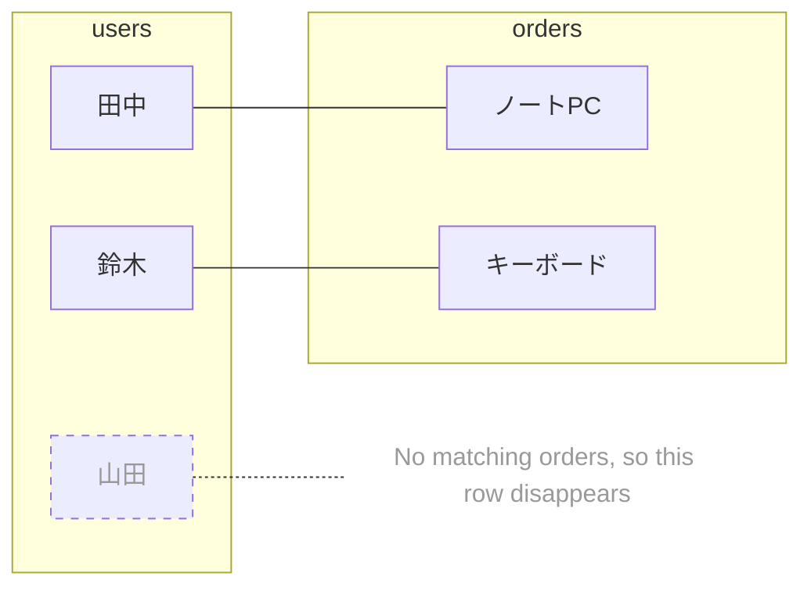
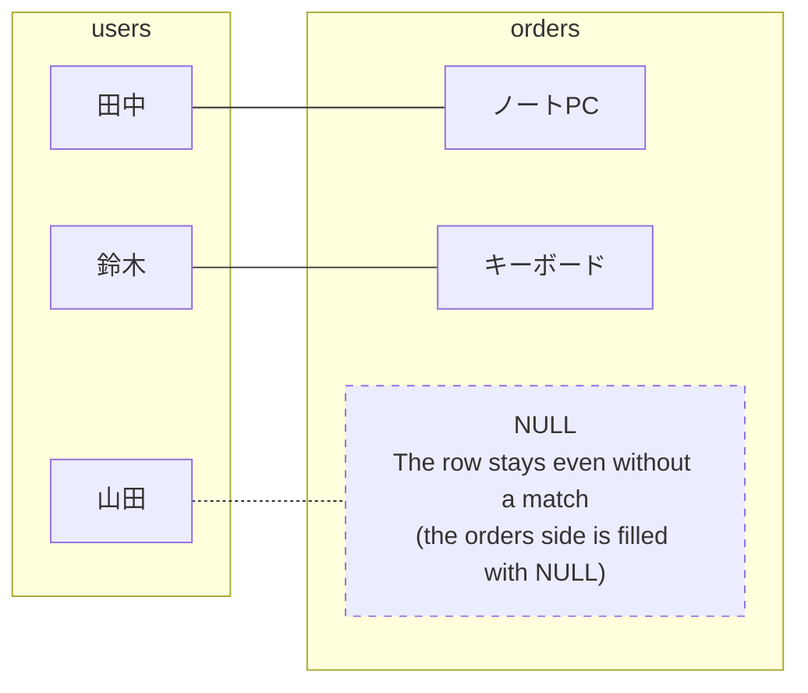

> 🇯🇵 Original (Japanese version): [JOIN入門.md](<../../../1年生_データ設計とアプリ開発/前期/20260728/JOIN入門.md>) <!-- original-ja-link -->

## What You'll Learn in This Article

- INNER JOIN joins "only the data that exists in both tables"
- LEFT JOIN joins "every row of the left table + the matching rows of the right table"
- Even with the same two tables and the same join condition, the number of rows in the result changes depending on the type of JOIN

## The Two Tables We'll Use

We'll explain this using `users` and `orders`. The key point is that **山田次郎 hasn't placed a single order yet**.

### 🧑 users Table

| id | name |
|----|------|
| 1  | 田中太郎 |
| 2  | 鈴木花子 |
| 3  | 山田次郎 |

### 🛒 orders Table

| id | user_id | product |
|----|---------|---------|
| 1  | 1       | ノートPC |
| 2  | 2       | キーボード |

`orders.user_id` refers to `users.id` (a foreign key). There isn't a single row in `orders` that refers to 山田次郎 (id=3).

## INNER JOIN: Join Only the Data That Exists in Both Tables

```sql
SELECT users.name, orders.product
FROM users
INNER JOIN orders ON users.id = orders.user_id;
```

**Result:**

| name | product |
|------|---------|
| 田中太郎 | ノートPC |
| 鈴木花子 | キーボード |

How INNER JOIN works (only matching pairs appear in the result)



山田次郎 has no matching rows in `orders`, so he **disappears from the result**. This is what "joining only the data that exists in both tables" means.

## LEFT JOIN: Join Every Row of the Left Table + the Matching Rows of the Right Table

```sql
SELECT users.name, orders.product
FROM users
LEFT JOIN orders ON users.id = orders.user_id;
```

**Result:**

| name | product |
|------|---------|
| 田中太郎 | ノートPC |
| 鈴木花子 | キーボード |
| 山田次郎 | NULL    |

How LEFT JOIN works (every row of the left table stays)



In `FROM users LEFT JOIN orders`, **users, written on the FROM side (the left side), is the base table**. 山田次郎's row remains even though he has no orders, and the columns from `orders` are filled with `NULL` (no matching data).

## Tips for Telling Them Apart

- **`FROM A LEFT JOIN B`** → **A is the left table**, and every row of A always stays
- If a row has no match, the columns from the right side (B) automatically become `NULL`
- `INNER JOIN` doesn't "keep everything" like this; only the matching rows stay

## Which One Should You Use?

| What you want to do | JOIN to use |
|---|---|
| See data only for people who have orders | `INNER JOIN` |
| List everyone, including people with 0 orders (e.g., to find people who haven't ordered yet and send them an informational email) | `LEFT JOIN` |
| Count the orders for each user (and show people with 0 orders as 0) | `LEFT JOIN` + `COUNT` |

The third example is the SQL covered in "5. LEFT JOIN" of `20260728_資料.md`, which also shows users with 0 orders. If you do the same thing with `INNER JOIN`, users who haven't ordered, like 山田次郎, don't appear in the result at all.

## Summary

- `INNER JOIN` joins "only the data that exists in both tables" → rows without a match disappear
- `LEFT JOIN` joins "every row of the left table in `FROM` + the matching rows of the right table" → rows of the left table stay even without a match, and the right side becomes `NULL`
- A good way to remember it: use LEFT JOIN when you want to include every person or row, and INNER JOIN when you only need matching data from both tables.

<!-- nav:start -->

---

| ⬅️ Back | 🗺️ Overview | Next ➡️ |
|:--|:--:|--:|
| [07/28 Table Relationships and JOIN](20260728_資料.md) | [Course Material Overview](../../README.md) | [07/28 SQL Exercises](20260728_演習.md) |

<!-- nav:end -->
