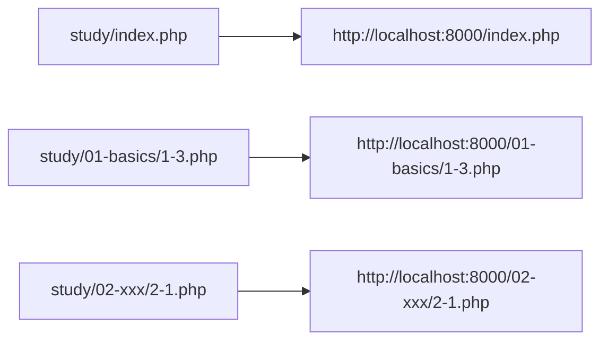

# How to Set Up a PHP Development Server

> 🇯🇵 Original (Japanese version): [PHP開発サーバーの立て方.md](<../../1年生_データ設計とアプリ開発/前期/PHP開発サーバーの立て方.md>) <!-- original-ja-link -->

If you open a PHP file directly in your browser, it won't run (the source code will be displayed or the file will be downloaded).
PHP is a language that is interpreted on the server side, so you must always access it through a server, such as one started with `php -S`.

## Before You Start

- PHP is installed (check with `php -v`)
- Here, we use the development server built into `php` (it isn't suitable for production use)
- In the commands below, replace `<ユーザー名>` with the user name on your own computer (for example, `taro` or `hanako`; on a Mac, you can check it with the `whoami` command)

## Method 1: Start the Server Directly in the study Directory

```bash
cd /Users/<ユーザー名>/Desktop/study
php -S localhost:8000
```

`cd` (change directory) is a command that changes the terminal's current directory.
By moving into the `study` directory with `cd /Users/<ユーザー名>/Desktop/study` and then running `php -S`,
`study`, where you started the server, becomes the web root.

The directory where you run `php -S` becomes the "web root (`/`)."
Since `contact.php` is directly inside `study/`, the URL is simply:

```
http://localhost:8000/contact.php
http://localhost:8000/1-3.php
http://localhost:8000/index.php
```

## Accessing Files in a Directory Structure Organized by Chapter

As you do more exercises, organize them by creating a subdirectory for each chapter (for example, `01-basics/`).

```
study/
  index.php
  contact.php
  01-basics/
    1-1.php
    1-2.php
    1-3.php
  02-xxx/
    2-1.php
```

Continue to run the server **directly in the study directory** (don't change where you start it).

```bash
cd /Users/<ユーザー名>/Desktop/study
php -S localhost:8000
```

Because the directory where you start the server becomes the web root, to access files in a subdirectory,
you need to **include that directory name in the URL**:

```
http://localhost:8000/index.php
http://localhost:8000/01-basics/1-3.php
http://localhost:8000/02-xxx/2-1.php
```

In other words, the file's path relative to `study/` corresponds directly to the path in the URL.



## Stopping the Server

Press `Ctrl + C` in the terminal where you started the server.

## About the Port Number

You can use any number for the `8000` part, as long as that port is free (for example, `php -S localhost:8080`).

<!-- nav:start -->

---

| ⬅️ Back | 🗺️ Overview | Next ➡️ |
|:--|:--:|--:|
| [06/30 Introduction to PHP](20260630/20260630_資料.md) | [Course Material Overview](../README.md) | [06/30 Exercises](20260630/20260630_演習.md) |

<!-- nav:end -->
