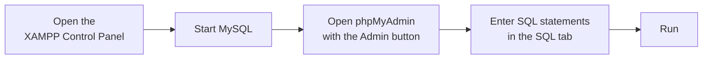
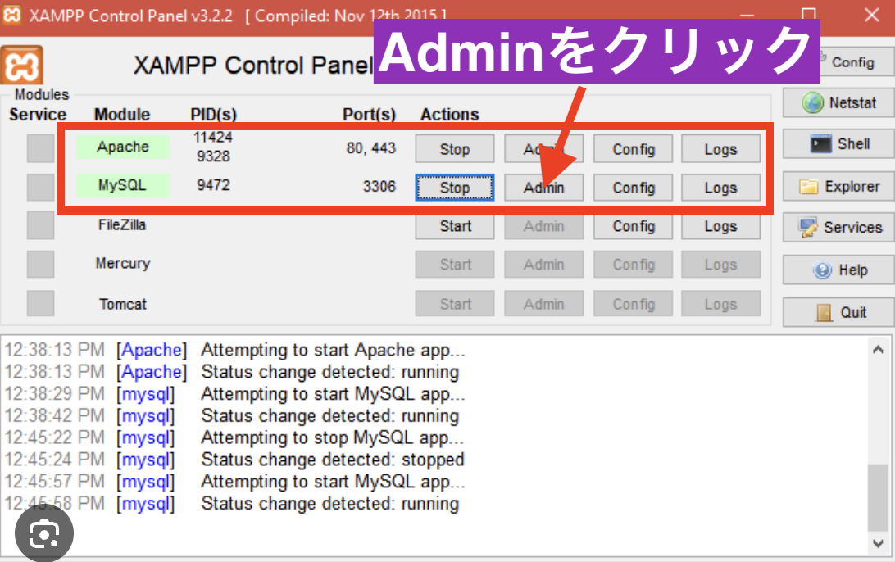
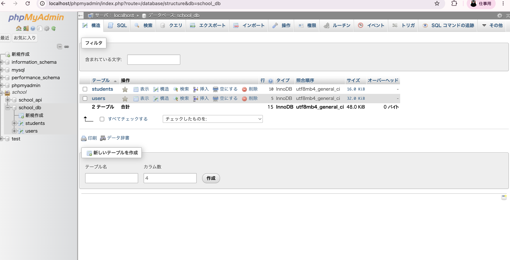
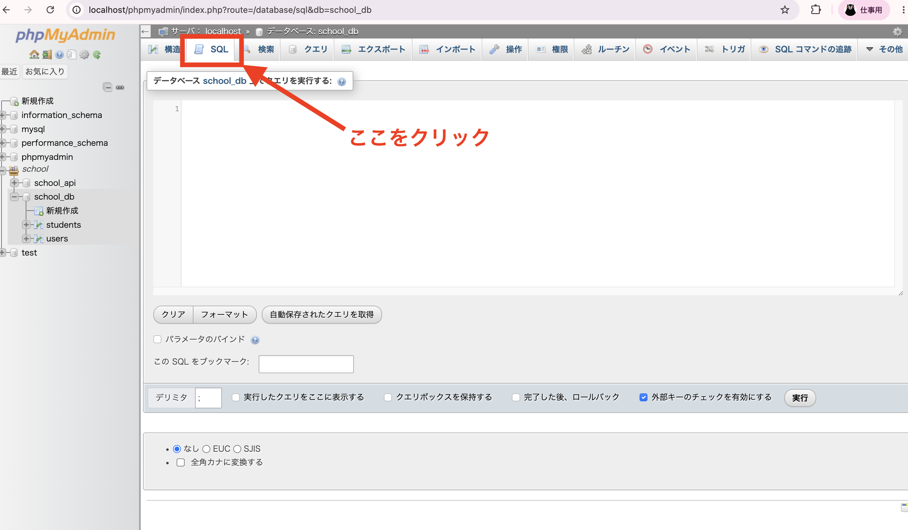

# How to Set Up a Database Server (XAMPP Edition)

> 🇯🇵 Original (Japanese version): [データベースサーバーの立て方.md](<../../../1年生_データ設計とアプリ開発/前期/データベースサーバーの立て方/データベースサーバーの立て方.md>) <!-- original-ja-link -->

## What You'll Learn in This Article

- What you are starting up with XAMPP
- How to open phpMyAdmin (the database management screen)
- How to run SQL statements in phpMyAdmin

Here is the overall flow.

## 1. What Is XAMPP?

XAMPP is software that makes it easy to install the following two components needed to run a web app on your computer.

- **Apache**: A web server for displaying web pages
- **MySQL**: A database server for storing data

Because app development requires a place to store data (a database), you first need to start MySQL.

## 2. Start XAMPP and Check That It's Running

Open the XAMPP app (XAMPP Control Panel).

If the `Actions` column for the `Apache` and `MySQL` rows shows `Stop`, they are already running. If it shows `Start`, they aren't running, so click that button to start them.

## 3. Open phpMyAdmin (the Management Screen)

Click the `Admin` button in the MySQL row.

**phpMyAdmin** then opens in your browser. phpMyAdmin is a management tool that lets you view and edit data stored in MySQL through a graphical interface. Here, you can see a list of the tables (such as `students` and `users`) in a database you've already created (for example, `school_db`).

## 4. Run SQL Statements

If you want to create tables or add or change data directly with SQL statements, click the `SQL` tab at the top of the screen.

When the tab opens, you'll see an input box where you can enter SQL statements. Enter your SQL statement there and click the "実行" (Go) button, and the SQL statement will be applied to the database.

## Summary

- XAMPP is a tool for running Apache (a web server) and MySQL (a database) together
- You can open the database management screen called phpMyAdmin from MySQL's `Admin` button
- You can run SQL statements directly from the `SQL` tab in phpMyAdmin

<!-- nav:start -->

---

| ⬅️ Back | 🗺️ Overview | Next ➡️ |
|:--|:--:|--:|
| [07/21 Why Do We Need a Database?](../20260721/20260721_資料.md) | [Course Material Overview](../../README.md) | [07/21 SQL Basics 1 (SELECT)](../20260721/20260721_資料_2.md) |

<!-- nav:end -->
