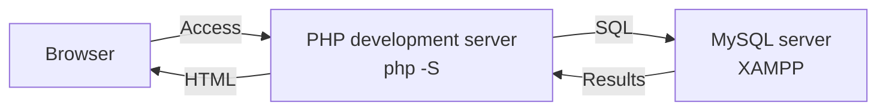
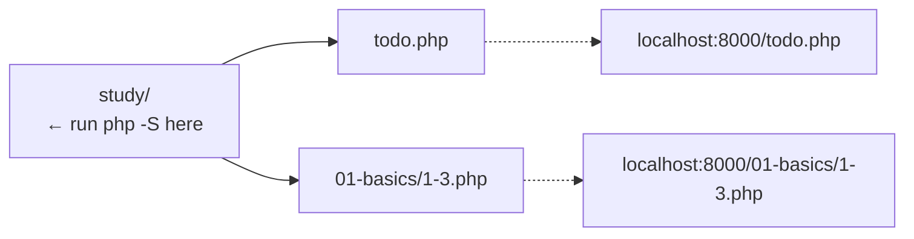
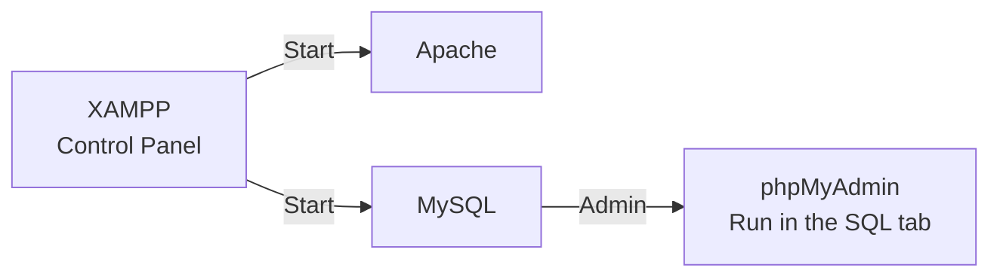
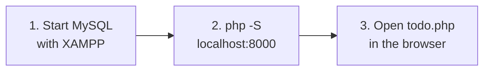

# Looking Back at the First Semester (Review)

> 🇯🇵 Original (Japanese version): [20261001_復習.md](<../../../1年生_データ設計とアプリ開発/後期/20261001/20261001_復習.md>) <!-- original-ja-link -->

Before we start the second semester, let's remember what we did in the first semester to "get ready to run an app."
To run a web app, we needed **two servers**.



- **PHP development server**: Its job is to run PHP programs
- **MySQL server**: Its job is to store data

**If either one of them is stopped, the app won't work.**

---

## 1. PHP Development Server

PHP is a language that runs on the server side, so opening a `.php` file directly in your browser won't run it.
That's why we started the development server that comes with PHP.

On Windows, run it in **PowerShell** (search for "PowerShell" in the Start menu).

```powershell
cd C:\Users\<ユーザー名>\Desktop\study
php -S localhost:8000
```

> **If you're told that `php` can't be found**
> Start PHP using the version included with XAMPP by specifying its location.
>
> ```powershell
> C:\xampp\php\php.exe -S localhost:8000
> ```

The folder where you run `php -S` becomes the `/` (root) of the URL.
To access a file inside a subfolder, include that folder name in the URL too.



To stop it, press `Ctrl + C` in the PowerShell window where you started it.

For details → [How to Set Up a PHP Development Server](../../前期/PHP開発サーバーの立て方.md)

---

## 2. XAMPP (MySQL)

We started MySQL in XAMPP to provide a place to store data.
Click the `Start` button in the XAMPP Control Panel; when it changes to `Stop`, MySQL is running.



Clicking the `Admin` button in the MySQL row opens the database management screen (phpMyAdmin).
From the `SQL` tab, we could run SQL statements directly.

For details → [How to Set Up a Database Server (XAMPP Edition)](../../前期/データベースサーバーの立て方/データベースサーバーの立て方.md)

---

## 3. How to Start the App

We connected to MySQL from PHP using PDO and ran the Todo management app (`todo.php`).
Follow these steps to start the app.



For details → [Starting the Todo Management App](../../前期/20260723/Todo管理アプリ起動する流れ.md)

<!-- nav:start -->

---

| ⬅️ Previous | 🗺️ Overview | Next ➡️ |
|:--|:--:|--:|
| [07/28 SQL Exercises](../../前期/20260728/20260728_演習.md) | [Course Material Overview](../../README.md) | [10/01 Introduction to Source Control](20261001_資料_1.md) |

<!-- nav:end -->