# Introduction to Source Control — Managing Code with SourceTree and GitHub

> 🇯🇵 Original (Japanese version): [20261001_資料_1.md](<../../../1年生_データ設計とアプリ開発/後期/20261001/20261001_資料_1.md>) <!-- original-ja-link -->

## Today's Goals
- Understand why source control is needed
- Be able to commit, push, and pull with SourceTree

[First semester review](./20261001_復習.md)

---

## 1. Why Do We Need Source Control?

Has this ever happened to you?

```
study/
  todo.php
  todo_コピー.php
  todo_動いてたやつ.php
  todo_最新2.php   ← which one is really the latest?
```

If you keep old versions by copying files, you lose track of which one is the latest and what you changed.
And if your computer breaks, everything is gone.

With Git, you can create **save points**, just like in a video game.
Even if you break something, you can always go back to the state when it was working.

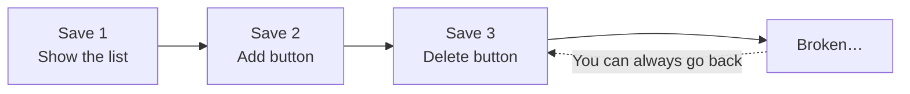

---

## 2. Git, GitHub, and SourceTree

The names are similar, but each one has a different role.

| Name | What is it? | Think of it as |
|------|-----------|-----------|
| **Git** | A system that records history | The save feature |
| **GitHub** | A service that keeps your history online | A place to store saves in the cloud |
| **SourceTree** | An app for using Git through a graphical interface | The save screen |

Git is normally used by typing commands in PowerShell or a similar tool, but today we will use SourceTree and do everything **with the mouse**.

---

## 3. Learn the Terms with a Diagram

In Git, files move between "working folder → your PC → GitHub."
The name of each arrow is the name of the operation.

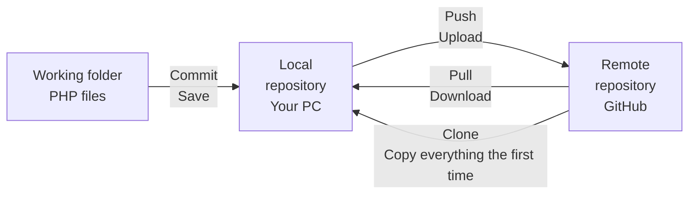

- **Repository**: A "box" that manages history. The one on your PC is called **local**, and the one on GitHub is called **remote**
- **Commit**: Record your changes as a save point
- **Push**: Upload the saves on your PC to GitHub
- **Pull**: Download the latest state from GitHub to your PC
- **Clone**: Copy an entire GitHub repository to your PC the first time

---

## 4. Install SourceTree

Download the installer from the official website and run it.

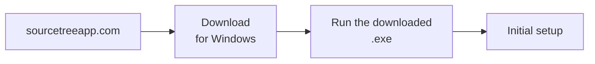

The installer will ask you a few questions along the way.

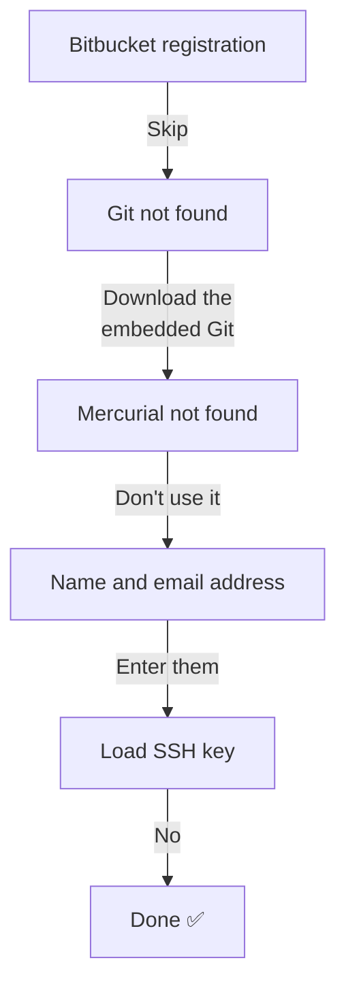

| Question | What to choose |
|------------|---------|
| Register with Bitbucket (Atlassian) | `Skip` (not used today) |
| Git not found | **Download an embedded version of Git** (installs a version of Git just for SourceTree) |
| Mercurial not found | `I don't want to use Mercurial` (not used today) |
| Name and email address | Enter them. This name will be recorded as the **author of your commits** |
| Load an SSH key? | `No` (not needed, because we use a token today) |

> The wording on the screen may differ slightly depending on the version. If you're unsure, ask your teacher.

> **Use a name that shows it's you**
> Today everyone uses the same repository, so choose a name like `yamada-taro` that makes it **clear whose commit it is**.

---

## 5. How We'll Work Today

Today, the whole class will use a **practice repository** that the teacher has prepared on GitHub.
You won't use your own GitHub account yet. Instead, you'll connect using three pieces of information from the teacher.

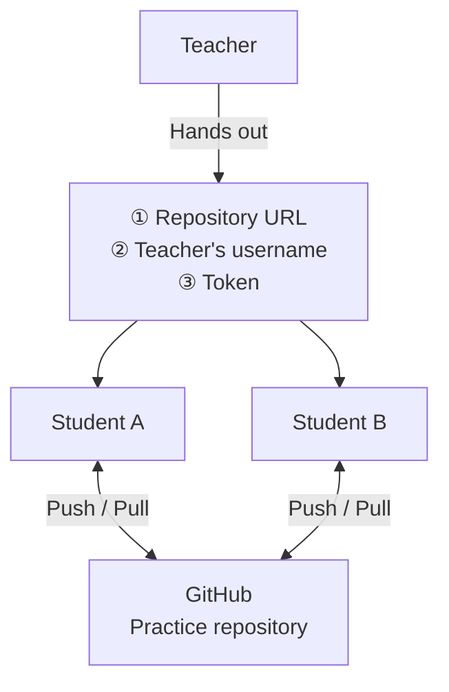

A **token** is a secret credential used instead of a password to tell GitHub "this person is allowed to do this" (it's a long string that starts with `github_pat_`).
Today's token is restricted so that it can only access the practice repository.

> ⚠️ **Never show your token to anyone, and never paste it on social media or in chats**

---

## 6. Clone

Copy the teacher's repository to your PC.

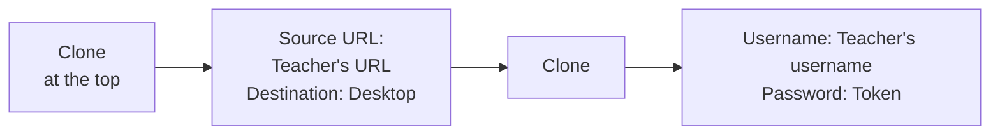

Click `Clone` at the top of SourceTree and enter the following.

| Field | What to enter |
|------|------------|
| Source Path / URL | The repository URL you got from the teacher |
| Destination Path | `C:\Users\<ユーザー名>\Desktop\<リポジトリ名>` |

If you're asked for a username and password, **paste the token into the password field**.

✅ If a `<リポジトリ名>` folder appears on your desktop with `README.md` inside, it worked.

The token you entered is saved in Windows "Credential Manager," so you won't be asked again next time.

> **If you can't find the folder on your desktop**
> On PCs that use OneDrive, the desktop may be located at `C:\Users\<ユーザー名>\OneDrive\デスクトップ`.
> To be safe, click the `...` button next to the destination and choose the desktop in File Explorer.

---

## 7. Commit

Put the PHP file you made in the first semester into the cloned folder and commit it.
Since everyone uses the same repository, create **a folder with your name** and put your file inside it.
That way, your files won't conflict with anyone else's.

```
<リポジトリ名>/
  README.md
  yamada-taro/     ← your folder
    todo.php
  suzuki-hanako/   ← someone else
    todo.php
```

After copying the file in File Explorer, open `File Status` on the left side of SourceTree.
Move the files shown under "Unstaged files" to "Staged," write a message, and commit.

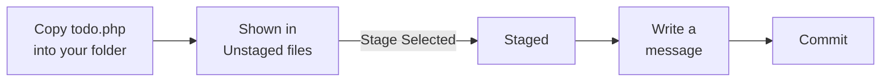

**Staging** is how you choose "the files to include in this save."

In your commit message, write **what you did** so it's easy to understand later.

| ❌ Bad message | ⭕ Good message |
|----------|----------|
| Fix | Fix bug where the Todo delete button didn't work |
| Update | Add a due date column to the Todo list |

---

## 8. Push

Just committing only records your changes on your own PC.
Push to upload them to GitHub.

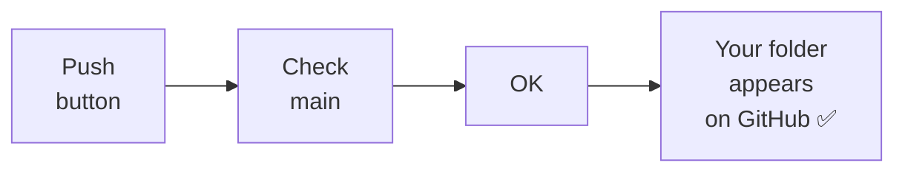

If your folder appears on the GitHub page the teacher shows on the screen, it worked.

### If you get an error (rejected)

If someone else has already pushed, the repository on GitHub has newer changes than yours.
If you try to push as is, GitHub will reject your push (rejected).
**Pull first to get the latest changes**, then push again.

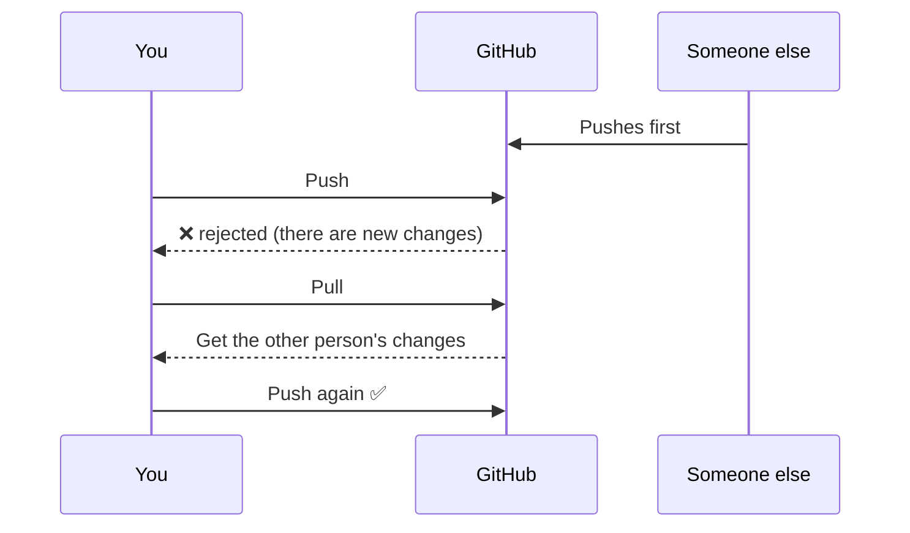

---

## 9. Pull

Bring the changes other people pushed onto your PC.

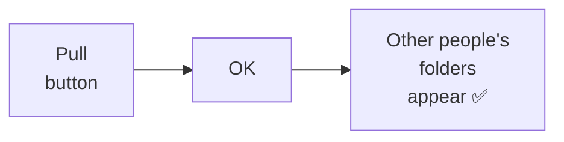

Open the `<リポジトリ名>` folder on your desktop in File Explorer. If you see other people's folders, it worked.
Being able to **share everyone's changes** through GitHub like this is what makes GitHub so useful.

---

## 10. The Workflow

When developing with Git, you repeat the following cycle.

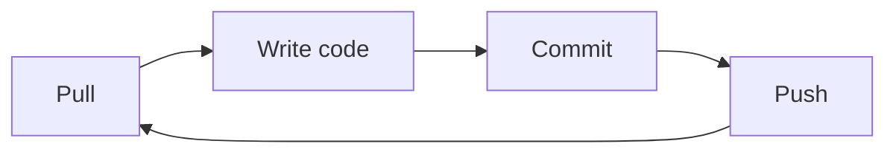

- **Pull before you start working**: Get other people's changes first
- **Commit often**: Save whenever you reach a point where you think "it works up to here"
- **Push when you finish working**: Save to GitHub and share

> Today's repository and token are **for practice only** (they will stop working after class).
> Create your own repository → [How to Create a GitHub Account and Repository](../20261008/20261008_資料_1.md)

<!-- nav:start -->

---

| ⬅️ Previous | 🗺️ Overview | Next ➡️ |
|:--|:--:|--:|
| [10/01 First Semester Review](20261001_復習.md) | [Course Overview](../../README.md) | [10/08 GitHub Account and Repository](../20261008/20261008_資料_1.md) |

<!-- nav:end -->
