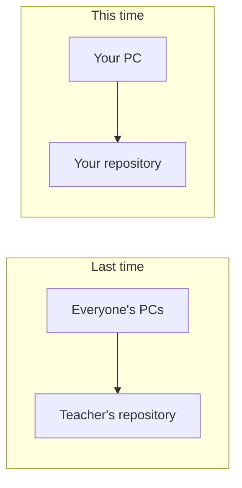
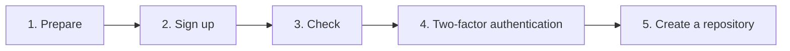
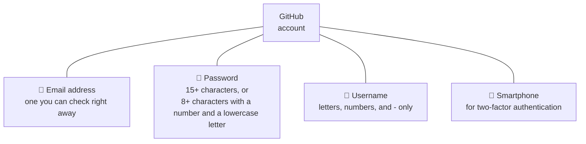
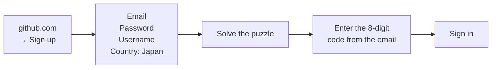
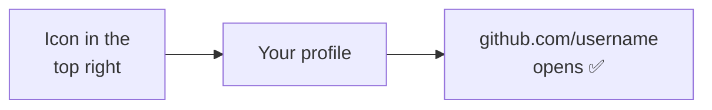
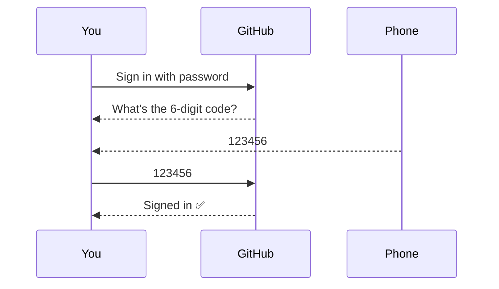
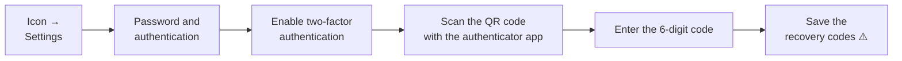
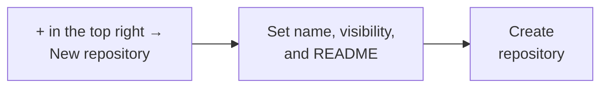
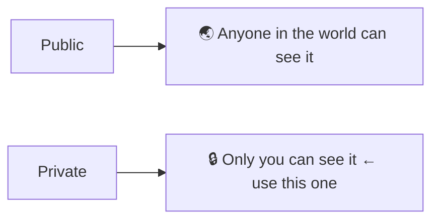

> 🇯🇵 Original (Japanese version): [20261008_資料_1.md](<../../../1年生_データ設計とアプリ開発/後期/20261008/20261008_資料_1.md>) <!-- original-ja-link -->

# How to Create a GitHub Account and Repository

## Today's Goals
- Be able to create a GitHub account
- Be able to create your own repository

[Back to Introduction to Source Control](../20261001/20261001_資料_1.md)

---

## Review of Last Class

In the last class, everyone pushed to **a repository in the teacher's GitHub account**.

This time, you'll **create your own GitHub account and your own repository**.
This will let you manage your code in your own place.

---

## Overall Flow

Today, you'll set up your own place for code on GitHub in the following five steps.

---

## 1. What You Need

Before you start signing up, have the following four things ready.

- **Email address**: A verification code will be sent to it, so use one you can check right away during class
- **Smartphone**: Used for two-factor authentication, which you'll set up later

### Choosing a Username

Your username **becomes part of a URL**, like `https://github.com/<ユーザー名>`, and **other people will see it**.
You may show it as part of your portfolio in the future, so avoid silly names.
If you don't want to show your real name, you don't have to use it.

| ❌ Avoid | ⭕ Good |
|-------------|----------|
| `unko-man`, `aaaa1234` | `taro-yamada`, `tyamada-dev` |

---

## 2. Sign Up

Open https://github.com and sign up using `Sign up` in the top right.

- If the username is already taken, it will be shown in red, so choose a different one
- The **puzzle** checks that you're human. Follow the on-screen instructions to solve it
- Enter the **8-digit code** sent to your registered email to finish signing up

If you see questions or plan choices along the way, proceed as follows.

| Screen | What to choose |
|------|---------|
| Question about how you'll use it | `Skip personalization` (skip) |
| Plan | **Free** |

> **If the email doesn't arrive**
> Check your spam folder → wait a few minutes and resend with `Resend the code` → if it still doesn't come, check that you typed the address correctly

---

## 3. Check

Open your profile page to check that your account was created.

**Write down your username.** You'll need it later.

---

## 4. Two-Factor Authentication

**Two-factor authentication (2FA)** is a system that verifies your sign-in with **a 6-digit code shown on your smartphone** in addition to your password.
Even if someone learns your password, they can't sign in without your phone.

GitHub requires you to set up two-factor authentication, and a setup prompt will appear a while after you sign in.

### Setup Steps

Install an authenticator app (such as Google Authenticator) on your phone before you start.

> ⚠️ **Always save your recovery codes!**
> They're your last resort for signing in if you lose your phone.
> If you lose them, you may be locked out of your account.

---

## 5. Create a Repository

Once your account is ready, create a **repository** (a box that manages history) to store your code.

Use the following settings.

| Field | Setting |
|------|------------|
| Repository name | `php-study` |
| Visibility | **`Private`** |
| Add README | **On** |

**Visibility** is the setting for who can see this repository.
Keep your practice code `Private`.

A **README** is a file that describes the repository.
Having a file in the repository from the start lets you check that its contents came through when you clone it later.

### Check ✅

You're done if all three of these are true.

- The URL is `github.com/<ユーザー名>/php-study`
- `README.md` is shown
- `Private` is shown next to the repository name

---

Next, you'll push the practice environment to the `php-study` repository you created → [Push the Practice Environment to Your Own Repository](./20261008_資料_2.md)

<!-- nav:start -->

---

| ⬅️ Previous | 🗺️ Overview | Next ➡️ |
|:--|:--:|--:|
| [10/01 Introduction to Source Control](../20261001/20261001_資料_1.md) | [Course Overview](../../README.md) | [10/08 Push the Practice Environment](20261008_資料_2.md) |

<!-- nav:end -->
