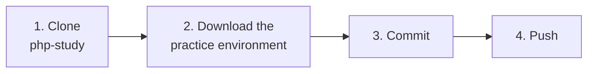
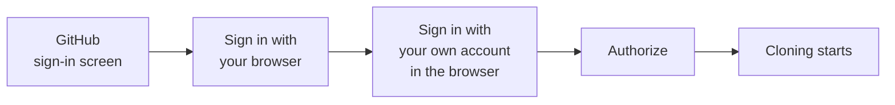
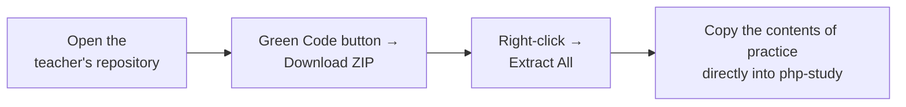
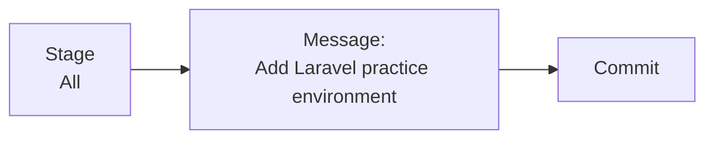

# Push the Practice Environment to Your Own Repository

> 🇯🇵 Original (Japanese version): [20261008_資料_2.md](<../../../1年生_データ設計とアプリ開発/後期/20261008/20261008_資料_2.md>) <!-- original-ja-link -->

## Today's Goals
- Be able to sign in with your own GitHub account, then clone and push
- Be able to push the practice environment to your own repository

[Back to How to Create a GitHub Account and Repository](./20261008_資料_1.md)

---

## Overall Flow

You'll put the **practice environment** prepared by the teacher into the `php-study` repository you created in [Material 1](./20261008_資料_1.md), and push it.



---

## 1. Clone php-study

Just like last time, copy it to your PC using `Clone` in SourceTree.
Last time you cloned using a URL that included a token, but this time you'll connect by **signing in with your own GitHub account**.

| Field | What to enter |
|------|------------|
| Source Path / URL | `https://github.com/<自分のユーザー名>/php-study.git` |
| Destination Path | `C:\Users\<ユーザー名>\Desktop\php-study` |

When you click `Clone`, a GitHub sign-in screen will appear.
Choose `Sign in with your browser` and sign in with **your own account**.



- When the browser asks you to sign in, use the account you created in Material 1 (also enter the 6-digit two-factor code)
- Click `Authorize` to return to SourceTree, and cloning will start
- Your sign-in information is saved in Windows, so you won't be asked again next time

✅ If a `php-study` folder appears on your desktop with `README.md` inside, it worked.

---

## 2. Download the Practice Environment

Download the teacher's repository as a ZIP file and extract the **contents** of the `practice` folder inside it.



**Teacher's repository:** https://github.com/hakobunet/iica-koyama

Inside the extracted folder, you'll find `practice` at the following location.

```
iica-koyama-main/
  docs/
    1年生_データ設計とアプリ開発/
      practice/   ← copy the contents of this folder
```

Open the `practice` folder and copy **all of its contents** **directly into** `php-study` (don't create a `practice` folder inside `php-study`).

```
php-study/
  README.md          ← you can replace this with the README.md from practice
  .gitattributes
  mysql/
    compose.yaml
  laravel/
    .gitignore
    compose.yaml
    Dockerfile
    entrypoint.sh
```

> **If a file named `README.md` already exists**
> It's fine to choose "Replace the file." You'll get the README that explains how to run the practice environment.

> **Don't select the files one by one**
> Files whose names start with `.`, like `.gitattributes` and `.gitignore`, are important configuration files.
> They can be hard to see, so after opening the `practice` folder, use `Ctrl + A` (Select All) to select everything, then copy it all at once.

---

## 3. Commit

When you open `File Status` in SourceTree, the files inside `mysql` and `laravel` are shown under "Unstaged files."



---

## 4. Push

Click the `Push` button → check `main` → click `OK` to upload to GitHub.

### Check ✅

Open `github.com/<ユーザー名>/php-study` in your browser. You're done if it looks like this:

- The `mysql` and `laravel` folders are shown at the very top level (directly under the repository)

> **If you see `403` or `Repository not found` when cloning or pushing**
> Check that `<自分のユーザー名>` in the URL is correct, and that you signed in with **your own account** in the browser.

Instructions for running the practice environment are in the `README.md` in the `php-study` folder.
Your folder is located at `C:\Users\<ユーザー名>\Desktop\php-study`, so wherever the README says `Desktop\practice`, read it as `Desktop\php-study`.

<!-- nav:start -->

---

| ⬅️ Previous | 🗺️ Overview | Next ➡️ |
|:--|:--:|--:|
| [10/08 GitHub Account and Repository](20261008_資料_1.md) | [Course Overview](../../README.md) | [10/08 Introduction to Docker](20261008_資料_3.md) |

<!-- nav:end -->
