# Introduction to Docker — Installing Docker Desktop

> 🇯🇵 Original (Japanese version): [20261008_資料_3.md](<../../../1年生_データ設計とアプリ開発/後期/20261008/20261008_資料_3.md>) <!-- original-ja-link -->

## Today's Goals
- Understand what Docker does for you
- Install Docker Desktop and run `hello-world`
- Start the practice environment and open the Laravel home page in your browser

---

## Introduction: What Is a Container?

A **container** is like a **small private room** created inside your PC.
The room contains only what's needed to run an app (such as PHP and MySQL).

In the first semester, you installed XAMPP directly on your PC.
With containers, you can run things inside the room without installing them on the PC itself.

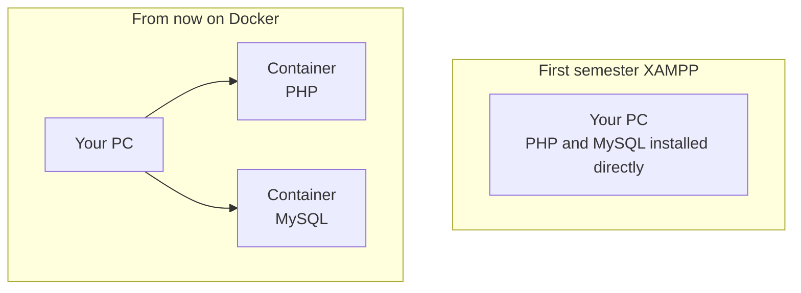

Containers have the following features.

| Feature | What does it mean? |
|------|--------------|
| **Each room is separate** | Containers don't affect each other. You can run an old and a new version of PHP at the same time |
| **Keeps your PC clean** | Nothing is installed on the PC itself |
| **Quick to create, quick to delete** | Starts in seconds. When you don't need it, delete it and create it again later |
| **Same contents on everyone's PC** | If you build from the same blueprint, everyone's PC gets the same environment |

The software that creates and runs these containers is **Docker**.

---

## 1. Why Use Docker?

In the first semester, you installed XAMPP and set up PHP and MySQL to run your apps.
But things like this often happen:

```
Student A: "But it works on my PC…"
Student B: "Looks like our PHP versions are different."
Student C: "I changed some XAMPP settings and now it doesn't work."
```

With **Docker**, you put the environment needed to run an app (PHP, MySQL, etc.) into **containers** (private rooms), so it runs the same way on any PC.

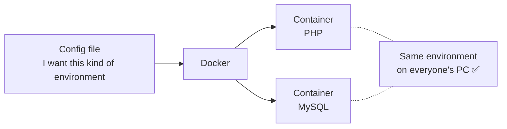

- Even if you break the environment, you can restore it right away by recreating the container
- If you share the config file, everyone on the team can set up the same environment

---

## 2. Docker, Images, and Containers

Let's learn the first few terms by comparing them to cooking.

| Name | What is it? | Think of it as |
|------|-----------|-----------|
| **Image** | A blueprint of an environment | A recipe |
| **Container** | A running environment created from an image | A dish made from the recipe |
| **Docker Desktop** | An app for using Docker on Windows | The kitchen |
| **Docker Hub** | A website where images are published | A cookbook |

You can make as many containers (dishes) as you like from one image (recipe).

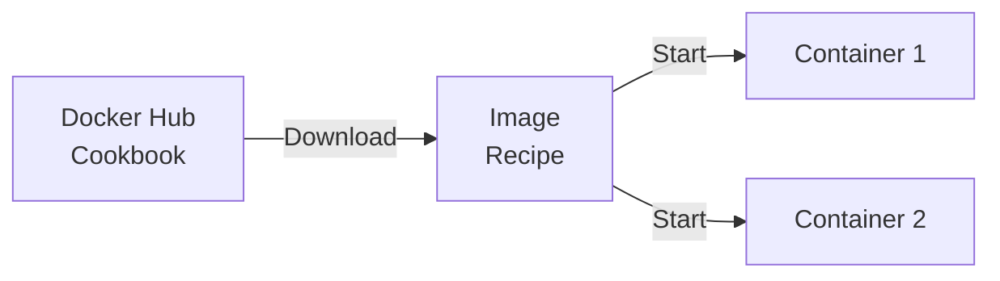

> **Is it OK to delete a container?**
> You can always recreate a container from its image (recipe), so if it breaks, just delete it and make a new one.
> However, **data created inside a container is deleted along with the container.** You'll learn how to keep data in a later class.

---

## 3. Installation Steps

Today we'll go in this order.

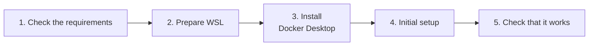

---

## 4. Check the Requirements

Before installing Docker Desktop, check that your PC meets the following requirements.

| What to check | Requirement |
|------------|------|
| Windows version | Windows 10 (22H2) or Windows 11 |
| Virtualization | **Enabled** |
| Account | A user with **administrator privileges** |

### Check Whether Virtualization Is Enabled

Docker uses a feature called **virtualization**, which runs another small PC inside your PC.

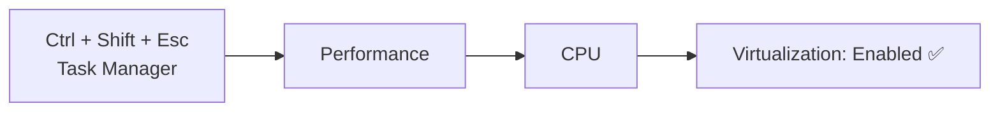

If the list in the lower right shows **"Virtualization: Enabled,"** you're good.

> **If it says "Disabled"**
> You need to enable it in the BIOS (the settings screen shown when the PC starts up). The steps differ by PC manufacturer, so please call your teacher.

---

## 5. Prepare WSL

**WSL** (Windows Subsystem for Linux) is a system for running Linux inside Windows.
Docker Desktop runs on top of WSL.

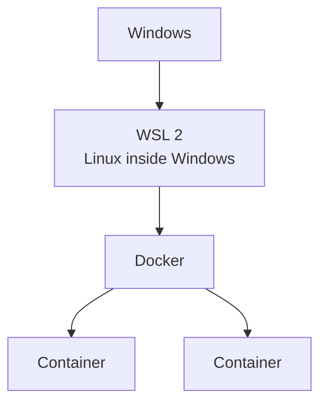

Search for "PowerShell" in the Start menu, then **right-click → "Run as administrator"** to open it.

```powershell
wsl --install
```

If it's already installed, update it to the latest version.

```powershell
wsl --update
```

When it's done, **restart your PC**.

✅ After restarting, run the following in PowerShell. If it shows `Default Version: 2`, you're good.

```powershell
wsl --status
```

> **If `wsl --install` asks for an Ubuntu username**
> This is the initial setup for Ubuntu (a type of Linux). Choose a username in lowercase letters and a password, and enter them.
> Nothing appears on the screen while you type the password, but it is being entered.

---

## 6. Install Docker Desktop

Download the installer from the official website and run it.

**Download page:** https://www.docker.com/products/docker-desktop/

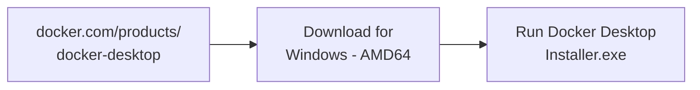

> **The difference between ARM64 and AMD64**
> These are types of PC CPUs. Most Windows PCs use **AMD64** (x86_64).
> Choose ARM64 only if your PC has a CPU designed for smartphones, such as Snapdragon.

The installer will ask you about some settings along the way.

| Question | What to choose |
|------------|---------|
| Use WSL 2 instead of Hyper-V | **On** (run on top of WSL) |
| Add shortcut to desktop | On (an icon is added to your desktop) |

Click `OK` to start the installation.
When `Close and restart` (or `Close`) appears, **restart your PC**.

---

## 7. Initial Setup

After restarting, double-click the **Docker Desktop** icon on your desktop to start it.

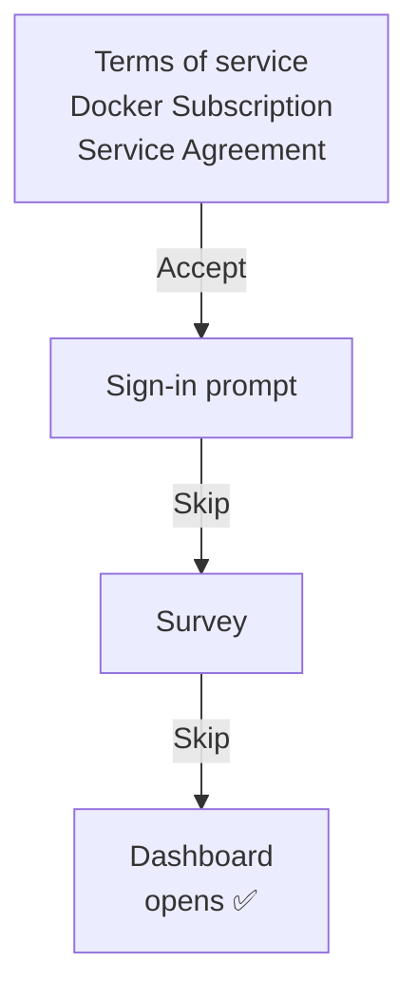

| Screen | What to choose |
|------|---------|
| Terms of service (Subscription Service Agreement) | `Accept` |
| Sign in (Sign in / Sign up) | `Skip` (today we'll use it without an account) |
| Survey (Welcome Survey) | `Skip` |

> It's free for learning and personal use.

> The wording on the screen may differ slightly depending on the version. If you're unsure, ask your teacher.

### Check That It's Running

If **Engine running** (in green) is shown in the lower left of the screen, Docker is running.
You can also check with the **whale icon** 🐳 in the taskbar at the lower right of the screen (inside `^`).

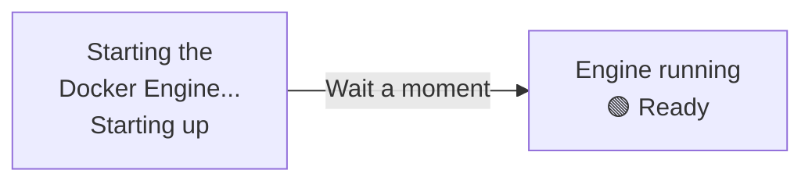

**You can't use Docker unless Docker Desktop is running.**
After restarting your PC, start Docker Desktop first.

---

## 8. Check That It Works

Open PowerShell (you don't need to run it as administrator) and check the Docker version.

```powershell
docker --version
```

```
Docker version 28.x.x, build xxxxxxx
```

If you see something like this, you're good (the numbers will differ from person to person).

Next, let's run the **hello-world** image, which is made for practice.

```powershell
docker run hello-world
```

With just this one command, Docker does the following.

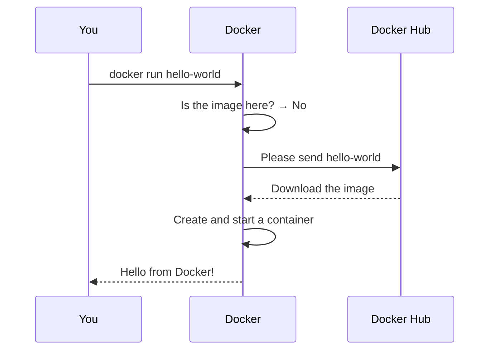

✅ If the following message appears, the installation was successful.

```
Hello from Docker!
This message shows that your installation appears to be working correctly.
```

If you run `docker run hello-world` again, it runs right away this time without downloading.
That's because the image (recipe) is already on your PC.

If you open `Containers` on the left side of Docker Desktop, you'll see the container you just ran.

---

## 9. Start the Practice Environment

Let's run the practice environment you pushed in [Material 2](./20261008_資料_2.md) with Docker.
**Always start them in the order mysql → laravel.**

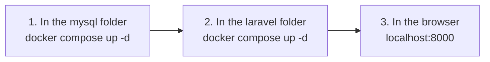

Once started, the two containers are connected and work like this.
The laravel container uses the mysql container, so start mysql first.

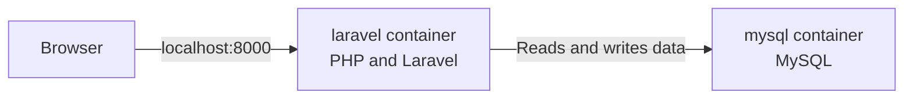

```powershell
cd C:\Users\<ユーザー名>\Desktop\php-study\mysql
docker compose up -d
```

```powershell
cd C:\Users\<ユーザー名>\Desktop\php-study\laravel
docker compose up -d
```

**The first time only**, installing Laravel takes a few minutes.
You can check the progress with `docker compose logs -f` (press `Ctrl + C` to stop watching).
When `Server running on [http://0.0.0.0:8000]` appears, it's ready.

✅ Open http://localhost:8000 in your browser. If you see the following screen, you're good.


---

## 10. Troubleshooting

| Symptom | Solution |
|------|------|
| It says `docker` can't be found | Check that Docker Desktop is running → reopen PowerShell |
| It stays at `Engine stopped` | Quit Docker Desktop and start it again → if that doesn't work, restart your PC |
| It says WSL is out of date (WSL update failed, etc.) | Run `wsl --update` in PowerShell as administrator → restart your PC |
| It says virtualization is disabled (Virtualization support not detected) | See [4. Check the Requirements](#4-check-the-requirements) → call your teacher |
| `error during connect` appears | Docker Engine is still starting. Wait until the lower left shows `Engine running` |

---

## 11. Summary

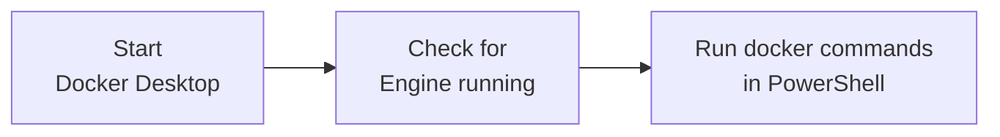

- An **image** is a blueprint, and a **container** is a running environment created from it
- Before using Docker, **start Docker Desktop**
- `docker run <イメージ名>` downloads the image and starts a container all in one go

Next time, we'll use Docker to build a PHP and MySQL environment.

<!-- nav:start -->

---

| ⬅️ Previous | 🗺️ Overview | Next ➡️ |
|:--|:--:|--:|
| [10/08 Push the Practice Environment](20261008_資料_2.md) | [Course Overview](../../README.md) | [10/15 How MVC Works](../20261015/20261015_資料_1.md) |

<!-- nav:end -->
