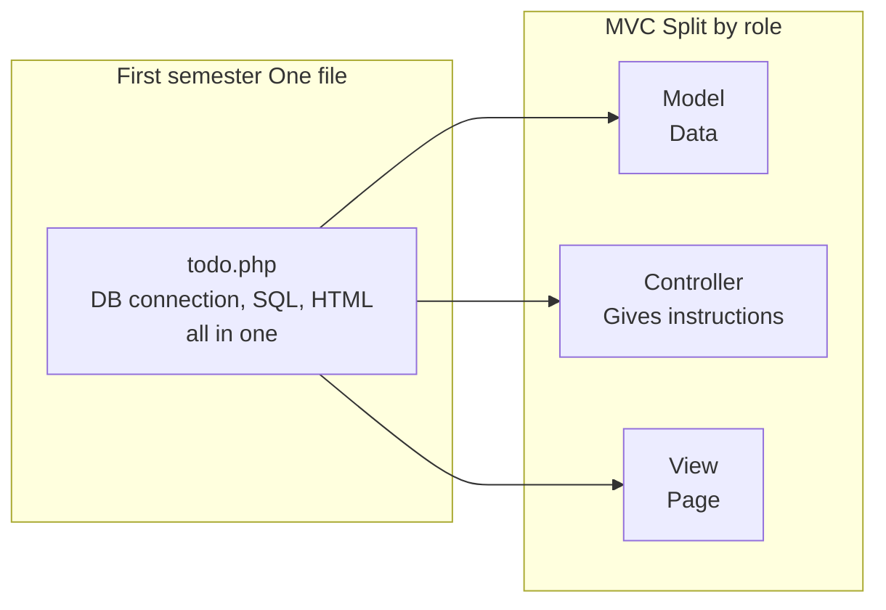
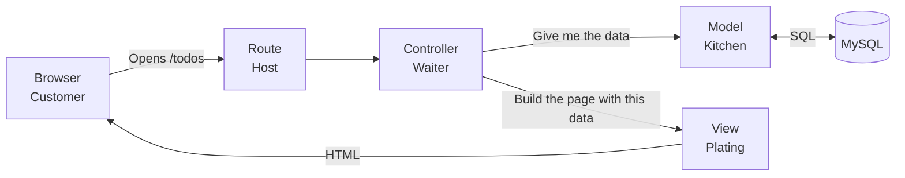
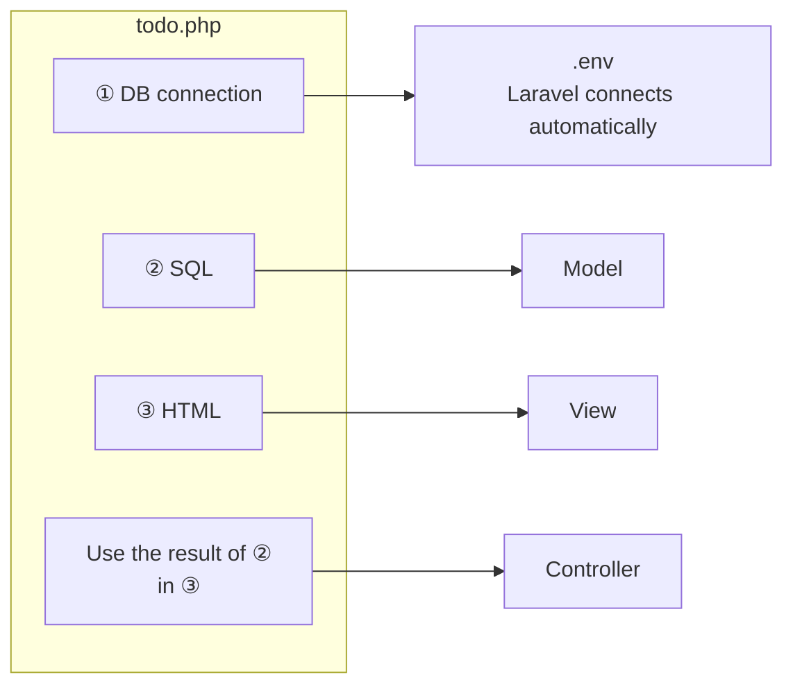
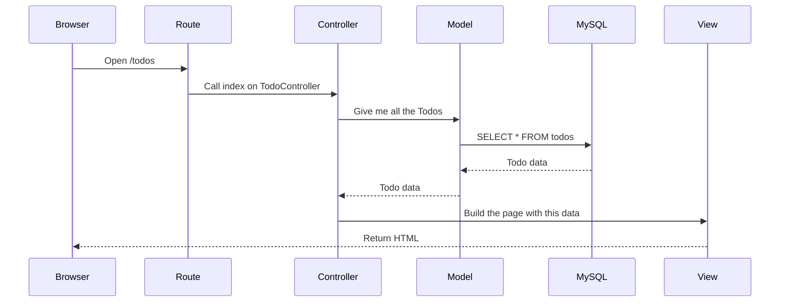
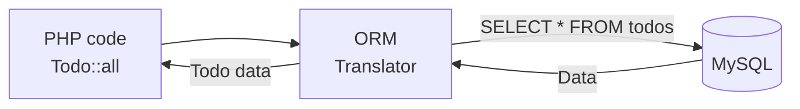
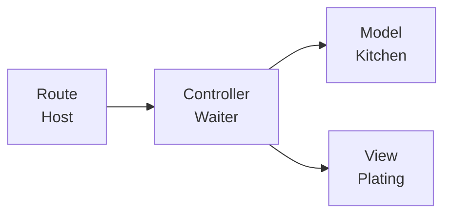

# Introduction to Laravel — How MVC Works

> 🇯🇵 Original (Japanese version): [20261015_資料_1.md](<../../../1年生_データ設計とアプリ開発/後期/20261015/20261015_資料_1.md>) <!-- original-ja-link -->

## Today's Goals
- Understand the roles in MVC (Model, View, Controller)
- Understand that in Laravel, a request flows "route → controller → model → view"
- Understand that with an ORM, you can read and write data without writing SQL

---

## 1. Looking Back at todo.php from the First Semester

The `todo.php` you made in the first semester had **everything in one file**.
Here is just the part that shows the list.

```php
<?php
// ① Connect to the database
$pdo = new PDO('mysql:host=127.0.0.1;dbname=school_db;charset=utf8mb4', 'root', '');

// ② Get the Todos with SQL
$stmt = $pdo->query("SELECT * FROM todos ORDER BY created_at DESC");
$todos = $stmt->fetchAll(PDO::FETCH_ASSOC);
?>
<!-- ③ Build the page with HTML -->
<ul>
<?php foreach ($todos as $todo): ?>
    <li><?= htmlspecialchars($todo['title']) ?></li>
<?php endforeach; ?>
</ul>
```

For a small app, this works fine.
But as the app grows, things like this happen:

```
Student A: "I just want to fix how the page looks, but the SQL mixed in makes it hard to read…"
Student B: "I ended up copying the same SELECT into lots of files."
Student C: "I don't know where to make the fix."
```

That's where **MVC** comes in: the idea of **splitting files by role**.



---

## 2. What Is MVC?

MVC is a way of splitting an app into three roles. Let's learn them by comparing them to a restaurant.

| Name | Role | In a restaurant |
|------|------|------------------|
| **M**odel | Reads and writes data in the database | The kitchen (brings out the ingredients) |
| **V**iew | Builds the page (HTML) | Plating (arranging the food on a plate to serve it) |
| **C**ontroller | Takes the order and gives instructions to the model and view | The waiter (connects the kitchen and plating) |

In Laravel, **routes** are added to this. A route decides which controller handles which URL.
A route is the restaurant's **host at the entrance**.



The key point is that **the controller is in the middle and gives instructions to everyone**.
The view doesn't go to the model to get data by itself. It receives the data from the controller.

### Where Does the First-Semester todo.php Go?

Parts ① to ③ of the `todo.php` above are split like this in MVC.



| Part of todo.php | Goes to | Location |
|---------------|-------|---------|
| ① Connect to the database | Laravel does it automatically | `.env` (config file) |
| ② Get the Todos with SQL | **Model** | `app/Models/Todo.php` |
| ③ Build the page with HTML | **View** | `resources/views/todos/index.blade.php` |
| Pass the result of ② to ③ | **Controller** | `app/Http/Controllers/TodoController.php` |
| Which URL runs this process | **Route** | `routes/web.php` |

---

## 3. The Flow of a Request

When you open `http://localhost:8000/todos` in your browser, Laravel processes it internally in the following order.



In restaurant terms, the flow looks like this.

1. A customer comes in (open `/todos` in the browser)
2. The host takes them to the waiter in charge (route → controller)
3. The waiter asks the kitchen for ingredients (controller → model)
4. The kitchen brings ingredients out of the storeroom (model → MySQL)
5. The waiter hands the ingredients to the plating staff (controller → view)
6. The dish is served to the customer (HTML is returned to the browser)

---

## 4. How an ORM Works

### What Is an ORM?

In the first semester, you **wrote SQL statements yourself**, like `SELECT * FROM todos`.
In Laravel, you can get data just by writing `Todo::all()` using a model.

This is possible thanks to a system called **ORM** (Object-Relational Mapping).
An ORM **automatically translates your PHP code into SQL** and sends it to MySQL.
Laravel's ORM is called **Eloquent**.



In restaurant terms, imagine the kitchen (model) has a **translator (ORM)** who turns the waiter's order, "Give me all the Todos," into language (SQL) that the storeroom (MySQL) can understand.

### Compare with First-Semester SQL

| What you want to do | First semester (writing SQL) | Laravel (Eloquent) |
|------------|-----------------|-------------------|
| Get everything | `SELECT * FROM todos` | `Todo::all()` |
| Get the one with id 1 | `SELECT * FROM todos WHERE id = 1` | `Todo::find(1)` |
| Get only unfinished ones | `SELECT * FROM todos WHERE is_done = 0` | `Todo::where('is_done', 0)->get()` |

For today, it's enough to understand that you can write it like this without writing SQL.

### Was Learning SQL a Waste?

**No.** Behind the scenes, the ORM builds SQL and sends it to MySQL.
When something doesn't work, or when you want to get complex data, the SQL you learned in the first semester will help.

---

## 5. Summary



| Role | In a nutshell |
|------|-----------|
| **Route** | Decides which controller handles which URL |
| **Controller** | Gets data from the model and passes it to the view |
| **Model** | Reads and writes data in the database (the ORM translates the operations into SQL) |
| **View** | Builds the page (HTML) |

Because files are split by role, you'll **know right away where to make a fix**: go to the view to fix the page, or go to the model to change how data is fetched.

Next, you'll actually use MVC to build a Todo list page → [Let's Build a Todo List](./20261015_資料_2.md)

<!-- nav:start -->

---

| ⬅️ Previous | 🗺️ Overview | Next ➡️ |
|:--|:--:|--:|
| [10/08 Introduction to Docker](../20261008/20261008_資料_3.md) | [Course Overview](../../README.md) | [10/15 Todo List](20261015_資料_2.md) |

<!-- nav:end -->
