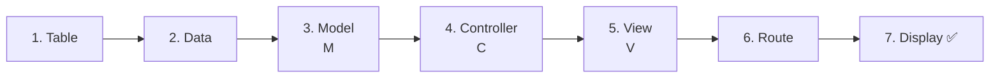
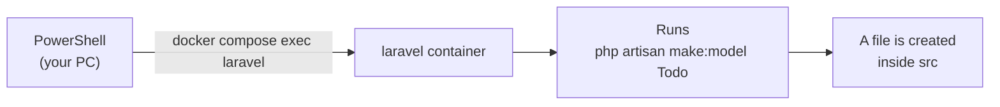
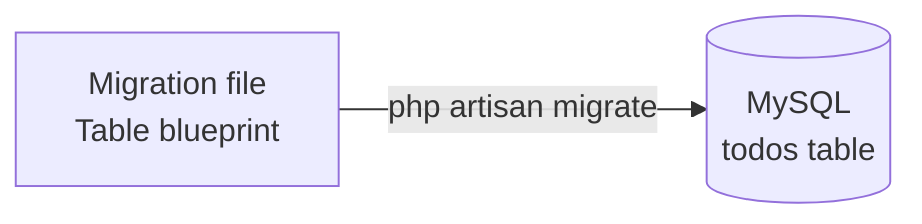
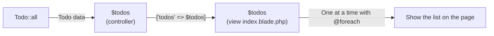
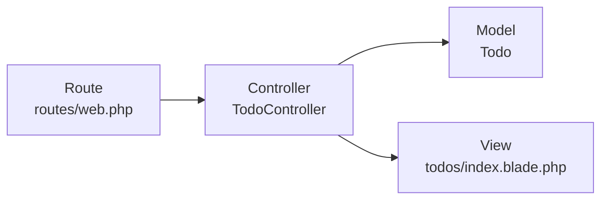

# Introduction to Laravel — Let's Build a Todo List

> 🇯🇵 Original (Japanese version): [20261015_資料_2.md](<../../../1年生_データ設計とアプリ開発/後期/20261015/20261015_資料_2.md>) <!-- original-ja-link -->

Using what you learned in [How MVC Works](./20261015_資料_1.md), you'll build a Todo list page.

## Today's Goals
- Be able to build a Todo list page using MVC
- Know where to write the migration, model, controller, view, and route

> Start the mysql and laravel parts of the practice environment (`php-study`) before you begin.
> For how to start them, see the `README.md` in the `php-study` folder.

You'll build a Todo list page using the same `todos` table as in the first semester.
The files will be created inside `php-study\laravel\src`.

---

## 1. Build Order

You'll build things **starting from the data side**, which is the reverse of **the order they run** (route → controller → model → view).
That's because you can't make the dish (the page) without the ingredients (the table and data).



---

## 2. How to Read the Commands

Today, you'll use commands like the following several times.
Run the commands in PowerShell after moving to the **laravel folder**.

```powershell
cd C:\Users\<ユーザー名>\Desktop\php-study\laravel
```

```powershell
docker compose exec laravel php artisan make:model Todo
```

It looks long, but it's split into two parts.

| Part | Meaning |
|------|------|
| `docker compose exec laravel` | "Run the following command inside the laravel container" |
| `php artisan make:model Todo` | "Create a model named Todo" |

Think of it as sending a command from PowerShell on your PC into the container to run it.
Files created inside the container show up in the `src` folder on your PC.



**artisan** is a **helper command** that comes with Laravel.
With `make:〇〇`, it automatically creates template files for you.

---

## 3. Let's Build It

Today you'll create or edit the following five files (inside `src`).

```
src/
├─ routes/
│   └─ web.php ······························ 6. Route (add to it)
├─ app/
│   ├─ Http/Controllers/
│   │   └─ TodoController.php ··············· 4. Controller
│   └─ Models/
│       └─ Todo.php ························· 3. Model
├─ resources/views/
│   └─ todos/
│       └─ index.blade.php ·················· 5. View
└─ database/migrations/
    └─ 2026_10_15_xxxxxx_create_todos_table.php ··· 1. Table
```

### 1. Create the Table (Migration)

> You are here: **🟢 1. Table** → 2. Data → 3. Model → 4. Controller → 5. View → 6. Route → 7. Display

A **migration** is a file that describes the blueprint of a table in PHP.
In the first semester, you created tables with SQL `CREATE TABLE`, but in Laravel you create them from this file.

Create a migration file with the following command.

```powershell
docker compose exec laravel php artisan make:migration create_todos_table
```

If you name it `create_〇〇_table`, Laravel reads the table name `todos` from it and creates a template for you.

A **file with a date in its name**, like `2026_10_15_123456_create_todos_table.php`, is created in `database/migrations/`.
Open it and change the contents of `up()` as follows.

```php
public function up(): void
{
    Schema::create('todos', function (Blueprint $table) {
        $table->id();
        $table->string('title');
        $table->boolean('is_done')->default(false);
        $table->timestamps();
    });
}
```

Let's compare it with the `CREATE TABLE` from the first semester. It does the same thing, written in PHP.

| First-semester SQL | Migration |
|----------|----------------|
| `id INT AUTO_INCREMENT PRIMARY KEY` | `$table->id();` (to be precise, it becomes `BIGINT UNSIGNED`, which can hold larger numbers than INT) |
| `title VARCHAR(255) NOT NULL` | `$table->string('title');` |
| `is_done TINYINT(1) NOT NULL DEFAULT 0` | `$table->boolean('is_done')->default(false);` |
| `created_at TIMESTAMP ...` | `$table->timestamps();` (creates two columns, `created_at` and `updated_at`. Laravel fills in the values automatically) |

After saving, run the migration to create the table.

Before that, let's check that **the `todos` table doesn't exist yet**.
Just writing the file doesn't create the table.

👀 **Look before you run it**: In phpMyAdmin (http://localhost:8080), open the `laravel` database from the list on the left.
Check that `todos` is **not yet** in the list of tables.



```powershell
docker compose exec laravel php artisan migrate
```

✅ **Check**: If the `todos` table now exists in the `laravel` database in phpMyAdmin (http://localhost:8080), you're good.

---

### 2. Add Data

> You are here: 1. Table → **🟢 2. Data** → 3. Model → 4. Controller → 5. View → 6. Route → 7. Display

Open the `todos` table in phpMyAdmin and add two or three Todos using `Insert`.
You can leave `id`, `created_at`, and `updated_at` empty.

| title | is_done |
|-------|---------|
| 牛乳を買う | 0 |
| レポートを出す | 1 |

✅ **Check**: If you can see the data you added in the `Browse` tab, you're good.

---

### 3. Create the Model (M)

> You are here: 1. Table → 2. Data → **🟢 3. Model** → 4. Controller → 5. View → 6. Route → 7. Display

Now that the table exists, create the **model** (the kitchen) that reads and writes the data in that table.

```powershell
docker compose exec laravel php artisan make:model Todo
```

`app/Models/Todo.php` is created. If you open it, you'll see there's almost nothing written in it.

```php
class Todo extends Model
{
    //
}
```

**That's it — it's finished. You don't need to add anything.**
Laravel automatically figures out the **table name `todos`** from the model name `Todo`, so this alone is enough to read and write data.

| Model name (singular, starts with a capital letter) | Table name (plural, lowercase) |
|------------------|------------------|
| `Todo` | `todos` |
| `User` | `users` |

With a model, you can read and write data **without writing SQL statements yourself**.
This is possible thanks to a system called **ORM** → [How an ORM Works](./20261015_資料_1.md#4-how-an-orm-works)

> **Add `-m` to create both at once**
> With `php artisan make:model Todo -m`, you can create the model and the migration in one go.
> Today we created them separately so you can understand each role on its own.

---

### 4. Create the Controller (C)

> You are here: 1. Table → 2. Data → 3. Model → **🟢 4. Controller** → 5. View → 6. Route → 7. Display

Create the **controller** (the waiter) that connects the model (the kitchen) and the view (plating).

```powershell
docker compose exec laravel php artisan make:controller TodoController
```

`app/Http/Controllers/TodoController.php` is created. Replace its contents with the following.

```php
<?php

namespace App\Http\Controllers;

use App\Models\Todo;  // ← This line lets you use the Todo model

class TodoController extends Controller
{
    public function index()
    {
        // ① Ask the model: "Give me all the Todos"
        $todos = Todo::all();

        // ② Ask the view: "Build the page with this data"
        return view('todos.index', ['todos' => $todos]);
    }
}
```

| Code | Meaning |
|--------|------|
| `Todo::all()` | Same as `SELECT * FROM todos`. No need to write SQL |
| `view('todos.index', ...)` | Builds the page using `resources/views/todos/index.blade.php` (`.` separates folders) |
| `['todos' => $todos]` | Makes the data available as `$todos` inside the view |

The data is passed from the controller to the view like this.



Compared with the first-semester `todo.php`, the two lines in ② have become a single line: `Todo::all()`.

```php
// First semester
$stmt = $pdo->query("SELECT * FROM todos");
$todos = $stmt->fetchAll(PDO::FETCH_ASSOC);

// Laravel
$todos = Todo::all();
```

---

### 5. Create the View (V)

> You are here: 1. Table → 2. Data → 3. Model → 4. Controller → **🟢 5. View** → 6. Route → 7. Display

Create the **view** (plating) that builds the page. For views, you create the file yourself instead of using a command.

1. Create a `todos` folder inside `resources/views`
2. Create a file named `index.blade.php` inside the `todos` folder

```
resources/views/
  └─ todos/
       └─ index.blade.php   ← write here
```

```html
<!DOCTYPE html>
<html lang="ja">
<head>
    <meta charset="UTF-8">
    <title>TODOアプリ</title>
</head>
<body>
    <h1>TODOアプリ</h1>

    <ul>
        @foreach ($todos as $todo)
            <li>
                <input type="checkbox" @checked($todo->is_done)>
                {{ $todo->title }}
            </li>
        @endforeach
    </ul>
</body>
</html>
```

**Blade** is Laravel's way of writing HTML. It's shorter than the PHP you wrote in the first semester.

| Blade | Written in first-semester PHP |
|-------|-----------------|
| `{{ $todo->title }}` | `<?= htmlspecialchars($todo['title']) ?>` |
| `@foreach (...)` to `@endforeach` | `<?php foreach (...): ?>` to `<?php endforeach; ?>` |
| `@checked($todo->is_done)` | `<?= $todo['is_done'] ? 'checked' : '' ?>` |

- `{{ }}` automatically applies `htmlspecialchars`, so it's safe
- In the first semester you used `$todo['title']`, but you get data from a model with **`$todo->title`** (an arrow)
- `@checked(...)` adds `checked` to the checkbox only when the value inside `( )` means done (`1`)
- You can click the checkbox, but today the change is **not saved to the database** yet (it goes back when you reload the page). On 10/29, we'll make it save when you click it

---

### 6. Write the Route

> You are here: 1. Table → 2. Data → 3. Model → 4. Controller → 5. View → **🟢 6. Route** → 7. Display

Finally, tell the **route** (the host) "which controller to run when `/todos` is opened."

Open `routes/web.php` and add the two lines marked with ★.

```php
<?php

use Illuminate\Support\Facades\Route;
use App\Http\Controllers\TodoController;  // ★ Add (write near the top)

Route::get('/', function () {
    return view('welcome');
});

Route::get('/todos', [TodoController::class, 'index']);  // ★ Add (write at the very bottom)
```

`Route::get('/todos', [TodoController::class, 'index']);` means the following.

```
Route::get( '/todos' ,  [TodoController::class, 'index'] );
             ~~~~~~~     ~~~~~~~~~~~~~~~~~~~~~  ~~~~~~~
             When this   TodoController's       index handles
             URL opens   the request
```

---

### 7. Display It ✅

> You are here: 1. Table → 2. Data → 3. Model → 4. Controller → 5. View → 6. Route → **🟢 7. Display**

Open http://localhost:8000/todos in your browser.
If the Todos you added in phpMyAdmin are shown as a list, it worked.

```
TODOアプリ

☐ 牛乳を買う
☑ レポートを出す
```

Completed Todos (`is_done` is `1`) are checked.

✅ **Check**: Add one more Todo in phpMyAdmin and reload the browser. If the new Todo appears, the data is being fetched from the database correctly.

---

## 4. Troubleshooting

Read the English message at the very top of the error page to find out what's wrong.

| Symptom | Where to look | Solution |
|------|----------|------|
| `404 Not Found` | Route | Check that you wrote the route in `routes/web.php` and that the URL is `/todos` |
| `Target class [TodoController] does not exist` | Route | Check that `use App\Http\Controllers\TodoController;` is at the top of `web.php` |
| `Class "App\Http\Controllers\Todo" not found` | Controller | Check that `use App\Models\Todo;` is at the top of `TodoController.php` |
| `View [todos.index] not found` | View | Check that the file is at `resources/views/todos/index.blade.php` (`.blade.php` is required) |
| `Table 'laravel.todos' doesn't exist` | Table | Check that you ran `php artisan migrate` |
| Nothing appears in the list | Data | Check in phpMyAdmin that the `todos` table has data |

---

## 5. Summary



| Role | What you wrote today | In a nutshell |
|------|--------------|-----------|
| **Route** | `Route::get('/todos', ...)` | Decides which controller handles which URL |
| **Controller** | `index()` in `TodoController` | Gets data from the model and passes it to the view |
| **Model** | `Todo` (`Todo::all()`) | Reads and writes data in the database |
| **View** | `todos/index.blade.php` | Builds the page (written in Blade) |

Because files are split by role, you'll **know right away where to make a fix**.

<!-- nav:start -->

---

| ⬅️ Previous | 🗺️ Overview | Next ➡️ |
|:--|:--:|--:|
| [10/15 How MVC Works](20261015_資料_1.md) | [Course Overview](../../README.md) | [10/22 Add a Todo (CREATE)](../20261022/20261022_資料_1.md) |

<!-- nav:end -->
