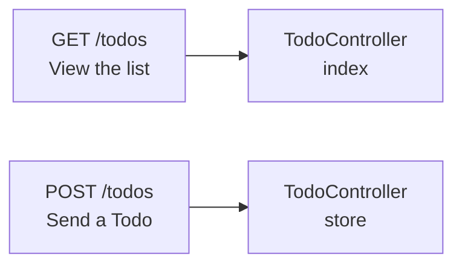
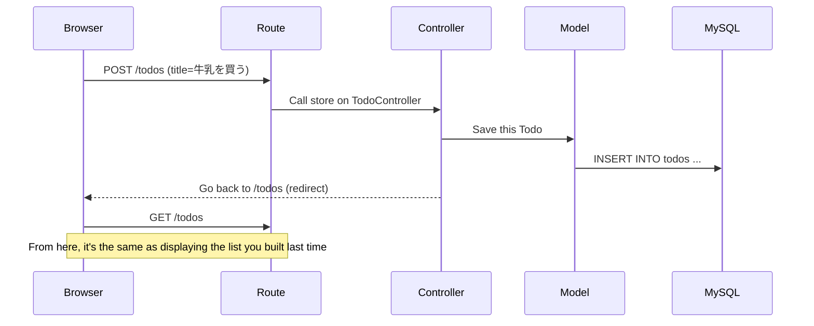
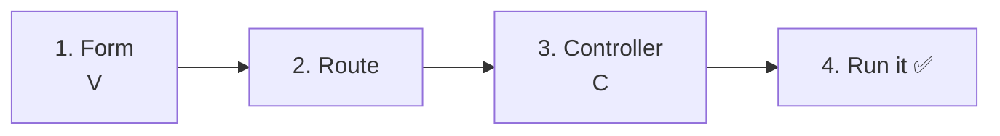
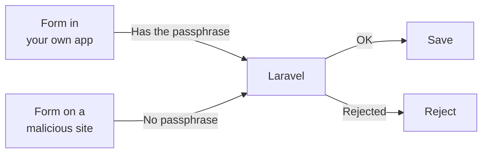
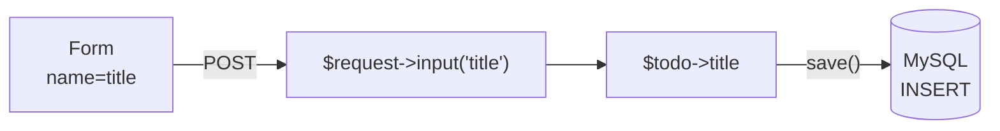
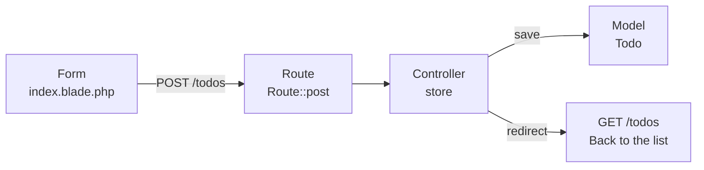

# Introduction to Laravel — Let's Add Todos (CREATE)

> 🇯🇵 Original (Japanese version): [20261022_資料_1.md](<../../../1年生_データ設計とアプリ開発/後期/20261022/20261022_資料_1.md>) <!-- original-ja-link -->

You'll add a **feature for adding Todos from a form** to the Todo list you built [last time](../20261015/20261015_資料_2.md).

## Today's Goals
- Understand the difference between GET and POST
- Be able to receive data sent from a form in a controller and save it to the database
- Be able to send the user back to the list page (redirect) after saving

> Start the mysql and laravel parts of the practice environment (`php-study`) before you begin.
> Before you begin, make sure you can open the `/todos` list page you built last time.

---

## 1. GET and POST

There are different types of requests from the browser to the server. Today we'll use these two.

| Type | When it's used | Think of it as |
|------|---------|-----------|
| **GET** | When you **view** a page (open a URL, click a link) | Asking to see the menu |
| **POST** | When you **send** data (a form's submit button) | Handing over an order slip |

Last time, you built a page for "viewing Todos," so it used **GET**.
Today, you'll build a feature for "sending and saving a Todo," so you'll use **POST**.

In Laravel, **GET and POST requests to the same URL can be handled by different methods**.



> **What about the first-semester todo.php?**
> In the first semester, everything was in one file, and you used `<input type="hidden" name="action" value="create">` to tell which operation to perform.
> In Laravel, **the combination of the URL and GET/POST** decides which method runs.

---

## 2. Today's Flow

When you click the form's submit button, the following steps happen in order.



The key point is the **redirect** at the end.
After saving, the controller doesn't build a page. Instead, it tells the browser, "Please open the list page (`/todos`) again."
Because the browser reopens the list, the Todo you added appears in it.

> **You did this in the first-semester todo.php too**
> In the first semester, you did the same thing with `header('Location: index.php');` (the PRG pattern).
> This prevents the same Todo from being registered twice when the page is reloaded.

---

## 3. Let's Build It

This time the table and model already exist, so you'll build things in **the order they run** (view → route → controller).



You'll touch the following three files (inside `src`). You won't change the model `Todo.php` today.

```
src/
├─ resources/views/todos/
│   └─ index.blade.php ················ 1. Add a form
├─ routes/
│   └─ web.php ························ 2. Add a POST route
└─ app/Http/Controllers/
    └─ TodoController.php ············· 3. Add a store method
```

---

### 1. Create the Form (V)

> You are here: **🟢 1. Form** → 2. Route → 3. Controller → 4. Run it

Open `resources/views/todos/index.blade.php` and add the form marked with ★ right below `<h1>`.

```html
<!DOCTYPE html>
<html lang="ja">
<head>
    <meta charset="UTF-8">
    <title>TODOアプリ</title>
</head>
<body>
    <h1>TODOアプリ</h1>

    {{-- ★ Start of added code --}}
    <form method="POST" action="/todos">
        @csrf
        <input type="text" name="title" placeholder="新しいTODOを入力" required>
        <button type="submit">追加</button>
    </form>
    {{-- ★ End of added code --}}

    <ul>
        @foreach ($todos as $todo)
            <li>
                <input type="checkbox" @checked($todo->is_done)>
                {{ $todo->title }}
            </li>
        @endforeach
    </ul>
</body>
</html>
```

| Code | Meaning |
|--------|------|
| `method="POST"` | Send with POST |
| `action="/todos"` | Send to `/todos` |
| `name="title"` | Send it with the name `title`. The controller uses this name to receive it |
| `required` | Prevents sending while the field is empty |
| `@csrf` | Adds the "secret passphrase" explained below |
| `{{-- --}}` | A Blade comment. It isn't shown on the page |

#### What Is `@csrf`?

`@csrf` adds a hidden **secret passphrase (CSRF token)** to a form.
If you use "View page source" in your browser, you'll see it has turned into a line like this.

```html
<input type="hidden" name="_token" value="ランダムな文字列">
```

When a POST arrives, Laravel checks the passphrase.
This protects against **an attack where a malicious site secretly submits a form to your app (CSRF)**.



Remember: **always write `@csrf` in POST forms**.

> **It may still work even if you forget `@csrf`**
> Besides the passphrase, Laravel 13 also asks the browser "was this sent from the same site?"
> Because of that, in the practice environment (`localhost`), it may still work even if you forget `@csrf`.
> But depending on the server environment you publish to, only the passphrase may be checked, so **always write it, even if it works without it**.

---

### 2. Write the Route

> You are here: 1. Form → **🟢 2. Route** → 3. Controller → 4. Run it

Open `routes/web.php` and add the ★ line.

```php
<?php

use Illuminate\Support\Facades\Route;
use App\Http\Controllers\TodoController;

Route::get('/', function () {
    return view('welcome');
});

Route::get('/todos', [TodoController::class, 'index']);
Route::post('/todos', [TodoController::class, 'store']);  // ★ Add
```

```
Route::post( '/todos' ,  [TodoController::class, 'store'] );
~~~~~~~~~~~   ~~~~~~~     ~~~~~~~~~~~~~~~~~~~~~  ~~~~~~~
When sent     to this     TodoController's       store handles it
with POST     URL
```

With `get` and `post`, different methods handle the requests, even though both use `/todos`.

| Route | Handled by | What it does |
|--------|------|---------|
| `Route::get('/todos', ...)` | `index` | Shows the list (last time) |
| `Route::post('/todos', ...)` | `store` | Saves a Todo (today) |

`store` means "to put away / save." In Laravel, `store` is a common name for methods that save data.

---

### 3. Write the Controller (C)

> You are here: 1. Form → 2. Route → **🟢 3. Controller** → 4. Run it

Open `app/Http/Controllers/TodoController.php` and add the ★ parts.

```php
<?php

namespace App\Http\Controllers;

use App\Models\Todo;
use Illuminate\Http\Request;  // ★ Add (to receive form data)

class TodoController extends Controller
{
    public function index()
    {
        $todos = Todo::all();

        return view('todos.index', ['todos' => $todos]);
    }

    // ★ Start of added code
    public function store(Request $request)
    {
        // ① Create a new Todo
        $todo = new Todo();

        // ② Set the title entered in the form
        $todo->title = $request->input('title');

        // ③ Save it to the database
        $todo->save();

        // ④ Go back to the list page
        return redirect('/todos');
    }
    // ★ End of added code
}
```

| Code | Meaning |
|--------|------|
| `Request $request` | A box holding the data sent from the form. Laravel passes it in automatically |
| `$request->input('title')` | Gets the value of the form's `name="title"`. Same as `$_POST['title']` in the first semester |
| `new Todo()` | Creates a new Todo (not saved yet) |
| `$todo->save()` | Saves it to the database. Same as `INSERT INTO todos ...` |
| `redirect('/todos')` | Tells the browser, "Please open `/todos` again" |

Let's compare it with the first-semester `todo.php`.

```php
// First semester
$title = trim($_POST['title'] ?? '');
$stmt = $pdo->prepare("INSERT INTO todos (title) VALUES (:title)");
$stmt->execute(['title' => $title]);
header('Location: index.php');
exit;

// Laravel
$todo = new Todo();
$todo->title = $request->input('title');
$todo->save();
return redirect('/todos');
```

Even without writing SQL, the model's `save()` builds the `INSERT` statement for you (ORM).
Laravel also uses prepared statements internally, so it's safe.
And the `trim()` from the first semester (removing spaces at the start and end) is also done automatically by Laravel.



---

### 4. Run It ✅

> You are here: 1. Form → 2. Route → 3. Controller → **🟢 4. Run it**

1. Open http://localhost:8000/todos in your browser
2. Type "宿題をする" in the input field and click `追加`
3. If "宿題をする" appears at the bottom of the list, it worked

```
TODOアプリ

[ 新しいTODOを入力 ] [追加]

☐ 牛乳を買う
☑ レポートを出す
☐ 宿題をする        ← added!
```

✅ **Check 1**: Open the `todos` table in phpMyAdmin (http://localhost:8080).
The Todo you added should have a date and time in `created_at` and `updated_at`. Laravel filled them in automatically when you called `save()`.
The time is 9 hours behind because Laravel records it in UTC (Coordinated Universal Time).
(For the Todos you entered by hand in phpMyAdmin last time, these columns are still empty (NULL).)

✅ **Check 2**: After adding a Todo, reload the page in your browser (F5).
Because it redirects, the same Todo won't be added twice.

---

## 4. Troubleshooting

> **🔥 If it doesn't work, write logs!**
> When you don't know the cause of an error, write logs to check how far the code ran → [[Important] How to Write Logs](./【重要】ログの出し方.md)

| Symptom | Where to check | Solution |
|------|----------|------|
| `The POST method is not supported for route todos.` | Route | Check that you wrote `Route::post('/todos', ...)` in `routes/web.php` |
| `Call to undefined method App\Http\Controllers\TodoController::store()` | Controller | Check that you wrote a `store` method in `TodoController.php`, and check the spelling of its name |
| `Class "App\Http\Controllers\Request" does not exist` | Controller | Check that `use Illuminate\Http\Request;` is at the top of `TodoController.php` |
| `Column 'title' cannot be null` | Form | Check the spelling of `name="title"` in `<input>` (it must be the same name as `input('title')` in the controller) |
| `419 Page Expired` | Form | Check that `@csrf` is inside the form (in the practice environment, this error may not appear even without `@csrf`) |
| The Todo doesn't appear in the list after adding it | Controller | Check that you wrote `$todo->save();`. Also check in phpMyAdmin whether the data was saved |

---

## 5. Summary



| What you wrote today | In a nutshell |
|--------------|-----------|
| `<form method="POST">` and `@csrf` | A form for sending Todos. Always use `@csrf` in POST forms |
| `Route::post('/todos', ...)` | When sent with POST, `store` handles it |
| `$request->input('title')` | Receives the value sent from the form |
| `new Todo()` → `save()` | Creates a new Todo and saves it (INSERT) |
| `redirect('/todos')` | Goes back to the list after saving |

---

## 6. Try More (If You Have Time Left)

Try making newly added Todos appear **at the top**.
Change `Todo::all()` in the `index` method as follows.

```php
$todos = Todo::orderBy('id', 'desc')->get();
```

It means the same as `ORDER BY id DESC` (largest id first = newest first).

> **There's also a way to write it with `Todo::create()`**
> If you search online, you'll often see the following instead of `new Todo()` → `save()`.
> ```php
> Todo::create(['title' => $request->input('title')]);
> ```
> It's handy because it fits on one line, but to use it, you need a setting in the model (`Fillable`) that says "which columns can be filled in."
> Without it, you'll get an error like `Add [title] to fillable property ...`.
> Today we used `new Todo()` → `save()` because it makes the mechanism easier to understand.

<!-- nav:start -->

---

📎 See also → [[Important] How to Write Logs](【重要】ログの出し方.md)

| ⬅️ Previous | 🗺️ Overview | Next ➡️ |
|:--|:--:|--:|
| [10/15 Todo List](../20261015/20261015_資料_2.md) | [Course Overview](../../README.md) | [10/22 Todo Details (SHOW)](20261022_資料_2.md) |

<!-- nav:end -->
