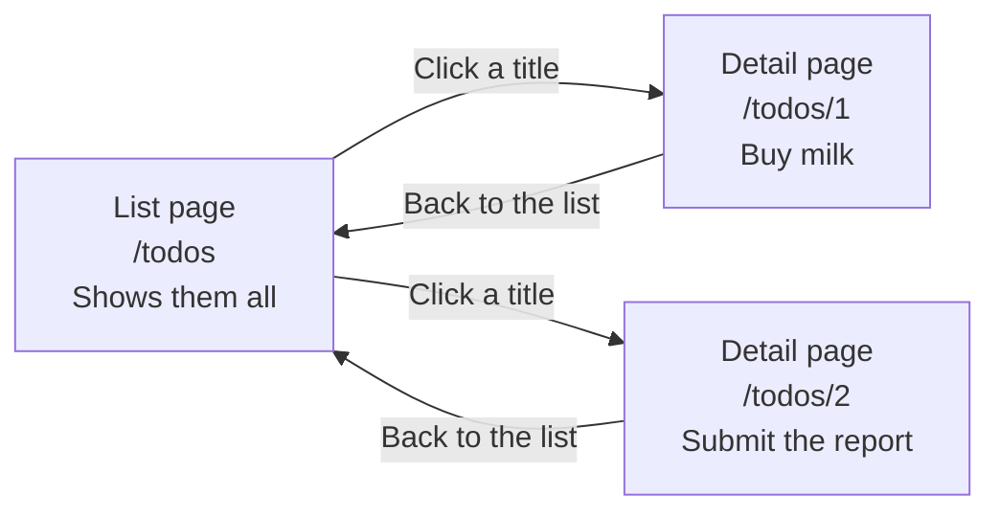
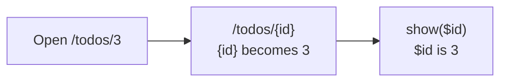
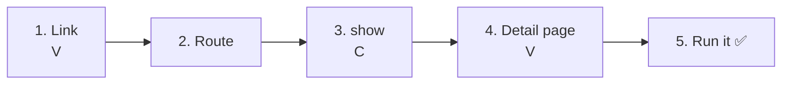
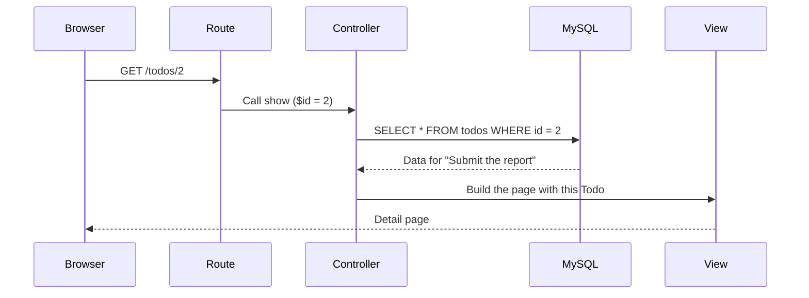
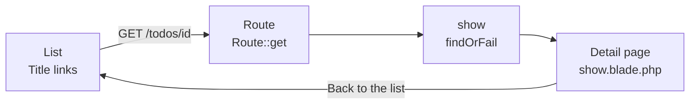

# Intro to Laravel — Let's Build a Todo Detail Page (SHOW)

> 🇯🇵 Original (Japanese version): [20261022_資料_2.md](<../../../1年生_データ設計とアプリ開発/後期/20261022/20261022_資料_2.md>) <!-- original-ja-link -->

In [Handout 1](./20261022_資料_1.md), you made it possible to add Todos. Next, we'll build **a page that shows one Todo in detail (a detail page)**.

## Today's Goals
- Put an `id` in the URL to choose which Todo to show (route parameters)
- Use the `id` to fetch just one Todo
- Display a Todo's information on a detail page

> We'll start with the "Adding a Todo" feature from Handout 1 already working.

---

## 1. List Page and Detail Page

The list page was the page that "shows all the Todos."
The detail page is the page that "shows **just one Todo** in detail."



| | URL | Handled by | What it shows |
|---|---|---|---|
| List page | `/todos` | `index` | All Todos |
| Detail page | `/todos/1`, `/todos/2` … | `show` | The one Todo **whose `id` matches the number in the URL** |

The number at the end of the URL is **the `id` of the Todo you want to see**.
`/todos/1` is the detail page for the Todo with `id` 1, and `/todos/2` is the one for the Todo with `id` 2.

> **Online shops work the same way**
> On a shopping site, when you click one item in the product list, a detailed page for just that item opens.
> If you look at the URL, it often **contains a number**, like `/items/12345`.

---

## 2. What's New Today

### Route parameter `{id}`

Writing a separate route for every Todo, like `/todos/1`, `/todos/2`, `/todos/3`…, would be a lot of work.
Instead, if you write `{id}` in the route, **that part of the URL can be anything**, and the controller can receive its value.

```php
Route::get('/todos/{id}', [TodoController::class, 'show']);
```



### Fetch just one with `findOrFail()`

On the list page, we fetched **all** of them with `Todo::all()`.
On the detail page, we use the `id` to fetch **just one**.

| Code | What it fetches | In SQL |
|--------|--------------|------------|
| `Todo::all()` | All of them | `SELECT * FROM todos` |
| `Todo::findOrFail($id)` | The one with the matching `id` | `SELECT * FROM todos WHERE id = ?` |

---

## 3. Let's Build It



You'll work on these 4 files (inside `src`).

```
src/
├─ resources/views/todos/
│   ├─ index.blade.php ················ 1. Turn the titles into links
│   └─ show.blade.php ················· 4. Detail page (create new)
├─ routes/
│   └─ web.php ························ 2. Add a route
└─ app/Http/Controllers/
    └─ TodoController.php ············· 3. Add a show method
```

---

### 1. Turn the list titles into links (V)

> You are here: **🟢 1. Link** → 2. Route → 3. show → 4. Detail page → 5. Run it

Open `resources/views/todos/index.blade.php` and wrap `{{ $todo->title }}` in a link, as shown at ★.

```html
    <ul>
        @foreach ($todos as $todo)
            <li>
                <input type="checkbox" @checked($todo->is_done)>
                <a href="/todos/{{ $todo->id }}">{{ $todo->title }}</a>  {{-- ★ Make it a link --}}
            </li>
        @endforeach
    </ul>
```

`{{ $todo->id }}` is replaced with that Todo's `id`.
Open the list in your browser and hover over a title. In the bottom-left corner, you'll see a different URL for each row, like `…/todos/1` and `…/todos/2`.

(If you click a title at this point, you'll get `404 Not Found`. That's because there's no route yet.)

---

### 2. Write the route

> You are here: 1. Link → **🟢 2. Route** → 3. show → 4. Detail page → 5. Run it

Add the ★ line to `routes/web.php`.

```php
Route::get('/todos', [TodoController::class, 'index']);
Route::post('/todos', [TodoController::class, 'store']);
Route::get('/todos/{id}', [TodoController::class, 'show']);  // ★ Added
```

```
Route::get( '/todos/{id}' ,  [TodoController::class, 'show'] );
~~~~~~~~~~   ~~~~~~~~~~~     ~~~~~~~~~~~~~~~~~~~~~  ~~~~~~
With GET,    when this URL   use TodoController's   show method
             is opened
             ({id} can be anything)
```

Now you have 3 routes.

| Route | Handled by | What it does |
|--------|------|---------|
| `GET /todos` | `index` | Shows the list |
| `POST /todos` | `store` | Adds a new one |
| `GET /todos/{id}` | `show` | Shows one Todo in detail |

`show` means "to display." In Laravel, `show` is the usual name for a method that displays one piece of data.

---

### 3. Write the show method (C)

> You are here: 1. Link → 2. Route → **🟢 3. show** → 4. Detail page → 5. Run it

Add the ★ `show` method to `app/Http/Controllers/TodoController.php`.

```php
    // (index and store are omitted)

    // ★ Start of added code
    public function show($id)
    {
        // ① Use the id to fetch the one Todo we want to see
        $todo = Todo::findOrFail($id);

        // ② Display the detail page
        return view('todos.show', ['todo' => $todo]);
    }
    // ★ End of added code
```

| Code | Meaning |
|--------|------|
| `show($id)` | The `{id}` part of the URL goes into `$id` |
| `Todo::findOrFail($id)` | Fetches the one Todo whose `id` matches |
| `view('todos.show', ...)` | Builds the page using `resources/views/todos/show.blade.php` |
| `['todo' => $todo]` | Makes it available in the view under the name `$todo` |

Let's compare it with `index`. They look almost the same.

| | `index` (list) | `show` (detail) |
|---|---|---|
| What it fetches | `Todo::all()` (all) | `Todo::findOrFail($id)` (one) |
| Variable | `$todos` (plural) | `$todo` (singular) |
| View | `todos.index` | `todos.show` |

> **What does the "OrFail" in `findOrFail` mean?**
> It means "if it can't be found, fail."
> If you try to open a Todo that doesn't exist, like `/todos/999`, it automatically shows a `404 Not Found` page.
> The similar `Todo::find($id)` returns `null` (empty) when nothing is found, which then causes an error in the view.

---

### 4. Build the detail page (V)

> You are here: 1. Link → 2. Route → 3. show → **🟢 4. Detail page** → 5. Run it

Create a new file called `show.blade.php` inside `resources/views/todos`.

```
resources/views/todos/
  ├─ index.blade.php
  └─ show.blade.php   ← Create new
```

```html
<!DOCTYPE html>
<html lang="ja">
<head>
    <meta charset="UTF-8">
    <title>TODOの詳細</title>
</head>
<body>
    <h1>{{ $todo->title }}</h1>

    <p>番号：{{ $todo->id }}</p>

    <p>
        状態：
        @if ($todo->is_done)
            完了 ✅
        @else
            未完了
        @endif
    </p>

    <a href="/todos">一覧にもどる</a>
</body>
</html>
```

| Code | Meaning |
|--------|------|
| `{{ $todo->title }}` | The Todo's title |
| `{{ $todo->id }}` | The Todo's number (`id`) |
| `@if` … `@else` … `@endif` | Shows "完了 ✅" (done) if it's done, and "未完了" (not done) otherwise |

In the list view, we used `@foreach` to loop through the Todos one at a time. On the detail page, `$todo` contains **only one Todo from the start**, so you don't need `@foreach`.

---

### 5. Run it ✅

> You are here: 1. Link → 2. Route → 3. show → 4. Detail page → **🟢 5. Run it**

1. Open http://localhost:8000/todos
2. Click "レポートを出す" (Submit the report)
3. If you see a detail page like the one below, it worked

```
レポートを出す

番号：2

状態：完了 ✅

一覧にもどる
```



✅ **Check 1**: Click the other Todos too, and make sure each one shows its own title and status.

✅ **Check 2**: In your browser, change the URL directly to http://localhost:8000/todos/999 and open it.
There's no Todo with `id` 999, so a `404 Not Found` page appears. That's proof that `findOrFail` is doing its job.

---

## 4. When Things Don't Work

> **🔥 If it doesn't work, write logs!**
> When you can't figure out what's causing an error, use `Log::info()` inside `show` to check the value of `$id` → [[Important] How to Write Logs](./【重要】ログの出し方.md)

| Symptom | Where the problem is | Fix |
|------|----------|------|
| Clicking a title gives `404 Not Found` | Route | Check that you wrote `Route::get('/todos/{id}', ...)` in `routes/web.php` |
| `Call to undefined method App\Http\Controllers\TodoController::show()` | Controller | Check that you wrote the `show` method in `TodoController.php`, and check its spelling |
| `View [todos.show] not found.` | View | Check that you created `resources/views/todos/show.blade.php`, and check the file name |
| `Undefined variable $todo` | Controller | Check the spelling of `'todo'` in `view('todos.show', ['todo' => $todo])` (make sure it isn't `'todos'`) |
| The same Todo shows up no matter which one you click | View | Check that the links in the list are `href="/todos/{{ $todo->id }}"` |

---

## 5. Summary



| What we wrote today | In a nutshell |
|--------------|-----------|
| `href="/todos/{{ $todo->id }}"` | Makes a link with the `id` in it for each Todo |
| `Route::get('/todos/{id}', ...)` | Receives the `id` in the URL as `$id` in the controller |
| `Todo::findOrFail($id)` | Fetches one Todo by its `id`. Shows a 404 if it doesn't exist |
| `show.blade.php` | The page that shows one Todo in detail |

The **`{id}` and `findOrFail()`** you learned here will also be used later when we build "Edit" and "Delete."

---

## 6. Try More (If You Have Time Left)

Try showing **the date and time it was created** (`created_at`) on the detail page too.

<details>
<summary>Hint</summary>

Add the following line to `show.blade.php`.

```html
<p>作った日時：{{ $todo->created_at }}</p>
```

- Todos you added with the form in Handout 1 will show a date and time (it's in UTC, so it's 9 hours behind Japan time)
- Todos you typed in by hand in phpMyAdmin last time have an empty `created_at` (NULL), so nothing is shown

</details>

<!-- nav:start -->

---

| ⬅️ Previous | 🗺️ Overview | Next ➡️ |
|:--|:--:|--:|
| [10/22 Adding Todos (CREATE)](20261022_資料_1.md) | [Overall Map of the Materials](../../README.md) | [10/29 Editing Todos (UPDATE)](../20261029/20261029_資料_1.md) |

<!-- nav:end -->
