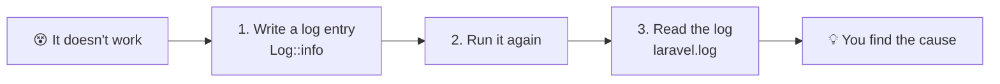
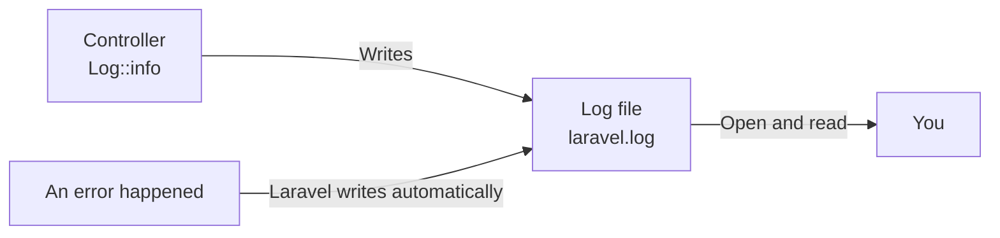
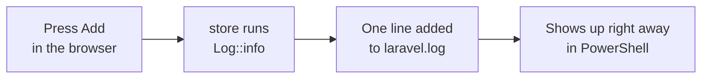
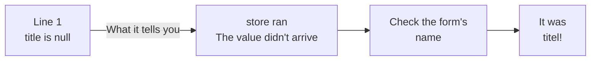
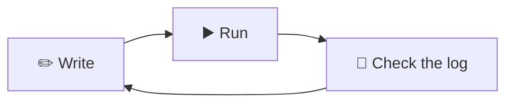

# [Important] If It Doesn't Work, Write Logs!

> 🇯🇵 Original (Japanese version): [【重要】ログの出し方.md](<../../../1年生_データ設計とアプリ開発/後期/20261022/【重要】ログの出し方.md>) <!-- original-ja-link -->

[Back to Let's Add Todos (CREATE)](./20261022_資料_1.md)

> ## 🔥 If it doesn't work, write logs!
> When your program doesn't work, **randomly rewriting the code almost never fixes it.**
> First, **write logs and see what's happening inside**. That's the fastest way to find the cause.
> You'll keep using this page in future classes and in your own projects. Whenever you're stuck, come back and read it again.
>
> ## 👀 Make checking logs a habit!
> Get into the habit of **checking your logs regularly**, not just when something doesn't work.
> You'll catch mistakes sooner, even when you only *think* something is working.



## Goals of This Page
- Understand what logs are for
- Write your own logs with `Log::info()`
- Open a log file and read its contents
- Make checking logs a daily habit

---

## 1. What Is a Log?

Sometimes, even when you press `追加` (Add) on the form, the data doesn't get saved properly.
But you can't see from the screen what's happening inside the controller.

- Are the form values actually reaching the controller?
- Is the `store` method even running?

That's where **logs** come in.
A log is like a **diary** where the app records what it did and when.



The log file is here, inside `src`.

```
src/
└─ storage/
    └─ logs/
        └─ laravel.log   ← Logs are written here
```

> **Errors are written automatically too**
> Even if you do nothing yourself, Laravel writes program errors to `laravel.log` when they happen.
> Even if you close the error page, you can check it in the log later.
>
> However, errors like `404 Not Found` (page not found), `405` (`The POST method is not supported ...`), and `419 Page Expired` —
> **errors that mean "the URL or the way it was sent is wrong" — are not written to the log**. For these, check your routes and forms.

---

## 2. Let's Write Some Logs

Let's add lines that write logs to the `store` method from last time.
Open `app/Http/Controllers/TodoController.php` and add the ★ parts.

```php
<?php

namespace App\Http\Controllers;

use App\Models\Todo;
use Illuminate\Http\Request;
use Illuminate\Support\Facades\Log;  // ★ Added (to use logs)

class TodoController extends Controller
{
    // (index is omitted)

    public function store(Request $request)
    {
        // ★ Write the value sent from the form to the log
        Log::info('Todoを追加します', ['title' => $request->input('title')]);

        $todo = new Todo();
        $todo->title = $request->input('title');
        $todo->save();

        // ★ Write to the log that it was saved
        Log::info('Todoを保存しました', ['id' => $todo->id]);

        return redirect('/todos');
    }
}
```

| Code | Meaning |
|--------|------|
| `use Illuminate\Support\Facades\Log;` | The line you need to use logs |
| `Log::info('メッセージ')` | Writes to the log as "info" |
| `['title' => ...]` | Writes values along with the message (optional) |
| `$todo->id` | After `save()`, you can get the `id` that was assigned automatically |

---

## 3. Let's Look at the Log

Open http://localhost:8000/todos in your browser, type "宿題をする" (do homework), and press `追加`.
Then let's look at the log. There are two ways to view it.

### Way 1: Open it in an editor

Open `src/storage/logs/laravel.log` in an editor such as VS Code.
Scroll to the very bottom, and you'll see new lines like these.

```
[2026-10-22 01:15:30] local.INFO: Todoを追加します {"title":"宿題をする"}
[2026-10-22 01:15:30] local.INFO: Todoを保存しました {"id":3}
```

| Part | Meaning |
|------|------|
| `[2026-10-22 01:15:30]` | The date and time it was written |
| `local` | The environment it's running in (the practice environment is `local`) |
| `INFO` | The log level (info) |
| `Todoを追加します` | The message you wrote |
| `{"title":"宿題をする"}` | The values written along with it |

> **Is the time 9 hours off?**
> Laravel records times in **UTC (Coordinated Universal Time)**. Japan time is UTC plus 9 hours.
> The `01:15:30` in the example above is `10:15:30` in Japan time.

### Way 2: Watch it in real time in PowerShell

In the laravel folder, run the following command.

```powershell
docker compose exec laravel tail -f storage/logs/laravel.log
```

Every time a log is written, it appears right away.
When you press `追加` in the browser, you'll see a new line appear.
To stop watching, press `Ctrl + C`.

> If you see `tail: cannot open ... No such file or directory`, the log file hasn't been created yet.
> The log file is created when the first line is written. Press `追加` in the browser once, then run the command again.



> **You can't use `php artisan pail`**
> If you search online, you'll find `php artisan pail` as a command for viewing logs.
> But the practice environment doesn't have the PHP feature (pcntl) that pail needs, so it won't work.
> Use `tail -f` instead.

---

## 4. Log Levels

Logs come in different levels depending on how important they are. Here are 4 commonly used levels.

| Code | Level | When to use it |
|--------|------|---------|
| `Log::debug('...')` | Debug | When you want to check a value during development |
| `Log::info('...')` | Info | Normal events, like "saved a Todo" |
| `Log::warning('...')` | Warning | Not an error, but something to watch out for |
| `Log::error('...')` | Error | When something fails |

In the log file, the level is written like `local.DEBUG`, `local.INFO`, `local.WARNING`, or `local.ERROR`.
When you're looking for errors, searching the file for `ERROR` makes them easy to find.

---

## 5. When It Doesn't Work, Use Logs to Find the Cause

### Without logs…

```
"Maybe this part is the problem…" → rewrite it → still doesn't work
"Then maybe it's this…"           → rewrite it → still doesn't work
"What did it look like at first…" → can't undo it 😱
```

If you rewrite things by guessing, it takes a long time, and you might **even break the parts that were working**.

| | Fixing by guesswork | Writing logs |
|---|---|---|
| What you do | Rewrite whichever part you suspect | Before changing the code, look inside with logs first |
| What you learn | Nothing | How far the program ran, and what the values were |
| Result | Whether it gets fixed is up to luck | You can narrow down where the problem is |

### Narrow down the cause with logs

You can use logs to check how far the program ran.

For example, say you accidentally set the form's `name` to `name="titel"` (a typo).
When you press `追加`, you get an error. The log says this:

```
[2026-10-22 01:20:05] local.INFO: Todoを追加します {"title":null}
[2026-10-22 01:20:05] local.ERROR: SQLSTATE[23000]: Integrity constraint violation: 1048 Column 'title' cannot be null ...
```



From the first line, you can tell that **`store` ran, but the `title` value didn't arrive**.
So you can suspect the part that sends the value (the form's `name`).

Like this, the trick to finding the cause is to **write logs before and after the suspected problem area, and check how far the program runs correctly**.

> **Show your logs when you ask a teacher or friend for help too**
> If you just say "It doesn't work," the person you ask can't figure out the cause either.
> If you **share your logs when you ask**, like "The log entry I wrote at the start of `store` showed `title` as `null`," the problem can be solved quickly.

---

## 6. Logs vs. `dd()`

Another way to check values is `dd()`.

```php
dd($request->input('title'));
```

When you write `dd()`, **the program stops right there**, and the value is shown in the browser.

| | `Log::info()` | `dd()` |
|---|---|---|
| Where does it show up? | The log file | The browser screen |
| Does the program stop? | No, it runs to the end | It stops right there |
| Best for | Following the whole flow, or reviewing later | Taking a quick look at one value on the spot |
| Remove it afterward? | You can leave it in | **Always remove it** (if you don't, it will keep stopping there) |

---

## 7. Make Checking Logs a Habit!

Logs aren't just for when things don't work. If you make a **habit of checking them regularly**, you'll catch mistakes sooner.

### Keep the log open while developing

While you're writing your program, keep `tail -f` running in PowerShell.
We recommend putting 3 windows side by side and repeating **write → run → check the log**.

```
┌──────────────┬──────────────┐
│              │              │
│  Editor      │  Browser     │
│  (write)     │  (run)       │
│              │              │
├──────────────┴──────────────┤
│  PowerShell (check the log) │
│  tail -f storage/logs/...   │
└─────────────────────────────┘
```



### Check the log even when it "works"

Even if it looks like it's working on screen, **the values inside may be different** from what you expect.
For example: is the title you entered arriving exactly as typed? Is one press of `追加` saving two items?
Only when you've checked in the log that "the values are what I expected" can you say "it works."

### When an error page appears, check the log first

When an error page appears, don't panic. Look at the **very bottom** of `laravel.log`.
The line marked `ERROR` tells you what happened.
(`404`, `405`, and `419` aren't written to the log, so read the message on the screen and check your routes and forms.)

### Log-checking habit checklist

- [ ] When I started developing, I opened the log with `tail -f`
- [ ] After pressing a button or opening a page, I checked the log
- [ ] Even when it "worked," I checked in the log that the values were what I expected
- [ ] When an error appeared, I looked at the bottom of `laravel.log` first
- [ ] When asking a question, I showed my logs too

---

## 8. Summary

> ## 🔥 If it doesn't work, write logs!
> ## 👀 Make checking logs a habit!

- A log is a diary where the app records what it did and when
- Write `use Illuminate\Support\Facades\Log;`, then write logs with `Log::info('メッセージ', [値])`
- Logs are written to `src/storage/logs/laravel.log`. Errors are written there automatically too
- You can watch them in real time with `docker compose exec laravel tail -f storage/logs/laravel.log`
- Times are in UTC (9 hours behind Japan time)
- When things don't work, write logs before and after the suspected problem area to check how far the program ran
- While developing, keep `tail -f` open and repeat **write → run → check the log**

<!-- nav:start -->

---

| ⬅️ Back | 🗺️ Overview | Next ➡️ |
|:--|:--:|--:|
| [10/22 Adding Todos (CREATE)](20261022_資料_1.md) | [Overall Map of the Materials](../../README.md) | [10/22 Todo Details (SHOW)](20261022_資料_2.md) |

<!-- nav:end -->
