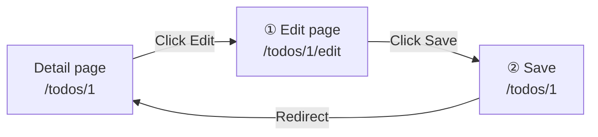
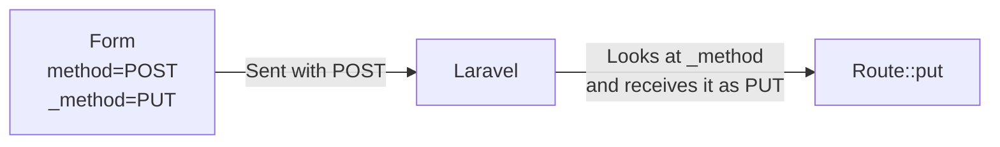
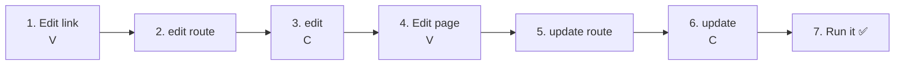
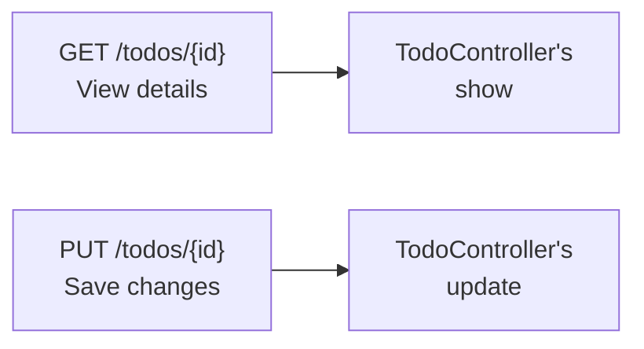
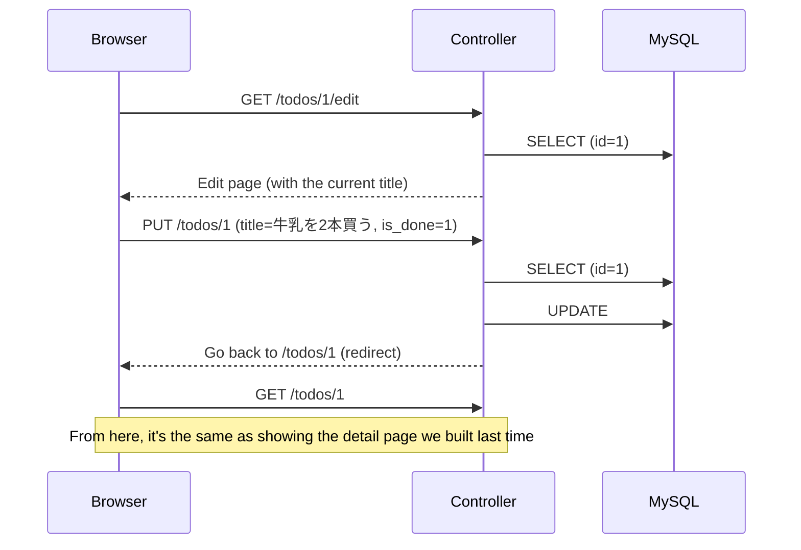
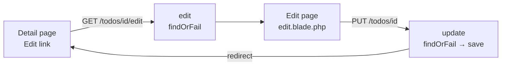

# Intro to Laravel — Let's Edit Todos (UPDATE)

> 🇯🇵 Original (Japanese version): [20261029_資料_1.md](<../../../1年生_データ設計とアプリ開発/後期/20261029/20261029_資料_1.md>) <!-- original-ja-link -->

We'll add an "編集" (Edit) button to the detail page we built [last time](../20261022/20261022_資料_2.md), and build **a feature that edits the title and status (done / not done) of a saved Todo**.

## Today's Goals
- Build an edit page that shows the current title and status
- Send the changes using PUT and `@method('PUT')`
- Save the updated title and status to the database (UPDATE)
- Understand how checkbox values are received

> Start the mysql and laravel containers in the practice environment (`php-study`) before you begin.
> We start from where last time's "detail page (`/todos/1`, etc.)" is already working.

---

## 1. Editing Uses "Two Pages"

Adding a Todo took one step: submitting the form.
Editing is split into two steps: **① open the edit page** → **② change it and send it**.



| | URL | Method | Handled by | What it does |
|---|---|---|---|---|
| ① | `/todos/1/edit` | GET | `edit` | Shows the edit page (with the current title already in the input field) |
| ② | `/todos/1` | PUT | `update` | Saves the updated title |

In both, the `1` in the URL is **the `id` of the Todo you want to edit**.
Just like last time's detail page, we use a **route parameter `{id}`** and **`findOrFail()`**.

> **What about todo.php from the first semester?**
> In the first semester, we chose which Todo to edit with `?edit=`, like `index.php?edit=3`.
> In Laravel, we **put the `id` inside the URL**, like `/todos/3/edit`.

---

## 2. What's New Today: PUT and `@method('PUT')`

In Laravel, the rule is to use the **PUT** method when you "update existing data."

| Method | When to use it | What we've built so far |
|------|---------|-------------------|
| GET | Viewing | List (`/todos`) and detail (`/todos/1`) |
| POST | Adding something new | Add (`/todos`) |
| **PUT** | Updating | **Today's edit feature** |

However, HTML forms **can only send GET and POST**.
So we send the form with POST, and use `@method('PUT')` to tell Laravel "this is actually PUT."

```html
<form method="POST" action="/todos/1">
    @csrf
    @method('PUT')
    ...
</form>
```

`@method('PUT')` turns into this one line: `<input type="hidden" name="_method" value="PUT">`.
Laravel looks at this `_method` and treats the request as PUT.



---

## 3. Let's Build It



You'll work on these 4 files (inside `src`).

```
src/
├─ resources/views/todos/
│   ├─ show.blade.php ················· 1. Add an edit link
│   └─ edit.blade.php ················· 4. Edit page (create new)
├─ routes/
│   └─ web.php ························ 2 & 5. Add routes
└─ app/Http/Controllers/
    └─ TodoController.php ············· 3 & 6. Add edit and update
```

---

### 1. Add an "Edit" link to the detail page (V)

> You are here: **🟢 1. Edit link** → 2. edit route → 3. edit → 4. Edit page → 5. update route → 6. update → 7. Run it

Open `resources/views/todos/show.blade.php`, which you made last time, and add the ★ line.

```html
<body>
    <h1>{{ $todo->title }}</h1>

    <p>番号：{{ $todo->id }}</p>

    <p>
        状態：
        @if ($todo->is_done)
            完了 ✅
        @else
            未完了
        @endif
    </p>

    <a href="/todos/{{ $todo->id }}/edit">編集</a>  {{-- ★ Added --}}
    <a href="/todos">一覧にもどる</a>
</body>
```

For the Todo with `id` 1, `/todos/{{ $todo->id }}/edit` becomes `/todos/1/edit`.

(If you click "編集" (Edit) at this point, you'll get `404 Not Found`. That's because there's no route yet.)

---

### 2. Write the route for the edit page

> You are here: 1. Edit link → **🟢 2. edit route** → 3. edit → 4. Edit page → 5. update route → 6. update → 7. Run it

Add the ★ line to `routes/web.php`.

```php
Route::get('/todos', [TodoController::class, 'index']);
Route::post('/todos', [TodoController::class, 'store']);
Route::get('/todos/{id}', [TodoController::class, 'show']);
Route::get('/todos/{id}/edit', [TodoController::class, 'edit']);  // ★ Added
```

```
Route::get( '/todos/{id}/edit' ,  [TodoController::class, 'edit'] );
~~~~~~~~~~   ~~~~~~~~~~~~~~~~     ~~~~~~~~~~~~~~~~~~~~~  ~~~~~~
With GET,    when this URL        use TodoController's   edit method
             is opened
```

`edit` means "to change something." In Laravel, `edit` is the usual name for a method that shows an edit page.

---

### 3. Write the edit method (C)

> You are here: 1. Edit link → 2. edit route → **🟢 3. edit** → 4. Edit page → 5. update route → 6. update → 7. Run it

Add the ★ `edit` method to `app/Http/Controllers/TodoController.php`.

```php
    // (index, store, and show are omitted)

    // ★ Start of added code
    public function edit($id)
    {
        // ① Use the id to fetch the one Todo we want to edit
        $todo = Todo::findOrFail($id);

        // ② Display the edit page
        return view('todos.edit', ['todo' => $todo]);
    }
    // ★ End of added code
```

Let's compare it with last time's `show`. **The only difference is the view it uses.**

| | `show` (detail) | `edit` (edit) |
|---|---|---|
| What it fetches | `Todo::findOrFail($id)` | `Todo::findOrFail($id)` |
| View | `todos.show` | **`todos.edit`** |

---

### 4. Build the edit page (V)

> You are here: 1. Edit link → 2. edit route → 3. edit → **🟢 4. Edit page** → 5. update route → 6. update → 7. Run it

Create a new file called `edit.blade.php` inside `resources/views/todos`.

```
resources/views/todos/
  ├─ index.blade.php
  ├─ show.blade.php
  └─ edit.blade.php   ← Create new
```

```html
<!DOCTYPE html>
<html lang="ja">
<head>
    <meta charset="UTF-8">
    <title>TODOの編集</title>
</head>
<body>
    <h1>TODOの編集</h1>

    <form method="POST" action="/todos/{{ $todo->id }}">
        @csrf
        @method('PUT')
        <input type="text" name="title" value="{{ $todo->title }}" required>
        <label>
            <input type="checkbox" name="is_done" value="1" @checked($todo->is_done)>
            完了
        </label>
        <button type="submit">保存</button>
    </form>

    <a href="/todos/{{ $todo->id }}">もどる</a>
</body>
</html>
```

| Code | Meaning |
|--------|------|
| `action="/todos/{{ $todo->id }}"` | Sends the form to a URL with the `id` of the Todo being edited, like `/todos/1` |
| `@csrf` | Adds a CSRF token (same as last time's add form) |
| `@method('PUT')` | Tells Laravel "this is actually PUT" |
| `value="{{ $todo->title }}"` | **Puts the current title in the input field from the start** |
| `name="is_done" value="1"` | `is_done=1` is sent **only when the box is checked** |
| `@checked($todo->is_done)` | If the Todo is done, the box starts out checked (same as the list on 10/15) |
| `<label>` … `</label>` | Lets you toggle the checkbox by clicking the word "完了" (done) too |

#### An important thing about checkboxes

A checkbox sends its value **only when it's checked**.
When it's unchecked, `is_done` itself is **not sent at all**.

| Checkbox | What gets sent |
|----------------|------------|
| ☑ Checked | `title=…` and `is_done=1` |
| ☐ Unchecked | Only `title=…` (nothing is sent for `is_done`) |

So in the controller, we decide done / not done based on **whether `is_done` was sent or not** (we'll write this in step 6).

Here are 4 differences from the add form.

| | Add form | Edit form |
|---|---|---|
| Sends to | `/todos` | `/todos/{{ $todo->id }}` |
| `@method('PUT')` | No | **Yes** |
| Input field | Empty | **Has the current title** (`value`) |
| Status | None (new Todos start as not done) | **A "done" checkbox** (checked according to the current status) |

✅ **Check**: On the detail page, click "編集." If you see an edit page with the current title in the input field and the current status in the checkbox, you're good.
(Don't click "保存" (Save) yet. If you do, you'll get an error.)

---

### 5. Write the route for saving

> You are here: 1. Edit link → 2. edit route → 3. edit → 4. Edit page → **🟢 5. update route** → 6. update → 7. Run it

Add the ★ line to `routes/web.php`.

```php
Route::get('/todos', [TodoController::class, 'index']);
Route::post('/todos', [TodoController::class, 'store']);
Route::get('/todos/{id}', [TodoController::class, 'show']);
Route::get('/todos/{id}/edit', [TodoController::class, 'edit']);
Route::put('/todos/{id}', [TodoController::class, 'update']);  // ★ Added
```

Now you have 5 routes.

| Route | Handled by | What it does |
|--------|------|---------|
| `GET /todos` | `index` | Shows the list |
| `POST /todos` | `store` | Adds a new one |
| `GET /todos/{id}` | `show` | Shows one Todo in detail |
| `GET /todos/{id}/edit` | `edit` | Shows the edit page |
| `PUT /todos/{id}` | `update` | Saves the changes |

For `/todos/{id}`, **GET is handled by `show`, and PUT is handled by `update`**.
It works the same way as `/todos`, where "GET goes to `index` and POST goes to `store`."



---

### 6. Write the update method (C)

> You are here: 1. Edit link → 2. edit route → 3. edit → 4. Edit page → 5. update route → **🟢 6. update** → 7. Run it

Add the ★ `update` method to `TodoController.php`.

```php
    // ★ Start of added code
    public function update(Request $request, $id)
    {
        // ① Use the id to fetch the one Todo we want to update
        $todo = Todo::findOrFail($id);

        // ② Update it with the entered title and status
        $todo->title = $request->input('title');
        $todo->is_done = $request->has('is_done');

        // ③ Save it to the database
        $todo->save();

        // ④ Go back to the detail page
        return redirect('/todos/' . $todo->id);
    }
    // ★ End of added code
```

| Code | Meaning |
|--------|------|
| `update(Request $request, $id)` | Receives both the form values (`$request`) and the `{id}` from the URL (`$id`) |
| `$request->has('is_done')` | `true` (done) if `is_done` was sent, `false` (not done) if not. Same as `isset($_POST['is_done'])` from the first semester |
| `'/todos/' . $todo->id` | Joins strings to make a URL like `/todos/1` (`.` is the string concatenation you learned in the first semester) |

It's almost the same as the `store` method for adding that you wrote last time. The differences are **① and ④**.

| | `store` (add) | `update` (edit) |
|---|---|---|
| ① | `new Todo()` (creates a new one) | `Todo::findOrFail($id)` (fetches an existing one) |
| ② | `$todo->title = ...` | `$todo->title = ...` and `$todo->is_done = ...` |
| ③ | `save()` → `INSERT` | `save()` → **`UPDATE`** |
| ④ | Goes back to the list (`/todos`) | Goes back to the detail page (`/todos/1`, etc.) |

Even with the same `save()`, Laravel automatically uses **`INSERT` for a newly created Todo and `UPDATE` for a fetched Todo**.

Let's compare it with `todo.php` from the first semester.

```php
// First semester
$id = (int)($_POST['id'] ?? 0);
$title = trim($_POST['title'] ?? '');
$stmt = $pdo->prepare("UPDATE todos SET title = :title WHERE id = :id");
$stmt->execute(['title' => $title, 'id' => $id]);
header('Location: index.php');
exit;

// Laravel
$todo = Todo::findOrFail($id);
$todo->title = $request->input('title');
$todo->is_done = $request->has('is_done');
$todo->save();
return redirect('/todos/' . $todo->id);
```

In the first semester, editing only changed the title, but the Laravel version updates **the status as well**.

---

### 7. Run it ✅

> You are here: 1. Edit link → 2. edit route → 3. edit → 4. Edit page → 5. update route → 6. update → **🟢 7. Run it**

1. Open http://localhost:8000/todos
2. Click "牛乳を買う" (Buy milk) to open its detail page
3. Click "編集"
4. Change the input field to "牛乳を2本買う" (buy 2 bottles of milk), check "完了", and press `保存`
5. If you're back on the detail page and the title has changed to "牛乳を2本買う" and the status to "完了 ✅", it worked
6. Also open the edit page again, uncheck the box, press `保存`, and make sure it goes back to "未完了" (not done)



✅ **Check 1**: Go back to the list page and make sure the title and checkbox in the list have changed too.

✅ **Check 2**: Open the `todos` table in phpMyAdmin.
The `updated_at` of the Todo you edited has changed to the time you saved it (it's in UTC, so it's 9 hours behind Japan time).
When you called `save()`, Laravel automatically filled in "the time it was updated." `created_at` stays the same.

> **What if you press "保存" without changing the title or the status?**
> When nothing has changed, Laravel doesn't run `UPDATE`. So `updated_at` doesn't change either.

---

## 4. When Things Don't Work

> **🔥 If it doesn't work, write logs!**
> When you can't figure out what's causing an error, use `Log::info()` inside `update` to check the values of `$id`, `title`, and `is_done` → [[Important] How to Write Logs](../20261022/【重要】ログの出し方.md)

| Symptom | Where the problem is | Fix |
|------|----------|------|
| Clicking "編集" gives `404 Not Found` | Route | Check that you wrote `Route::get('/todos/{id}/edit', ...)` in `routes/web.php` |
| `Call to undefined method App\Http\Controllers\TodoController::edit()` | Controller | Check that you wrote the `edit` method in `TodoController.php`, and check its spelling (same for `update`) |
| `View [todos.edit] not found.` | View | Check that you created `resources/views/todos/edit.blade.php`, and check the file name |
| The input field on the edit page is empty | View | Check that the `<input>` has `value="{{ $todo->title }}"` |
| Pressing "保存" gives `The POST method is not supported for route todos/1.` | View | Check that the form on the edit page has `@method('PUT')` |
| Pressing "保存" gives `The PUT method is not supported for route todos/1.` | Route | Check that you wrote `Route::put('/todos/{id}', ...)` in `routes/web.php` |
| The title doesn't change even after saving | Controller | Check that `update` has `$todo->save();` |
| It stays not done even after you check the box and save | View / Controller | Check that `name="is_done"` and `$request->has('is_done')` are spelled the same |
| It stays done even after you uncheck the box and save | Controller | Check that `update` has `$todo->is_done = $request->has('is_done');` |
| A different Todo got changed | View | Check `action="/todos/{{ $todo->id }}"` on the edit page |

> `404` and `The ... method is not supported` errors are not written to the log. Read the message on the screen and check your routes and forms.

---

## 5. Summary



| What we wrote today | In a nutshell |
|--------------|-----------|
| `Route::get('/todos/{id}/edit', ...)` and `edit` | Shows the edit page. Almost the same as `show` |
| `value="{{ $todo->title }}"` | Puts the current title in the input field |
| `<input type="checkbox" name="is_done" ...>` | A checkbox for editing the status. Sent only when checked |
| `$request->has('is_done')` | Decides done / not done based on whether `is_done` was sent |
| `@method('PUT')` | Sends the form with POST, and says "it's actually PUT" |
| `Route::put('/todos/{id}', ...)` and `update` | Saves the changes |
| `save()` on a fetched Todo | Becomes an `UPDATE` (an `INSERT` for a newly created Todo) |

---

## 6. Try More (If You Have Time Left)

Change the heading on the edit page from "TODOの編集" (Edit TODO) to something like "『牛乳を買う』の編集" (Editing "Buy milk") — **a heading that includes the title of the Todo being edited**.

<details>
<summary>Hint</summary>

Use `{{ $todo->title }}` inside the `<h1>` in `edit.blade.php`.

```html
<h1>『{{ $todo->title }}』の編集</h1>
```

</details>

---

Next, we'll build a feature that switches between done and not done with the checkboxes on the list → [Let's Toggle Done / Not Done (PATCH)](./20261029_資料_2.md)

<!-- nav:start -->

---

| ⬅️ Previous | 🗺️ Overview | Next ➡️ |
|:--|:--:|--:|
| [10/22 Todo Details (SHOW)](../20261022/20261022_資料_2.md) | [Overall Map of the Materials](../../README.md) | [10/29 Toggling Done (PATCH)](20261029_資料_2.md) |

<!-- nav:end -->
