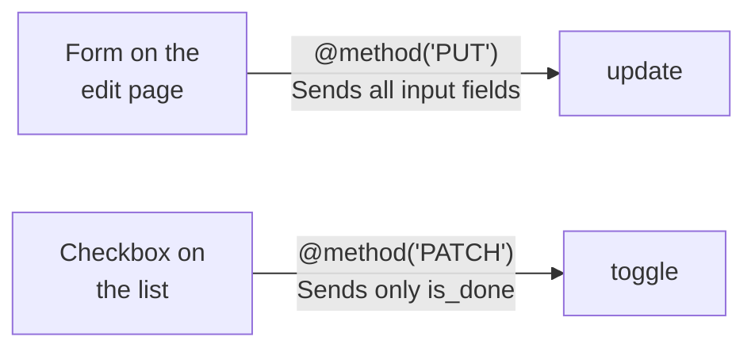
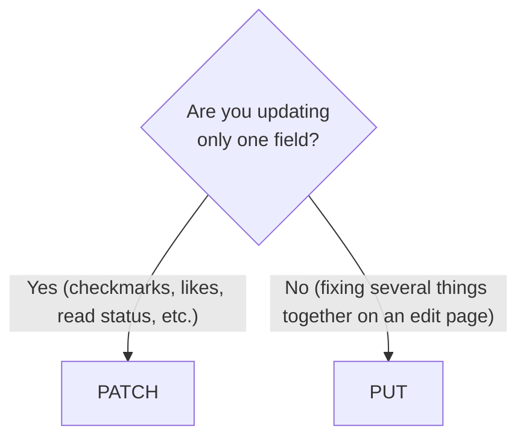
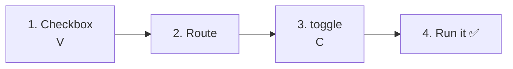
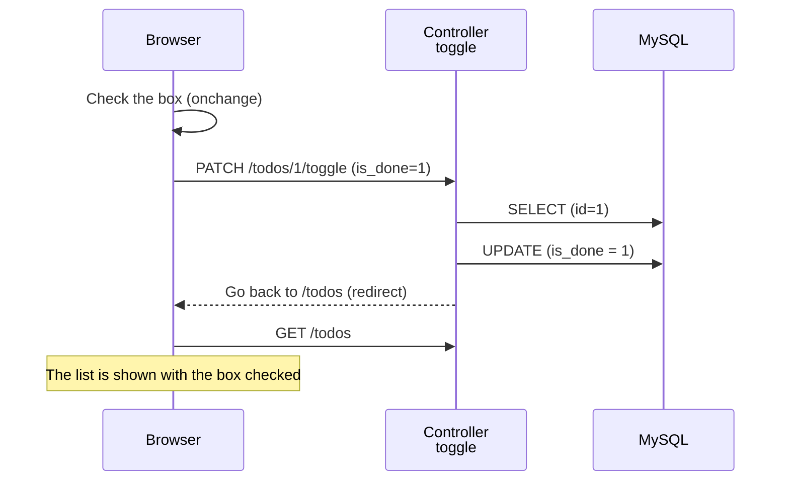
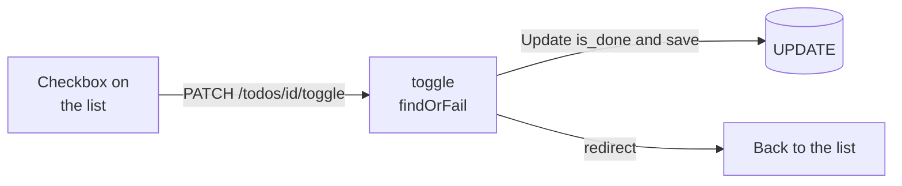

# Intro to Laravel — Let's Toggle Done / Not Done (PATCH)

> 🇯🇵 Original (Japanese version): [20261029_資料_2.md](<../../../1年生_データ設計とアプリ開発/後期/20261029/20261029_資料_2.md>) <!-- original-ja-link -->

In [Handout 1](./20261029_資料_1.md), you made it possible to edit a Todo's title. Next, we'll build **a feature that switches between done and not done** using the checkboxes on the list.

## Today's Goals
- Understand the difference between PUT and PATCH
- Send a request that updates only part of the data, using PATCH and `@method('PATCH')`
- Switch between done and not done with a checkbox

> We start from where "Editing a Todo" in Handout 1 is already working.

---

## 1. What Is Toggling Done / Not Done?

In Handout 1, you made it possible to change the status (`is_done`) from the edit page.
But even if you click the checkboxes on the list, **nothing is saved to the database** (when you reload the page, they go back to how they were).
Here, we'll make the checkboxes on the list **switch between "done ⇄ not done" as soon as you click them**.
You'll be able to switch them right there on the list, without opening the edit page every time.

```
TODOアプリ

☐ 牛乳を買う         ← Check it and it becomes "done"
☑ レポートを出す     ← Uncheck it and it goes back to "not done"
```

Under the hood, it's the same **UPDATE** as the `update` you built in Handout 1. The only difference is that we update `is_done` instead of `title`.

| URL | Method | Handled by | What it does |
|-----|------|------|---------|
| `/todos/1/toggle` | **PATCH** | `toggle` | Updates `is_done` |

`toggle` means "to switch something on and off."

---

## 2. What's New Today: PATCH

Besides **PUT**, there's another method for updating: **PATCH**.
Both mean "update," but they differ in **how much they update**.

| Method | Meaning | Think of it as |
|------|------|-----------|
| PUT | Updates the data **as a whole** | Rewriting a document from scratch and **replacing the whole thing** |
| **PATCH** | Updates **only part** of the data | Putting correction tape on **just one spot** in the document |

In English, a `patch` is a piece of cloth you sew over a hole to fix it.

### Let's compare with an address card

For example, say you have an "address card" like this.

```
Name: Hanako Yamada
Address: ○○ Ward, Tokyo…
Phone: 090-xxxx-xxxx
```

You moved, and **only your address** changed.

```
[PUT] Write a whole new card and replace the old one

  ┌──────────────────────────┐
  │ Name: Hanako Yamada      │ ← Not changed, but you write it anyway
  │ Address: Osaka… (new)    │ ← The part that changed
  │ Phone: 090-xxxx-xxxx     │ ← Not changed, but you write it anyway
  └──────────────────────────┘

[PATCH] Put correction tape over just the address on the current card

  ┌──────────────────────────┐
  │ Address: Osaka… (new)    │ ← Only the part that changed
  └──────────────────────────┘
```

| | PUT | PATCH |
|---|---|---|
| What you send | **Name, address, and phone — all of them** (you also write the name and phone, even though they didn't change) | **Only the address** |
| What about fields you didn't write? | They are treated as empty | They are left unchanged |

With PUT, you hand over **everything**, saying "this is the new card," so any field you forget to write ends up empty.
With PATCH, you say "just fix this part," so the fields you didn't write stay as they are.

### In the Todo app

Here's how this applies to the Todo app.

| | Edit (`update`) | Toggle done / not done (`toggle`) |
|---|---|---|
| What's the action? | On the edit page, **rewrite the Todo's contents** and save | On the list, switch **just the checkbox** |
| What you send | **All** the input fields on the edit page (`title` and `is_done`) | **Only `is_done`** |
| Method | **PUT** | **PATCH** |
| How to write it | `@method('PUT')` / `Route::put(...)` | `@method('PATCH')` / `Route::patch(...)` |



> **You can already change the status on the edit page, so why build toggle?**
> The edit page is "a page for rewriting the title and status **together**" (PUT).
> The checkboxes on the list are for "quickly changing **only** the status, right there" (PATCH).
> Both change `is_done`, but **what they send (everything, or just part)** is different, so we make them separate actions with separate methods.
> PUT is for "sending all the fields on a page again," and PATCH is for "changing just one specific field."

### When you're not sure



Here are some examples of how these methods are used in everyday apps.

| Action | Method | Reason |
|------|------|------|
| Pressing "Save" on a profile edit page | PUT | Re-sends your name, bio, and so on together |
| "Liking" a post | PATCH | Changes just one thing: the "like" |
| Marking a message as "read" | PATCH | Changes just one thing: "whether it's been read" |
| Checking off a Todo | PATCH | Changes just one thing: `is_done` |

### Will it work with either PUT or PATCH?

In Laravel, you can save with `save()` the same way no matter which one you use. **The program behaves the same.**
(The address card story is about the **meaning** of PUT and PATCH. In Laravel, fields you didn't send with PUT are not automatically emptied.)
We still use them differently so that you can **tell "what the action does"** just by looking at the route.

```php
Route::put('/todos/{id}', ...);           // "So this rewrites the whole Todo"
Route::patch('/todos/{id}/toggle', ...);  // "So this changes part of the Todo"
```

> In real-world development, some teams use PATCH for edit pages too. What matters is **keeping the rules consistent within your team**.
> In this class, we'll stick to "PUT for edit pages, PATCH when changing just one field."

HTML forms can't send PATCH either, so just like PUT, we use `@method('PATCH')`.

> **We did this in todo.php in the first semester too**
> In the first semester, we sent `action=toggle` and decided done / not done with `isset($_POST['is_done']) ? 1 : 0`.
> We'll build it with the same idea in Laravel.

---

## 3. Let's Build It



You'll work on these 3 files (inside `src`).

```
src/
├─ resources/views/todos/
│   └─ index.blade.php ················ 1. Wrap the checkbox in a form
├─ routes/
│   └─ web.php ························ 2. Add a route
└─ app/Http/Controllers/
    └─ TodoController.php ············· 3. Add a toggle method
```

---

### 1. Save changes made with the checkboxes on the list (V)

> You are here: **🟢 1. Checkbox** → 2. Route → 3. toggle → 4. Run it

Rewrite the inside of `<li>` in `resources/views/todos/index.blade.php` as follows.
**Wrap the existing checkbox in a form**, and add `name`, `value`, and `onchange`.

```html
    <ul>
        @foreach ($todos as $todo)
            <li>
                {{-- ★ Start of changes --}}
                <form method="POST" action="/todos/{{ $todo->id }}/toggle" style="display: inline;">
                    @csrf
                    @method('PATCH')
                    <input type="checkbox" name="is_done" value="1" onchange="this.form.submit()" @checked($todo->is_done)>
                </form>
                {{-- ★ End of added code --}}
                <a href="/todos/{{ $todo->id }}">{{ $todo->title }}</a>
            </li>
        @endforeach
    </ul>
```

| | Since 10/15 (clicking doesn't save) | From today (clicking saves) |
|---|---|---|
| Form | None | Wrapped in `<form ...>` |
| `name="is_done" value="1"` | None | Yes |
| `onchange` | None | Yes |
| `@checked(...)` | Yes | Yes (unchanged) |

| Code | Meaning |
|--------|------|
| `action="/todos/{{ $todo->id }}/toggle"` | Sends to a URL with that Todo's `id`, like `/todos/1/toggle` |
| `@method('PATCH')` | Tells Laravel "this is actually PATCH" (because we're updating only part of the data) |
| `name="is_done" value="1"` | `is_done=1` is sent **only when the box is checked** |
| `onchange="this.form.submit()"` | Sends the form the moment you change the checkbox (no submit button needed) |
| `@checked($todo->is_done)` | If the Todo is done, the box starts out checked (same as 10/15) |
| `style="display: inline;"` | Keeps the form from adding a line break after it, so it sits next to the title |

> **An important thing about checkboxes (review of Handout 1)**
> A checkbox sends `is_done=1` **only when it's checked**. When it's unchecked, `is_done` itself is not sent at all.
> So in the controller, just like `update` in Handout 1, we decide done / not done based on **whether `is_done` was sent or not**.

---

### 2. Write the route

> You are here: 1. Checkbox → **🟢 2. Route** → 3. toggle → 4. Run it

Add the ★ line to `routes/web.php`.

```php
Route::get('/todos', [TodoController::class, 'index']);
Route::post('/todos', [TodoController::class, 'store']);
Route::get('/todos/{id}', [TodoController::class, 'show']);
Route::get('/todos/{id}/edit', [TodoController::class, 'edit']);
Route::put('/todos/{id}', [TodoController::class, 'update']);
Route::patch('/todos/{id}/toggle', [TodoController::class, 'toggle']);  // ★ Added
```

`/todos/{id}` (editing the title) and `/todos/{id}/toggle` (toggling done / not done) have different URLs, so they're handled by different methods.

---

### 3. Write the toggle method (C)

> You are here: 1. Checkbox → 2. Route → **🟢 3. toggle** → 4. Run it

Add the ★ `toggle` method to `TodoController.php`.

```php
    // ★ Start of added code
    public function toggle(Request $request, $id)
    {
        // ① Use the id to fetch the one Todo we want to toggle
        $todo = Todo::findOrFail($id);

        // ② Done (true) if is_done was sent, not done (false) if not
        $todo->is_done = $request->has('is_done');

        // ③ Save it to the database
        $todo->save();

        // ④ Go back to the list page
        return redirect('/todos');
    }
    // ★ End of added code
```

| Code | Meaning |
|--------|------|
| `$request->has('is_done')` | `true` if `is_done` was sent, `false` if not. Same as `isset($_POST['is_done'])` from the first semester |

Let's compare it with `update`.

| | `update` (edit page) | `toggle` (checkbox on the list) |
|---|---|---|
| ① | `Todo::findOrFail($id)` | `Todo::findOrFail($id)` |
| ② | Updates `title` and `is_done` | Updates **only `is_done`** |
| ③ | `save()` → `UPDATE` | `save()` → `UPDATE` |
| ④ | Goes back to the detail page | Goes back to the list page |

Let's compare it with `todo.php` from the first semester.

```php
// First semester
$id = (int)($_POST['id'] ?? 0);
$isDone = isset($_POST['is_done']) ? 1 : 0;
$stmt = $pdo->prepare("UPDATE todos SET is_done = :is_done WHERE id = :id");
$stmt->execute(['is_done' => $isDone, 'id' => $id]);
header('Location: index.php');
exit;

// Laravel
$todo = Todo::findOrFail($id);
$todo->is_done = $request->has('is_done');
$todo->save();
return redirect('/todos');
```

---

### 4. Run it ✅

> You are here: 1. Checkbox → 2. Route → 3. toggle → **🟢 4. Run it**

1. Open http://localhost:8000/todos
2. Check the checkbox for "牛乳を買う" (Buy milk)
3. If the page reloads and the box stays checked, it worked
4. Also uncheck it again and make sure it stays unchecked



✅ **Check 1**: Open the detail page of the Todo you checked, and make sure it says "完了 ✅" (done).

✅ **Check 2**: Open the `todos` table in phpMyAdmin, and make sure `is_done` changes to `1` (done) or `0` (not done).

---

## 4. When Things Don't Work

> **🔥 If it doesn't work, write logs!**
> When you can't figure out what's causing an error, use `Log::info()` inside `toggle` to check whether `is_done` is being sent → [[Important] How to Write Logs](../20261022/【重要】ログの出し方.md)

| Symptom | Where the problem is | Fix |
|------|----------|------|
| Nothing happens when you check the box | View | Check that the `<input>` has `onchange="this.form.submit()"` |
| Checking the box gives `404 Not Found` | Route | Check that you wrote `Route::patch('/todos/{id}/toggle', ...)` in `routes/web.php` |
| Checking the box gives `The POST method is not supported for route todos/1/toggle.` | View | Check that the checkbox's form has `@method('PATCH')` |
| Checking the box gives `The PATCH method is not supported for route todos/1/toggle.` | Route | Check that `routes/web.php` doesn't say `Route::put(...)` (change it to `Route::patch(...)`) |
| You check the box, but it comes back unchecked | View / Controller | Check that `name="is_done"` and `$request->has('is_done')` are spelled the same |
| The Todo is done, but the box isn't checked | View | Check that the `<input>` has `@checked($todo->is_done)` |

---

## 5. Summary



| What we wrote today | In a nutshell |
|--------------|-----------|
| PATCH and `@method('PATCH')` | Used when updating only part of the data (PUT for the whole thing) |
| `onchange="this.form.submit()"` | Sends the form the moment you change the checkbox |
| `name="is_done" value="1"` | `is_done=1` is sent only when the box is checked |
| `Route::patch('/todos/{id}/toggle', ...)` | When something is sent with PATCH, `toggle` handles it |
| `$request->has('is_done')` | Decides done / not done based on whether `is_done` was sent |

---

Next, we'll build a feature for deleting Todos → [Let's Delete Todos (DELETE)](./20261029_資料_3.md)

<!-- nav:start -->

---

| ⬅️ Previous | 🗺️ Overview | Next ➡️ |
|:--|:--:|--:|
| [10/29 Editing Todos (UPDATE)](20261029_資料_1.md) | [Overall Map of the Materials](../../README.md) | [10/29 Deleting Todos (DELETE)](20261029_資料_3.md) |

<!-- nav:end -->
