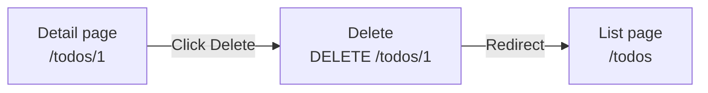
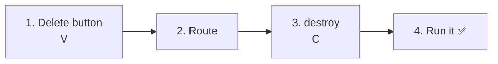
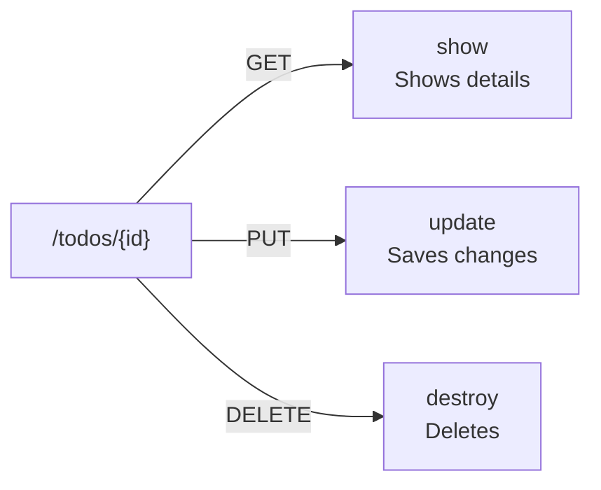
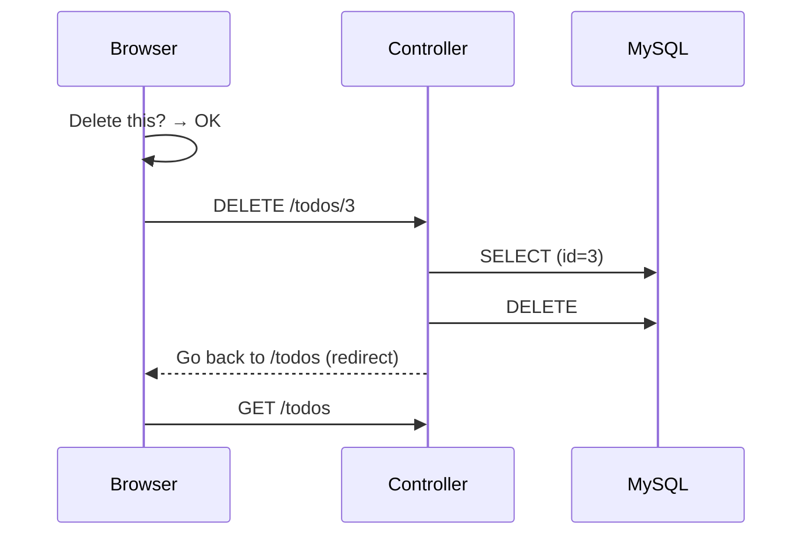
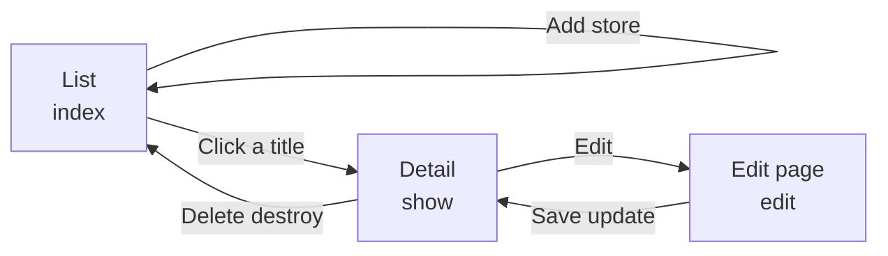

# Intro to Laravel — Let's Delete Todos (DELETE)

> 🇯🇵 Original (Japanese version): [20261029_資料_3.md](<../../../1年生_データ設計とアプリ開発/後期/20261029/20261029_資料_3.md>) <!-- original-ja-link -->

In [Handout 1](./20261029_資料_1.md) and [Handout 2](./20261029_資料_2.md), you made it possible to edit Todos. Next, we'll build **a feature for removing (deleting) Todos**.

## Today's Goals
- Send a delete request using DELETE and `@method('DELETE')`
- Delete a Todo from the database with `delete()`
- Understand the whole picture of add, view, edit, and delete (CRUD)

> We'll start with the "Toggling done / not done" feature from Handout 2 already working.

---

## 1. How Deleting Works

Unlike editing, deleting **doesn't require opening a page — it's done with a single button**.



| URL | Method | Handled by | What it does |
|-----|------|------|---------|
| `/todos/1` | **DELETE** | `destroy` | Deletes the Todo |

### DELETE and `@method('DELETE')`

In Laravel, the rule is to use the **DELETE** method when you "remove data."
Just like with PUT, HTML forms can't send DELETE, so we use `@method('DELETE')`.

| Method | When to use it | How to write it |
|------|---------|--------|
| PUT | Updating | `@method('PUT')` in the form |
| PATCH | Updating only part of the data | `@method('PATCH')` in the form |
| **DELETE** | Removing | `@method('DELETE')` in the form |

> **Why a form button instead of a link (`<a>`)?**
> Links open with GET. The rule is that GET is "for viewing only," so we don't use it for actions that remove data.
> If you could delete with a link, just opening the URL would make the Todo disappear.
> Remember: when you change data (add, edit, delete), **submit the request with a form button**.

---

## 2. Let's Build It



You'll work on these 3 files (inside `src`).

```
src/
├─ resources/views/todos/
│   └─ show.blade.php ················· 1. Add a delete button
├─ routes/
│   └─ web.php ························ 2. Add a route
└─ app/Http/Controllers/
    └─ TodoController.php ············· 3. Add a destroy method
```

---

### 1. Add a "Delete" button to the detail page (V)

> You are here: **🟢 1. Delete button** → 2. Route → 3. destroy → 4. Run it

Add the ★ form to `resources/views/todos/show.blade.php`.

```html
    <a href="/todos/{{ $todo->id }}/edit">編集</a>

    {{-- ★ Start of added code --}}
    <form method="POST" action="/todos/{{ $todo->id }}" onsubmit="return confirm('削除しますか？');">
        @csrf
        @method('DELETE')
        <button type="submit">削除</button>
    </form>
    {{-- ★ End of added code --}}

    <a href="/todos">一覧にもどる</a>
```

| Code | Meaning |
|--------|------|
| `action="/todos/{{ $todo->id }}"` | Sends to a URL with the `id` of the Todo you want to remove, like `/todos/1` |
| `@method('DELETE')` | Tells Laravel "this is actually DELETE" |
| `onsubmit="return confirm('削除しますか？');"` | Shows a confirmation dialog before sending. If you choose "Cancel," nothing is sent |

There are no input fields. That's because **the `id` in the URL is all it takes to know which Todo to remove**.

> **We did this in todo.php in the first semester too**
> Confirming with `confirm()` before deleting is the same as in `todo.php` from the first semester.
> A deletion can't be undone, so showing a confirmation gives you peace of mind.

---

### 2. Write the route

> You are here: 1. Delete button → **🟢 2. Route** → 3. destroy → 4. Run it

Add the ★ line to `routes/web.php`.

```php
Route::get('/todos', [TodoController::class, 'index']);
Route::post('/todos', [TodoController::class, 'store']);
Route::get('/todos/{id}', [TodoController::class, 'show']);
Route::get('/todos/{id}/edit', [TodoController::class, 'edit']);
Route::put('/todos/{id}', [TodoController::class, 'update']);
Route::patch('/todos/{id}/toggle', [TodoController::class, 'toggle']);
Route::delete('/todos/{id}', [TodoController::class, 'destroy']);  // ★ Added
```

`destroy` means "to break or remove something." In Laravel, `destroy` is the usual name for a method that deletes.

Now, for `/todos/{id}`, **GET is handled by `show`, PUT by `update`, and DELETE by `destroy`**.

Even for the same URL, the controller method that handles the request depends on the HTTP method used.



---

### 3. Write the destroy method (C)

> You are here: 1. Delete button → 2. Route → **🟢 3. destroy** → 4. Run it

Add the ★ `destroy` method to `TodoController.php`.

```php
    // ★ Start of added code
    public function destroy($id)
    {
        // ① Use the id to fetch the one Todo we want to remove
        $todo = Todo::findOrFail($id);

        // ② Delete it from the database
        $todo->delete();

        // ③ Go back to the list page
        return redirect('/todos');
    }
    // ★ End of added code
```

| Code | Meaning |
|--------|------|
| `$todo->delete()` | Deletes it from the database. Same as `DELETE FROM todos WHERE id = ?` |
| `redirect('/todos')` | Goes back to the list page (because the deleted Todo's detail page no longer exists) |

Let's compare it with `todo.php` from the first semester.

```php
// First semester
$id = (int)($_POST['id'] ?? 0);
$stmt = $pdo->prepare("DELETE FROM todos WHERE id = :id");
$stmt->execute(['id' => $id]);
header('Location: index.php');
exit;

// Laravel
$todo = Todo::findOrFail($id);
$todo->delete();
return redirect('/todos');
```

---

### 4. Run it ✅

> You are here: 1. Delete button → 2. Route → 3. destroy → **🟢 4. Run it**

1. Open http://localhost:8000/todos
2. Click a Todo that's OK to remove (for example, "宿題をする" (Do homework)) to open its detail page
3. Click "削除" (Delete)
4. When "削除しますか？" (Delete this?) appears, press `OK`
5. If you're back on the list page and that Todo is gone, it worked



✅ **Check 1**: Open the `todos` table in phpMyAdmin, and make sure the row for the Todo you removed is gone.

✅ **Check 2**: Directly open the URL of the deleted Todo's detail page (for example, http://localhost:8000/todos/3 ).
It no longer exists, so you'll get `404 Not Found`. `findOrFail` is doing its job.

✅ **Check 3**: Also click "削除" (Delete), press `キャンセル` (Cancel) in the confirmation dialog, and make sure nothing gets removed.

---

## 3. When Things Don't Work

> **🔥 If it doesn't work, write logs!**
> When you can't figure out what's causing an error, use `Log::info()` inside `destroy` to check the value of `$id` → [[Important] How to Write Logs](../20261022/【重要】ログの出し方.md)

| Symptom | Where the problem is | Fix |
|------|----------|------|
| Clicking "削除" gives `The POST method is not supported for route todos/1.` | View | Check that the delete form has `@method('DELETE')` |
| Clicking "削除" gives `The DELETE method is not supported for route todos/1.` | Route | Check that you wrote `Route::delete('/todos/{id}', ...)` in `routes/web.php` |
| `Call to undefined method App\Http\Controllers\TodoController::destroy()` | Controller | Check that you wrote the `destroy` method in `TodoController.php`, and check its spelling |
| You deleted it, but it's still in the list | Controller | Check that `destroy` has `$todo->delete();` |
| The confirmation dialog doesn't appear | View | Check that the `<form>` has `onsubmit="return confirm('削除しますか？');"` |

---

## 4. CRUD Is Complete!

Now you can **add, view, edit, and delete** Todos.
Together, these 4 operations are called **CRUD**. Most web apps are built using a combination of these operations.

| | Meaning | SQL | In our Todo app | Built on |
|---|---|---|---|---|
| **C**reate | Add | `INSERT` | `store` | 10/22 |
| **R**ead | View | `SELECT` | `index`, `show` | 10/15, 10/22 |
| **U**pdate | Edit | `UPDATE` | `edit`, `update`, `toggle` | Today |
| **D**elete | Delete | `DELETE` | `destroy` | Today |

You now have 7 routes in total.

| Route | Handled by | What it does |
|--------|------|---------|
| `GET /todos` | `index` | Shows the list |
| `POST /todos` | `store` | Adds a new one |
| `GET /todos/{id}` | `show` | Shows one Todo in detail |
| `GET /todos/{id}/edit` | `edit` | Shows the edit page |
| `PUT /todos/{id}` | `update` | Saves the changes |
| `PATCH /todos/{id}/toggle` | `toggle` | Toggles done / not done |
| `DELETE /todos/{id}` | `destroy` | Deletes |



<!-- nav:start -->

---

| ⬅️ Previous | 🗺️ Overview | Next ➡️ |
|:--|:--:|--:|
| [10/29 Toggling Done (PATCH)](20261029_資料_2.md) | [Overall Map of the Materials](../../README.md) | [11/05 Seeder & Factory](../20261105/20261105_資料_1.md) |

<!-- nav:end -->
