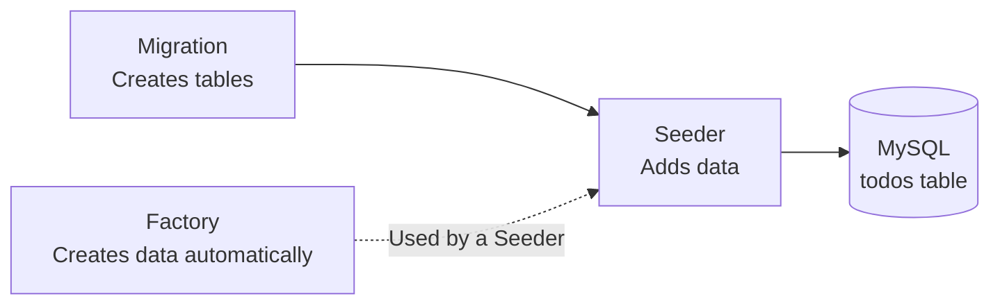
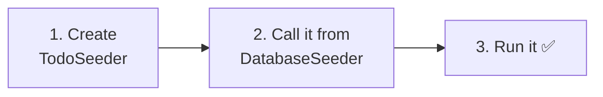
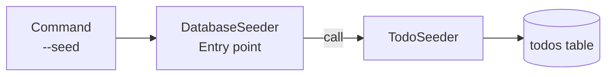
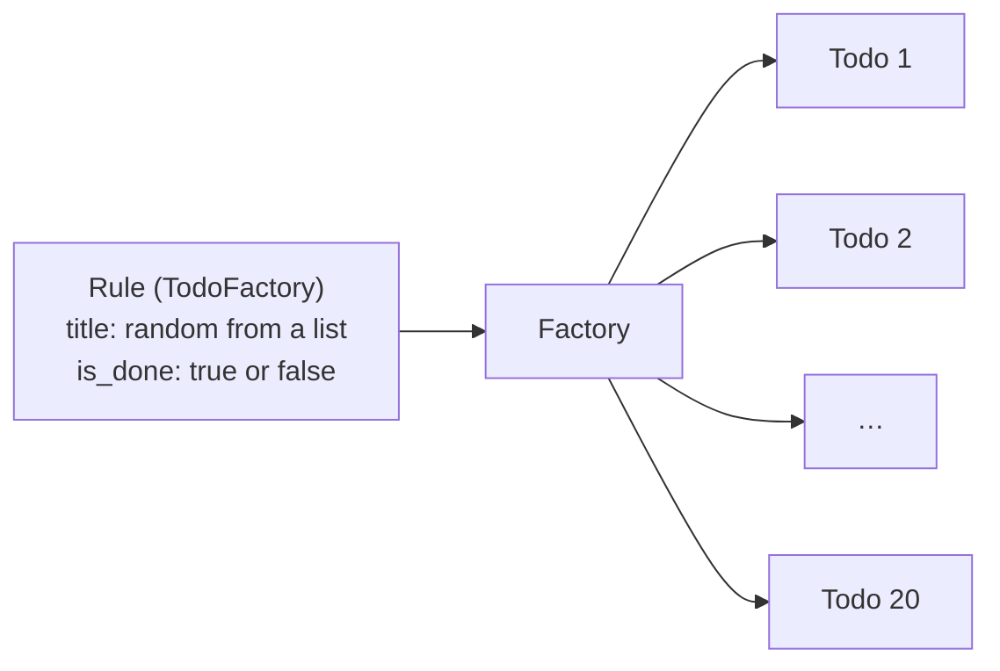
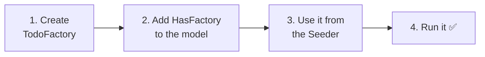
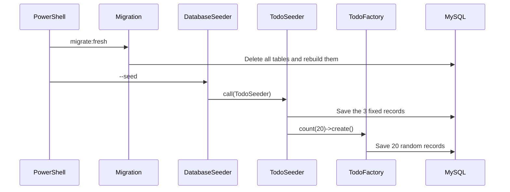
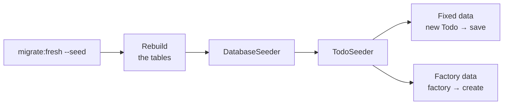

# Getting Started with Laravel — Let's Add Test Data (Seeders and Factories)

> 🇯🇵 Original (Japanese version): [20261105_資料_1.md](<../../../1年生_データ設計とアプリ開発/後期/20261105/20261105_資料_1.md>) <!-- original-ja-link -->

Until now, we have been adding Todo data by typing it into phpMyAdmin one record at a time, or by using the form.
Today, we will learn **how to add test data with a single command**.

## Today's goals
- Use a Seeder to add a fixed set of test data
- Use a Factory to create lots of test data automatically
- Use `migrate:fresh --seed` to reset the database to its starting state at any time

> Before you start, launch the mysql and laravel containers in your practice environment (`php-study`).
> Run the commands in PowerShell after moving into the **laravel folder**.

---

## 1. Why do we need a way to add test data?

Have you ever run into situations like these?

```
Student A: "I was practicing deleting, and now all my Todos are gone. Do I have to type them in again...?"
Student B: "I want to check how the list page looks, but I only have 3 Todos."
Student C: "My friend's PC has different data from mine."
```

If you add test data **with a program**, here is what changes.

| | Typing into phpMyAdmin | Adding with a program |
|---|---|---|
| Effort to add | Type each record one by one | One command |
| If the data gets deleted | Type it all again | One command restores it |
| If you want 100 records | Very hard | Just change a number |
| Across everyone's PCs | All different | Everyone gets the same data |

In Laravel, we do this with **Seeders** and **Factories**.

---

## 2. Seeders and Factories

A **Seeder** is "something that plants seeds."
It plants the initial data, like seeds, in an empty table.

| Name | Role | Like... |
|------|------|-----------|
| **Migration** | Creates tables (we learned this on 10/15) | Preparing the field |
| **Seeder** | Puts data into tables | Planting seeds |
| **Factory** | Creates lots of data automatically | A machine that makes lots of seeds |



Today, we will build these two things, in this order:

1. Use a **Seeder** to add 3 fixed Todos
2. Use a **Factory** to automatically create and add 20 Todos

The files are located here, inside `src`:

```
src/
└─ database/
    ├─ migrations/ ··········· Table blueprints (made on 10/15)
    ├─ seeders/
    │   ├─ DatabaseSeeder.php ··· Already there. Runs all the Seeders from here
    │   └─ TodoSeeder.php ······· We make this today
    └─ factories/
        └─ TodoFactory.php ······ We make this today
```

---

## 3. Let's add fixed data with a Seeder



### 1. Create TodoSeeder

> You are here: **🟢 1. TodoSeeder** → 2. DatabaseSeeder → 3. Run it

Create the Seeder file with the following command.

```powershell
docker compose exec laravel php artisan make:seeder TodoSeeder
```

This creates `database/seeders/TodoSeeder.php`. Replace its contents with the following.

```php
<?php

namespace Database\Seeders;

use App\Models\Todo;  // ← This line lets us use the Todo model
use Illuminate\Database\Seeder;

class TodoSeeder extends Seeder
{
    public function run(): void
    {
        // Prepare the data you want to add as an array
        $todos = [
            ['title' => '牛乳を買う',     'is_done' => false],
            ['title' => 'レポートを出す', 'is_done' => true],
            ['title' => '宿題をする',     'is_done' => false],
        ];

        // Create and save the Todos one at a time
        foreach ($todos as $data) {
            $todo = new Todo();
            $todo->title = $data['title'];
            $todo->is_done = $data['is_done'];
            $todo->save();
        }
    }
}
```

| Code | Meaning |
|--------|------|
| `run()` | The method that runs when you run the Seeder |
| `$todos = [ ... ]` | An array containing the data you want to add (using the associative arrays we learned about in the first semester) |
| `foreach` | Repeats the loop for each item in the array |
| `new Todo()` to `save()` | Saves one Todo, written the same way as `store` from 10/22 |

In `store`, we used the values received from the form. In the Seeder, we use **the values in the array**. That is the only difference.

---

### 2. Call it from DatabaseSeeder

> You are here: 1. TodoSeeder → **🟢 2. DatabaseSeeder** → 3. Run it

`database/seeders/DatabaseSeeder.php` is the **entry point for Seeders**.
When you run the command that runs Seeders, this file runs first.

When you open it, you will see it already has code that "creates one test user."
We are not using users right now, so replace its contents with the following.

```php
<?php

namespace Database\Seeders;

use Illuminate\Database\Seeder;

class DatabaseSeeder extends Seeder
{
    public function run(): void
    {
        // Run TodoSeeder
        $this->call(TodoSeeder::class);
    }
}
```

`$this->call(TodoSeeder::class)` means "please run `TodoSeeder`."
When you add more Seeders, add another `$this->call(...)` line here for each one.



---

### 3. Run it ✅

> You are here: 1. TodoSeeder → 2. DatabaseSeeder → **🟢 3. Run it**

Run the following command.

```powershell
docker compose exec laravel php artisan migrate:fresh --seed
```

| Part | Meaning |
|------|------|
| `migrate:fresh` | **Deletes all the tables** and rebuilds them with the migrations |
| `--seed` | After rebuilding, adds data with the Seeders |

> ⚠️ **`migrate:fresh` deletes all your data**
> Any Todos you added through phpMyAdmin or the form will all be deleted too.
> This is fine because it is a practice database, but **never use it on a production database**.

✅ **Check 1**: Open http://localhost:8000/todos. If you see 3 Todos, you are good.

✅ **Check 2**: Open the `todos` table in phpMyAdmin.
Because we added the data with `save()`, `created_at` and `updated_at` also have dates and times in them (they were empty when we typed data in by hand).

✅ **Check 3**: Delete a few Todos, then run `migrate:fresh --seed` again.
**You will be back to the original 3 Todos.** Now you can start your practice over any time.

---

## 4. Let's create lots of data with a Factory

You can write 3 records by hand, but 20 or 100 records would be a lot of work.
With a **Factory**, you write just one rule that says "make data like this," and it can create as many records as you want automatically.





### 1. Create TodoFactory

> You are here: **🟢 1. TodoFactory** → 2. HasFactory → 3. Use it from the Seeder → 4. Run it

```powershell
docker compose exec laravel php artisan make:factory TodoFactory
```

This creates `database/factories/TodoFactory.php`. Replace the `definition()` method with the following.

```php
    public function definition(): array
    {
        return [
            'title' => fake()->randomElement([
                '牛乳を買う',
                'レポートを出す',
                '宿題をする',
                '部屋のそうじ',
                '本を返す',
                'ゴミを出す',
            ]),
            'is_done' => fake()->boolean(),
        ];
    }
```

| Code | Meaning |
|--------|------|
| `definition()` | Where you write the rule for "what values to use when creating one Todo" |
| `fake()` | A tool (Faker) that generates random values for test data |
| `fake()->randomElement([...])` | Picks one item at random from the array |
| `fake()->boolean()` | Picks `true` or `false` at random |

We do not write `id`, `created_at`, or `updated_at`, because they are filled in automatically, just like before.

---

### 2. Add HasFactory to the model

> You are here: 1. TodoFactory → **🟢 2. HasFactory** → 3. Use it from the Seeder → 4. Run it

To use a Factory, the model needs a line that says "this model can use a Factory."
Open `app/Models/Todo.php` and add the two lines marked with ★.

```php
<?php

namespace App\Models;

use Illuminate\Database\Eloquent\Factories\HasFactory;  // ★ Added
use Illuminate\Database\Eloquent\Model;

class Todo extends Model
{
    use HasFactory;  // ★ Added
}
```

Now, when you write `Todo::factory()`, you can use `TodoFactory`.
(Laravel automatically finds `TodoFactory` based on the model name `Todo`.)

---

### 3. Use the Factory from the Seeder

> You are here: 1. TodoFactory → 2. HasFactory → **🟢 3. Use it from the Seeder** → 4. Run it

Add the line marked with ★ at the end of `run()` in `database/seeders/TodoSeeder.php`.

```php
    public function run(): void
    {
        $todos = [
            ['title' => '牛乳を買う',     'is_done' => false],
            ['title' => 'レポートを出す', 'is_done' => true],
            ['title' => '宿題をする',     'is_done' => false],
        ];

        foreach ($todos as $data) {
            $todo = new Todo();
            $todo->title = $data['title'];
            $todo->is_done = $data['is_done'];
            $todo->save();
        }

        // ★ Create and save 20 Todos with the Factory
        Todo::factory()->count(20)->create();
    }
```

```
Todo::factory() -> count(20) -> create();
~~~~~~~~~~~~~~~    ~~~~~~~~~    ~~~~~~~~
With TodoFactory   20 records   create and save
```

---

### 4. Run it ✅

> You are here: 1. TodoFactory → 2. HasFactory → 3. Use it from the Seeder → **🟢 4. Run it**

```powershell
docker compose exec laravel php artisan migrate:fresh --seed
```

✅ **Check 1**: Open http://localhost:8000/todos. If you see **23** Todos (the 3 fixed ones + 20 from the Factory), you are good.

✅ **Check 2**: Run `migrate:fresh --seed` one more time.
The first 3 Todos stay the same, but for the 20 made by the Factory, **the titles and done/not-done status change every time you run it**. This is because they are created randomly.



---

## 5. Command summary

| Command | What it does |
|---------|---------|
| `php artisan make:seeder TodoSeeder` | Creates a Seeder file |
| `php artisan make:factory TodoFactory` | Creates a Factory file |
| `php artisan migrate:fresh --seed` | Rebuilds all the tables, then adds data with the Seeders |
| `php artisan db:seed` | Keeps the tables as they are and **adds** data with the Seeders |

> **If you only run `db:seed`, your data keeps growing**
> `db:seed` **adds** data without deleting what is already there. If you run it twice, you will have twice as many Todos.
> When you want to "go back to the starting state," use `migrate:fresh --seed`.

(Run every command with `docker compose exec laravel` in front of it.)

---

## 6. When things go wrong

> **🔥 If it doesn't work, output a log!**
> You can use `Log::info()` inside a Seeder too → [[Important] How to Output Logs](../20261022/【重要】ログの出し方.md)

| Symptom | Where the problem is | What to do |
|------|----------|------|
| `Class "Database\Seeders\Todo" not found` | Seeder | Check that `use App\Models\Todo;` is at the top of `TodoSeeder.php` |
| `Call to undefined method App\Models\Todo::factory()` | Model | Check that you wrote `use HasFactory;` in `Todo.php` (you also need `use Illuminate\...\HasFactory;` at the top) |
| `Class "Database\Factories\TodoFactory" not found` | Factory | Check that `database/factories/TodoFactory.php` exists, and check the file name and class name |
| `Duplicate entry 'test@example.com'` | DatabaseSeeder | You ran `db:seed` twice while the code that creates a test user was still there. Rewrite `DatabaseSeeder.php`, or use `migrate:fresh --seed` |
| You have 2 or 3 times as many Todos | Command | You ran `db:seed` several times. Start over with `migrate:fresh --seed` |
| You ran it, but no Todos were added | DatabaseSeeder | Check that `$this->call(TodoSeeder::class);` is in `DatabaseSeeder.php` |

---

## 7. Summary



| What we wrote today | In a nutshell |
|--------------|-----------|
| `TodoSeeder` | Adds fixed test data |
| `$this->call(...)` in `DatabaseSeeder` | The entry point for Seeders. Runs each Seeder from here |
| `definition()` in `TodoFactory` | The rule for what values to use when creating one record |
| `use HasFactory;` in the model | Lets you use `Todo::factory()` |
| `Todo::factory()->count(20)->create()` | Creates and saves 20 records following the rule |
| `migrate:fresh --seed` | Resets the database to its starting state at any time |

---

## 8. Try more (if you have extra time)

1. Change the number of records the Factory creates to **100**, and see what happens to the list page.
2. Add 5 Todos of your own to the `randomElement` list in the Factory.

<details>
<summary>Hints</summary>

1. Change `count(20)` to `count(100)` in `TodoSeeder.php`, then run `migrate:fresh --seed`.
2. Add items to the `randomElement([...])` array in `TodoFactory.php`, like `'買い物に行く',`.

</details>

<!-- nav:start -->

---

| ⬅️ Previous | 🗺️ Overview | Next ➡️ |
|:--|:--:|--:|
| [10/29 Deleting Todos (DELETE)](../20261029/20261029_資料_3.md) | [Course overview](../../README.md) | [11/05 Validation](20261105_資料_2.md) |

<!-- nav:end -->
