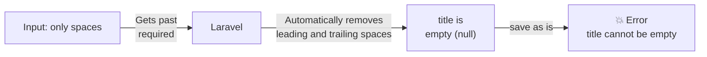
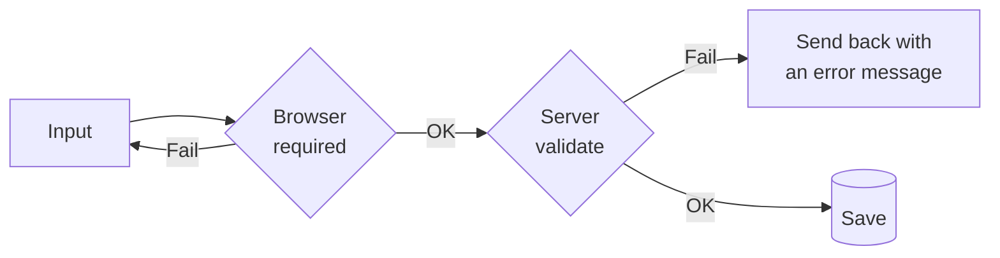
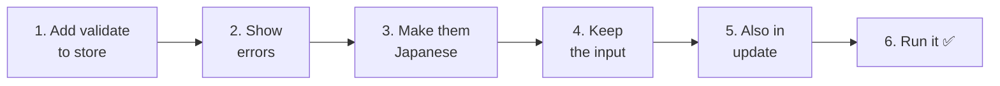
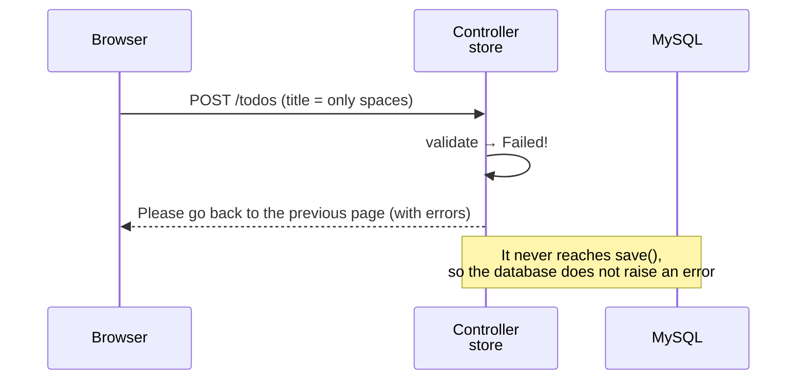
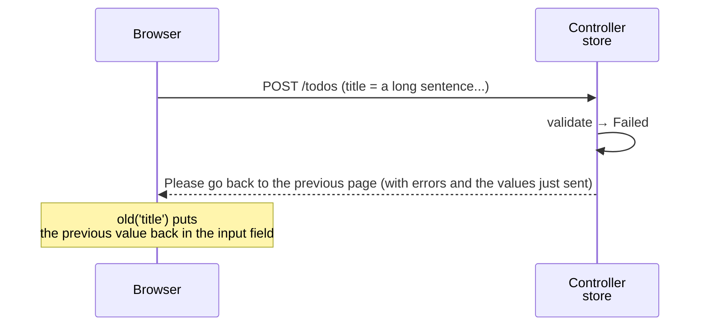
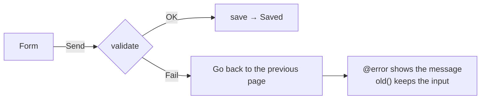

# Getting Started with Laravel — Let's Check the Input (Validation)

> 🇯🇵 Original (Japanese version): [20261105_資料_2.md](<../../../1年生_データ設計とアプリ開発/後期/20261105/20261105_資料_2.md>) <!-- original-ja-link -->

We can now add and edit Todos, but there is actually a problem: **if someone enters something wrong, we get an error screen**.
Today, we will learn about **validation**, which checks the entered values on the server side.

## Today's goals
- Understand why the browser's check (`required`) is not enough
- Check input with `$request->validate()`
- Show error messages on the screen and keep the values the user entered

> We will start from where we finished "Editing Todos" on 10/29.

---

## 1. Try it: what happens if you add only spaces...?

Open http://localhost:8000/todos, type **only regular spaces** into the input field, and click `追加`.

```
SQLSTATE[23000]: Integrity constraint violation: 1048 Column 'title' cannot be null
```

We got an error screen. What happened?



1. HTML's `required` only checks "whether something was entered." Spaces count as "something entered," so they get through
2. Laravel **automatically removes spaces at the beginning and end** of the values it receives (we learned this on 10/22). As a result, the title becomes empty (`null`)
3. The `title` column in the `todos` table cannot be empty, so we get an error when saving

Also, with the browser's developer tools (F12), someone could even remove `required` and submit the form.

---

## 2. What is validation?

**Validation** means "checking whether the entered values are correct **before saving them**."

You can check in two places: the browser and the server.

| | Checking in the browser | Checking on the server (validation) |
|---|---|---|
| Where you write it | HTML (`required`, etc.) | Controller (`$request->validate()`) |
| Strengths | Tells you right away, before sending | **Cannot be bypassed** |
| Weaknesses | Can be removed with developer tools, and spaces alone get through | The data has to be sent to the server first |



The browser check is "a convenience for the user," and the server check is "the lock that protects the app."
Remember: **always write the server check**.

---

## 3. Let's build it



You will work on these 3 files (inside `src`).

```
src/
├─ app/Http/Controllers/
│   └─ TodoController.php ············· 1, 3, 5. Add validate
└─ resources/views/todos/
    ├─ index.blade.php ················ 2, 4. Add error display and old()
    └─ edit.blade.php ················· 5. Add error display and old()
```

---

### 1. Add validate to store (C)

> You are here: **🟢 1. validate** → 2. Show errors → 3. Japanese → 4. Keep the input → 5. Also in update → 6. Run it

At the **very beginning** of the `store` method in `app/Http/Controllers/TodoController.php`, add the part marked with ★.

```php
    public function store(Request $request)
    {
        // ★ Check the input
        $request->validate([
            'title' => 'required|max:255',
        ]);

        $todo = new Todo();
        $todo->title = $request->input('title');
        $todo->save();

        return redirect('/todos');
    }
```

| Code | Meaning |
|--------|------|
| `$request->validate([...])` | Checks the values that were sent |
| `'title' => ...` | Checks the value from the form's `name="title"` |
| `required` | Must not be empty (only spaces also counts as empty, because Laravel removes them) |
| `max:255` | Up to 255 characters (because the `title` column is `VARCHAR(255)`) |
| `\|` | Separates rules. It means "`required` and `max:255`" |

**If the check fails, the code stops there, and the user is automatically sent back to the input page.** The `save()` below it does not run.



✅ **Check**: Try clicking `追加` with only spaces again.
You will not get an error screen, and you will go back to the list page. No Todo is added either.
...But **the screen does not tell you why you were sent back**. Next, we will show an error message.

---

### 2. Show the error message (V)

> You are here: 1. validate → **🟢 2. Show errors** → 3. Japanese → 4. Keep the input → 5. Also in update → 6. Run it

Add the part marked with ★ to the form in `resources/views/todos/index.blade.php`.

```html
    <form method="POST" action="/todos">
        @csrf
        <input type="text" name="title" placeholder="新しいTODOを入力" required>
        <button type="submit">追加</button>

        {{-- ★ Start of added code --}}
        @error('title')
            <p style="color: red;">{{ $message }}</p>
        @enderror
        {{-- ★ End of added code --}}
    </form>
```

| Code | Meaning |
|--------|------|
| `@error('title')` to `@enderror` | Shows what is inside only when the `title` check fails |
| `{{ $message }}` | The error message |

✅ **Check**: When you click `追加` with only spaces, you will see this in red text.

```
The title field is required.
```

The message came out in English. Next, we will change it to Japanese.

---

### 3. Change the error message to Japanese (C)

> You are here: 1. validate → 2. Show errors → **🟢 3. Japanese** → 4. Keep the input → 5. Also in update → 6. Run it

Add **an array of messages** as the second argument of `validate`.

```php
        $request->validate([
            'title' => 'required|max:255',
        ], [
            'title.required' => 'タイトルを入力してください。',        // ★ Added
            'title.max' => 'タイトルは255文字以内で入力してください。',  // ★ Added
        ]);
```

| Code | Meaning |
|--------|------|
| `'title.required' => '...'` | The message shown when `title` fails `required` |
| `'title.max' => '...'` | The message shown when `title` fails `max` |

Using the format `'field_name.rule'`, you can set a message for each rule.

✅ **Check**: When you click `追加` with only spaces, you should see "タイトルを入力してください。" ("Please enter a title.").

---

### 4. Keep the entered value (V)

> You are here: 1. validate → 2. Show errors → 3. Japanese → **🟢 4. Keep the input** → 5. Also in update → 6. Run it

When the user is sent back because of an error, the input field becomes empty.
If they had typed a long sentence, they would have to type it all again from the beginning.

Add the `value` marked with ★ to the `<input>` in `index.blade.php`.

```html
        <input type="text" name="title" value="{{ old('title') }}" placeholder="新しいTODOを入力" required>
        {{--                            ~~~~~~~~~~~~~~~~~~~~~~~~~ ★ Added --}}
```

`old('title')` is "**the `title` value that was just sent**."
When the user is sent back because of an error, you can put that value back into the input field.

When sending the user back, Laravel also remembers "the values that were just sent," so you can get them with `old()`.



---

### 5. Add validation to update too

> You are here: 1. validate → 2. Show errors → 3. Japanese → 4. Keep the input → **🟢 5. Also in update** → 6. Run it

When editing, saving with only spaces causes the same error.
Add the same `validate` as in `store` to `update` in `TodoController.php` too.

```php
    public function update(Request $request, $id)
    {
        // ★ The same check as store
        $request->validate([
            'title' => 'required|max:255',
        ], [
            'title.required' => 'タイトルを入力してください。',
            'title.max' => 'タイトルは255文字以内で入力してください。',
        ]);

        $todo = Todo::findOrFail($id);
        $todo->title = $request->input('title');
        $todo->is_done = $request->has('is_done');
        $todo->save();

        return redirect('/todos/' . $todo->id);
    }
```

Also update the form in `resources/views/todos/edit.blade.php` as marked with ★.

```html
    <form method="POST" action="/todos/{{ $todo->id }}">
        @csrf
        @method('PUT')
        <input type="text" name="title" value="{{ old('title', $todo->title) }}" required>  {{-- ★ Use old --}}
        <label>
            <input type="checkbox" name="is_done" value="1" @checked($todo->is_done)>
            完了
        </label>
        <button type="submit">保存</button>

        {{-- ★ Start of added code --}}
        @error('title')
            <p style="color: red;">{{ $message }}</p>
        @enderror
        {{-- ★ End of added code --}}
    </form>
```

`old('title', $todo->title)` means "use the value that was just sent if there is one, **otherwise use the current title**."

| Situation | What goes in the input field |
|------|----------------|
| When you first open the edit page | The current title (`$todo->title`) |
| When you are sent back because of an error | The value you just sent (`old('title')`) |

---

### 6. Run it ✅

> You are here: 1. validate → 2. Show errors → 3. Japanese → 4. Keep the input → 5. Also in update → **🟢 6. Run it**

Try these 4 things.

| | What to do | Expected result |
|---|---|---|
| ① | On the add form, enter only spaces and click `追加` | "タイトルを入力してください。" appears, and no Todo is added |
| ② | On the add form, enter a normal Todo and click `追加` | It is added, just like before |
| ③ | On the edit page, change the title to only spaces and click `保存` | You go back to the edit page, and "タイトルを入力してください。" appears |
| ④ | In the developer tools (F12), remove `required` from the `<input>`, leave it empty, and click `追加` | Even without the browser check, the server check stops it |

> **How to do ④**
> 1. Right-click the input field → "Inspect"
> 2. In the developer tools, double-click `required` in `<input ... required>` and delete it
> 3. Leave the input field empty and click `追加`

✅ If "タイトルを入力してください。" appears in ④, you have confirmed that **even if someone gets past the browser check, the app is still protected**.

---

## 4. When things go wrong

> **🔥 If it doesn't work, output a log!** → [[Important] How to Output Logs](../20261022/【重要】ログの出し方.md)
> However, failed validation is not written to the log (because it is normal behavior, not an error).

| Symptom | Where the problem is | What to do |
|------|----------|------|
| Sending only spaces still gives `Column 'title' cannot be null` | Controller | Check that you wrote `validate` **before** `save()` |
| You are sent back, but no message appears | View | Check that you wrote `@error('title')` to `@enderror`, and check the spelling of `'title'` |
| The message is still in English | Controller | Check the spelling of `'title.required'` (joined with `.`) |
| The input field is empty when you are sent back | View | Check that you wrote `value="{{ old('title') }}"` |
| The input field is empty when you open the edit page | View | Check that you wrote the second argument (`$todo->title`) in `old('title', $todo->title)` |
| Editing the title to only spaces gives an error screen | Controller | Check that you also wrote `validate` in `update` |

---

## 5. Summary



| What we wrote today | In a nutshell |
|--------------|-----------|
| `$request->validate([...])` | Checks the input on the server before saving |
| `'required\|max:255'` | Must not be empty, up to 255 characters |
| `'title.required' => '...'` | Changes the error message to Japanese |
| `@error('title')` to `@enderror` | Shows the error message |
| `old('title')` | Keeps the previous input when you are sent back because of an error |

**The browser check is a convenience; the server check is the lock. Always write the server check.**

---

## 6. Try more (if you have extra time)

Limit the title to **20 characters**. When someone tries to add a Todo with 21 or more characters, show "タイトルは20文字以内で入力してください。" ("Please enter a title of 20 characters or less.").

<details>
<summary>Hints</summary>

In both `store` and `update`, change `max:255` to `max:20`, and change the message to say "20文字以内" (20 characters or less) too.

```php
        $request->validate([
            'title' => 'required|max:20',
        ], [
            'title.required' => 'タイトルを入力してください。',
            'title.max' => 'タイトルは20文字以内で入力してください。',
        ]);
```

</details>

<!-- nav:start -->

---

| ⬅️ Previous | 🗺️ Overview | Next ➡️ |
|:--|:--:|--:|
| [11/05 Seeders and Factories](20261105_資料_1.md) | [Course overview](../../README.md) | [11/12 Turning shared parts into components (@include)](../20261112/20261112_資料_1.md) |

<!-- nav:end -->
