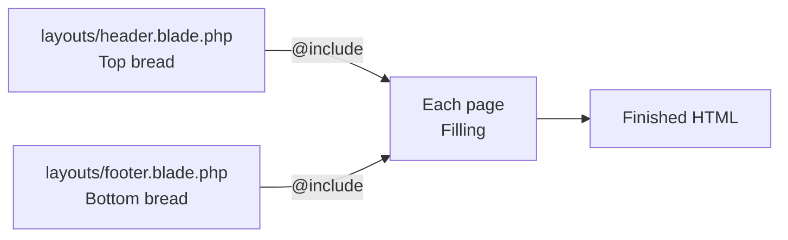
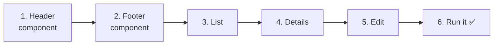
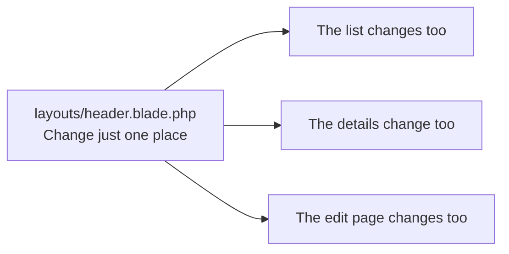
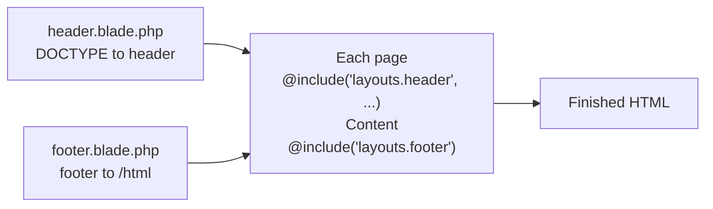

# Getting Started with Laravel — Let's Turn Shared Parts into Components (@include)

> 🇯🇵 Original (Japanese version): [20261112_資料_1.md](<../../../1年生_データ設計とアプリ開発/後期/20261112/20261112_資料_1.md>) <!-- original-ja-link -->

We now have 3 pages: the list, details, and edit pages.
But we are writing **the same HTML** over and over in every file. Today, we will learn how to move those shared parts into **component files** and load them.

## Today's goals
- Understand the benefits of turning shared parts into components
- Move the header and footer into component files and load them with `@include`
- Pass a value to `@include` to change the title for each page
- Confirm that changing a component in one place changes every page

> We will start from where we finished "Validation" on 11/5.

---

## 1. We are writing the same HTML again and again

Let's compare our current 3 views.

```
index.blade.php (List)        show.blade.php (Details)      edit.blade.php (Edit)
┌─────────────────────────┐   ┌─────────────────────────┐   ┌─────────────────────────┐
│ <!DOCTYPE html>         │   │ <!DOCTYPE html>         │   │ <!DOCTYPE html>         │
│ <html lang="ja">        │   │ <html lang="ja">        │   │ <html lang="ja">        │
│ <head>                  │   │ <head>                  │   │ <head>                  │
│   <meta charset=...>    │   │   <meta charset=...>    │   │   <meta charset=...>    │
│   <title>TODOアプリ     │   │   <title>TODOの詳細     │   │   <title>TODOの編集     │
│ </head>                 │   │ </head>                 │   │ </head>                 │
│ <body>                  │   │ <body>                  │   │ <body>                  │
│ ┌─────────────────────┐ │   │ ┌─────────────────────┐ │   │ ┌─────────────────────┐ │
│ │ List content        │ │   │ │ Details content     │ │   │ │ Edit content        │ │
│ └─────────────────────┘ │   │ └─────────────────────┘ │   │ └─────────────────────┘ │
│ </body>                 │   │ </body>                 │   │ </body>                 │
│ </html>                 │   │ </html>                 │   │ </html>                 │
└─────────────────────────┘   └─────────────────────────┘   └─────────────────────────┘
```

The only things that differ between pages are **the `<title>` and the content inside `<body>`**. Everything else is the same in all 3.

When you write the same thing many times, problems like these happen.

```
Student A: "I want to add a 'TODOアプリ' link at the top of every page. Do I have to edit all 3 files...?"
Student B: "I added a footer to the bottom of every page, but I forgot to add it to the details page."
Student C: "If we get up to 10 pages, I'll have to make the same change in 10 places."
```

---

## 2. Turning shared parts into "components"

So, we split the shared parts into 2 component files: the **top half** and the **bottom half**.
Each page then just **loads** the top half at the beginning and the bottom half at the end.

```
layouts/header.blade.php (top-half component)
┌─────────────────────────┐
│ <!DOCTYPE html>         │
│ <html> <head> … </head> │
│ <body>                  │
│ <header>…</header>      │ ← The part shown at the top of the screen
└─────────────────────────┘
            ＋
todos/index.blade.php (each page)
┌─────────────────────────┐
│ Only the list content   │
└─────────────────────────┘
            ＋
layouts/footer.blade.php (bottom-half component)
┌─────────────────────────┐
│ <footer>…</footer>      │ ← The part shown at the bottom of the screen
│ </body>                 │
│ </html>                 │
└─────────────────────────┘
```

Think of it like a **sandwich**.
The top slice of bread (header) and the bottom slice (footer) are always the same, and only the filling in between (each page's content) changes.

To load a component, use Blade's **`@include`**.

| How to write it | Meaning |
|--------|------|
| `@include('layouts.header')` | **Puts the contents** of `resources/views/layouts/header.blade.php` **right here, as is** |
| `@include('layouts.header', ['title' => '一覧'])` | When adding the component, passes "一覧" (List) under the name `$title` |



> **`<head>` and `<header>` are different things**
> Their names are similar, but they have different roles.
>
> | Tag | Role | Visible on screen? |
> |------|------|-------------|
> | `<head>` | Information about the page (character encoding, tab title, etc.). It is for the browser | Not visible |
> | `<header>` | The part shown at the top of the page (app name, menu, etc.) | Visible |
>
> Today's `header.blade.php` will contain **both** of these.

---

## 3. Let's build it



You will work on these 5 files (inside `src`).

```
src/
└─ resources/views/
    ├─ layouts/
    │   ├─ header.blade.php ········· 1. Header component (new)
    │   └─ footer.blade.php ········· 2. Footer component (new)
    └─ todos/
        ├─ index.blade.php ·········· 3. Rewrite it to load the components
        ├─ show.blade.php ··········· 4. Rewrite it to load the components
        └─ edit.blade.php ··········· 5. Rewrite it to load the components
```

---

### 1. Create the header component

> You are here: **🟢 1. Header** → 2. Footer → 3. List → 4. Details → 5. Edit → 6. Run it

Create a `layouts` folder inside `resources/views`, and create a file named `header.blade.php`.

```html
<!DOCTYPE html>
<html lang="ja">
<head>
    <meta charset="UTF-8">
    <title>{{ $title }} | TODOアプリ</title>
</head>
<body>
    <header>
        <a href="/todos">TODOアプリ</a>
    </header>
```

| Code | Meaning |
|--------|------|
| `{{ $title }}` | Filled in with the title passed from each page. It is shown on the browser tab |
| `<header>` to `</header>` | The part shown at the top of every page |

Do not write `</body>` and `</html>` here. Write them in the **footer component**.

---

### 2. Create the footer component

> You are here: 1. Header → **🟢 2. Footer** → 3. List → 4. Details → 5. Edit → 6. Run it

In the same `resources/views/layouts` folder, create `footer.blade.php`.

```html
    <footer>
        <p>© 2026 TODOアプリ</p>
    </footer>
</body>
</html>
```

This closes the `<body>` and `<html>` that were opened in the header.

---

### 3. Rewrite the list page

> You are here: 1. Header → 2. Footer → **🟢 3. List** → 4. Details → 5. Edit → 6. Run it

Rewrite `resources/views/todos/index.blade.php` as follows.

```html
@include('layouts.header', ['title' => '一覧'])

    <h1>TODOアプリ</h1>

    <form method="POST" action="/todos">
        @csrf
        <input type="text" name="title" value="{{ old('title') }}" placeholder="新しいTODOを入力" required>
        <button type="submit">追加</button>

        @error('title')
            <p style="color: red;">{{ $message }}</p>
        @enderror
    </form>

    <ul>
        @foreach ($todos as $todo)
            <li>
                <form method="POST" action="/todos/{{ $todo->id }}/toggle" style="display: inline;">
                    @csrf
                    @method('PATCH')
                    <input type="checkbox" name="is_done" value="1" onchange="this.form.submit()" @checked($todo->is_done)>
                </form>
                <a href="/todos/{{ $todo->id }}">{{ $todo->title }}</a>
            </li>
        @endforeach
    </ul>

@include('layouts.footer')
```

Compared with before the rewrite, here is what changed.

| | Before | After |
|---|---|---|
| `<!DOCTYPE html>` to `<body>` | Written out | Replaced with one line: `@include('layouts.header', ['title' => '一覧'])` |
| Content inside `<body>` | Unchanged | Unchanged |
| `</body>` `</html>` | Written out | Replaced with one line: `@include('layouts.footer')` |

`['title' => '一覧']` has the same form as `view('todos.index', ['todos' => $todos])`, which we wrote in the controller.
Inside the component, you can use "一覧" under the name `$title`.

✅ **Check**: Open http://localhost:8000/todos. You are good if you see a "TODOアプリ" link above the list and "© 2026 TODOアプリ" below it.
Also check that the browser tab shows "一覧 | TODOアプリ".

---

### 4. Rewrite the details page

> You are here: 1. Header → 2. Footer → 3. List → **🟢 4. Details** → 5. Edit → 6. Run it

Rewrite `resources/views/todos/show.blade.php` as follows.

```html
@include('layouts.header', ['title' => $todo->title])

    <h1>{{ $todo->title }}</h1>

    <p>番号：{{ $todo->id }}</p>

    <p>
        状態：
        @if ($todo->is_done)
            完了 ✅
        @else
            未完了
        @endif
    </p>

    <a href="/todos/{{ $todo->id }}/edit">編集</a>

    <form method="POST" action="/todos/{{ $todo->id }}" onsubmit="return confirm('削除しますか？');">
        @csrf
        @method('DELETE')
        <button type="submit">削除</button>
    </form>

    <a href="/todos">一覧にもどる</a>

@include('layouts.footer')
```

You can also pass **variables**, like `['title' => $todo->title]`.
On the details page for "牛乳を買う", the tab will show "牛乳を買う | TODOアプリ".

✅ **Check**: Click a Todo in the list. You are good if the header and footer also appear on the details page.

---

### 5. Rewrite the edit page

> You are here: 1. Header → 2. Footer → 3. List → 4. Details → **🟢 5. Edit** → 6. Run it

Rewrite `resources/views/todos/edit.blade.php` as follows.

```html
@include('layouts.header', ['title' => '編集'])

    <h1>TODOの編集</h1>

    <form method="POST" action="/todos/{{ $todo->id }}">
        @csrf
        @method('PUT')
        <input type="text" name="title" value="{{ old('title', $todo->title) }}" required>
        <label>
            <input type="checkbox" name="is_done" value="1" @checked($todo->is_done)>
            完了
        </label>
        <button type="submit">保存</button>

        @error('title')
            <p style="color: red;">{{ $message }}</p>
        @enderror
    </form>

    <a href="/todos/{{ $todo->id }}">もどる</a>

@include('layouts.footer')
```

✅ **Check**: Click "編集" on the details page. You are good if the header and footer also appear on the edit page.

---

### 6. Run it ✅: What happens when you change a component in one place?

> You are here: 1. Header → 2. Footer → 3. List → 4. Details → 5. Edit → **🟢 6. Run it**

Now for the best part of using components.
Open **only** `layouts/header.blade.php`, and change "TODOアプリ" to "わたしのTODO".

```html
    <header>
        <a href="/todos">わたしのTODO</a>  {{-- ★ Changed --}}
    </header>
```

✅ **Check**: Reload **all 3 pages**: the list, details, and edit pages.
If the header has changed to "わたしのTODO" on **every page**, you have succeeded.



Without components, you would have had to edit all 3 files.
**Change one place, and every page changes.** That is the power of components.

---

## 4. When things go wrong

> **🔥 If it doesn't work, output a log!** → [[Important] How to Output Logs](../20261022/【重要】ログの出し方.md)

| Symptom | Where the problem is | What to do |
|------|----------|------|
| `View [layouts.header] not found.` | Component | Check the location and file name of `resources/views/layouts/header.blade.php` (`layouts` ends with an `s`. The same goes for `footer`) |
| `Undefined variable $title` | Each page | Check that you did not forget `['title' => ...]` in `@include('layouts.header', ['title' => ...])` |
| The tab title looks wrong | Each page | Check that `'title'` in `['title' => ...]` matches the name in the component's `{{ $title }}` |
| The footer does not appear | Each page | Check that you wrote `@include('layouts.footer')` at the end of the page |
| `<!DOCTYPE html>` appears twice | Each page | Check whether `<!DOCTYPE html>` through `<body>` is still present in each page. If so, delete it because it is already in the header component |

> **`@include` goes in 2 places: the beginning and the end**
> Every page must have both `@include('layouts.header', ...)` and `@include('layouts.footer')`: **one at the beginning and one at the end**.
> If you forget the footer, the HTML will be missing `</body>` and `</html>` (the browser will still display it, but it is not correct HTML).

---

## 5. Summary



| What we wrote today | In a nutshell |
|--------------|-----------|
| `layouts/header.blade.php` | The top half of every page (`<!DOCTYPE html>` to `<header>`) |
| `layouts/footer.blade.php` | The bottom half of every page (`<footer>` to `</html>`) |
| `@include('layouts.header', ['title' => ...])` | Loads the top-half component and passes the title |
| `@include('layouts.footer')` | Loads the bottom-half component |

**Turn shared parts into components. Change one place, and every page changes.**

> **There are other ways to write this**
> Laravel also has `@extends`, `@section`, and `@yield`, which put the whole page "frame" into one file, and another approach called **components**, written like `<x-layout>`.
> If you see them online, just think, "They're doing the same thing in a different way."

<!-- nav:start -->

---

| ⬅️ Previous | 🗺️ Overview | Next ➡️ |
|:--|:--:|--:|
| [11/05 Validation](../20261105/20261105_資料_2.md) | [Course overview](../../README.md) | [11/12 Adding categories](20261112_資料_2.md) |

<!-- nav:end -->
