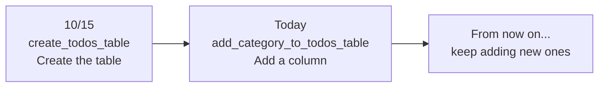
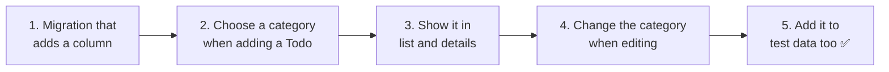
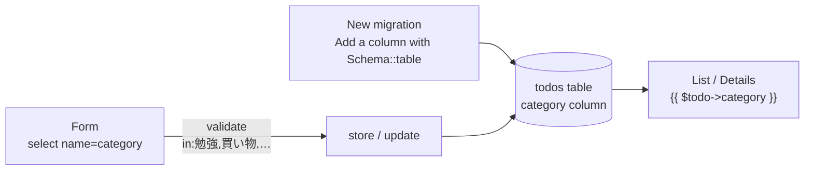

# Getting Started with Laravel — Let's Add Categories to Todos (A Migration That Adds a Column)

> 🇯🇵 Original (Japanese version): [20261112_資料_2.md](<../../../1年生_データ設計とアプリ開発/後期/20261112/20261112_資料_2.md>) <!-- original-ja-link -->

As you get more Todos, you will want to **categorize** them, for example, as "study" or "shopping."
Today, we will make it possible to give Todos a **category**.

## Today's goals
- **Add a column with a migration** to a table that already exists
- Use a select box to choose a category from a fixed set of options
- Use validation (`in`) to reject categories outside the allowed set

> We will start from where we finished "Let's Turn Shared Parts into Components" in [Material 1](./20261112_資料_1.md).

---

## 1. What we will build today

We will **choose from these four categories**.

| Category |
|---------|
| 勉強 (Study) |
| 買い物 (Shopping) |
| 家のこと (Home) |
| その他 (Other) |

```
TODOアプリ

[ 新しいTODOを入力 ] [ 勉強 ▼ ] [追加]

☐ [勉強] レポートを書く
☑ [買い物] 牛乳を買う
☐ [家のこと] 部屋のそうじ
```

We will add one `category` column to the `todos` table.

| id | title | **category** | is_done | created_at | updated_at |
|----|-------|-------------|---------|-----------|-----------|
| 1 | レポートを書く | **勉強** | 0 | … | … |
| 2 | 牛乳を買う | **買い物** | 1 | … | … |

---

## 2. Something new: a migration that adds a column

On 10/15, we **created** the `todos` table with a migration.
Today, we will **add a column** to the `todos` table that already exists.

There is an important rule here.

> **Never rewrite a migration that has already been run. Add a new migration instead.**



Even if you add `category` to the 10/15 migration (`create_todos_table`), **it has already been run, so running `migrate` will not apply it**.
Migrations are a **record (diary) of changes** to your tables. You do not rewrite earlier diary entries; instead, you write "today I added a column" on a new page.

| | Creating the table (10/15) | Adding a column (today) |
|---|---|---|
| File name | `create_todos_table` | `add_category_to_todos_table` |
| Contents | `Schema::create('todos', ...)` | `Schema::table('todos', ...)` |
| Meaning | Creates a new table | Changes a table that already exists |

---

## 3. Let's build it



You will work on these files (inside `src`).

```
src/
├─ database/
│   ├─ migrations/
│   │   └─ xxxx_add_category_to_todos_table.php ··· 1. Create a new one
│   ├─ seeders/TodoSeeder.php ····················· 5. Add categories
│   └─ factories/TodoFactory.php ·················· 5. Add categories
├─ resources/views/todos/
│   ├─ index.blade.php ···························· 2, 3. Select box and display
│   ├─ show.blade.php ····························· 3. Display
│   └─ edit.blade.php ····························· 4. Select box
└─ app/Http/Controllers/
    └─ TodoController.php ························· 2, 4. store and update
```

---

### 1. Create a migration that adds a column

> You are here: **🟢 1. Migration** → 2. Adding → 3. Display → 4. Editing → 5. Test data

Create the migration file with the following command.

```powershell
docker compose exec laravel php artisan make:migration add_category_to_todos_table
```

If you name it `add_XX_to_YY_table`, Laravel understands that "this changes the `YY` table" and creates a template for you.

This creates `2026_11_12_xxxxxx_add_category_to_todos_table.php` in `database/migrations/`. Fill in `up()` and `down()` as follows.

```php
    public function up(): void
    {
        Schema::table('todos', function (Blueprint $table) {
            $table->string('category')->default('その他')->after('title');
        });
    }

    public function down(): void
    {
        Schema::table('todos', function (Blueprint $table) {
            $table->dropColumn('category');
        });
    }
```

| Code | Meaning |
|--------|------|
| `Schema::table('todos', ...)` | Changes the existing `todos` table (use `Schema::create` when creating one) |
| `$table->string('category')` | Adds a text column named `category` |
| `->default('その他')` | Uses "その他" (Other) when nothing is entered |
| `->after('title')` | Adds it after the `title` column (to make it easier to read in phpMyAdmin) |
| `up()` | What happens when you run `migrate` (adds the column) |
| `down()` | What happens when you undo it (removes the column) |

> **Why do we add `default('その他')`?**
> The `todos` table already has some Todos in it.
> When we add the column, what should go in `category` for the existing Todos? With `default`, all the existing Todos become "その他."

After saving, run the migration.

```powershell
docker compose exec laravel php artisan migrate
```

✅ **Check**: Open the `todos` table in phpMyAdmin.
You are good if there is a `category` column after `title`, and all the existing Todos are set to "その他."
**Your existing Todos have not been deleted.** This is because `migrate` only runs the migrations that have not been run yet (just today's one).

| Command | What it does | Existing data |
|---------|---------|------------|
| `migrate` | Runs only the migrations that have not been run yet | **Kept** |
| `migrate:fresh` | Deletes all the tables and runs every migration from the beginning | Deleted |

---

### 2. Choose a category when adding a Todo

> You are here: 1. Migration → **🟢 2. Adding** → 3. Display → 4. Editing → 5. Test data

#### ① Add a select box to the add form (V)

Add the select box marked with ★ to the add form in `resources/views/todos/index.blade.php`.

```html
    <form method="POST" action="/todos">
        @csrf
        <input type="text" name="title" value="{{ old('title') }}" placeholder="新しいTODOを入力" required>

        {{-- ★ Start of addition --}}
        <select name="category">
            <option value="勉強">勉強</option>
            <option value="買い物">買い物</option>
            <option value="家のこと">家のこと</option>
            <option value="その他">その他</option>
        </select>
        {{-- ★ End of addition --}}

        <button type="submit">追加</button>

        @error('title')
            <p style="color: red;">{{ $message }}</p>
        @enderror
    </form>
```

| Code | Meaning |
|--------|------|
| `<select name="category">` | Sends the selected option under the name `category` |
| `<option value="勉強">勉強</option>` | An option. The `value` is what gets sent |

#### ② Save the category in store too (C)

Add the parts marked with ★ to `store` in `app/Http/Controllers/TodoController.php`.

```php
    public function store(Request $request)
    {
        $request->validate([
            'title' => 'required|max:255',
            'category' => 'required|in:勉強,買い物,家のこと,その他',  // ★ Added
        ], [
            'title.required' => 'タイトルを入力してください。',
            'title.max' => 'タイトルは255文字以内で入力してください。',
            'category.required' => 'カテゴリを選んでください。',           // ★ Added
            'category.in' => 'カテゴリは、リストの中から選んでください。',  // ★ Added
        ]);

        $todo = new Todo();
        $todo->title = $request->input('title');
        $todo->category = $request->input('category');  // ★ Added
        $todo->save();

        return redirect('/todos');
    }
```

| Code | Meaning |
|--------|------|
| `'category' => 'required\|in:勉強,買い物,家のこと,その他'` | `category` must be **one of** these 4 |
| `$todo->category = $request->input('category')` | Sets the selected category |

> **It is a select box, so why check it with `in`?**
> The select box only has 4 options, but as we learned on 11/5, **the browser's checks can be bypassed**.
> Someone could use the developer tools to change `<option value="勉強">` to `<option value="ゲーム">` and send it.
> The server-side `in` rejects anything other than the 4 allowed values.

---

### 3. Show the category in the list and details

> You are here: 1. Migration → 2. Adding → **🟢 3. Display** → 4. Editing → 5. Test data

#### ① List (V)

Add the part marked with ★ inside the `<li>` in `index.blade.php`.

```html
            <li>
                <form method="POST" action="/todos/{{ $todo->id }}/toggle" style="display: inline;">
                    @csrf
                    @method('PATCH')
                    <input type="checkbox" name="is_done" value="1" onchange="this.form.submit()" @checked($todo->is_done)>
                </form>
                [{{ $todo->category }}]  {{-- ★ Added --}}
                <a href="/todos/{{ $todo->id }}">{{ $todo->title }}</a>
            </li>
```

#### ② Details (V)

Add the line marked with ★ below the "番号" (number) line in `show.blade.php`.

```html
    <p>番号：{{ $todo->id }}</p>

    <p>カテゴリ：{{ $todo->category }}</p>  {{-- ★ Added --}}
```

✅ **Check**: Choose a category on the list page and add a Todo.
You are good if the list shows something like `[勉強] レポートを書く`, and the details page also shows "カテゴリ：勉強."

---

### 4. Change the category when editing a Todo

> You are here: 1. Migration → 2. Adding → 3. Display → **🟢 4. Editing** → 5. Test data

#### ① Add a select box to the edit form (V)

Add the select box marked with ★ to the form in `edit.blade.php`.

```html
    <form method="POST" action="/todos/{{ $todo->id }}">
        @csrf
        @method('PUT')
        <input type="text" name="title" value="{{ old('title', $todo->title) }}" required>

        {{-- ★ Start of addition --}}
        <select name="category">
            <option value="勉強" @selected($todo->category === '勉強')>勉強</option>
            <option value="買い物" @selected($todo->category === '買い物')>買い物</option>
            <option value="家のこと" @selected($todo->category === '家のこと')>家のこと</option>
            <option value="その他" @selected($todo->category === 'その他')>その他</option>
        </select>
        {{-- ★ End of addition --}}

        <label>
            <input type="checkbox" name="is_done" value="1" @checked($todo->is_done)>
            完了
        </label>
        <button type="submit">保存</button>

        @error('title')
            <p style="color: red;">{{ $message }}</p>
        @enderror
    </form>
```

| Code | Meaning |
|--------|------|
| `@selected($todo->category === '勉強')` | If the current category is "勉強," this option is selected from the start |

`@selected` is the select-box version of the checkbox's `@checked`.
It adds `selected` to the `<option>` only when what is inside the `( )` is `true`.

#### ② Save the category in update too (C)

Add the parts marked with ★ to `update` in `TodoController.php`, the same way as in `store`.

```php
    public function update(Request $request, $id)
    {
        $request->validate([
            'title' => 'required|max:255',
            'category' => 'required|in:勉強,買い物,家のこと,その他',  // ★ Added
        ], [
            'title.required' => 'タイトルを入力してください。',
            'title.max' => 'タイトルは255文字以内で入力してください。',
            'category.required' => 'カテゴリを選んでください。',           // ★ Added
            'category.in' => 'カテゴリは、リストの中から選んでください。',  // ★ Added
        ]);

        $todo = Todo::findOrFail($id);
        $todo->title = $request->input('title');
        $todo->category = $request->input('category');  // ★ Added
        $todo->is_done = $request->has('is_done');
        $todo->save();

        return redirect('/todos/' . $todo->id);
    }
```

✅ **Check**: Open the edit page and make sure the current category is already selected.
Change the category and click `保存`. You are good if the category on the details page changes.

---

### 5. Add categories to the test data too

> You are here: 1. Migration → 2. Adding → 3. Display → 4. Editing → **🟢 5. Test data**

Let's also add categories to the Seeder and Factory we made on 11/5.

#### ① TodoSeeder (fixed data)

Add the parts marked with ★ to the array and the `foreach` in `database/seeders/TodoSeeder.php`.

```php
        $todos = [
            ['title' => '牛乳を買う',     'category' => '買い物', 'is_done' => false],  // ★ Added category
            ['title' => 'レポートを出す', 'category' => '勉強',   'is_done' => true],   // ★
            ['title' => '宿題をする',     'category' => '勉強',   'is_done' => false],  // ★
        ];

        foreach ($todos as $data) {
            $todo = new Todo();
            $todo->title = $data['title'];
            $todo->category = $data['category'];  // ★ Added
            $todo->is_done = $data['is_done'];
            $todo->save();
        }
```

#### ② TodoFactory (automatically created data)

Add the line marked with ★ to `definition()` in `database/factories/TodoFactory.php`.

```php
        return [
            'title' => fake()->randomElement([
                '牛乳を買う',
                'レポートを出す',
                '宿題をする',
                '部屋のそうじ',
                '本を返す',
                'ゴミを出す',
            ]),
            'category' => fake()->randomElement(['勉強', '買い物', '家のこと', 'その他']),  // ★ Added
            'is_done' => fake()->boolean(),
        ];
```

```powershell
docker compose exec laravel php artisan migrate:fresh --seed
```

✅ **Check**: Open the list. You are good if each of the 23 Todos has a category.
`migrate:fresh` runs every migration from the beginning, so **today's migration runs along with them**.

---

## 4. When things go wrong

> **🔥 If it doesn't work, output a log!** → [[Important] How to Output Logs](../20261022/【重要】ログの出し方.md)

| Symptom | Where the problem is | What to do |
|------|----------|------|
| `Unknown column 'category'` | Migration | Check that you ran `php artisan migrate` |
| Running `migrate` does not create the `category` column | Migration | Check that you did not add it to the 10/15 migration (write it in a **new migration**) |
| "カテゴリは、リストの中から選んでください。" appears | View / Controller | Check that the category names in `<option value="...">` and `in:...` match **exactly, character for character** |
| You added a Todo, but every category becomes "その他" | Controller | Check that `store` has `$todo->category = $request->input('category');` |
| The current category is not selected on the edit page | View | Check that you wrote `@selected($todo->category === '...')`, and check the category names |

---

## 5. Summary



| What we wrote today | In a nutshell |
|--------------|-----------|
| `make:migration add_category_to_todos_table` | Creates a migration that adds a column to an existing table |
| `Schema::table(...)` and `->default(...)` | Adds a column. Existing data gets the `default` value |
| `php artisan migrate` | Runs only the migrations that have not been run yet (data is kept) |
| `<select>` and `<option>` | Choose from a fixed set of options |
| `@selected(...)` | Selects the current value from the start (the select-box version of `@checked`) |
| `'in:勉強,買い物,…'` | Rejects anything other than the allowed values on the server side |

**Never rewrite a migration that has already been run. Add changes with a new migration.**

---

## 6. Try more (if you have extra time)

Add "部活" (Club activities) as a category.
Think about which files you need to change on your own.

<details>
<summary>Hints</summary>

Add "部活" in these **4 places**.

1. The `<option>` in the add form in `index.blade.php`
2. The `<option>` in the edit form in `edit.blade.php` (including `@selected`)
3. The `in:...` in `store` in `TodoController.php`
4. The `in:...` in `update` in `TodoController.php`

(If you also want the Factory to create "部活," add it to `randomElement` in `TodoFactory.php` too.)

Did you notice that we are **writing the same list of categories in 4 places**?
If you forget to add it in just one place, you can get bugs such as "you can select it, but you can't save it." Ideally, we would **define the list once and reuse it**, as we did in Material 1.

</details>

<!-- nav:start -->

---

| ⬅️ Previous | 🗺️ Overview | Next ➡️ |
|:--|:--:|--:|
| [11/12 Turning shared parts into components (@include)](20261112_資料_1.md) | [Course overview](../../README.md) | [11/19 Student Management ①: List and Details](../20261119/20261119_資料_1.md) |

<!-- nav:end -->
