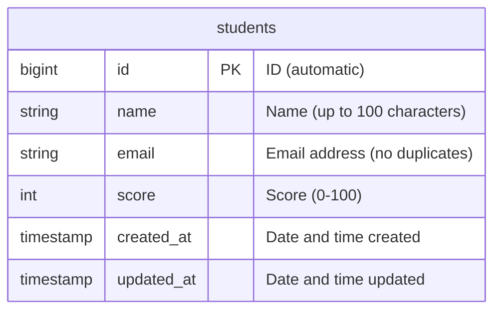
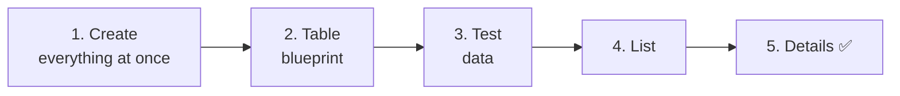
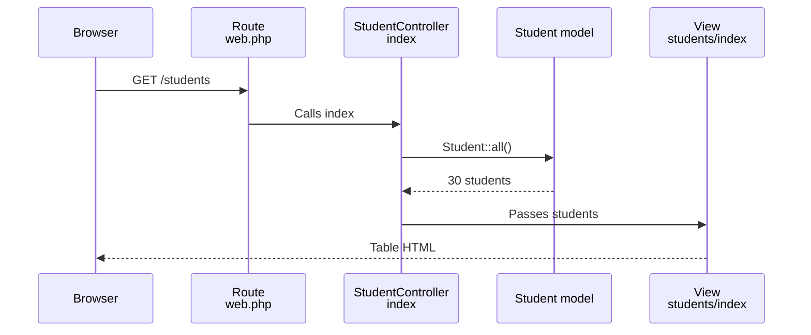

# Let's Build a Student Management App ① — Setup, List, and Details

> 🇯🇵 Original (Japanese version): [20261119_資料_1.md](<../../../1年生_データ設計とアプリ開発/後期/20261119/20261119_資料_1.md>) <!-- original-ja-link -->

Starting today, we'll build a new app: a **student management app**.
This time, use what you learned in the Todo app and build it **on your own**.

## Today's Goals
- Use `make:model -mf` to create a model, migration, and factory all at once
- Create a students table and fill it with test data
- Build a student list page and a student details page

> Start the mysql and laravel containers in the practice environment (`php-study`) before you begin.
> We'll add the student management app to the **same project (`src`)** as the Todo app.

---

## 1. What Is the Student Management App?

It's an app that lets teachers manage their students' **names, email addresses, and scores**.

```
生徒管理アプリ

[ 生徒を追加 ]

| 名前       | 点数 |
|------------|------|
| 山田 太郎  |  85  |
| 佐藤 花子  |  92  |
| 鈴木 一郎  |  70  |
```

We'll build this app up little by little over the next three classes.

| Class | What we build |
|----|---------|
| **Class 1 (today)** | View the student list and details, and add, edit, and delete students (CRUD) |
| Class 2 | Login (so that only teachers can use it) |
| Class 3 | Relationships (record which teacher registered each student) |

> **An app you'll keep using in second year**
> In second year, you'll rebuild this app as an **API** (a system that returns only data instead of web pages).
> The table and URLs you create today will be used as-is in second year too.

### Compare It with the Todo App

The steps are almost exactly the same as for the Todo app.

| | Todo app | Student management app |
|---|---|---|
| Table | `todos` | `students` |
| Model | `Todo` | `Student` |
| Controller | `TodoController` | `StudentController` |
| URL | `/todos` | `/students` |
| View folder | `resources/views/todos/` | `resources/views/students/` |

### The Students Table



Here's what's different from the Todo table.

| Column | What's new |
|----|------------|
| `email` | **Two students can't be registered with the same email address** (no duplicates) |
| `score` | Stores an **integer** (`integer`) instead of text |

---

## 2. Let's Build It



### 1. Create the Model, Migration, and Factory All at Once

> You are here: **🟢 1. Create everything at once** → 2. Blueprint → 3. Test data → 4. List → 5. Details

For the Todo app, we created the migration, model, and factory one at a time.
This time, we'll create them **all at once with a single command**.

```powershell
docker compose exec laravel php artisan make:model Student -mf
```

| Part | Meaning |
|------|------|
| `make:model Student` | Creates the `Student` model |
| `-m` | Also creates a migration (**m**igration) |
| `-f` | Also creates a factory (**f**actory) |

This creates the following three files.

```
src/
├─ app/Models/Student.php ··································· model
├─ database/migrations/xxxx_create_students_table.php ······· migration
└─ database/factories/StudentFactory.php ···················· factory
```

Because we added `-f`, the model already includes `HasFactory` (in the Todo app, we added it by hand).

```php
class Student extends Model
{
    /** @use HasFactory<\Database\Factories\StudentFactory> */
    use HasFactory;
}
```

---

### 2. Write the Table Blueprint (Migration)

> You are here: 1. Create everything at once → **🟢 2. Blueprint** → 3. Test data → 4. List → 5. Details

Open `database/migrations/xxxx_create_students_table.php` and change the contents of `up()` as follows.

```php
    public function up(): void
    {
        Schema::create('students', function (Blueprint $table) {
            $table->id();
            $table->string('name', 100);
            $table->string('email')->unique();
            $table->integer('score')->default(0);
            $table->timestamps();
        });
    }
```

| Code | Meaning |
|--------|------|
| `$table->string('name', 100)` | Name. Up to 100 characters |
| `$table->string('email')->unique()` | Email address. **The same value can't be stored twice** |
| `$table->integer('score')->default(0)` | Score. An integer; 0 if nothing is entered |

👀 **Check before you run it**: In phpMyAdmin (http://localhost:8080), confirm that the `laravel` database does **not yet** have a `students` table.
Writing the blueprint alone doesn't create the table.

```powershell
docker compose exec laravel php artisan migrate
```

✅ **Check**: If the `students` table now shows up in phpMyAdmin, you're good.

---

### 3. Add Test Data (Factory and Seeder)

> You are here: 1. Create everything at once → 2. Blueprint → **🟢 3. Test data** → 4. List → 5. Details

#### ① Tell the factory how to make a student

Change the contents of `definition()` in `database/factories/StudentFactory.php` as follows.

```php
    public function definition(): array
    {
        return [
            'name' => fake('ja_JP')->name(),
            'email' => fake()->unique()->safeEmail(),
            'score' => fake()->numberBetween(0, 100),
        ];
    }
```

| Code | Meaning |
|--------|------|
| `fake('ja_JP')->name()` | Generates a random **Japanese name** (e.g., 山田 太郎) |
| `fake()->unique()->safeEmail()` | Generates a random email address. `unique()` makes sure no two are the same |
| `fake()->numberBetween(0, 100)` | Generates a random integer from 0 to 100 |

> We never use real students' names or email addresses for practice. We use the factory to create **fake data**.

#### ② Create a seeder and add 30 students

```powershell
docker compose exec laravel php artisan make:seeder StudentSeeder
```

Change the contents of `run()` in `database/seeders/StudentSeeder.php` as follows.

```php
<?php

namespace Database\Seeders;

use App\Models\Student;
use Illuminate\Database\Seeder;

class StudentSeeder extends Seeder
{
    public function run(): void
    {
        Student::factory()->count(30)->create();
    }
}
```

Add the line marked ★ to `database/seeders/DatabaseSeeder.php`.

```php
    public function run(): void
    {
        $this->call(TodoSeeder::class);
        $this->call(StudentSeeder::class);  // ★ Added
    }
```

```powershell
docker compose exec laravel php artisan migrate:fresh --seed
```

✅ **Check**: Open the `students` table in phpMyAdmin. If there are 30 students in it, you're good.
(Because we used `migrate:fresh`, the Todo data also goes back to its starting state.)

---

### 4. Build the List Page

> You are here: 1. Create everything at once → 2. Blueprint → 3. Test data → **🟢 4. List** → 5. Details

#### ① Create the controller

```powershell
docker compose exec laravel php artisan make:controller StudentController
```

Change `app/Http/Controllers/StudentController.php` to the following.

```php
<?php

namespace App\Http\Controllers;

use App\Models\Student;
use Illuminate\Http\Request;

class StudentController extends Controller
{
    public function index()
    {
        $students = Student::all();

        return view('students.index', ['students' => $students]);
    }
}
```

It's the same as `index` in `TodoController`; we just changed `Todo` to `Student`.

#### ② Write the route

Add the two lines marked ★ to `routes/web.php`.

```php
use App\Http\Controllers\StudentController;  // ★ Added (put it near the top)

// (Todo routes omitted)

Route::get('/students', [StudentController::class, 'index']);  // ★ Added
```

#### ③ Create the view

Create a `students` folder inside `resources/views`, and then create `index.blade.php` in it.
We'll reuse the **header and footer components** we made on 11/12 here, too.

```html
@include('layouts.header', ['title' => '生徒一覧'])

    <h1>生徒一覧</h1>

    <table border="1">
        <tr>
            <th>名前</th>
            <th>点数</th>
        </tr>
        @foreach ($students as $student)
            <tr>
                <td><a href="/students/{{ $student->id }}">{{ $student->name }}</a></td>
                <td>{{ $student->score }}</td>
            </tr>
        @endforeach
    </table>

@include('layouts.footer')
```

| Code | Meaning |
|--------|------|
| `<table>` | Creates a table. `<tr>` is a row, `<th>` is a heading cell, and `<td>` is a regular cell |
| `border="1"` | Adds border lines to the table |

#### ④ Add a "Student Management" link to the header

Add the link marked ★ to `resources/views/layouts/header.blade.php`.

```html
    <header>
        <a href="/todos">TODOアプリ</a>
        <a href="/students">生徒管理</a>  {{-- ★ Added --}}
    </header>
```

**Update the component in just one place, and the link appears on both the Todo pages and the student pages** (that's the power of reusable components you learned on 11/12).

What happens between opening `/students` and seeing the list is the same as with the Todo app.



✅ **Check**: Open http://localhost:8000/students. If you see the 30 students in a table, you're good.

---

### 5. Build the Details Page

> You are here: 1. Create everything at once → 2. Blueprint → 3. Test data → 4. List → **🟢 5. Details**

#### ① Add show to the controller

Add the `show` method marked ★ to `StudentController.php`.

```php
    // ★ Start of added code
    public function show($id)
    {
        $student = Student::findOrFail($id);

        return view('students.show', ['student' => $student]);
    }
    // ★ End of added code
```

#### ② Add the route

```php
Route::get('/students', [StudentController::class, 'index']);
Route::get('/students/{id}', [StudentController::class, 'show']);  // ★ Added
```

#### ③ Create the view

Create `resources/views/students/show.blade.php`.

```html
@include('layouts.header', ['title' => $student->name])

    <h1>{{ $student->name }}</h1>

    <p>番号：{{ $student->id }}</p>
    <p>メールアドレス：{{ $student->email }}</p>
    <p>点数：{{ $student->score }}点</p>

    <a href="/students">一覧にもどる</a>

@include('layouts.footer')
```

✅ **Check**: Click a student's name in the list. If the details page appears, you're good.
Also check that opening a URL for a student who doesn't exist, like http://localhost:8000/students/999, gives you `404 Not Found`.

---

## 3. Troubleshooting

> **🔥 If it doesn't work, check the logs!** → [[Important] How to Check the Logs](../20261022/【重要】ログの出し方.md)

| Symptom | Where the cause is | Fix |
|------|----------|------|
| `Table 'laravel.students' doesn't exist` | Migration | Check that you ran `php artisan migrate` (or `migrate:fresh --seed`) |
| `Call to undefined method App\Models\Student::factory()` | Model | You forgot `-f` in `make:model`. Add `use HasFactory;` to `Student.php` |
| Names come out in English (e.g., John Smith) | Factory | Check that you wrote `'ja_JP'` in `fake('ja_JP')->name()` |
| `Target class [StudentController] does not exist.` | Route | Check that `use App\Http\Controllers\StudentController;` is at the top of `web.php` |
| `View [students.index] not found.` | View | Check the location of `resources/views/students/index.blade.php` (`students` ends with an `s`) |
| `Undefined variable $title` | View | Check that you didn't forget the `['title' => ...]` part of `@include('layouts.header', ['title' => ...])` |

---

## 4. Summary

| What we wrote today | In a nutshell |
|--------------|-----------|
| `make:model Student -mf` | Creates the model, migration, and factory all at once |
| `->unique()` (migration) | Makes a column that can't store the same value twice |
| `$table->integer(...)` | An integer column |
| `fake('ja_JP')->name()` | Generates random Japanese names |
| `index` and `show` | Build the list and details pages the same way as in the Todo app |
| `<table>` | Shows the list as a table |

**The steps are the same as for the Todo app. If you just think of `Todo` as `Student`, you can build it yourself.**

Next, we'll make it possible to add, edit, and delete students → [Let's Build a Student Management App ② — Add, Edit, and Delete](./20261119_資料_2.md)

<!-- nav:start -->

---

| ⬅️ Previous | 🗺️ Overview | Next ➡️ |
|:--|:--:|--:|
| [11/12 Adding Categories](../20261112/20261112_資料_2.md) | [Course Materials Overview](../../README.md) | [11/19 Student Management ② Add, Edit, and Delete](20261119_資料_2.md) |

<!-- nav:end -->
