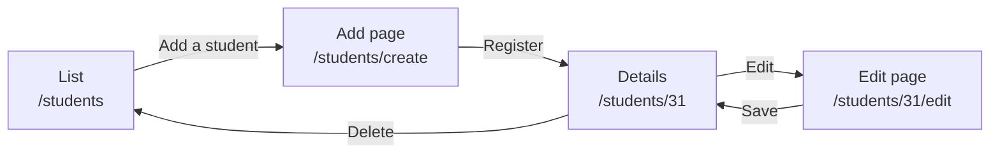
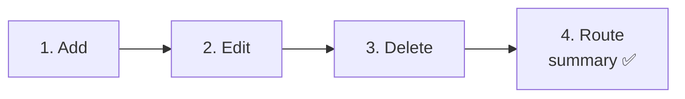
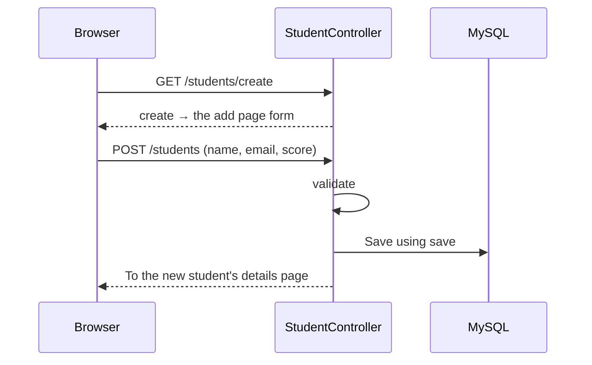
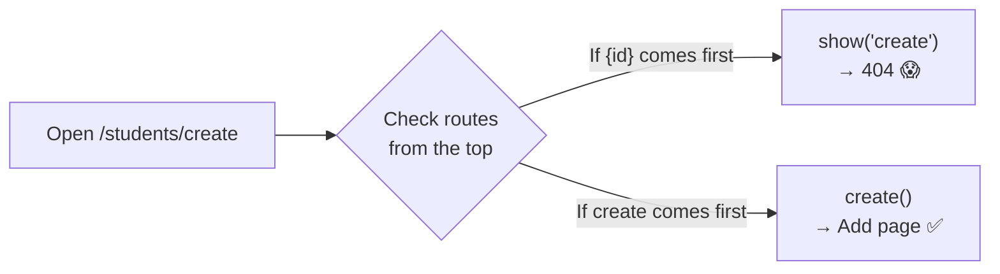
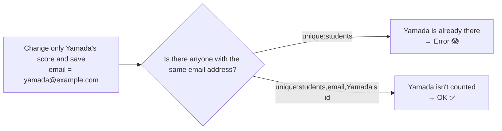

# Let's Build a Student Management App ② — Add, Edit, and Delete

> 🇯🇵 Original (Japanese version): [20261119_資料_2.md](<../../../1年生_データ設計とアプリ開発/後期/20261119/20261119_資料_2.md>) <!-- original-ja-link -->

In [Handout 1](./20261119_資料_1.md), we built the student list and details pages.
Next, we'll make it possible to **add, edit, and delete** students.

## Today's Goals
- Build a form with many input fields as a separate page for adding students
- Check for duplicate email addresses (`unique`) and validate the score range (`integer`, `min`, `max`)
- When editing, **exclude the student's own email address from the duplicate check**

> We'll start from where Handout 1 left off, with the list and details pages working.

---

## 1. What's Different from the Todo App

The steps are almost the same as for the Todo app, but there are two differences.

| | Todo app | Student management app |
|---|---|---|
| Where the add form is | At the top of the list page | We make a **separate page for adding** (`/students/create`) |
| Input fields | Title only | **Three**: name, email address, and score |

With this many input fields, putting the form at the top of the list would make it hard to read. So we'll make a **separate page for adding**.



---

## 2. Let's Build It



### 1. Make It Possible to Add Students

> You are here: **🟢 1. Add** → 2. Edit → 3. Delete → 4. Route summary

#### ① Show the add page (create)

Add the `create` method marked ★ to `StudentController.php`.

```php
    // ★ Start of added code
    public function create()
    {
        return view('students.create');
    }
    // ★ End of added code
```

`create` is a method that **only shows the add form**. It doesn't use the database.

#### ② Create the view for the add page

Create `resources/views/students/create.blade.php`.

```html
@include('layouts.header', ['title' => '生徒の追加'])

    <h1>生徒の追加</h1>

    <form method="POST" action="/students">
        @csrf

        <p>
            名前：
            <input type="text" name="name" value="{{ old('name') }}" required>
            @error('name') <span style="color: red;">{{ $message }}</span> @enderror
        </p>

        <p>
            メールアドレス：
            <input type="email" name="email" value="{{ old('email') }}" required>
            @error('email') <span style="color: red;">{{ $message }}</span> @enderror
        </p>

        <p>
            点数：
            <input type="number" name="score" value="{{ old('score') }}" min="0" max="100" required>
            @error('score') <span style="color: red;">{{ $message }}</span> @enderror
        </p>

        <button type="submit">登録</button>
    </form>

    <a href="/students">一覧にもどる</a>

@include('layouts.footer')
```

| Code | Meaning |
|--------|------|
| `type="email"` | An input field for email addresses. The browser checks whether it looks like an email address |
| `type="number" min="0" max="100"` | An input field for numbers. Only allows values from 0 to 100 |
| `@error('name')` to `@enderror` | Shows an error message for each input field (same as on 11/5) |
| `old('name')` | Keeps what you typed when the page comes back with an error (same as on 11/5) |

Also add a link to the add page under the `<h1>` on the list page (`students/index.blade.php`).

```html
    <h1>生徒一覧</h1>

    <a href="/students/create">生徒を追加</a>  {{-- ★ Added --}}
```

#### ③ Save it (store)

Add the `store` method marked ★ to `StudentController.php`.

```php
    // ★ Start of added code
    public function store(Request $request)
    {
        $request->validate([
            'name' => 'required|max:100',
            'email' => 'required|email|unique:students',
            'score' => 'required|integer|min:0|max:100',
        ], [
            'name.required' => '名前を入力してください。',
            'name.max' => '名前は100文字以内で入力してください。',
            'email.required' => 'メールアドレスを入力してください。',
            'email.email' => 'メールアドレスの形で入力してください。',
            'email.unique' => 'そのメールアドレスは、すでに登録されています。',
            'score.required' => '点数を入力してください。',
            'score.integer' => '点数は整数で入力してください。',
            'score.min' => '点数は0以上で入力してください。',
            'score.max' => '点数は100以下で入力してください。',
        ]);

        $student = new Student();
        $student->name = $request->input('name');
        $student->email = $request->input('email');
        $student->score = $request->input('score');
        $student->save();

        return redirect('/students/' . $student->id);
    }
    // ★ End of added code
```

Here are the new validation rules.

| Rule | Meaning |
|--------|------|
| `email` | Is it in email address format (does it have an `@`, etc.)? |
| `unique:students` | Checks that **the same value is not already** in the `students` table |
| `integer` | Is it an integer? |
| `min:0` and `max:100` | Is it 0 or more and 100 or less? (When used with `integer`, it checks **the size of the number**) |

> **`max:100` means different things in these two places**
> `max:100` on `name` means "up to **100 characters**," and `max:100` on `score` means "**100 or less**."
> With `integer`, it checks the size of the number; without it, it checks the number of characters.

After saving, you're sent to the details page of the student you just added.

Adding is split into **two round trips**: "show the form (`create`)" and "save it (`store`)."



#### ④ Add the routes

Add the two lines marked ★ to `routes/web.php`. **Pay attention to the order you write them in.**

```php
Route::get('/students', [StudentController::class, 'index']);
Route::get('/students/create', [StudentController::class, 'create']);  // ★ Added (above {id}!)
Route::post('/students', [StudentController::class, 'store']);         // ★ Added
Route::get('/students/{id}', [StudentController::class, 'show']);
```

> ⚠️ **Write `/students/create` above `/students/{id}`**
> Routes are checked **in order, from top to bottom**.
> If `/students/{id}` comes first, the `create` in `/students/create` gets treated as the `{id}`.
> Then `show('create')` runs, looks for a student whose `id` is `create`, and you get `404 Not Found`.



✅ **Check**: Use "生徒を追加" (Add a student) on the list page to register one student. Also try these three things.

| What to do | It's working if... |
|---------|------------|
| Register a student normally | The details page appears |
| Register with **the same email address** as a student already in the list | You see "そのメールアドレスは、すでに登録されています。" (That email address is already registered.) |
| Use the developer tools to remove `max="100"` from the score field, then register with `150` | You see "点数は100以下で入力してください。" (Enter a score of 100 or less.) |

---

### 2. Make It Possible to Edit Students

> You are here: 1. Add → **🟢 2. Edit** → 3. Delete → 4. Route summary

#### ① Show the edit page (edit)

Add the `edit` method marked ★ to `StudentController.php`.

```php
    // ★ Start of added code
    public function edit($id)
    {
        $student = Student::findOrFail($id);

        return view('students.edit', ['student' => $student]);
    }
    // ★ End of added code
```

#### ② Create the view for the edit page

Create `resources/views/students/edit.blade.php`. The differences from the add page are marked with ★.

```html
@include('layouts.header', ['title' => '生徒の編集'])

    <h1>生徒の編集</h1>

    <form method="POST" action="/students/{{ $student->id }}">  {{-- ★ Destination --}}
        @csrf
        @method('PUT')  {{-- ★ PUT --}}

        <p>
            名前：
            <input type="text" name="name" value="{{ old('name', $student->name) }}" required>  {{-- ★ Current value --}}
            @error('name') <span style="color: red;">{{ $message }}</span> @enderror
        </p>

        <p>
            メールアドレス：
            <input type="email" name="email" value="{{ old('email', $student->email) }}" required>  {{-- ★ Current value --}}
            @error('email') <span style="color: red;">{{ $message }}</span> @enderror
        </p>

        <p>
            点数：
            <input type="number" name="score" value="{{ old('score', $student->score) }}" min="0" max="100" required>  {{-- ★ Current value --}}
            @error('score') <span style="color: red;">{{ $message }}</span> @enderror
        </p>

        <button type="submit">保存</button>
    </form>

    <a href="/students/{{ $student->id }}">もどる</a>

@include('layouts.footer')
```

Also add a link to the edit page on the details page (`students/show.blade.php`).

```html
    <p>点数：{{ $student->score }}点</p>

    <a href="/students/{{ $student->id }}/edit">編集</a>  {{-- ★ Added --}}
```

#### ③ Save it (update)

Add the `update` method marked ★ to `StudentController.php`.

```php
    // ★ Start of added code
    public function update(Request $request, $id)
    {
        // ① First, get the student we're editing
        $student = Student::findOrFail($id);

        // ② Validate (for email, exclude this student from the duplicate check)
        $request->validate([
            'name' => 'required|max:100',
            'email' => 'required|email|unique:students,email,' . $student->id,
            'score' => 'required|integer|min:0|max:100',
        ], [
            'name.required' => '名前を入力してください。',
            'name.max' => '名前は100文字以内で入力してください。',
            'email.required' => 'メールアドレスを入力してください。',
            'email.email' => 'メールアドレスの形で入力してください。',
            'email.unique' => 'そのメールアドレスは、すでに登録されています。',
            'score.required' => '点数を入力してください。',
            'score.integer' => '点数は整数で入力してください。',
            'score.min' => '点数は0以上で入力してください。',
            'score.max' => '点数は100以下で入力してください。',
        ]);

        // ③ Update the values and save
        $student->name = $request->input('name');
        $student->email = $request->input('email');
        $student->score = $request->input('score');
        $student->save();

        return redirect('/students/' . $student->id);
    }
    // ★ End of added code
```

##### Why we add `$student->id` after `unique:students,email,`

Say you change **only the score** on the edit page and save.
You didn't change the email address, so the `students` table already contains **this student's own email address**.
If you keep the same `unique:students` as in `store`, you'll be told "already registered."



| How it's written | Meaning |
|--------|------|
| `unique:students` | Checks that the same value is not already in the `students` table |
| `unique:students,email,` . `$student->id` | Checks that the same value is not already in the `email` column of the `students` table, **but doesn't count this student (`$student->id`)** |

> **Why use `$student->id` instead of `$id`?**
> `$id` is a value that comes from the URL. Users can change the URL however they like.
> `$student->id`, which we already got with `findOrFail`, is **a reliable value that comes from the database**.
> The official Laravel documentation also warns that the ID you exclude from the unique check should never come from user input.
> That's why we **get the student with `findOrFail` first**.

#### ④ Add the routes

```php
Route::get('/students/{id}', [StudentController::class, 'show']);
Route::get('/students/{id}/edit', [StudentController::class, 'edit']);  // ★ Added
Route::put('/students/{id}', [StudentController::class, 'update']);     // ★ Added
```

✅ **Check**: Try these three things.

| What to do | It's working if... |
|---------|------------|
| Change only the score and save | No error appears, and the score changes on the details page |
| Change the name and save | The name changes on the details page |
| Change the email address to match **another student's** and save | You see "そのメールアドレスは、すでに登録されています。" (That email address is already registered.) |

---

### 3. Make It Possible to Delete Students

> You are here: 1. Add → 2. Edit → **🟢 3. Delete** → 4. Route summary

#### ① Write destroy

Add the `destroy` method marked ★ to `StudentController.php`.

```php
    // ★ Start of added code
    public function destroy($id)
    {
        $student = Student::findOrFail($id);
        $student->delete();

        return redirect('/students');
    }
    // ★ End of added code
```

#### ② Add a delete button to the details page

In `students/show.blade.php`, add the form marked ★ below the edit link.

```html
    <a href="/students/{{ $student->id }}/edit">編集</a>

    {{-- ★ Start of added code --}}
    <form method="POST" action="/students/{{ $student->id }}" onsubmit="return confirm('削除しますか？');">
        @csrf
        @method('DELETE')
        <button type="submit">削除</button>
    </form>
    {{-- ★ End of added code --}}
```

#### ③ Add the route

```php
Route::delete('/students/{id}', [StudentController::class, 'destroy']);  // ★ Added
```

✅ **Check**: Press "削除" (Delete) on the details page. If that student disappears from the list, you're good.

---

### 4. Route Summary ✅

> You are here: 1. Add → 2. Edit → 3. Delete → **🟢 4. Route summary**

The student management app now has **7** routes in total. `routes/web.php` looks like this.

```php
Route::get('/students', [StudentController::class, 'index']);
Route::get('/students/create', [StudentController::class, 'create']);
Route::post('/students', [StudentController::class, 'store']);
Route::get('/students/{id}', [StudentController::class, 'show']);
Route::get('/students/{id}/edit', [StudentController::class, 'edit']);
Route::put('/students/{id}', [StudentController::class, 'update']);
Route::delete('/students/{id}', [StudentController::class, 'destroy']);
```

| Route | Handled by | What it does | Page |
|--------|------|---------|------|
| `GET /students` | `index` | Shows the list | Yes |
| `GET /students/create` | `create` | Shows the add page | Yes |
| `POST /students` | `store` | Adds and saves | No (goes to details) |
| `GET /students/{id}` | `show` | Shows the details | Yes |
| `GET /students/{id}/edit` | `edit` | Shows the edit page | Yes |
| `PUT /students/{id}` | `update` | Updates and saves | No (goes to details) |
| `DELETE /students/{id}` | `destroy` | Deletes | No (goes to list) |

> **These 7 are a standard pattern in Laravel**
> When you have list, add, details, edit, and delete, most apps end up with these same 7 routes.
> That's why Laravel also lets you **write all 7 in one line**: `Route::resource('students', StudentController::class);`.
> Today, we wrote them as 7 separate lines so you can understand each one.
>
> **In second year**, you'll rebuild **the 5 routes other than `create` and `edit` (which only show pages)** as an API.

---

## 3. Troubleshooting

> **🔥 If it doesn't work, check the logs!** → [[Important] How to Check the Logs](../20261022/【重要】ログの出し方.md)

| Symptom | Where the cause is | Fix |
|------|----------|------|
| Clicking "生徒を追加" (Add a student) gives `404 Not Found` | Route | Check that the `/students/create` route is **above** `/students/{id}` |
| Changing only the score and saving gives an "already registered" error | Controller | Check that `. $student->id` comes after `unique:students,email,` in `update` |
| You can register a student with the same email address as another student | Controller | Check that `store` has `unique:students` |
| `SQLSTATE[23000]: ... Duplicate entry` | Controller | Check that you didn't forget `unique` in the validation (the database's `unique` constraint is what stopped it) |
| You can register a score of `150` | Controller | Check that `score` has `integer` (without it, the rule checks **the number of characters** (3) instead of the size of the number) |
| The input fields are empty when the page comes back with an error | View | Check that you wrote `value="{{ old('...') }}"` |

---

## 4. Summary

| What we wrote today | In a nutshell |
|--------------|-----------|
| `create` and `create.blade.php` | A page that only shows the add form |
| `email` and `unique:students` | Is it in email format, and is it not a duplicate? |
| `integer`, `min:0`, and `max:100` | Is it an integer from 0 to 100? |
| `unique:students,email,` . `$student->id` | When editing, exclude the student being edited from the duplicate check |
| Put `/students/create` above `{id}` | Routes are checked from top to bottom |
| The 7 routes | Laravel's standard pattern for list, add, details, edit, and delete |

**You built a new app using only what you learned in the Todo app.** Next time, we'll add **login** to this app so that only teachers can use it.

<!-- nav:start -->

---

| ⬅️ Previous | 🗺️ Overview | Next ➡️ |
|:--|:--:|--:|
| [11/19 Student Management ① List and Details](20261119_資料_1.md) | [Course Materials Overview](../../README.md) | [11/26 Student Management ③ Login](../20261126/20261126_資料_1.md) |

<!-- nav:end -->
