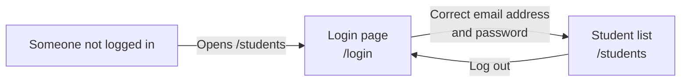
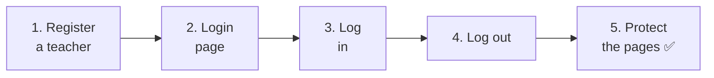
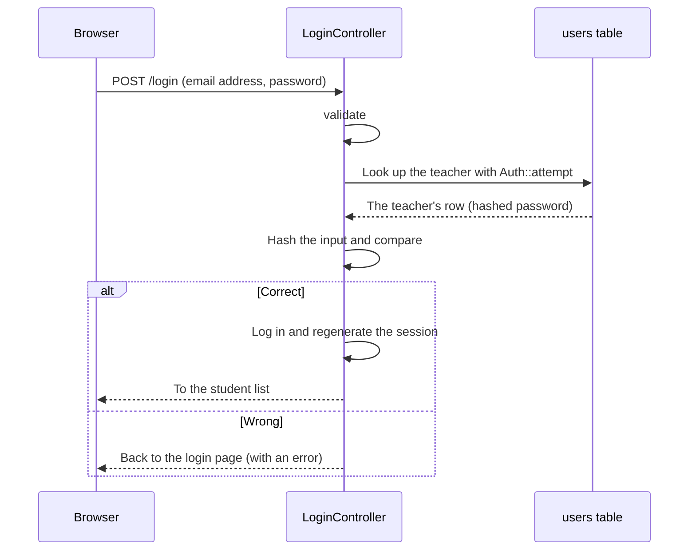
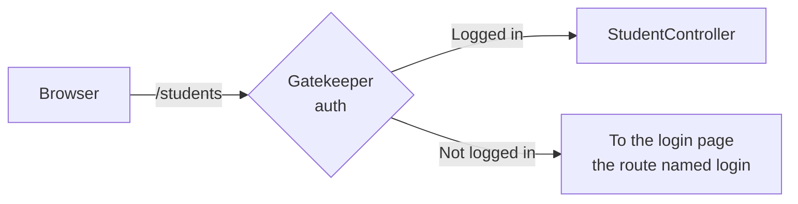
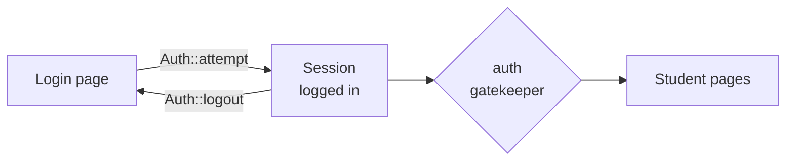

# Let's Build a Student Management App ③ — Login

> 🇯🇵 Original (Japanese version): [20261126_資料_1.md](<../../../1年生_データ設計とアプリ開発/後期/20261126/20261126_資料_1.md>) <!-- original-ja-link -->

Students' names and email addresses are **information that not just anyone should be able to see**.
Today, we'll add **login** to the student management app so that only teachers can use it.

## Today's Goals
- Understand how login works (password hashing and sessions)
- Build a login page and a logout feature
- Prevent people who aren't logged in from viewing the student pages (`auth`)

> We'll start from where the 11/19 "student management app (add, edit, and delete)" left off.

---

## 1. How Login Works

### What We're Building Today



- When someone who isn't logged in opens `/students`, they're **redirected to the login page**
- After entering the correct email address and password, they can use the student pages
- The Todo app pages can still be used by anyone, just like before

### Teachers Go in the `users` Table

Teachers who log in are stored in the **`users` table that Laravel includes from the start**.
(Actually, it's been there ever since you first started the practice environment.)

| Column | Meaning |
|----|------|
| `name` | The teacher's name |
| `email` | The email address used to log in |
| `password` | The password (stored **hashed**) |

### Password "Hashing"

You should **never store passwords in the database as plain text**.
If the contents of the database ever leaked, everyone's passwords would be exposed.

So we **hash** passwords (turn them into a jumble of characters that can't be converted back to the original) before storing them.

```
Password you entered       What goes into the database
password          ─→     $2y$12$Kx8f3... (a jumble of about 60 characters)
```

| | Ordinary encryption | Hashing |
|---|---|---|
| Can it be reversed? | Yes (if you have the key) | **No** |
| What happens at login? | — | The password you enter is hashed the same way, and the two are **compared** |

Laravel does the hashing for you automatically.

### Sessions: How Laravel Remembers That You're Logged In

Once you've logged in, it would be a pain to type your password again every time you move to another page.
Laravel uses something called a **session** to remember that "this person is logged in."

> Think of it like a **wristband at an amusement park**.
> When you show your ticket (password) at the entrance (login page), you get a wristband.
> After that, you just show your wristband to get on any ride (page).

---

## 2. Let's Build It



Here are the files we'll work with (inside `src`).

```
src/
├─ database/seeders/
│   ├─ UserSeeder.php ·················· 1. Register a teacher (new file)
│   └─ DatabaseSeeder.php ·············· 1. Call UserSeeder
├─ app/Http/Controllers/
│   └─ LoginController.php ············· 2, 3, 4. Log in and log out (new file)
├─ resources/views/
│   ├─ login.blade.php ················· 2. Login page (new file)
│   └─ layouts/header.blade.php ········ 4. Teacher's name and logout button
└─ routes/web.php ······················ 2, 3, 4, 5. Routes
```

---

### 1. Register a Teacher (Seeder)

> You are here: **🟢 1. Register a teacher** → 2. Login page → 3. Log in → 4. Log out → 5. Protect the pages

```powershell
docker compose exec laravel php artisan make:seeder UserSeeder
```

Change `database/seeders/UserSeeder.php` to the following.

```php
<?php

namespace Database\Seeders;

use App\Models\User;
use Illuminate\Database\Seeder;

class UserSeeder extends Seeder
{
    public function run(): void
    {
        $user = new User();
        $user->name = '山田先生';
        $user->email = 'teacher@example.com';
        $user->password = 'password';  // Automatically hashed when saved
        $user->save();
    }
}
```

Add the line marked ★ at the **very top** of `run()` in `database/seeders/DatabaseSeeder.php`.

```php
    public function run(): void
    {
        $this->call(UserSeeder::class);  // ★ Added
        $this->call(TodoSeeder::class);
        $this->call(StudentSeeder::class);
    }
```

```powershell
docker compose exec laravel php artisan migrate:fresh --seed
```

✅ **Check**: Open the `users` table in phpMyAdmin.
If 山田先生's `password` is **a jumble of characters like `$2y$12$...`** instead of `password`, you're good.

> **Why is it hashed automatically?**
> If you open `app/Models/User.php`, you'll find the line `'password' => 'hashed'`.
> This setting means "when a value is put into `password`, hash it automatically." Laravel writes it for you from the start.

> ⚠️ **Don't add teachers directly in phpMyAdmin**
> If you type `password` into the `password` field in phpMyAdmin, it gets stored as is, without being hashed, and you won't be able to log in.
> Register teachers through the seeder (or through a page like the ones we'll build later).

---

### 2. Build the Login Page

> You are here: 1. Register a teacher → **🟢 2. Login page** → 3. Log in → 4. Log out → 5. Protect the pages

#### ① Create the controller

```powershell
docker compose exec laravel php artisan make:controller LoginController
```

Change `app/Http/Controllers/LoginController.php` to the following.

```php
<?php

namespace App\Http\Controllers;

use Illuminate\Http\Request;
use Illuminate\Support\Facades\Auth;

class LoginController extends Controller
{
    // Show the login page
    public function showForm()
    {
        return view('login');
    }
}
```

#### ② Create the view

Create `resources/views/login.blade.php`.

```html
@include('layouts.header', ['title' => 'ログイン'])

    <h1>ログイン</h1>

    <form method="POST" action="/login">
        @csrf

        <p>
            メールアドレス：
            <input type="email" name="email" value="{{ old('email') }}" required>
        </p>

        <p>
            パスワード：
            <input type="password" name="password" required>
        </p>

        @error('email')
            <p style="color: red;">{{ $message }}</p>
        @enderror

        <button type="submit">ログイン</button>
    </form>

@include('layouts.footer')
```

| Code | Meaning |
|--------|------|
| `type="password"` | An input field that shows what you type as `●●●` |
| No `old()` on the password | For safety, the password isn't kept even when the page comes back with an error |

#### ③ Write the route

Add the parts marked ★ to `routes/web.php`.

```php
use App\Http\Controllers\LoginController;  // ★ Added (put it near the top)

Route::get('/login', [LoginController::class, 'showForm'])->name('login');  // ★ Added
```

| Code | Meaning |
|--------|------|
| `->name('login')` | Gives this route the **name** `login` |

> **Why give it a name?**
> Later, in "5. Protect the pages," we'll use a feature that **redirects people who aren't logged in to the login page**.
> When that happens, Laravel looks for the route named `login` and sends them there. Without the name, Laravel wouldn't know where to send them.

✅ **Check**: Open http://localhost:8000/login. If the login page appears, you're good.

---

### 3. Make Login Work

> You are here: 1. Register a teacher → 2. Login page → **🟢 3. Log in** → 4. Log out → 5. Protect the pages

#### ① Write the login method

Add the `login` method marked ★ to `LoginController.php`.

```php
    // ★ Start of added code
    public function login(Request $request)
    {
        // ① Validate the input
        $credentials = $request->validate([
            'email' => 'required|email',
            'password' => 'required',
        ]);

        // ② Check whether the email address and password are correct
        if (Auth::attempt($credentials)) {
            // ③ If they are, regenerate the session and go to the student list
            $request->session()->regenerate();

            return redirect()->intended('/students');
        }

        // ④ If they're wrong, send the user back to the login page
        return back()->withErrors([
            'email' => 'メールアドレスかパスワードがちがいます。',
        ])->onlyInput('email');
    }
    // ★ End of added code
```

| Code | Meaning |
|--------|------|
| `$credentials = $request->validate([...])` | Validates the input, then takes out `email` and `password` |
| `Auth::attempt($credentials)` | Looks up the teacher with that email address in the `users` table, then hashes the entered password and compares it with the stored one. If it matches, it **logs the teacher in** and returns `true` |
| `$request->session()->regenerate()` | Creates a fresh session (wristband). This stops anyone else from using someone else's wristband |
| `redirect()->intended('/students')` | Goes back to the page the user was trying to open before logging in. If there wasn't one, goes to `/students` |
| `back()->withErrors([...])` | Sends the user back to the previous page (the login page) and shows an error message |
| `->onlyInput('email')` | When going back, keeps only the email address (not the password) |

Here's the login flow as a diagram.



> **Why we just say "the email address or password is wrong"**
> If we said "this email address isn't registered," a bad actor could figure out which email addresses *are* registered.
> We deliberately don't say which one is wrong.

#### ② Add the route

```php
Route::get('/login', [LoginController::class, 'showForm'])->name('login');
Route::post('/login', [LoginController::class, 'login']);  // ★ Added
```

✅ **Check**: Try these two things on the login page.

| Input | It's working if... |
|------|------------|
| `teacher@example.com` / `password` | You're taken to the student list |
| `teacher@example.com` / `abc` | You see "メールアドレスかパスワードがちがいます。" (The email address or password is wrong.) |

---

### 4. Logging Out and Showing Who's Logged In

> You are here: 1. Register a teacher → 2. Login page → 3. Log in → **🟢 4. Log out** → 5. Protect the pages

#### ① Write the logout method

Add the `logout` method marked ★ to `LoginController.php`.

```php
    // ★ Start of added code
    public function logout(Request $request)
    {
        Auth::logout();

        $request->session()->invalidate();
        $request->session()->regenerateToken();

        return redirect('/login');
    }
    // ★ End of added code
```

| Code | Meaning |
|--------|------|
| `Auth::logout()` | Logs out |
| `$request->session()->invalidate()` | Makes the session (wristband) unusable |
| `$request->session()->regenerateToken()` | Also regenerates the CSRF token used by `@csrf` |

#### ② Add the route

```php
Route::post('/logout', [LoginController::class, 'logout']);  // ★ Added
```

> **Logging out uses POST, too**
> Logging out **changes the state** of being logged in, so we send it with a form button (POST), not a link (GET).
> (It's the same idea as on 10/29: "When you change data, send it with a form button.")

#### ③ Show the teacher's name and a logout button in the header

Add the parts marked ★ to `resources/views/layouts/header.blade.php`.

```html
    <header>
        <a href="/todos">TODOアプリ</a>
        <a href="/students">生徒管理</a>

        {{-- ★ Start of added code --}}
        @auth
            {{ Auth::user()->name }} さん
            <form method="POST" action="/logout" style="display: inline;">
                @csrf
                <button type="submit">ログアウト</button>
            </form>
        @endauth

        @guest
            <a href="/login">ログイン</a>
        @endguest
        {{-- ★ End of added code --}}
    </header>
```

| Code | Meaning |
|--------|------|
| `@auth` to `@endauth` | Shown only **when logged in** |
| `@guest` to `@endguest` | Shown only **when not logged in** |
| `Auth::user()->name` | The name of the teacher who is logged in |

✅ **Check**: When you log in, the header shows "山田先生 さん" and a "ログアウト" (Log out) button.
Press "ログアウト". If you're taken back to the login page and the header changes to a "ログイン" (Log in) link, you're good.
(The header is a shared component, so it appears the same way on the Todo pages too.)

---

### 5. Protect the Pages from People Who Aren't Logged In

> You are here: 1. Register a teacher → 2. Login page → 3. Log in → 4. Log out → **🟢 5. Protect the pages**

Right now, anyone can still open `/students` without logging in.
In `routes/web.php`, wrap the student routes in an **`auth` group**, as marked with ★.

```php
// ★ Start of added code: routes only logged-in users can use
Route::middleware('auth')->group(function () {
    Route::get('/students', [StudentController::class, 'index']);
    Route::get('/students/create', [StudentController::class, 'create']);
    Route::post('/students', [StudentController::class, 'store']);
    Route::get('/students/{id}', [StudentController::class, 'show']);
    Route::get('/students/{id}/edit', [StudentController::class, 'edit']);
    Route::put('/students/{id}', [StudentController::class, 'update']);
    Route::delete('/students/{id}', [StudentController::class, 'destroy']);
});
// ★ End of added code
```

| Code | Meaning |
|--------|------|
| `Route::middleware('auth')` | Checks "is the user logged in?" **before** the route runs |
| `->group(function () { ... })` | Applies that check to **all** the routes inside `{ }` |

**Middleware** is like a **gatekeeper standing in front of** the controller.



✅ **Check**: Try these steps in order.

1. Log out, then open http://localhost:8000/students → **You're redirected to the login page**
2. Log in right there → **You're taken back to the student list** (thanks to `intended`)
3. Log out, then open http://localhost:8000/todos → **You can use Todo without logging in**

---

## 3. Route Summary

The login and student routes in `routes/web.php` now look like this.

```php
// Log in and log out
Route::get('/login', [LoginController::class, 'showForm'])->name('login');
Route::post('/login', [LoginController::class, 'login']);
Route::post('/logout', [LoginController::class, 'logout']);

// Logged-in users only
Route::middleware('auth')->group(function () {
    Route::get('/students', [StudentController::class, 'index']);
    // ... (the 7 student routes)
});
```

---

## 4. Troubleshooting

> **🔥 If it doesn't work, check the logs!** → [[Important] How to Check the Logs](../20261022/【重要】ログの出し方.md)

| Symptom | Where the cause is | Fix |
|------|----------|------|
| `Route [login] not defined.` | Route | Check that you added `->name('login')` to the `/login` route |
| You can't log in even though the details should be correct | Data | In phpMyAdmin, check that the teacher's `password` looks like `$2y$...`. If it's plain text, re-add it from the seeder with `migrate:fresh --seed` |
| `Class "App\Http\Controllers\Auth" not found` | Controller | Check that `use Illuminate\Support\Facades\Auth;` is at the top of `LoginController.php` |
| Pressing log out gives `419 Page Expired` | View | Check that the logout form has `@csrf` (in the practice environment, this error may not appear even without `@csrf`) |
| Clicking a logout link gives `The GET method is not supported` | View | Use a `<form method="POST">` button for logging out, not an `<a>` link |
| You can see the student pages without logging in | Route | Check that the student routes are **inside** the `{ }` of `Route::middleware('auth')->group(...)` |

---

## 5. Summary



| What we wrote today | In a nutshell |
|--------------|-----------|
| `'password' => 'hashed'` (User model) | Hashes passwords automatically (already written for you) |
| `Auth::attempt($credentials)` | Logs the user in if the email address and password are correct |
| `$request->session()->regenerate()` | Regenerates the session after login |
| `Auth::logout()` | Logs out |
| `@auth` and `@guest` | Shown only when logged in / only when not logged in |
| `Auth::user()` | The teacher who is logged in |
| `Route::middleware('auth')->group(...)` | Makes routes that only logged-in users can use |
| `->name('login')` | Where people who aren't logged in get redirected |

**Passwords are hashed. Sessions keep you logged in. Middleware protects the pages.**

> **In second year**, you'll replace sessions with **tokens** (Sanctum) to check who's logged in.
> An API has no pages, so instead of a "wristband," you send a "secret password string" along with every request.

Next time, we'll make it possible to record **which teacher registered each student** (relationships).

<!-- nav:start -->

---

| ⬅️ Previous | 🗺️ Overview | Next ➡️ |
|:--|:--:|--:|
| [11/19 Student Management ② Add, Edit, and Delete](../20261119/20261119_資料_2.md) | [Course Materials Overview](../../README.md) | [12/03 Student Management ④ Relationships](../20261203/20261203_資料_1.md) |

<!-- nav:end -->
