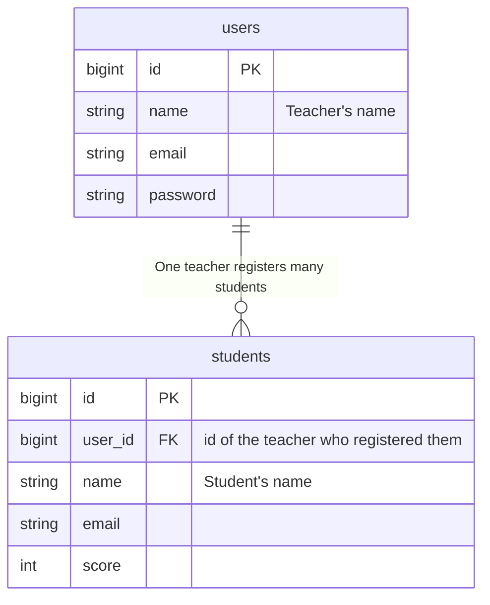
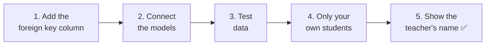
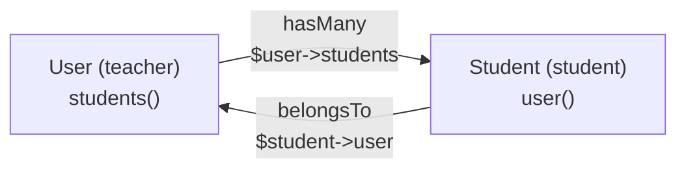
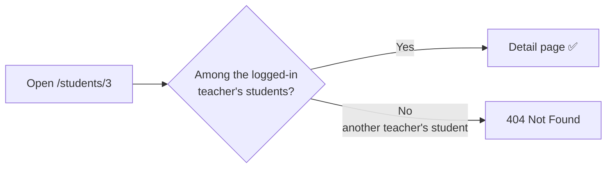
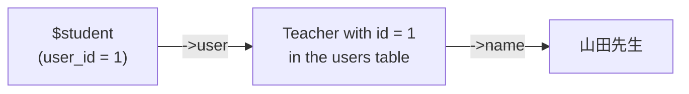
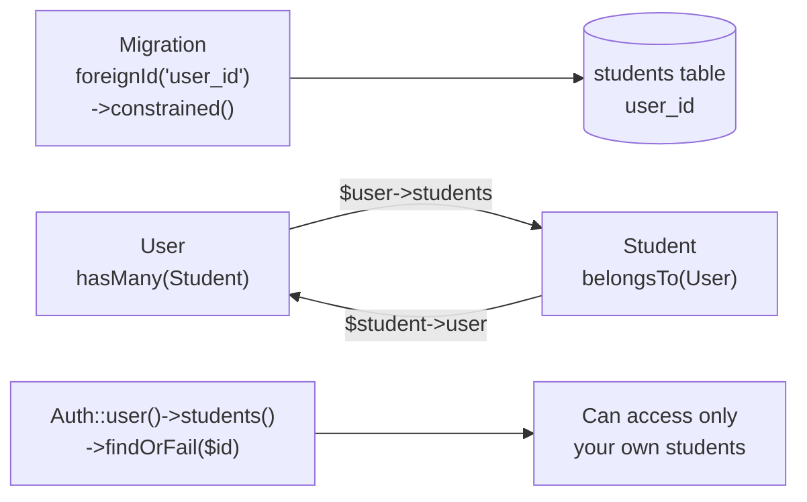

# Let's Build a Student Management App ④ — Relationships (Connecting Teachers and Students)

> 🇯🇵 Original (Japanese version): [20261203_資料_1.md](<../../../1年生_データ設計とアプリ開発/後期/20261203/20261203_資料_1.md>) <!-- original-ja-link -->

Last time, we made it possible for teachers to log in.
But right now, **no matter which teacher logs in, they can see every student**.
Today, we will record **which teacher registered** each student, so that each teacher can manage **only their own students**.

## Today's Goals
- You can express a one-to-many relationship with an ER diagram and tables (a foreign key)
- You can connect models with `hasMany` and `belongsTo`
- You can make the list, detail, edit, and delete features work only with the logged-in teacher's students

> We start from where we finished on 11/26, with "login" working.

---

## 1. The Relationship Between Teachers and Students

### One teacher is in charge of many students



| Teachers (users) | Students (students) |
|--------------|-----------------|
| Teacher Yamada (id: 1) | Teacher Yamada has 15 students |
| Teacher Sato (id: 2) | Teacher Sato has 15 students |

This kind of relationship is called **one-to-many**.

- From the teacher's side, there are **many** students (many)
- From the student's side, there is **one** teacher (one)

### Foreign key: give each student the "teacher's number"

We add a column (`user_id`) to the students table that holds **the `id` of the teacher who registered the student**.

| id | **user_id** | name | email | score |
|----|------------|------|-------|-------|
| 1 | **1** | 田中 一郎 | … | 85 |
| 2 | **1** | 鈴木 花子 | … | 92 |
| 3 | **2** | 高橋 次郎 | … | 70 |

Students with `user_id` `1` belong to Teacher Yamada, and students with `2` belong to Teacher Sato.

A **column that holds the `id` of another table** like this is called a **foreign key**.

> **Why do we store the teacher's "id" instead of their "name"?**
> If we stored the name, then whenever a teacher changed their name, we would have to fix every one of their students' rows.
> With the `id`, even if the teacher's name changes, we don't have to touch the students' rows.

---

## 2. Let's Build It



These are the files you will touch (inside `src`).

```
src/
├─ database/
│   ├─ migrations/xxxx_add_user_id_to_students_table.php ··· 1. Create new
│   ├─ factories/StudentFactory.php ························· 3. Add user_id
│   └─ seeders/
│       ├─ UserSeeder.php ··································· 3. Make two teachers
│       └─ StudentSeeder.php ································ 3. Create students for each teacher
├─ app/Models/
│   ├─ User.php ············································· 2. Add students()
│   └─ Student.php ·········································· 2. Add user()
├─ app/Http/Controllers/StudentController.php ··············· 4. Limit to your own students
└─ resources/views/students/show.blade.php ·················· 5. Show the teacher's name
```

---

### 1. Add the foreign key column (migration)

> You are here: **🟢 1. Foreign key** → 2. Models → 3. Test data → 4. Only your own students → 5. Teacher's name

We will create a **migration that adds a column**, as we learned on 11/12.

```powershell
docker compose exec laravel php artisan make:migration add_user_id_to_students_table
```

Write the contents of `up()` and `down()` like this.

```php
    public function up(): void
    {
        Schema::table('students', function (Blueprint $table) {
            $table->foreignId('user_id')
                ->after('id')
                ->constrained()
                ->cascadeOnDelete();
        });
    }

    public function down(): void
    {
        Schema::table('students', function (Blueprint $table) {
            $table->dropForeign(['user_id']);
            $table->dropColumn('user_id');
        });
    }
```

| Code | Meaning |
|--------|------|
| `foreignId('user_id')` | Adds the foreign key column `user_id` (a big integer column, the same type as `id`) |
| `->after('id')` | Adds it right after the `id` column (to make it easier to read) |
| `->constrained()` | Makes it so that `user_id` **can only hold an `id` that exists in the `users` table** (a foreign key constraint) |
| `->cascadeOnDelete()` | When a teacher is deleted, that teacher's students are deleted too |
| `dropForeign` → `dropColumn` | When undoing, remove the constraint first, then delete the column |

> **How does `constrained()` know it's the "`users` table"?**
> Because the column is named `user_id`. Laravel figures, "If it's `user_id`, it must be the `id` of the `users` table."

**Don't run `migrate` yet.** We'll explain why in "3. Test data."

---

### 2. Connect the models (hasMany and belongsTo)

> You are here: 1. Foreign key → **🟢 2. Models** → 3. Test data → 4. Only your own students → 5. Teacher's name

Just connecting the tables isn't enough to get "this teacher's students" from PHP code.
**We also write the relationship in the models.**

#### ① Write "has many students" in the teacher (User)

Add the parts marked ★ to `app/Models/User.php`.

```php
use Illuminate\Database\Eloquent\Relations\HasMany;  // ★ Add (in the list of use lines near the top)

class User extends Authenticatable
{
    // (Leave the existing code as it is)

    // ★ Add from here: the students this teacher registered
    public function students(): HasMany
    {
        return $this->hasMany(Student::class);
    }
    // ★ Up to here
}
```

#### ② Write "belongs to one teacher" in the student (Student)

Add the parts marked ★ to `app/Models/Student.php`.

```php
<?php

namespace App\Models;

use Illuminate\Database\Eloquent\Factories\HasFactory;
use Illuminate\Database\Eloquent\Model;
use Illuminate\Database\Eloquent\Relations\BelongsTo;  // ★ Add

class Student extends Model
{
    /** @use HasFactory<\Database\Factories\StudentFactory> */
    use HasFactory;

    // ★ Add from here: the teacher who registered this student
    public function user(): BelongsTo
    {
        return $this->belongsTo(User::class);
    }
    // ★ Up to here
}
```

| Model | What you wrote | Meaning | How to use it |
|--------|----------|------|-------|
| `User` | `hasMany(Student::class)` | A teacher **has many** students | `$user->students` gives **all** of that teacher's students |
| `Student` | `belongsTo(User::class)` | A student **belongs to** one teacher | `$student->user` gives that student's **one** teacher |



> **Naming rule**
> The "many" side uses the **plural** (`students`), and the "one" side uses the **singular** (`user`).
> That way, they read naturally in English: `$user->students` (the teacher's students) and `$student->user` (the student's teacher).

---

### 3. Recreate the test data

> You are here: 1. Foreign key → 2. Models → **🟢 3. Test data** → 4. Only your own students → 5. Teacher's name

#### Why `migrate:fresh` instead of `migrate`?

The `students` table currently has 30 students in it.
If we add a `user_id` column here, **what should we put in `user_id` for those 30 existing students?**
Because of `constrained()`, we can't put in a number that doesn't exist in the `users` table.

So this time, we'll use `migrate:fresh --seed` to **rebuild the tables and reinsert the students, each with a teacher**.
To do that, we first fix the Seeder and Factory.

#### ① Make two teachers (UserSeeder)

Add the second teacher marked ★ to `run()` in `database/seeders/UserSeeder.php`.

```php
    public function run(): void
    {
        $user = new User();
        $user->name = '山田先生';
        $user->email = 'teacher@example.com';
        $user->password = 'password';
        $user->save();

        // ★ Add from here
        $user = new User();
        $user->name = '佐藤先生';
        $user->email = 'teacher2@example.com';
        $user->password = 'password';
        $user->save();
        // ★ Up to here
    }
```

#### ② Create 15 students for each teacher (StudentSeeder)

Rewrite `run()` in `database/seeders/StudentSeeder.php` like this.

```php
<?php

namespace Database\Seeders;

use App\Models\Student;
use App\Models\User;  // ★ Add
use Illuminate\Database\Seeder;

class StudentSeeder extends Seeder
{
    public function run(): void
    {
        // Create 15 students for each teacher
        foreach (User::all() as $user) {
            Student::factory()->count(15)->for($user)->create();
        }
    }
}
```

| Code | Meaning |
|--------|------|
| `User::all()` | Gets all the teachers |
| `->for($user)` | "Create these as this teacher's students." `$user->id` goes into `user_id` |

#### ③ Add user_id to the Factory too (StudentFactory)

Add the one line marked ★ to `definition()` in `database/factories/StudentFactory.php`.

```php
use App\Models\User;  // ★ Add (write it near the top)

    public function definition(): array
    {
        return [
            'user_id' => User::factory(),  // ★ Add
            'name' => fake('ja_JP')->name(),
            'email' => fake()->unique()->safeEmail(),
            'score' => fake()->numberBetween(0, 100),
        ];
    }
```

`User::factory()` means "If no teacher is specified, create a teacher too."
In today's Seeder, we specify the teacher with `->for($user)`, so no new teachers are created.

#### ④ Rebuild

```powershell
docker compose exec laravel php artisan migrate:fresh --seed
```

✅ **Check**: In phpMyAdmin, confirm these two things.

- The `users` table has two teachers: Teacher Yamada and Teacher Sato
- The `students` table has a `user_id` column, with 15 students whose value is `1` and 15 students whose value is `2`

---

### 4. Make it so teachers can see only their own students

> You are here: 1. Foreign key → 2. Models → 3. Test data → **🟢 4. Only your own students** → 5. Teacher's name

Rewrite `app/Http/Controllers/StudentController.php`.
First add `use Illuminate\Support\Facades\Auth;` near the top, then change the parts marked ★.

```php
use Illuminate\Support\Facades\Auth;  // ★ Add
```

#### ① List (index): only your own students

```php
    public function index()
    {
        $students = Auth::user()->students;  // ★ Change from Student::all()

        return view('students.index', ['students' => $students]);
    }
```

`Auth::user()` is the logged-in teacher.
`->students` gets **only that teacher's students**. This works thanks to the `hasMany` we wrote in step 2.

#### ② Add (store): record which teacher registered the student

```php
        $student = new Student();
        $student->user_id = Auth::id();  // ★ Add: the id of the logged-in teacher
        $student->name = $request->input('name');
        $student->email = $request->input('email');
        $student->score = $request->input('score');
        $student->save();
```

| Code | Meaning |
|--------|------|
| `Auth::id()` | The `id` of the logged-in teacher |

#### ③ Detail, edit, and delete: only allow access to your own students

Change **every** `Student::findOrFail($id)` in the four methods `show`, `edit`, `update`, and `destroy` like this.

```php
        // Before
        $student = Student::findOrFail($id);

        // After
        $student = Auth::user()->students()->findOrFail($id);
```

`Auth::user()->students()` means "from among the logged-in teacher's students," and `findOrFail($id)` means "find the student whose `id` matches."
**If you try to access another teacher's student by `id`, the student won't be found, and you'll get `404 Not Found`.**



> **The difference between `students` and `students()`**
>
> | How it's written | Meaning | When to use it |
> |-------|------|---------|
> | `Auth::user()->students` | **Gets all** of that teacher's students | List (you want everyone) |
> | `Auth::user()->students()` | **Only adds the condition** "from among that teacher's students." You can chain things like `->findOrFail($id)` after it | Detail, edit, delete (you want to find one student) |

✅ **Check**: Try the following in order.

| What to do | Expected result |
|---------|------------|
| Log in as Teacher Yamada (`teacher@example.com`) and open the list | Only 15 students are shown |
| Add one student | In phpMyAdmin, the added student's `user_id` is `1` |
| From the list, open a student's detail page and note the number in the URL (e.g. `/students/3`) | — |
| Log out, then log in as Teacher Sato (`teacher2@example.com`) | The list shows 15 students different from Teacher Yamada's |
| Directly open the URL of Teacher Yamada's student that you noted | You get **`404 Not Found`** (you can't see another teacher's students) |

---

### 5. Show the name of the teacher who registered the student on the detail page

> You are here: 1. Foreign key → 2. Models → 3. Test data → 4. Only your own students → **🟢 5. Teacher's name**

Add the one line marked ★ to `resources/views/students/show.blade.php`.

```html
    <p>番号：{{ $student->id }}</p>
    <p>メールアドレス：{{ $student->email }}</p>
    <p>点数：{{ $student->score }}点</p>
    <p>登録した先生：{{ $student->user->name }}</p>  {{-- ★ Add --}}
```

`$student->user` gets that student's teacher (`belongsTo`), and `->name` gets that teacher's name.
Even without writing an SQL `JOIN`, Laravel fetches it from the `users` table for you.

✅ **Check**: It's OK if the detail page shows something like "登録した先生：山田先生" (Registered by: Teacher Yamada).



---

## 3. When Things Don't Work

> **🔥 If it doesn't work, check the logs!** → [[Important] How to Output Logs](../20261022/【重要】ログの出し方.md)

| Symptom | Where the cause is | Fix |
|------|----------|------|
| `Cannot add or update a child row: a foreign key constraint fails` when running `migrate` | Migration | The existing students have no teacher to assign. Rebuild with `migrate:fresh --seed` |
| `Call to undefined method App\Models\User::students()` | Model | Check that you wrote the `students()` method in `User.php` |
| `Return value must be of type App\Models\HasMany` | Model | Check that `use Illuminate\Database\Eloquent\Relations\HasMany;` is at the top of `User.php` (the same goes for `BelongsTo` in `Student.php`) |
| The list shows everyone (30 students) | Controller | Check that `index` uses `Auth::user()->students` |
| You can see the detail page of another teacher's student | Controller | Check that you changed **all four** of `show`, `edit`, `update`, and `destroy` to `Auth::user()->students()->findOrFail($id)` |
| Adding a student gives `Field 'user_id' doesn't have a default value` | Controller | Check that `store` has `$student->user_id = Auth::id();` |
| `Attempt to read property "name" on null` where the teacher's name should be | Model / data | Check that you wrote `user()` in `Student.php`, and that the teacher for that student's `user_id` exists |

---

## 4. Summary



| What we wrote today | In a nutshell |
|--------------|-----------|
| `foreignId('user_id')->constrained()` | Adds a foreign key column that can only hold an `id` that exists in `users` |
| `hasMany(Student::class)` | A teacher has many students (`$user->students`) |
| `belongsTo(User::class)` | A student belongs to one teacher (`$student->user`) |
| `->for($user)` (Factory) | Creates test data as this teacher's students |
| `Auth::id()` | The `id` of the logged-in teacher |
| `Auth::user()->students` | All of the logged-in teacher's students |
| `Auth::user()->students()->findOrFail($id)` | Finds one student among your own. If it's another teacher's student, you get a 404 |

**Connect tables with foreign keys. Connect models with hasMany and belongsTo.**

And with that, the student management app is complete 🎉
Listing, adding, viewing, editing, and deleting (CRUD), plus login and relationships: you now have all the key building blocks of a web app.

> **In your second year**, you will rebuild this app as an **API**.
> The tables (`users`, `students`) and the relationships (`hasMany`, `belongsTo`) will be used **as they are**.
> What changes is that "returning an HTML page" becomes "returning JSON data," and login switches from sessions to tokens.

<!-- nav:start -->

---

| ⬅️ Previous | 🗺️ Overview | Next ➡️ |
|:--|:--:|--:|
| [11/26 Student Management ③ Login](../20261126/20261126_資料_1.md) | [Overall Map of the Materials](../../README.md) | [12/10 Student Management ⑤ Teacher Sign-Up](../20261210/20261210_資料_1.md) |

<!-- nav:end -->
