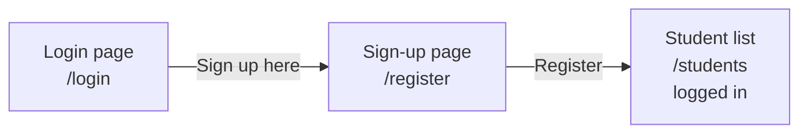
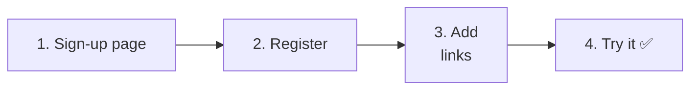
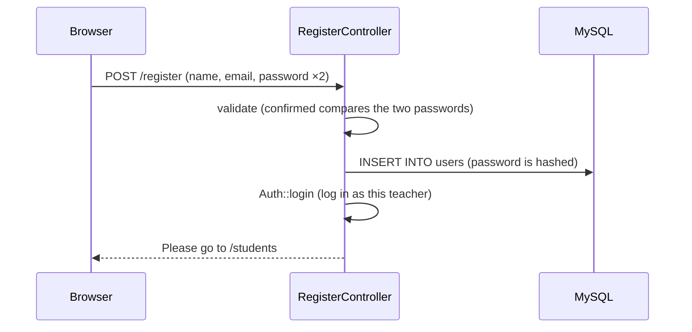

# Let's Build a Student Management App ⑤ — Teacher Sign-Up

> 🇯🇵 Original (Japanese version): [20261210_資料_1.md](<../../../1年生_データ設計とアプリ開発/後期/20261210/20261210_資料_1.md>) <!-- original-ja-link -->

Right now, teachers **can only be registered with a Seeder**. Rewriting the program every time a new teacher joins is a lot of work.
Today, we will make it possible to **create a teacher account** from a page in the app (sign-up).

## Today's Goals
- You can build a sign-up page and save teachers to the `users` table
- You can check the password "confirmation" with validation (`confirmed`)
- You can keep the user logged in right after they sign up (`Auth::login`)

> We start from where we finished on 12/3, with "relationships" working.

---

## 1. What We'll Build Today



```
新規登録

名前：             [ 鈴木先生            ]
メールアドレス：   [ suzuki@example.com  ]
パスワード：       [ ●●●●●●●●            ]
パスワード（確認）：[ ●●●●●●●●            ]

[登録]
```

### How it differs from login

It is structured almost the same way as the login feature we built on 11/26.

| | Login (11/26) | Sign-up (today) |
|---|---|---|
| URL | `/login` | `/register` |
| What it does | **Checks** whether the teacher is in `users` | **Adds** a new teacher to `users` |
| Input fields | Email address, password | Name, email address, password, **password (confirmation)** |
| At the end | Logs in with `Auth::attempt()` | Logs in with `Auth::login()` |

> **In your second year**, you will rebuild this sign-up as an API (`POST /api/register`) too.
> You will use the same checking rules (validation) in your second year as well.

---

## 2. Let's Build It



These are the files you will touch (inside `src`).

```
src/
├─ app/Http/Controllers/
│   └─ RegisterController.php ·········· 1, 2. Sign-up (create new)
├─ resources/views/
│   ├─ register.blade.php ·············· 1. Sign-up page (create new)
│   ├─ login.blade.php ················· 3. Link to sign-up
│   └─ layouts/header.blade.php ········ 3. Link to sign-up
└─ routes/web.php ······················ 1, 2. Routes
```

---

### 1. Build the sign-up page

> You are here: **🟢 1. Sign-up page** → 2. Register → 3. Links → 4. Try it

#### ① Create the controller

```powershell
docker compose exec laravel php artisan make:controller RegisterController
```

Write `app/Http/Controllers/RegisterController.php` like this.

```php
<?php

namespace App\Http\Controllers;

use App\Models\User;
use Illuminate\Http\Request;
use Illuminate\Support\Facades\Auth;

class RegisterController extends Controller
{
    // Show the sign-up page
    public function showForm()
    {
        return view('register');
    }
}
```

#### ② Create the view

Create `resources/views/register.blade.php`.

```html
@include('layouts.header', ['title' => '新規登録'])

    <h1>新規登録</h1>

    <form method="POST" action="/register">
        @csrf

        <p>
            名前：
            <input type="text" name="name" value="{{ old('name') }}" required>
            @error('name') <span style="color: red;">{{ $message }}</span> @enderror
        </p>

        <p>
            メールアドレス：
            <input type="email" name="email" value="{{ old('email') }}" required>
            @error('email') <span style="color: red;">{{ $message }}</span> @enderror
        </p>

        <p>
            パスワード（8文字以上）：
            <input type="password" name="password" required>
            @error('password') <span style="color: red;">{{ $message }}</span> @enderror
        </p>

        <p>
            パスワード（確認）：
            <input type="password" name="password_confirmation" required>
        </p>

        <button type="submit">登録</button>
    </form>

    <a href="/login">ログインはこちら</a>

@include('layouts.footer')
```

| Code | Meaning |
|--------|------|
| `name="password"` | The password |
| `name="password_confirmation"` | The password **confirmation**. The **rule** is to add `_confirmation` after `password` in the name |

> **Why enter the password twice?**
> Passwords are shown as `●●●`, so you can't tell if you made a typo.
> By having users enter it twice and comparing **whether the two match**, you can catch typos.

#### ③ Write the route

Add the parts marked ★ to `routes/web.php`.

```php
use App\Http\Controllers\RegisterController;  // ★ Add (write it near the top)

Route::get('/register', [RegisterController::class, 'showForm']);  // ★ Add
```

✅ **Check**: Open http://localhost:8000/register. It's OK if the sign-up page appears.

---

### 2. Make registration work

> You are here: 1. Sign-up page → **🟢 2. Register** → 3. Links → 4. Try it

#### ① Write the register method

Add the `register` method marked ★ to `RegisterController.php`.

```php
    // ★ Add from here
    public function register(Request $request)
    {
        // ① Check the input
        $request->validate([
            'name' => 'required|string|max:255',
            'email' => 'required|email|unique:users,email',
            'password' => 'required|min:8|confirmed',
        ], [
            'name.required' => '名前を入力してください。',
            'name.max' => '名前は255文字以内で入力してください。',
            'email.required' => 'メールアドレスを入力してください。',
            'email.email' => 'メールアドレスの形で入力してください。',
            'email.unique' => 'そのメールアドレスは、すでに登録されています。',
            'password.required' => 'パスワードを入力してください。',
            'password.min' => 'パスワードは8文字以上で入力してください。',
            'password.confirmed' => 'パスワード（確認）が一致しません。',
        ]);

        // ② Save the teacher
        $user = new User();
        $user->name = $request->input('name');
        $user->email = $request->input('email');
        $user->password = $request->input('password');  // Automatically hashed when saved
        $user->save();

        // ③ Log them in right away
        Auth::login($user);
        $request->session()->regenerate();

        // ④ Go to the student list
        return redirect('/students');
    }
    // ★ Up to here
```

Here's what's new.

| Code | Meaning |
|--------|------|
| `string` | Must be a string |
| `unique:users,email` | Checks that the same value doesn't already exist in the `email` column of the `users` table (you can't register the same email address twice) |
| `min:8` | At least 8 characters (since there's no `integer` rule, it checks the **number of characters**) |
| `confirmed` | Checks whether `password` and `password_confirmation` **match** |
| `Auth::login($user)` | **Logs in as this teacher** without checking the password |

> **The difference between `Auth::attempt` and `Auth::login`**
>
> | | `Auth::attempt($credentials)` (11/26) | `Auth::login($user)` (today) |
> |---|---|---|
> | The password is | checked | not checked |
> | When to use it | Login page (we don't know if it's really them) | Right after sign-up (we know it's the person who just registered) |
>
> It would be annoying to make someone enter their password again on the login page right after signing up, wouldn't it?
> Since the user has just registered, we log them in right away.

> **Is it OK to store the password as it is?**
> As we learned on 11/26, thanks to `'password' => 'hashed'` in the `User` model, it is **automatically hashed when saved**.
> In the second-year materials, you hash it yourself with `Hash::make(...)`, but Laravel doesn't hash a value that's already hashed a second time, so either way works correctly.

#### ② Add the route

```php
Route::get('/register', [RegisterController::class, 'showForm']);
Route::post('/register', [RegisterController::class, 'register']);  // ★ Add
```



---

### 3. Add links to the sign-up page

> You are here: 1. Sign-up page → 2. Register → **🟢 3. Links** → 4. Try it

#### ① On the login page

Add the one line marked ★ below `</form>` in `resources/views/login.blade.php`.

```html
        <button type="submit">ログイン</button>
    </form>

    <a href="/register">新規登録はこちら</a>  {{-- ★ Add --}}
```

#### ② In the header

Add the one line marked ★ inside `@guest` in `resources/views/layouts/header.blade.php`.

```html
        @guest
            <a href="/login">ログイン</a>
            <a href="/register">新規登録</a>  {{-- ★ Add --}}
        @endguest
```

"新規登録" (Sign up) appears in the header only when you are not logged in.

---

### 4. Try it ✅

> You are here: 1. Sign-up page → 2. Register → 3. Links → **🟢 4. Try it**

Log out, then try the following in order.

| | What to do | Expected result |
|---|---|---|
| ① | On the sign-up page, register with the name "鈴木先生", email address `suzuki@example.com`, and password `password123` (the same both times) | You are taken to the student list, and the header shows "鈴木先生 さん" (Teacher Suzuki) |
| ② | Look at the student list | **There are 0 students** (Teacher Suzuki hasn't registered anyone yet; this is thanks to the relationships from 12/3) |
| ③ | Look at the `users` table in phpMyAdmin | Teacher Suzuki is there, and `password` is hashed (`$2y$12$...`) |
| ④ | Log out, then log in with Teacher Suzuki's email address and password | You can log in |
| ⑤ | Sign up again with `suzuki@example.com` | "そのメールアドレスは、すでに登録されています。" (That email address is already registered.) appears |
| ⑥ | Sign up with different values in the password and confirmation fields | "パスワード（確認）が一致しません。" (The password confirmation does not match.) appears |
| ⑦ | Sign up with the password `abc` | "パスワードは8文字以上で入力してください。" (Please enter a password of at least 8 characters.) appears |

---

## 3. Route Summary

The routes for login and sign-up now look like this.

```php
// Login and logout
Route::get('/login', [LoginController::class, 'showForm'])->name('login');
Route::post('/login', [LoginController::class, 'login']);
Route::post('/logout', [LoginController::class, 'logout']);

// Sign-up
Route::get('/register', [RegisterController::class, 'showForm']);
Route::post('/register', [RegisterController::class, 'register']);
```

Write the sign-up routes **outside** of `Route::middleware('auth')`.
That's because these pages are used by people who don't have an account yet (and can't log in).

---

## 4. When Things Don't Work

> **🔥 If it doesn't work, check the logs!** → [[Important] How to Output Logs](../20261022/【重要】ログの出し方.md)

| Symptom | Where the cause is | Fix |
|------|----------|------|
| It says "does not match" even though you entered the same password | View | Check that the confirmation field is named `password_confirmation` (if even one letter is misspelled, they can't be compared) |
| Opening the sign-up page sends you to the login page | Route | Check that the `/register` routes are **outside** the `{ }` of `Route::middleware('auth')` |
| You registered, but you're not logged in | Controller | Check that you wrote `Auth::login($user);` |
| You can't log in as the teacher you registered | Data | Check in phpMyAdmin that `password` is hashed. Check that you didn't delete `'password' => 'hashed'` from `User.php` |
| `Class "App\Http\Controllers\User" not found` | Controller | Check that `use App\Models\User;` is at the top of `RegisterController.php` |
| `Target class [RegisterController] does not exist.` | Route | Check that `use App\Http\Controllers\RegisterController;` is at the top of `web.php` |

---

## 5. Summary

| What we wrote today | In a nutshell |
|--------------|-----------|
| `name="password_confirmation"` | The password confirmation field. The name is fixed by convention |
| `confirmed` | Checks that `password` and `password_confirmation` match |
| `unique:users,email` | Two teachers can't register with the same email address |
| `min:8` | The password must be at least 8 characters |
| `new User()` → `save()` | Saves the teacher (the password is hashed automatically) |
| `Auth::login($user)` | Logs in as that teacher without checking the password |

**Sign-up is "add the user, then log them in right away." Login is "check that it's really them, then log them in."**

Now the app lets teachers create their own accounts and manage their own students.

<!-- nav:start -->

---

| ⬅️ Previous | 🗺️ Overview | Next ➡️ |
|:--|:--:|--:|
| [12/03 Student Management ④ Relationships](../20261203/20261203_資料_1.md) | [Overall Map of the Materials](../../README.md) | — |

<!-- nav:end -->
