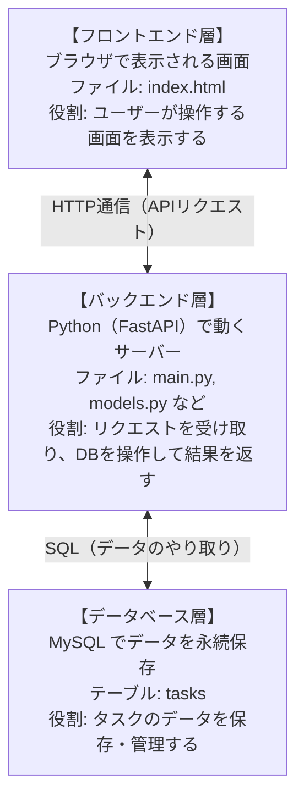
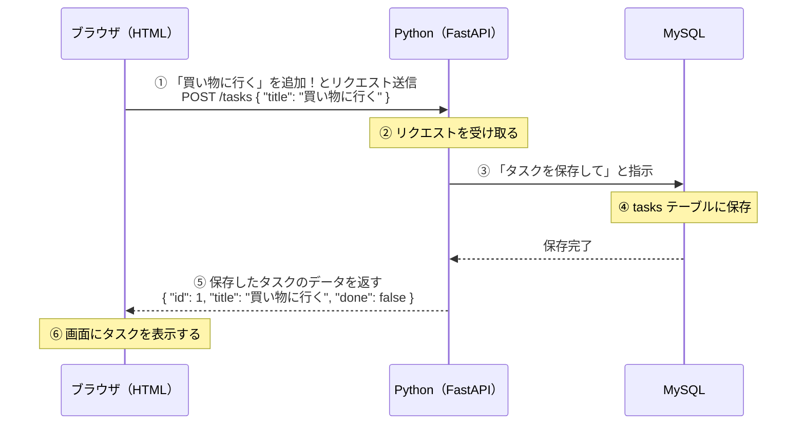

# 番外編：タスク管理システムを作ろう

## 今回のゴール
- HTML + Python + MySQL の 3 層構造システムを理解する
- Python でバックエンドを実装できる
- フロントエンド（HTML）とバックエンド（Python）が API で連携する仕組みを理解する

---

## 1. 何を作るのか

**タスク管理アプリ（Todo アプリ）**

```
┌─────────────────────────────────────────┐
│           タスク管理アプリ               │
│                                         │
│  [ やること一覧 ]                        │
│  □ 買い物に行く        [完了] [削除]    │
│  ☑ 宿題を終わらせる   [完了] [削除]    │
│  □ 部屋を掃除する      [完了] [削除]    │
│                                         │
│  新しいタスク: [____________] [追加]    │
└─────────────────────────────────────────┘
```

できること：
- タスクの一覧表示
- 新しいタスクの追加
- タスクを完了/未完了に切り替える
- タスクの削除

---

## 2. システムの全体像

今回作るシステムは **3 つの層** で構成されます。



### 通信の流れ（例：タスクを追加する場合）



---

## 3. 使用技術

| 役割 | 技術 | 説明 |
|------|------|------|
| フロントエンド | HTML + JavaScript | ブラウザで表示する画面 |
| バックエンド | Python + FastAPI | API サーバー |
| DB 接続 | SQLAlchemy | Python から MySQL を操作するライブラリ |
| データベース | MySQL | データを保存するソフトウェア |

### FastAPI を選んだ理由

- シンプルで初心者でも読みやすいコードが書ける
- `http://localhost:8000/docs` を開くだけで API のテスト画面が自動生成される
- Python のクラス（OOP）を自然に使う設計になっている

---

## 4. フォルダ構成

```
my_todo_app/
├── main.py          ← アプリの起動ファイル（エントリポイント）
├── database.py      ← MySQL への接続設定
├── models.py        ← データベースのテーブル定義（クラスで書く）
├── schemas.py       ← API のデータ形式定義（クラスで書く）
├── routers/
│   └── tasks.py     ← タスク関連の API ルーティング
└── static/
    └── index.html   ← フロントエンドの HTML ファイル
```

---

## 5. 環境構築

### MySQL の準備

MySQL のインストール・データベース作成の手順は OS によって異なります。
→ **[01_MySQL環境構築.md](./01_MySQL環境構築.md)** を参照してください。

### Python パッケージのインストール

#### Mac

Mac では `pip3 install` を直接実行すると以下のエラーが出ます：
```
error: externally-managed-environment
```

**仮想環境（venv）** を作成してからインストールしてください。

```bash
# プロジェクトフォルダ内で実行
python3 -m venv venv

# 仮想環境を有効化（プロンプトに (venv) が付けばOK）
source venv/bin/activate

# 有効化後にインストール
pip install fastapi uvicorn sqlalchemy pymysql
```

#### Windows

Windows ではそのままインストールできます。

```cmd
pip install fastapi uvicorn sqlalchemy pymysql
```

仮想環境を使いたい場合（推奨）：

```cmd
python -m venv venv
venv\Scripts\activate
pip install fastapi uvicorn sqlalchemy pymysql
```

| パッケージ | 役割 |
|-----------|------|
| `fastapi` | Web API フレームワーク |
| `uvicorn` | FastAPI を動かすサーバー |
| `sqlalchemy` | Python から DB を操作するライブラリ |
| `pymysql` | Python から MySQL に接続するドライバ |

### 仮想環境とは？

```
仮想環境 = プロジェクト専用の Python の入れ物

システム全体の Python         プロジェクト専用の Python
（触ってはいけない）           （自由にパッケージを入れられる）
      │                              │
      │  python3 -m venv venv（Mac） │
      │  python -m venv venv（Win）  │
      └──────────────────────────→  venv/
                                      ├── bin/      （Mac）
                                      ├── Scripts/  （Windows）
                                      └── lib/...
```

一度作ったら **ターミナルを開くたびに有効化**が必要です：

```bash
source venv/bin/activate   # Mac
```
```cmd
venv\Scripts\activate      # Windows
```

### サーバーの起動方法

**Mac（仮想環境を有効化してから起動）：**
```bash
source venv/bin/activate
uvicorn main:app --reload
```

**Windows（仮想環境なしの場合）：**
```cmd
uvicorn main:app --reload
```

起動後、ブラウザで以下を開きます：
- アプリ画面: `http://localhost:8000`
- API ドキュメント: `http://localhost:8000/docs`

---

## 6. 学習の進め方

| ステップ | 資料 | 内容 |
|---------|------|------|
| 1 | 01_MySQL環境構築 | MySQL のインストールと DB 作成 |
| 2 | 02_Python_OOP入門 | クラスとは何か、なぜ使うのか |
| 3 | 03_FastAPI入門 | API サーバーの基本を作る |
| 4 | 04_データベース連携 | MySQL とつないでデータを保存する |
| 5 | 05_CRUD_API実装 | 一覧・追加・更新・削除を実装する |
| 6 | 06_フロントエンド連携 | HTML 画面から API を呼び出す |

---

> 次のステップ → [01_MySQL環境構築.md](./01_MySQL環境構築.md)
