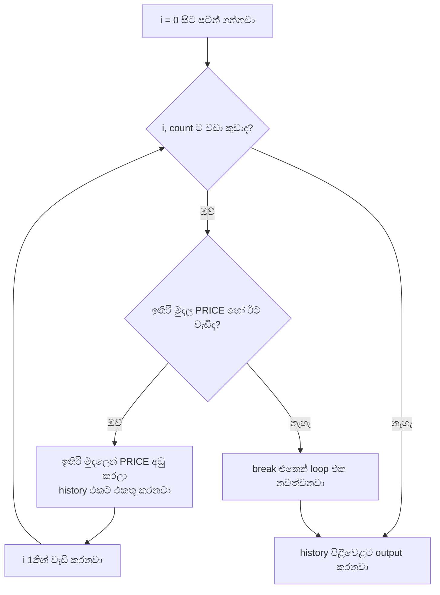
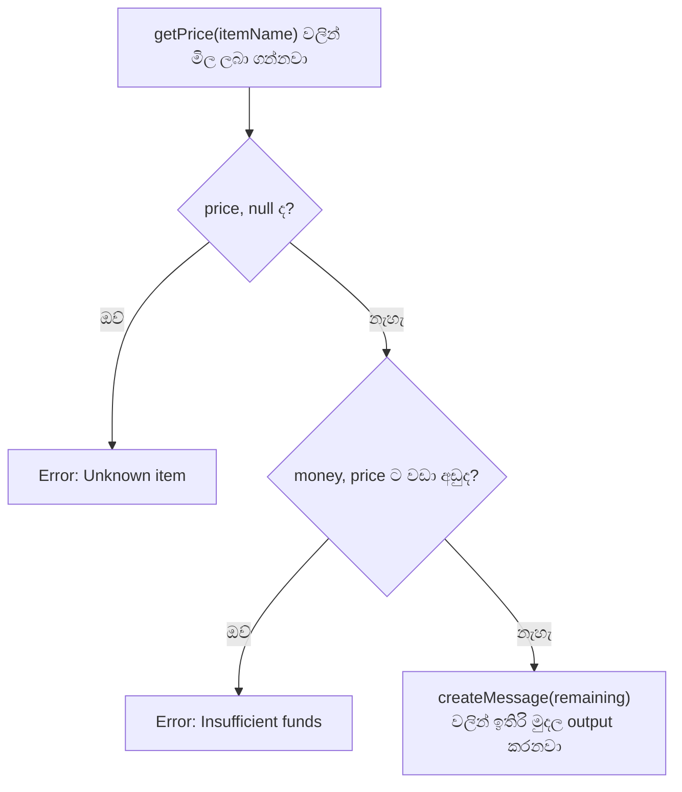

> 🇯🇵 මුල් පිටපත (ජපන් භාෂාවෙන්): [2026_04_21_演習.md](<../../1年生_前期_ITシステム基礎/2026_04_21/2026_04_21_演習.md>) <!-- original-ja-link -->


---

## විස්තීර්ණ අභ්‍යාසය: Vending machine program එකක් හැදීම

### 【STEP 1】Variable සහ constant වල මූලික කරුණු

**අවශ්‍යතා:**
- භාණ්ඩයේ මිල constant එකක් වන `PRICE` (150) ලෙස නිර්වචනය කරන්න.
- Standard input එකෙන් "දාපු මුදල" සංඛ්‍යාවක් විදිහට ලබා ගන්න.
- දාපු මුදලෙන් මිල අඩු කරලා "ඉතිරි මුදල" ගණනය කරලා, `Remaining: [සංඛ්‍යාව]` විදිහට output කරන්න.

JavaScript

```
const reader = require('readline').createInterface({
  input: process.stdin,
  output: process.stdout
});

const lines = [];
reader.on('line', (line) => {
  lines.push(line);
});

reader.on('close', () => {
  const PRICE = 150;
  let money = Number(lines[0]); // 1 වන පේළියේ input එක
  
  let remaining = money - PRICE;
  console.log(`Remaining: ${remaining}`);
});
```

---

### 【STEP 2】if statement එකෙන් කොන්දේසි මත ශාඛාකරණය

**අවශ්‍යතා:**
- දාපු මුදල `PRICE` ට වඩා අඩු නම්, `Error: Insufficient funds` කියලා output කරලා අවසන් කරන්න.
- මුදල ප්‍රමාණවත් නම් විතරක්, ඉතිරි මුදල (change) output කරන්න.

JavaScript

```
reader.on('close', () => {
  const PRICE = 150;
  let money = Number(lines[0]);

  if (money < PRICE) {
    console.log("Error: Insufficient funds");
  } else {
    let remaining = money - PRICE;
    console.log(`Remaining: ${remaining}`);
  }
});
```

---

### 【STEP 3】Array සහ for statement (කිහිපයක් මිලදී ගැනීම)

**අවශ්‍යතා:**
- Input එකේ 1 වන පේළියේ "දාපු මුදල" සහ 2 වන පේළියේ "මිලදී ගන්න ඕනේ ගණන" ලැබෙනවා.
- එකක් ගන්න හැම වතාවකම ඉතිරි මුදල ගණනය කරලා, එය `history` කියන array එකට එකතු කරන්න.
- මිලදී ගන්න අතරතුර ඉතිරි මුදල මදි වුණොත්, එතනින් loop එක නවත්වන්න.
- අන්තිමට array එකේ අන්තර්ගතය loop එකකින් පිළිවෙළට output කරන්න.

මිලදී ගැනීමේ loop එකේ ක්‍රියාවලිය මෙහෙමයි.



JavaScript

```
reader.on('close', () => {
  let money = Number(lines[0]);
  const count = Number(lines[1]);
  const PRICE = 150;
  const history = [];

  // මිලදී ගැනීමේ loop එක
  for (let i = 0; i < count; i++) {
    if (money >= PRICE) {
      money -= PRICE;
      history.push(money);
    } else {
      break;
    }
  }

  // Array එකේ අන්තර්ගතය loop එකකින් output කරනවා (for statement version එක)
  for (let i = 0; i < history.length; i++) {
    // history[i] වලින් array එකේ එක් එක් element එකට access කරනවා
    console.log(`Step ${i + 1}: ${history[i]}`);
  }
});
```


```
reader.on('close', () => {
  let money = Number(lines[0]);
  const count = Number(lines[1]);
  const PRICE = 150;
  const history = [];

  for (let i = 0; i < count; i++) {
    if (money >= PRICE) {
      money -= PRICE;
      history.push(money);
    } else {
      break;
    }
  }

  // Array එකේ අන්තර්ගතය loop එකකින් output කරනවා
  history.forEach((rem, index) => {
    console.log(`Step ${index + 1}: ${rem}`);
  });
});
```

---

### 【STEP 4】Refactoring: switch statement එකෙන් අවස්ථා කිහිපයකට ශාඛාකරණය

**අවශ්‍යතා:**

- Input එකේ 1 වන පේළියේ "දාපු මුදල" සහ 2 වන පේළියේ "භාණ්ඩයේ නම (Coke, Water, Coffee)" ලැබෙනවා.
- `switch` statement එක භාවිත කරලා, භාණ්ඩයේ නම අනුව මිල වෙනස් කරන්න.
    - Coke: 150, Water: 100, Coffee: 120
    - වෙන ඕනෑම එකක් නම්: `Error: Unknown item` කියලා output කරන්න.

JavaScript

```
reader.on('close', () => {
  let money = Number(lines[0]);
  const itemName = lines[1]; // භාණ්ඩයේ නම
  let price = 0;

  // if / else if භාවිත කරලා අවස්ථා කිහිපයකට ශාඛාකරණය
  if (itemName === "Coke") {
    price = 150;
  } else if (itemName === "Water") {
    price = 100;
  } else if (itemName === "Coffee") {
    price = 120;
  } else {
    // කිසිම කොන්දේසියකට ගැළපෙන්නේ නැති අවස්ථාව (switch එකේ default එකට සමානයි)
    console.log("Error: Unknown item");
    return; 
  }

  // මිලදී ගන්න පුළුවන්ද කියලා තීරණය කිරීම
  if (money >= price) {
    console.log(`Remaining: ${money - price}`);
  } else {
    console.log("Error: Insufficient funds");
  }
});
```

```
reader.on('close', () => {
  let money = Number(lines[0]);
  const itemName = lines[1]; // 2 වන පේළිය: භාණ්ඩයේ නම
  let price = 0;

  switch (itemName) {
    case "Coke":
      price = 150;
      break;
    case "Water":
      price = 100;
      break;
    case "Coffee":
      price = 120;
      break;
    default:
      console.log("Error: Unknown item");
      return; // සැකසීම අවසන් කරනවා
  }

  if (money >= price) {
    console.log(`Remaining: ${money - price}`);
  } else {
    console.log("Error: Insufficient funds");
  }
});
```

---

### 【STEP 5】අවසාන refactoring: කේතය functions ලෙස වෙන් කිරීම

### 【STEP 5】Refactoring: කේතය functions ලෙස වෙන් කිරීම සහ template literal

**අවශ්‍යතා:**
- භාණ්ඩයේ නමෙන් මිල return කරන `getPrice(name)` function එක හදන්න.
- මිලදී ගත්තාට පස්සේ ඉතිරි මුදල ගණනය කරලා string එකක් return කරන `createMessage(remaining)` function එක හදන්න.
- මේ functions භාවිත කරලා ප්‍රධාන සැකසීම පිළිවෙළකට සකස් කරන්න.

ප්‍රධාන සැකසීමේ තීරණ ගැනීමේ ක්‍රියාවලිය මෙහෙමයි.



JavaScript

```
// මිල තීරණය කරන function එක
const getPrice = (name) => {
  switch (name) {
    case "Coke":   return 150;
    case "Water":  return 100;
    case "Coffee": return 120;
    default:       return null;
  }
};

// පණිවිඩය හදන function එක (template literal)
const createMessage = (remaining) => `Result: Remaining balance is ${remaining} yen.`;

reader.on('close', () => {
  const money = Number(lines[0]);
  const itemName = lines[1];
  
  const price = getPrice(itemName);

  if (price === null) {
    console.log("Error: Unknown item");
  } else if (money < price) {
    console.log("Error: Insufficient funds");
  } else {
    const remaining = money - price;
    console.log(createMessage(remaining));
  }
});
```

---

### 💡 පන්තියේදී උගන්වන විට සැලකිලිමත් විය යුතු කරුණු

- **Asynchronous සැකසීම ගැන සැලකිල්ල:** `reader.on('close', ...)` එකෙන් පිටත code ලිව්වොත්, input එක සම්පූර්ණ වෙන්න කලින්ම ඒක run වෙලා error එකක් එන බව කියලා දෙන්න.
    
- **Array index:** `lines[0]`, `lines[1]` වගේ, input එක මොන පිළිවෙළටද එන්නේ කියලා සිසුන්ට හිතන්න සලස්වන එක වැදගත්.
    
- **trim() අවශ්‍ය වීම:** මේ code එකේ දාලා නැති වුණත්, input එකේ අනවශ්‍ය හිස්තැන් තියෙන්න පුළුවන් නිසා, ප්‍රායෝගිකව `lines.push(line.trim());` කියලා ලියන්න උගන්වනවා නම් තවත් හොඳයි.