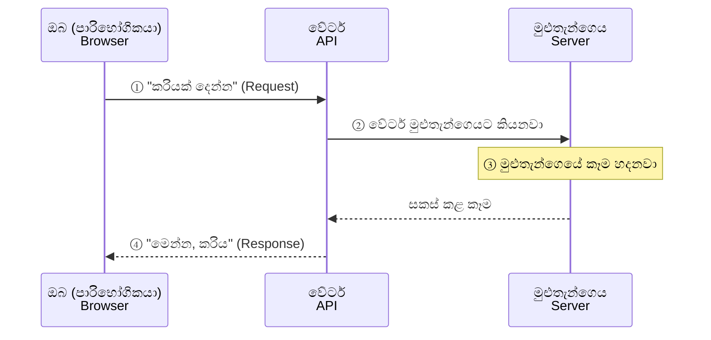
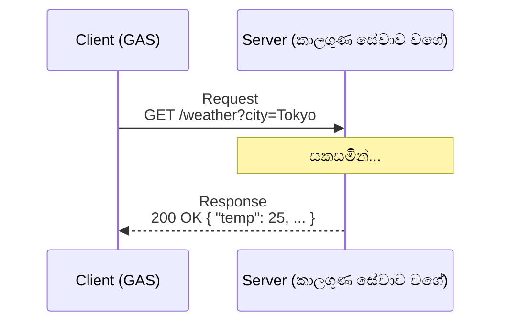
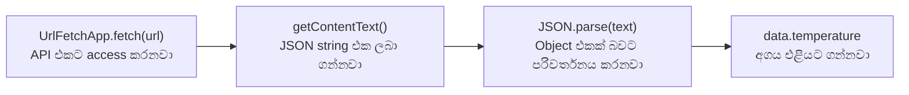

# API කියන්නේ මොකක්ද — Request, Response සහ JSON

> 🇯🇵 මුල් පිටපත (ජපන් භාෂාවෙන්): [20260512_API説明資料.md](<../../1年生_前期_ITシステム基礎/2026_05_12/20260512_API説明資料.md>) <!-- original-ja-link -->

## අද දින ඉලක්ක
- API කියන්නේ මොකක්ද කියලා ඔබේම වචනවලින් පැහැදිලි කරන්න පුළුවන් වීම
- HTTP හි "request සහ response" සංකල්පය තේරුම් ගැනීම
- JSON දත්ත කියවලා තේරුම් ගන්න පුළුවන් වීම
- GAS හි `UrlFetchApp` භාවිතයෙන් බාහිර API එකක් call කරන්න පුළුවන් වීම

---

## 1. API කියන්නේ මොකක්ද?

**API (Application Programming Interface) = App එකිනෙක සමඟ සන්නිවේදනය කිරීමට ඇති අතුරුමුහුණත (interface)**

### අපිට හුරුපුරුදු උදාහරණයකින් හිතමු

Restaurant එකක උදාහරණයෙන් හිතුවොත් මෙහෙමයි.



මුළුතැන්ගෙය (server) ඇතුළේ වැඩ කරන විදිහ ඔබ දැනගෙන ඉන්න ඕනේ නැහැ.  
වේටර් (API) හරහා order කරන්න විතරයි තියෙන්නේ.

---

## 2. HTTP request සහ response



**Request වර්ග:**
| Method | තේරුම | උදාහරණය |
|---------|------|-----|
| GET | දත්ත ලබා ගන්න ඕනේ | කාලගුණ දත්ත ලබා ගන්නවා |
| POST | දත්ත යවන්න / හදන්න ඕනේ | Form එකක් submit කරනවා |
| PUT | දත්ත යාවත්කාලීන කරන්න ඕනේ | Profile එක වෙනස් කරනවා |
| DELETE | දත්ත මකන්න ඕනේ | Post එකක් මකනවා |

**Response status code:**
| Code | තේරුම |
|--------|------|
| 200 | OK (සාර්ථකයි) |
| 404 | Not Found (හොයාගන්න බැහැ) |
| 500 | Internal Server Error (server එකේ error එකක්) |

---

## 3. JSON — දත්ත හුවමාරු කරන ආකෘතිය

API එකෙන් එන දත්ත ප්‍රධාන වශයෙන් **JSON (JavaScript Object Notation)** ආකෘතියෙන් තමයි එන්නේ.

```json
{
  "city": "Tokyo",
  "weather": "晴れ",
  "temperature": 25.5,
  "humidity": 60,
  "forecast": [
    { "date": "2024-01-15", "temp": 24 },
    { "date": "2024-01-16", "temp": 22 },
    { "date": "2024-01-17", "temp": 27 }
  ]
}
```

ලියන විදිහ JavaScript object වලට ගොඩක් සමානයි. 08 වන පාඩමේ ඉගෙන ගත් දැනුම එහෙම්මම භාවිත කරන්න පුළුවන්!

---

## 4. GAS එකෙන් බාහිර API එකක් call කිරීම

දත්ත ලබා ගැනීමේ ක්‍රියාවලිය පහත පියවර 4කින් සමන්විතයි.



```javascript
function callApi() {
  // UrlFetchApp.fetch(URL) = දීපු URL එකට access කරලා දත්ත ලබා ගන්නවා
  const url = "https://api.example.com/data";
  
  const response = UrlFetchApp.fetch(url);
  
  // Response එකේ අන්තර්ගතය string එකක් විදිහට ලබා ගන්නවා
  const text = response.getContentText();
  console.log(text);  // JSON string එක පෙන්වනවා
  
  // JSON string එක object එකක් බවට පරිවර්තනය කරනවා (08 වන පාඩමේ ඉගෙන ගත්තා!)
  const data = JSON.parse(text);
  console.log(data.temperature);  // → 25.5
}
```

---

## 5. Public API එකක් ඇත්තටම භාවිත කරලා බලමු

### උදාහරණය: Open-Meteo (නොමිලේ ලැබෙන කාලගුණ API එකක්, API key ඕනේ නැහැ)

```javascript
function getWeather() {
  // ටෝකියෝවල අක්ෂාංශ සහ දේශාංශ දීලා කාලගුණ දත්ත ලබා ගන්නවා
  const url = "https://api.open-meteo.com/v1/forecast?latitude=35.6762&longitude=139.6503&current_weather=true";
  
  // API එකට request එක යවනවා
  const response = UrlFetchApp.fetch(url);
  
  // Response එක JSON ආකෘතියෙන් ලබා ගන්නවා
  const json = JSON.parse(response.getContentText());
  
  // current_weather ඇතුළේ වත්මන් කාලගුණ දත්ත තියෙනවා
  const weather = json.current_weather;
  
  console.log("気温: " + weather.temperature + "℃");
  console.log("風速: " + weather.windspeed + " km/h");
  
  // කාලගුණ code එක ජපන් භාෂාවට පරිවර්තනය කරනවා (කොටසක් විතරයි)
  const weatherCodes = {
    0: "快晴",
    1: "晴れ",
    2: "一部曇り",
    3: "曇り",
    61: "弱い雨",
    63: "適度な雨",
    65: "強い雨",
  };
  
  const weatherText = weatherCodes[weather.weathercode] || "不明";
  console.log("天気: " + weatherText);
}
```

---

## 6. API response එක sheet එකට ලිවීම

```javascript
function weatherToSheet() {
  const sheet = SpreadsheetApp.getActiveSpreadsheet().getActiveSheet();
  
  // API එකෙන් කාලගුණ දත්ත ලබා ගන්නවා
  const url = "https://api.open-meteo.com/v1/forecast?latitude=35.6762&longitude=139.6503&current_weather=true";
  const response = UrlFetchApp.fetch(url);
  const data = JSON.parse(response.getContentText());
  const weather = data.current_weather;
  
  // වත්මන් වේලාව ලබා ගන්නවා
  const now = new Date();
  const timeStr = Utilities.formatDate(now, "Asia/Tokyo", "yyyy/MM/dd HH:mm");
  
  // අන්තිම පේළියට ඊළඟ පේළියේ ලියනවා
  const nextRow = sheet.getLastRow() + 1;
  sheet.getRange(nextRow, 1).setValue(timeStr);
  sheet.getRange(nextRow, 2).setValue(weather.temperature);
  sheet.getRange(nextRow, 3).setValue(weather.windspeed);
  
  console.log("天気データを記録しました！");
}
```

---

## සාරාංශය

| පදය                       | තේරුම                |
| ------------------------ | ----------------- |
| API                      | App එකිනෙක සමඟ සන්නිවේදනය කිරීමට ඇති අතුරුමුහුණත |
| Request                    | Client එකේ සිට server එකට යවන ඉල්ලීම  |
| Response                    | Server එකේ සිට client එකට එන පිළිතුර  |
| JSON                     | දත්ත හුවමාරුවට භාවිත කරන ආකෘතිය     |
| `UrlFetchApp.fetch(url)` | GAS එකෙන් URL එකකට access කරනවා |
| `JSON.parse(str)`        | JSON string එක object එකක් බවට පරිවර්තනය කරනවා |

---

## ඊළඟ පාඩම (14 වන පාඩම) ගැන පෙරදැක්මක්

කාලගුණය සහ විනිමය අනුපාත වැනි දත්ත ලබා දෙන public API භාවිත කරලා, දත්ත spreadsheet එකක ස්වයංක්‍රීයව සටහන් කරන අභ්‍යාසයක් කරනවා.
