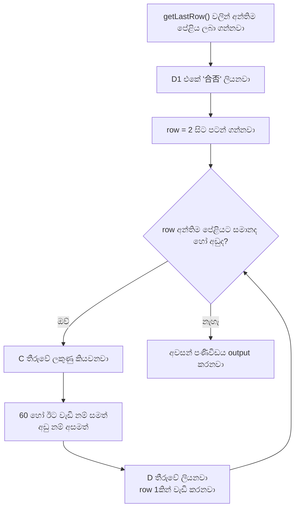

# අභ්‍යාස ගැටලු

> 🇯🇵 මුල් පිටපත (ජපන් භාෂාවෙන්): [20260512_演習回答.md](<../../1年生_前期_ITシステム基礎/2026_05_12/20260512_演習回答.md>) <!-- original-ja-link -->

## සූදානම: spreadsheet එකක් හැදීම

1. අලුත් Google Spreadsheet එකක් හදන්න
2. Spreadsheet එකේ නම "GAS演習" කියලා දාන්න
3. "Extensions" (拡張機能) → "Apps Script" විවෘත කරන්න

---

## අභ්‍යාසය 1: cell එකකට තොරතුරු ලිවීම

### ගැටලුව

> **ගතවන කාලය (දළ වශයෙන්): මිනිත්තු 10–15**

GAS භාවිත කරලා, ඔබේ ස්වයං හැඳින්වීම spreadsheet එකේ ලියන function එකක් හදමු.

**කරන්න ඕනේ දේ:**

1. `jikoshokaSheet` කියන නමින් function එකක් හදන්න
2. දැනට තියෙන sheet එක `sheet` කියන variable එකට ගන්න (පාඩම් මාලාවේ 3 වන පරිච්ඡේදය බලන්න)
3. පහළ table එකේ තියෙන විදිහට, එක් එක් cell එකේ අගය ලියන්න

| Cell | ලියන අන්තර්ගතය |
|------|------------|
| A1 | `"自己紹介"` කියන string එක (ස්වයං හැඳින්වීම) |
| B1 | **ඔබේ නම** (උදා: `"田中太郎"`) |
| A2 | `"年齢"` කියන string එක (වයස) |
| B2 | **ඔබේ වයස** (සංඛ්‍යාවක්. Quote නැතුව) |

4. **ඊට අමතරව**, A3–B4 භාවිත කරලා, ඔබ කැමති තොරතුරු (විනෝදාංශ, උපන් ප්‍රදේශය වගේ) ඔබම එකතු කරලා බලන්න

> **ඉඟිය:** Cell එකකට ලියන්න `getRange("A1").setValue(අගය)` භාවිත කරනවා (පාඩම් මාලාවේ 3 වන පරිච්ඡේදය)

**Run කරලා sheet එකේ ලියවුණාද කියලා බලන්න**

### පිළිතුර

```javascript
function jikoshokaSheet() {
  const sheet = SpreadsheetApp.getActiveSpreadsheet().getActiveSheet();
  
  // A1 එකේ "自己紹介" කියලා ලියනවා
  sheet.getRange("A1").setValue("自己紹介");
  
  // B1 එකේ ඔබේ නම ලියනවා (← මේක වෙනස් කරන්න)
  sheet.getRange("B1").setValue("田中太郎");
  
  // A2 එකේ "年齢", B2 එකේ වයස සංඛ්‍යාවක් විදිහට ලියනවා
  sheet.getRange("A2").setValue("年齢");
  sheet.getRange("B2").setValue(18);
  
  // A3, B3, A4, B4 ත් ඔබම එකතු කරලා බලන්න
}
```

---

## අභ්‍යාසය 2: ලකුණු table එක එකවර ලිවීම

### ගැටලුව

> **ගතවන කාලය (දළ වශයෙන්): මිනිත්තු 20–30**

Cell එකින් එක ලියන එක අමාරුයි. මේ පාර **2D array සහ `setValues()`** භාවිත කරලා, ලකුණු table එක එකවර ලියන function එකක් හදමු.

**කරන්න ඕනේ දේ:**

1. `seisekiTable` කියන නමින් function එකක් හදන්න
2. මුලින්ම sheet එක **සම්පූර්ණයෙන්ම clear** කරන්න (`clearContents()` භාවිත කරන්න)
3. 1 වන පේළියේ `"番号"`, `"名前"`, `"点数"` (අංකය, නම, ලකුණු) කියන header ලියන්න
   - **2D array** `[["番号", "名前", "点数"]]` එක `setValues()` වලින් ලියන්න
   - `getRange(1, 1, 1, 3)` වලින් "1 වන පේළියේ 1 වන තීරුවේ සිට, පේළි 1 × තීරු 3" කියලා දක්වන්න (පාඩම් මාලාවේ 5 වන පරිච්ඡේදය)
4. 2 වන පේළියේ සිට පහළට, පහත සිසුන් 5 දෙනාගේ දත්ත ලියන්න

| අංකය | නම | ලකුණු |
|------|------|------|
| 1 | 田中太郎 | 85 |
| 2 | 鈴木花子 | 72 |
| 3 | 山田次郎 | 91 |
| 4 | 佐藤三郎 | 68 |
| 5 | 伊藤美咲 | 78 |

   - දත්ත 2D array එකක් විදිහට සූදානම් කරලා, `getRange(2, 1, දත්තවල පේළි ගණන, දත්තවල තීරු ගණන)` වලින් ලියන්න
5. Header පේළිය (1 වන පේළිය) **bold** කරලා **අළු පැහැති background වර්ණයක්** (`"#CCCCCC"`) දාන්න (පාඩම් මාලාවේ 7 වන පරිච්ඡේදය)

> **ඉඟිය:** `data.length` වලින් පේළි ගණනත්, `data[0].length` වලින් තීරු ගණනත් ලබා ගන්න පුළුවන්

### පිළිතුර

```javascript
function seisekiTable() {
  const sheet = SpreadsheetApp.getActiveSpreadsheet().getActiveSheet();
  
  // Sheet එක clear කරනවා (කලින් තිබුණු දත්ත මකනවා)
  sheet.clearContents();
  
  // Header පේළිය
  const header = [["番号", "名前", "点数"]];
  sheet.getRange(1, 1, 1, 3).setValues(header);
  
  // දත්ත පේළි (සිසුන් 5 දෙනා)
  const data = [
    [1, "田中太郎", 85],
    [2, "鈴木花子", 72],
    [3, "山田次郎", 91],
    [4, "佐藤三郎", 68],
    [5, "伊藤美咲", 78],
  ];
  
  // 2 වන පේළියේ සිට ලියනවා
  sheet.getRange(2, 1, data.length, data[0].length).setValues(data);
  
  // Header එක bold කරනවා
  sheet.getRange(1, 1, 1, 3).setFontWeight("bold");
  sheet.getRange(1, 1, 1, 3).setBackground("#CCCCCC");
}
```

---

## අභ්‍යාසය 3: cell කියවලා දත්ත සැකසීම

### ගැටලුව

> **ගතවන කාලය (දළ වශයෙන්): මිනිත්තු 30–40**

**අභ්‍යාසය 2 run කළාට පස්සේ මේක කරන්න.**

අභ්‍යාසය 2 දී හදපු ලකුණු table එකේ ලකුණු කියවලා, D තීරුවේ "合否" (සමත්/අසමත්) ස්වයංක්‍රීයව තීරණය කරලා ලියන function එකක් හදමු.

**කරන්න ඕනේ දේ:**

1. `readAndProcess` කියන නමින් function එකක් හදන්න

2. `getLastRow()` වලින් දත්ත තියෙන අන්තිම පේළියේ අංකය ලබා ගන්න (පාඩම් මාලාවේ 6 වන පරිච්ඡේදය)

3. D තීරුවේ (4 වන තීරුව) 1 වන පේළියේ `"合否"` කියන header එක ලියන්න
   - `getRange(1, 4)` වලින් "1 වන පේළිය, 4 වන තීරුව" කියලා දක්වන්න

4. `for` loop එකෙන් 2 වන පේළියේ සිට අන්තිම පේළිය දක්වා නැවත නැවත කරන්න
   - එක් එක් පේළියේ C තීරුවේ (3 වන තීරුව) ලකුණු `getValue()` වලින් කියවන්න
   - ලකුණු **60 හෝ ඊට වැඩි නම් `"合格"`** (සමත්), **ඊට අඩු නම් `"不合格"`** (අසමත්) කියලා තීරණය කරන්න
     - Ternary operator එක `score >= 60 ? "合格" : "不合格"` භාවිත කරන්න
   - තීරණය කරපු ප්‍රතිඵලය D තීරුවේ (4 වන තීරුව) `setValue()` වලින් ලියන්න

5. Loop එක ඉවර වුණාම `console.log("合否判定が完了しました！")` output කරන්න

> **ඉඟිය:** `getRange(පේළි අංකය, තීරු අංකය)` වලින් පේළිය සහ තීරුව සංඛ්‍යා මගින් දක්වන්න පුළුවන් (පාඩම් මාලාවේ 4 වන පරිච්ඡේදය)

ක්‍රියාවලිය රූප සටහනකින් පෙන්නුවොත් මෙහෙමයි.



**Run කළාට පස්සේ D තීරුවේ සමත්/අසමත් පෙන්වනවාද කියලා බලන්න**

### පිළිතුර

```javascript
function readAndProcess() {
  const sheet = SpreadsheetApp.getActiveSpreadsheet().getActiveSheet();
  
  // අභ්‍යාසය 2 run කළාට පස්සේ, මේ code එක run කරන්න
  
  // 2 වන පේළියේ සිට අන්තිම පේළිය දක්වා දත්ත කියවනවා
  const lastRow = sheet.getLastRow();
  
  // D තීරුවේ (4 වන තීරුව) "合否" ලියනවා
  // Header
  sheet.getRange(1, 4).setValue("合否");
  
  for (let row = 2; row <= lastRow; row++) {
    // C තීරුවේ (3 වන තීරුව) ලකුණු කියවනවා
    const score = sheet.getRange(row, 3).getValue();
    
    // 60 හෝ ඊට වැඩි නම් සමත්, අඩු නම් අසමත්
    const result = score >= 60 ? "合格" : "不合格";
    
    // D තීරුවේ ලියනවා
    sheet.getRange(row, 4).setValue(result);
  }
  
  console.log("合否判定が完了しました！");
}
```

---

## අභ්‍යාසය 4: format එක හදමු

### ගැටලුව

> **ගතවන කාලය (දළ වශයෙන්): මිනිත්තු 15–20**

**අභ්‍යාසය 3 run කළාට පස්සේ මේක කරන්න.**

අභ්‍යාසය 3 දී ලියපු "合否" තීරුව කියවලා, සමත් සහ අසමත් පේළිවලට **background වර්ණයක්** දාලා, ප්‍රතිඵලය එක බැල්මෙන් තේරෙන ලකුණු table එකක් විදිහට සම්පූර්ණ කරමු.

**කරන්න ඕනේ දේ:**

1. `colorFormat` කියන නමින් function එකක් හදන්න
2. `getLastRow()` වලින් අන්තිම පේළියේ අංකය ලබා ගන්න
3. `for` loop එකෙන් 2 වන පේළියේ සිට අන්තිම පේළිය දක්වා නැවත නැවත කරන්න
   - D තීරුවේ (4 වන තීරුව) අගය `getValue()` වලින් කියවන්න
   - අගය `"合格"` (සමත්) නම්, ඒ පේළියේ (1–4 තීරු) background වර්ණය **ලා නිල්** `"#CCE5FF"` කරන්න
   - අගය `"不合格"` (අසමත්) නම්, ඒ පේළියේ background වර්ණය **ලා තැඹිලි** `"#FFE5CC"` කරන්න
   - පේළියක පළල දක්වන්න `getRange(පේළි අංකය, 1, 1, 4)` භාවිත කරන්න ("පේළි අංකය දක්වන පේළියේ 1 වන තීරුවේ සිට, පේළි 1 × තීරු 4")

> **පරීක්ෂා කරන කරුණ:** Run කළාට පස්සේ සමත් පේළි නිල් පාටින්, අසමත් පේළි තැඹිලි පාටින් තියෙනවා නම් සාර්ථකයි

### පිළිතුර

```javascript
function colorFormat() {
  const sheet = SpreadsheetApp.getActiveSpreadsheet().getActiveSheet();
  const lastRow = sheet.getLastRow();
  
  for (let row = 2; row <= lastRow; row++) {
    const result = sheet.getRange(row, 4).getValue();
    
    if (result === "合格") {
      // සමත් පේළිය ලා නිල් කරනවා
      sheet.getRange(row, 1, 1, 4).setBackground("#CCE5FF");
    } else {
      // අසමත් පේළිය ලා තැඹිලි කරනවා
      sheet.getRange(row, 1, 1, 4).setBackground("#FFE5CC");
    }
  }
}
```
