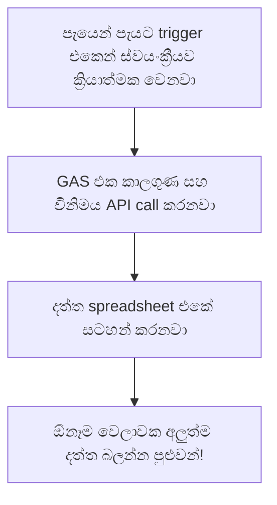

# GAS + API අභ්‍යාසය — කාලගුණ සහ විනිමය අනුපාත දත්ත sheet එකේ ස්වයංක්‍රීයව යාවත්කාලීන කිරීම

> 🇯🇵 මුල් පිටපත (ජපන් භාෂාවෙන්): [20260519.md](<../../1年生_前期_ITシステム基礎/2026_05_19/20260519.md>) <!-- original-ja-link -->

## අද දින ඉලක්ක
- Public API එකක් call කරලා දත්ත ලබා ගන්න පුළුවන් වීම
- ලබා ගත් දත්ත spreadsheet එකේ ස්වයංක්‍රීයව සටහන් කරන්න පුළුවන් වීම
- Trigger එක්ක එකතු කරපු ස්වයංක්‍රීය tool එකක් සම්පූර්ණ කිරීම

---

## 1. අද හදන දේ



---

## 2. විනිමය අනුපාත API (ExchangeRate-API)

මේක නොමිලේ භාවිත කරන්න පුළුවන් විනිමය අනුපාත API එකක්.

```javascript
function getExchangeRate() {
  // ඩොලරයේ සිට එක් එක් මුදල් ඒකකයට විනිමය අනුපාතය ලබා ගන්නවා
  // base=USD → ඩොලර් 1ක් යෙන් කීයද, යුරෝ කීයද වගේ
  const url = "https://open.er-api.com/v6/latest/USD";
  
  const response = UrlFetchApp.fetch(url);
  const data = JSON.parse(response.getContentText());
  
  // data.rates ඇතුළේ එක් එක් මුදල් ඒකකයේ අනුපාතය තියෙනවා
  const jpyRate = data.rates.JPY;   // ඩොලර් → යෙන්
  const eurRate = data.rates.EUR;   // ඩොලර් → යුරෝ
  const gbpRate = data.rates.GBP;   // ඩොලර් → පවුම්
  
  console.log(`1ドル = ${jpyRate}円`);
  console.log(`1ドル = ${eurRate}ユーロ`);
  console.log(`1ドル = ${gbpRate}ポンド`);
  
  return { JPY: jpyRate, EUR: eurRate, GBP: gbpRate };
}
```

---

## 3. කාලගුණ API (Open-Meteo)

```javascript
function getWeatherData() {
  // ටෝකියෝවල කාලගුණය (13 වන පාඩමේ පුනරීක්ෂණය)
  const url = "https://api.open-meteo.com/v1/forecast"
    + "?latitude=35.6762"
    + "&longitude=139.6503"
    + "&current_weather=true"
    + "&hourly=temperature_2m,precipitation_probability";
  
  const response = UrlFetchApp.fetch(url);
  const data = JSON.parse(response.getContentText());
  
  const current = data.current_weather;
  return {
    temperature: current.temperature,
    windspeed: current.windspeed,
    weathercode: current.weathercode
  };
}
```

---

## 4. ඒකාබද්ධ අභ්‍යාසය: spreadsheet එකේ දත්ත ස්වයංක්‍රීයව සටහන් කරන පද්ධතිය

```javascript
// Sheet එකේ 1 වන පේළියේ header ලියනවා (පළමු සැකසුමේදී එක් වරක් පමණක් run කරන්න)
function setupHeader() {
  const sheet = SpreadsheetApp.getActiveSpreadsheet().getActiveSheet();
  sheet.clearContents();
  
  const headers = [["記録日時", "気温(℃)", "風速(km/h)", "1ドル(円)", "1ドル(ユーロ)"]];
  sheet.getRange(1, 1, 1, headers[0].length).setValues(headers);
  sheet.getRange(1, 1, 1, headers[0].length).setFontWeight("bold");
  sheet.getRange(1, 1, 1, headers[0].length).setBackground("#4A90D9");
  sheet.getRange(1, 1, 1, headers[0].length).setFontColor("#FFFFFF");
  
  console.log("ヘッダーを設定しました");
}

// නිතිපතා run වෙන ප්‍රධාන function එක (trigger එකට සකසන්න)
function recordData() {
  const sheet = SpreadsheetApp.getActiveSpreadsheet().getActiveSheet();
  
  // වත්මන් වේලාව
  const now = new Date();
  const timeStr = Utilities.formatDate(now, "Asia/Tokyo", "yyyy/MM/dd HH:mm");
  
  // කාලගුණ දත්ත ලබා ගන්නවා
  let temperature = "取得失敗";
  let windspeed = "取得失敗";
  
  try {
    const weatherUrl = "https://api.open-meteo.com/v1/forecast?latitude=35.6762&longitude=139.6503&current_weather=true";
    const weatherRes = UrlFetchApp.fetch(weatherUrl);
    const weatherData = JSON.parse(weatherRes.getContentText());
    temperature = weatherData.current_weather.temperature;
    windspeed = weatherData.current_weather.windspeed;
  } catch (e) {
    // Error එකක් ආවත් program එක නවත්වන්නේ නැහැ
    console.log("天気取得エラー: " + e.message);
  }
  
  // විනිමය දත්ත ලබා ගන්නවා
  let jpyRate = "取得失敗";
  let eurRate = "取得失敗";
  
  try {
    const fxUrl = "https://open.er-api.com/v6/latest/USD";
    const fxRes = UrlFetchApp.fetch(fxUrl);
    const fxData = JSON.parse(fxRes.getContentText());
    jpyRate = Math.round(fxData.rates.JPY * 100) / 100;  // දශම ස්ථාන 2ක් දක්වා
    eurRate = Math.round(fxData.rates.EUR * 10000) / 10000;
  } catch (e) {
    console.log("為替取得エラー: " + e.message);
  }
  
  // අන්තිම පේළියට පස්සේ එකතු කරනවා
  const nextRow = sheet.getLastRow() + 1;
  const newData = [[timeStr, temperature, windspeed, jpyRate, eurRate]];
  sheet.getRange(nextRow, 1, 1, newData[0].length).setValues(newData);
  
  console.log(`データを記録しました: ${timeStr}`);
}
```

---

## 5. භාවිත කරන ආකාරයේ සාරාංශය

**මුල් වතාවේ සැකසුම:**
1. `setupHeader()` එක පාරක් run කරන්න
2. Trigger එක සකසන්න
3. ඊට පස්සේ දත්ත ස්වයංක්‍රීයව එකතු වෙනවා!

**ක්‍රියාකාරිත්වය පරීක්ෂා කිරීම:**
- `recordData()` අතින් කිහිප වතාවක් run කරලා දත්ත වැඩි වෙනවාද කියලා බලන්න

---

## සාරාංශය · 3 වන අදියර අවසන්!

| ඉගෙන ගත් දේ | සාරාංශය |
|-----------|-------|
| SpreadsheetApp | Cell කියවීම සහ ලිවීම |
| for loop | සියලු පේළි ස්වයංක්‍රීයව සැකසීම |
| Trigger | වේලාව සහ event අනුව ස්වයංක්‍රීයව ක්‍රියාත්මක කිරීම |
| GmailApp | Email ස්වයංක්‍රීයව යැවීම |
| UrlFetchApp | බාහිර API වලින් දත්ත ලබා ගැනීම |
| JSON.parse | JSON string එක object එකක් බවට පරිවර්තනය කිරීම |

---