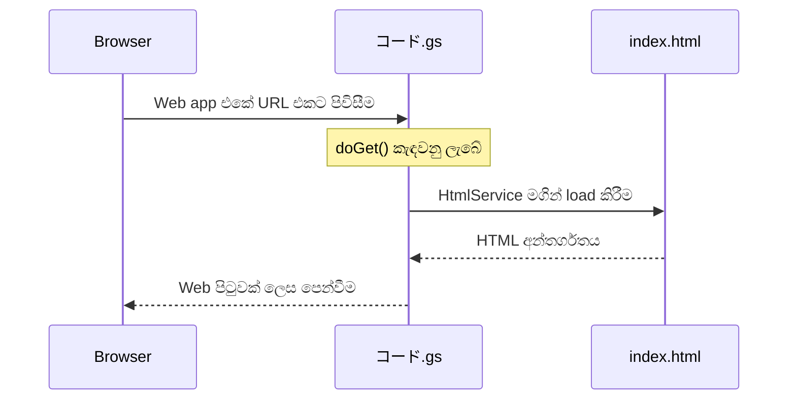

# HTML මූලික කරුණු — Tag, ව්‍යුහය, Form

> 🇯🇵 මුල් පිටපත (ජපන් භාෂාවෙන්): [20260519_html.md](<../../1年生_前期_ITシステム基礎/2026_05_19/20260519_html.md>) <!-- original-ja-link -->

## අද දින ඉලක්ක
- HTML හි මූලික ව්‍යුහය ලිවීමට හැකි වීම
- නිතර භාවිත වන tag හොඳින් භාවිත කිරීමට හැකි වීම
- Form එකක් සෑදීමට හැකි වීම
- GAS හි HTML Service මගින් Web පිටුවක් පෙන්වීමට හැකි වීම

---

## 1. HTML යනු කුමක්ද

**HTML (HyperText Markup Language) = Web පිටුවක "ඇටසැකිල්ල" සාදන භාෂාව**

```
Web පිටුවක සංරචක:
├── HTML → ව්‍යුහය සහ අන්තර්ගතය (ඇට සහ මස්)
├── CSS  → පෙනුම (ඇඳුම් සහ මේකප්)
└── JS   → චලනය (මාංශ පේශි)
```

---

## 2. මූලික ව්‍යුහය

```html
<!DOCTYPE html>
<html lang="ja">
<head>
  <!-- head ඇතුළේ තියෙන්නේ browser එකට දෙන සැකසුම් තොරතුරු. තිරයේ පෙන්වන්නේ නැහැ -->
  <meta charset="UTF-8">
  <title>ページタイトル</title>  <!-- Tab එකේ පෙන්වයි -->
</head>
<body>
  <!-- body ඇතුළේ ලියන දේ තිරයේ පෙන්වයි -->
  <h1>見出し1</h1>
  <p>段落テキスト</p>
</body>
</html>
```

---

## 3. නිතර භාවිත වන tag

### මාතෘකා සහ ඡේද

```html
<h1>大見出し（一番大きい）</h1>
<h2>中見出し</h2>
<h3>小見出し</h3>
<p>段落テキスト。改行は自動。</p>
<br>  <!-- පේළි බිඳීමක් බලහත්කාරයෙන් යෙදීම -->
<hr>  <!-- තිරස් ඉර -->
```

### Link සහ රූප

```html
<!-- Link -->
<a href="https://google.com">Google へ</a>
<a href="page2.html">次のページ</a>          <!-- එකම site එක ඇතුළේ -->
<a href="https://google.com" target="_blank">新しいタブで開く</a>

<!-- රූප -->

<!-- alt = රූපය පෙන්වන්න බැරි වුණොත් ඒ වෙනුවට පෙන්වන text එක -->
```

### ලැයිස්තු

```html
<!-- අංක නැති ලැයිස්තුව (ul = unordered list)-->
<ul>
  <li>りんご</li>
  <li>みかん</li>
  <li>ぶどう</li>
</ul>

<!-- අංක සහිත ලැයිස්තුව (ol = ordered list)-->
<ol>
  <li>手を洗う</li>
  <li>野菜を切る</li>
  <li>炒める</li>
</ol>
```

### Table (වගුව)

```html
<table border="1">
  <thead>
    <tr>
      <th>名前</th>   <!-- th = header cell (තද අකුරු, මැදට) -->
      <th>点数</th>
    </tr>
  </thead>
  <tbody>
    <tr>
      <td>田中太郎</td>   <!-- td = data cell -->
      <td>85</td>
    </tr>
    <tr>
      <td>鈴木花子</td>
      <td>72</td>
    </tr>
  </tbody>
</table>
```

### div සහ span (කණ්ඩායම් කිරීම)

```html
<!-- div = block element කණ්ඩායමක් (සිරස්ව පෙළගැසේ) -->
<div class="box">
  <h2>タイトル</h2>
  <p>内容</p>
</div>

<!-- span = inline element කණ්ඩායමක් (තිරස්ව පෙළගැසේ) -->
<p>テキストの<span style="color: red;">一部だけ</span>を変える</p>
```

---

## 4. Form

මෙය පරිශීලකයාගෙන් දත්ත ඇතුළත් කර ගැනීමට භාවිත කරන අංගයකි.

```html
<form action="" method="post">
  <!-- Text ඇතුළත් කිරීම -->
  <label for="namae">名前：</label>
  <input type="text" id="namae" name="namae" placeholder="名前を入力">
  
  <br>
  
  <!-- Email ඇතුළත් කිරීම -->
  <label for="email">メール：</label>
  <input type="email" id="email" name="email">
  
  <br>
  
  <!-- සංඛ්‍යාත්මක අගයක් ඇතුළත් කිරීම -->
  <label for="age">年齢：</label>
  <input type="number" id="age" name="age" min="0" max="150">
  
  <br>
  
  <!-- Select box -->
  <label for="grade">学年：</label>
  <select id="grade" name="grade">
    <option value="1">1年生</option>
    <option value="2">2年生</option>
    <option value="3">3年生</option>
  </select>
  
  <br>
  
  <!-- Text area (පේළි කිහිපයක්) -->
  <label for="comment">コメント：</label>
  <textarea id="comment" name="comment" rows="4" cols="40"></textarea>
  
  <br>
  
  <!-- Submit button -->
  <button type="submit">送信する</button>
</form>
```

---

## 5. GAS හි HTML Service මගින් Web පිටුවක් පෙන්වීම

GAS භාවිතයෙන් Web පිටුවක් publish කරන්න පුළුවන්!

**ගොනු ව්‍යුහය (GAS editor එකේ සාදන ගොනු):**
- `コード.gs` (GAS හි ප්‍රධාන file එක)
- `index.html` (පෙන්වන HTML file එක)

**コード.gs:**
```javascript
// Web app එකක් ලෙස publish කිරීමට අවශ්‍ය function එක
// URL එකට පිවිසෙන විට මෙම function එක කැඳවනු ලැබේ
function doGet() {
  // index.html load කර පෙන්වයි
  return HtmlService.createHtmlOutputFromFile("index")
    .setTitle("私のWebページ");
}
```

**index.html:**
```html
<!DOCTYPE html>
<html lang="ja">
<head>
  <meta charset="UTF-8">
  <title>GASのWebページ</title>
</head>
<body>
  <h1>こんにちは！GAS HTML サービス</h1>
  <p>これはGASで表示したWebページです。</p>
  
  <ul>
    <li>スプレッドシートのデータを表示できる</li>
    <li>フォームの送信を受け取れる</li>
    <li>インターネットで公開できる</li>
  </ul>
</body>
</html>
```

Publish කළ URL එකට පිවිසුණාම, පහත පිළිවෙළට පිටුව පෙන්වනවා.



**Web app එකක් ලෙස publish කරන ආකාරය:**
1. "Deploy" → "New deployment"
2. වර්ගය: "Web app" තෝරන්න
3. පිවිසිය හැකි user: "Anyone"
4. "Deploy" → URL එකක් නිකුත් වෙනවා!

---

## සාරාංශය

| Tag | භාවිතය |
|------|------|
| `<h1>`〜`<h6>` | මාතෘකා |
| `<p>` | ඡේදය |
| `<a href="">` | Link |
| `` | රූපය |
| `<ul>` / `<ol>` / `<li>` | ලැයිස්තුව |
| `<table>` / `<tr>` / `<td>` | වගුව |
| `<form>` | Form (දත්ත ඇතුළත් කර ගැනීම) |
| `<input>` / `<button>` | ඇතුළත් කිරීමේ කොටස් සහ button |
| `<div>` / `<span>` | කණ්ඩායම් කිරීම |

---
