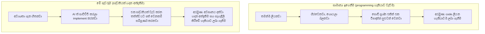
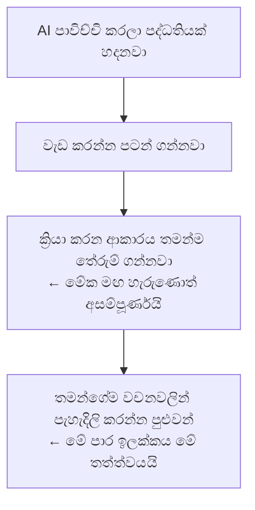

# පාඨමාලාවේ අරමුණ — අවසාන පැවරුම ගැන ආපසු හැරී බැලීම

> 🇯🇵 මුල් පිටපත (ජපන් භාෂාවෙන්): [授業の趣旨_まとめ.md](<../1年生_前期_ITシステム基礎/授業の趣旨_まとめ.md>) <!-- original-ja-link -->

ඉදිරිපත් කිරීම් දැනටමත් අවසන් වුණත්, මේ පැවරුමෙන් අපි බලාපොරොත්තු වුණේ මොනවාද කියලා නැවත පැහැදිලි කරන්නයි මේ ලියන්නේ.
ඉදිරිපත් කිරීම් අහගෙන ඉන්නකොට "AI පාවිච්චි කරන්න පුළුවන්ද?" "මමම code ලියන්න ඕනෑ නැද්ද?" කියලා ව්‍යාකූල වුණ අයත් ඇති කියලා හිතන නිසා, ඒ ප්‍රශ්නවලට පිළිතුරුත් මෙහි ඇතුළත් කළා.

---

## 1. මේ පාඨමාලාවෙන් වැඩියෙන්ම කියා දෙන්න ඕනෑ දේ

Programming කියන්නේ විස්තර කියවලා හරි අහලා හරි විතරක් ප්‍රගුණ කරන්න පුළුවන් දෙයක් නෙවෙයි. **තමන්ම ප්‍රායෝගිකව code ලියමින් වැඩ කිරීම හැර එය ඉගෙන ගන්න වෙනත් ක්‍රමයක් නැහැ** කියලයි මම හිතන්නේ.

ඒ සඳහා ප්‍රායෝගික ඉගෙනුම් ක්‍රමයක් විදිහට, ඉගෙනුම් වෙබ් අඩවිය **paiza** හි skill check භාවිත කරමින්,

```
[ D ප්‍රශ්න ]  ──── ගොඩක් කරන්න ────▶ [ C ප්‍රශ්න ]
 මූලික syntax සහ සිතීමේ ක්‍රමය      ටිකක් සංකීර්ණ ප්‍රශ්නවලට
 අතින් කරලා මතක තබා ගන්න          මුහුණ දීලා යෙදීමේ හැකියාව වඩන්න
```

කියන පිළිවෙළට ඉදිරියට යන්න කියලා මම නිර්දේශ කරනවා. මේ පැවරුම ඉවර වුණාට පස්සෙත්, programming හැකියාව දියුණු කරගන්න කැමති අයට මේක තවමත් පිළිගත්, සාර්ථක ඉගෙනුම් ක්‍රමයක්.

---

## 2. මේ පැවරුමේ අරමුණ සහ කාර්යභාරය

මේ අවසාන පැවරුමට, ඉහත ඉගෙනුම් ක්‍රමයට වඩා ටිකක් වෙනස් අරමුණක් දීලා තියෙනවා.



- **AI භාවිතයට අවසර දී තිබෙනවා**
- අවධානය යොමු වෙන්නේ "හරි code එක තමන්ගේ අතින් විතරක් ලියන්න පුළුවන්ද" කියන එකට නෙවෙයි, **"මුල සිටම එක පද්ධතියක් ඇත්තටම හදලා බලන" අත්දැකීමටමයි**

ඒ කියන්නේ මේ පාර, code පේළියෙන් පේළිය තමන්ම ලියන පුහුණුවට වඩා, අවශ්‍යතා පිළිවෙළකට සකස් කරලා AI ත් පාවිච්චි කරමින් වැඩ කරන දෙයක් හදන අත්දැකීමට මුල් තැන දුන් පැවරුමක්.

---

## 3. ඉදිරිපත් කිරීමේදී පැහැදිලි කිරීම අනිවාර්ය ඇයි

පැවරුම් භාර දීමේ නීතිවල තියෙන "ඉදිරිපත් කිරීමේදී පැහැදිලි කිරීමේ අවශ්‍යතාව" තමයි මේ පැවරුමේ වැදගත්ම කොටස.



AI පාවිච්චි කරලා හදපු පද්ධතියක් වුණත්,

- මොන අරමුණකටද හැදුවේ
- ඒක වැඩ කරන්නේ කොහොමද
- Code එකේ මොන තැන්වලටද තමන්ගේම අදහස් යොදාගෙන වැඩිදියුණු කිරීම් හෝ ගැළපීම් කළේ

කියන දේවල් **තමන්ගේම වචනවලින් පැහැදිලි කරන්න පුළුවන්** වීම අපි බලාපොරොත්තු වෙනවා. AI ලවා හදවලා එතනින් නවත්තන්නේ නැතුව, හදපු දේ ක්‍රියා කරන ආකාරය තමන්ම තේරුම් අරන් පැහැදිලි කරන්න පුළුවන් තත්ත්වයට පත්වීම තමයි මේ අවශ්‍යතාවේ අරමුණ.

---

## 4. "තමන්ම code ලියන්න කැමතියි" කියන අයට

මේ පාර AI භාවිතයට අවසර දුන් නිසා, "AI පාවිච්චි කරනවා කියලා උපකල්පනය කරනවාද?" කියලා ව්‍යාකූල වුණ අයත් හිටියා වගේ.

එහෙම නෙවෙයි. **තමන්ගේම හැකියාවෙන් code ලියන්න කැමති අයට, ලියන්න පුළුවන්.** ඇගයීම කරන්නේ "මොනවද කරන්න පුළුවන්" කියන එක බලලා නිසා, තමන්ම ලියපු code එක වුණත්, AI පාවිච්චි කරපු code එක වුණත්, අවශ්‍යතා සපුරලා තමන්ට පැහැදිලි කරන්න පුළුවන් නම් එකම විදිහට ඇගයීම කරනවා.

ඇත්තටම programming හැකියාව බැරෑරුම් විදිහට දියුණු කරගන්න ඕනෑ නම්, 1 වන කොටසේ සඳහන් කරපු paiza හි D→C ප්‍රශ්න පුහුණුව වගේ, තමන්ම ලියලා, හිරවෙලා, හොයලා බලන අත්දැකීම ඉදිරියටත් මඟ හරින්න බැහැ. මේ පාර AI ට අවසර දුන්නා කියලා, ඒ ඉගෙනුම් ක්‍රමය නවත්තන්න පුළුවන් කියන අදහසක් නැහැ.

---

## 5. AI සහ මෘදුකාංග සංවර්ධනයේ යථාර්ථය

මේ පැවරුම කරපු ආකාරය, සැබෑ වැඩබිම්වල සංවර්ධන කටයුතු කරගෙන යන ආකාරයට ළං කරපු එකක් කියලත් කියන්න පුළුවන්.

```
┌────────────────────────────┐
│  මුල් අවධියේ දළ implementation │ ← බොහෝ විට AI භාර ගනී
└──────────────┬─────────────┘
               ▼
┌────────────────────────────┐
│  දෝෂ සෙවීම, සියුම් නිවැරදි කිරීම │
│  ක්‍රියාව තේරුම් ගැනීම, අනුන්ට පැහැදිලි කිරීම │ ← මිනිසා (ඔබ) භාර ගනී
└────────────────────────────┘
```

වර්තමාන සංවර්ධන වැඩබිම්වලත්,

- මුල් අවධියේ දළ implementation එක AI ට භාර දෙන එක සාමාන්‍ය දෙයක් වෙමින් තියෙනවා
- අනෙක් පැත්තෙන්, දෝෂ සෙවීම, සියුම් නිවැරදි කිරීම්, ක්‍රියා කරන ආකාරය තේරුම් ගැනීම සහ පැහැදිලි කිරීම මිනිසුන් භාර ගන්නවා

කියන වැඩ බෙදීම පුළුල් වෙමින් තියෙනවා. මේ පාර "AI එකෙන් හදලා, අන්තිමට තමන්ම පැහැදිලි කරන" ක්‍රියාවලිය පැවරුමක් කළේ, අද කාලයේ සංවර්ධන කටයුතු සිදු වන ආකාරය අත්විඳින්න සලස්වන අදහසෙනුත් තමයි.

---

## සාරාංශය

- Programming හැකියාව වඩන හොඳම මාර්ගය තමන්ම ලියලා, හිරවෙලා, හොයලා බලන එකයි (paiza D→C)
- මේ පැවරුම ඒ ඉගෙනුම් ක්‍රමයට වඩා වෙනස් අරමුණක් ඇති එකක්. එහි අරමුණ "AI පාවිච්චි කරලා හරි එක පද්ධතියක් අවසානය දක්වා හදන අත්දැකීම" ලබා ගැනීමයි
- AI එකෙන් හැදුවත්, තමන්ම ලිව්වත් ඇගයීම එකයි. වැදගත් වෙන්නේ අන්තිමට තමන්ගේම වචනවලින් පැහැදිලි කරන්න පුළුවන් වීමයි
- මේක අද සැබෑ සංවර්ධන වැඩබිම්වල වැඩ කරන ආකාරයට සමීප අත්දැකීමක් ද වෙනවා
