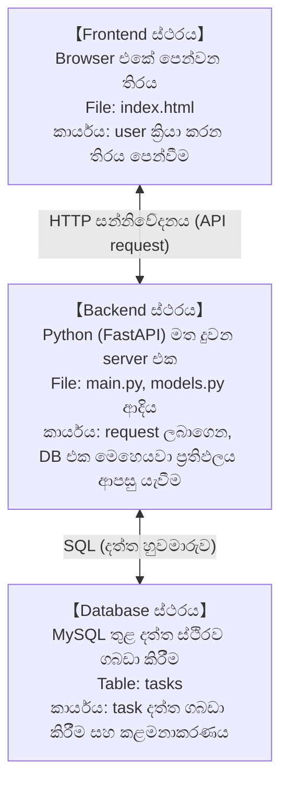
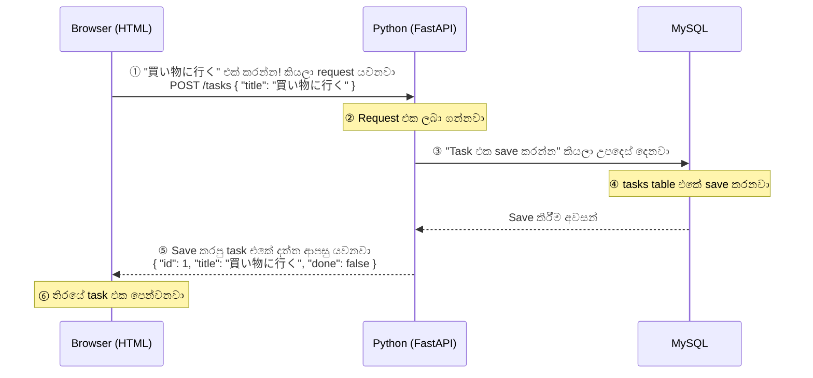

# අමතර කොටස: Task කළමනාකරණ පද්ධතියක් හදමු

> 🇯🇵 මුල් පිටපත (ජපන් භාෂාවෙන්): [00_概要とシステム設計.md](<../../1年生_前期_ITシステム基礎/番外編/00_概要とシステム設計.md>) <!-- original-ja-link -->

## මෙම පාඩමේ ඉලක්ක
- HTML + Python + MySQL යන ස්ථර 3 කින් යුත් පද්ධතියක් තේරුම් ගැනීම
- Python භාවිතයෙන් backend එක implement කිරීමට හැකි වීම
- Frontend (HTML) සහ backend (Python) API හරහා එකට වැඩ කරන ආකාරය තේරුම් ගැනීම

---

## 1. අපි හදන්නේ මොකක්ද

**Task කළමනාකරණ app එකක් (Todo app එකක්)**

```
┌─────────────────────────────────────────┐
│         Task කළමනාකරණ app එක            │
│                                         │
│  [ කළ යුතු දේවල් ලැයිස්තුව ]              │
│  □ සාප්පු යන්න        [අවසන්] [මකන්න]  │
│  ☑ ගෙදර වැඩ ඉවර කරන්න [අවසන්] [මකන්න]  │
│  □ කාමරය පිරිසිදු කරන්න [අවසන්] [මකන්න]  │
│                                         │
│  අලුත් task: [____________] [එක් කරන්න] │
└─────────────────────────────────────────┘
```

කරන්න පුළුවන් දේවල්:
- Task ලැයිස්තුව පෙන්වීම
- අලුත් task එක් කිරීම
- Task එකක් සම්පූර්ණ කළ / නොකළ තත්ත්වයට මාරු කිරීම
- Task මකා දැමීම

---

## 2. පද්ධතියේ සමස්ත චිත්‍රය

මේ පාර හදන පද්ධතිය **ස්ථර 3 කින්** සමන්විතයි.



### සන්නිවේදනයේ ගලායාම (උදා: task එකක් එක් කරන විට)



---

## 3. භාවිත කරන තාක්ෂණය

| කාර්යය | තාක්ෂණය | විස්තරය |
|------|------|------|
| Frontend | HTML + JavaScript | Browser එකේ පෙන්වන තිරය |
| Backend | Python + FastAPI | API server එක |
| DB සම්බන්ධතාව | SQLAlchemy | Python වලින් MySQL මෙහෙයවන library එක |
| Database | MySQL | දත්ත ගබඩා කරන මෘදුකාංගය |

### FastAPI තෝරා ගත්තේ ඇයි

- සරලයි, ආරම්භකයින්ටත් කියවන්න පහසු code ලියන්න පුළුවන්
- `http://localhost:8000/docs` විවෘත කළ පමණින් API එක පරීක්ෂා කිරීම සඳහා තිරයක් ස්වයංක්‍රීයව නිර්මාණය වෙනවා
- Python class (OOP) ස්වාභාවිකව භාවිත වන ලෙස නිර්මාණය කරලා තියෙනවා

---

## 4. Folder ව්‍යුහය

```
my_todo_app/
├── main.py          ← App එක ආරම්භ කරන file එක (entry point)
├── database.py      ← MySQL සම්බන්ධතා සැකසුම්
├── models.py        ← Database table අර්ථ දැක්වීම (class වලින් ලියනවා)
├── schemas.py       ← API දත්ත ආකෘති අර්ථ දැක්වීම (class වලින් ලියනවා)
├── routers/
│   └── tasks.py     ← Task සම්බන්ධ API routing
└── static/
    └── index.html   ← Frontend HTML file එක
```

---

## 5. පරිසරය සකස් කිරීම

### MySQL සූදානම් කිරීම

MySQL install කිරීමේ සහ database සෑදීමේ පියවර OS එක අනුව වෙනස් වෙනවා.
→ **[01_MySQL環境構築.md](./01_MySQL環境構築.md)** බලන්න.

### Python package install කිරීම

#### Mac

Mac එකේ `pip3 install` කෙලින්ම run කළොත් පහත error එක එනවා:
```
error: externally-managed-environment
```

**Virtual environment (venv)** එකක් හදලා ඊට පස්සේ install කරන්න.

```bash
# Project folder එක ඇතුළේ run කරන්න
python3 -m venv venv

# Virtual environment එක activate කරන්න (prompt එකේ (venv) පෙන්නුවොත් හරි)
source venv/bin/activate

# Activate කළාට පස්සේ install කරන්න
pip install fastapi uvicorn sqlalchemy pymysql
```

#### Windows

Windows වල එහෙමම install කරන්න පුළුවන්.

```cmd
pip install fastapi uvicorn sqlalchemy pymysql
```

Virtual environment එකක් භාවිත කරන්න කැමති නම් (නිර්දේශිතයි):

```cmd
python -m venv venv
venv\Scripts\activate
pip install fastapi uvicorn sqlalchemy pymysql
```

| Package | කාර්යය |
|-----------|------|
| `fastapi` | Web API framework එක |
| `uvicorn` | FastAPI run කරන server එක |
| `sqlalchemy` | Python වලින් DB මෙහෙයවන library එක |
| `pymysql` | Python වලින් MySQL වලට සම්බන්ධ වන driver එක |

### Virtual environment යනු කුමක්ද?

```
Virtual environment = Project එකට විතරක් වෙන් වූ Python බහාලුමක්

මුළු system එකේම Python        Project එකට විතරක් වෙන් වූ Python
(වෙනස් නොකළ යුතුයි)            (කැමති package දාන්න පුළුවන්)
      │                              │
      │  python3 -m venv venv (Mac)  │
      │  python -m venv venv (Win)   │
      └──────────────────────────→  venv/
                                      ├── bin/      (Mac)
                                      ├── Scripts/  (Windows)
                                      └── lib/...
```

එක පාරක් හැදුවාට පස්සේ **terminal එක විවෘත කරන හැම වතාවකම activate කරන්න** ඕනෑ:

```bash
source venv/bin/activate   # Mac
```
```cmd
venv\Scripts\activate      # Windows
```

### Server එක ආරම්භ කරන ආකාරය

**Mac (virtual environment එක activate කරලා ආරම්භ කරන්න):**
```bash
source venv/bin/activate
uvicorn main:app --reload
```

**Windows (virtual environment නැතිනම්):**
```cmd
uvicorn main:app --reload
```

ආරම්භ කළාට පස්සේ browser එකේ පහත ඒවා විවෘත කරන්න:
- App තිරය: `http://localhost:8000`
- API documentation: `http://localhost:8000/docs`

---

## 6. ඉගෙනීම කරගෙන යන ආකාරය

| පියවර | ලේඛනය | අන්තර්ගතය |
|---------|------|------|
| 1 | 01_MySQL環境構築 | MySQL install කිරීම සහ DB සෑදීම |
| 2 | 02_Python_OOP入門 | Class යනු කුමක්ද, ඇයි භාවිත කරන්නේ |
| 3 | 03_FastAPI入門 | API server එකක මූලික කොටස හදනවා |
| 4 | 04_データベース連携 | MySQL එක්ක සම්බන්ධ කරලා දත්ත save කරනවා |
| 5 | 05_CRUD_API実装 | ලැයිස්තුව, එක් කිරීම, යාවත්කාලීන කිරීම, මකා දැමීම implement කරනවා |
| 6 | 06_フロントエンド連携 | HTML තිරයෙන් API call කරනවා |

---

> ඊළඟ පියවර → [01_MySQL環境構築.md](./01_MySQL環境構築.md)
