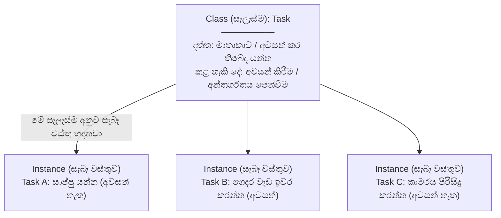

# Python Object-Oriented Programming හැඳින්වීම

> 🇯🇵 මුල් පිටපත (ජපන් භාෂාවෙන්): [02_Python_OOP入門.md](<../../1年生_前期_ITシステム基礎/番外編/02_Python_OOP入門.md>) <!-- original-ja-link -->

## මෙම පාඩමේ ඉලක්ක
- "Class" සහ "instance" අතර වෙනස පැහැදිලි කිරීමට හැකි වීම
- `__init__` method එකේ කාර්යය තේරුම් ගැනීම
- Class භාවිතයෙන් දත්ත සහ ක්‍රියාවලි එකට එකතු කිරීමට හැකි වීම

---

## 1. Object-oriented යනු කුමක්ද?

Object-oriented යනු program ලියන විට **එකිනෙකට සම්බන්ධ දත්ත සහ ක්‍රියාවලි එකට ගොනු කරන** ආකාරයකි.

### උපමාවකින් තේරුම් ගනිමු: "සැලැස්ම" සහ "සැබෑ වස්තුව"



**Class** = සැලැස්ම (එකක් විතරයි තියෙන්නේ)
**Instance** = සැලැස්මෙන් හදපු සැබෑ වස්තුව (ඕනෑ තරම් හදන්න පුළුවන්)

---

## 2. Class එකක් ලියලා බලමු

### පියවර 1: සරලම class එක

```python
# Class එක අර්ථ දැක්වීම
class Task:
    pass  # තවම කිසිවක් නැත
```

```python
# Instance එකක් හදනවා
task1 = Task()  # Task class එකෙන් instance එකක් හදනවා
task2 = Task()  # තව එකක් හදන්නත් පුළුවන්

print(task1)  # <__main__.Task object at 0x...>
print(task2)  # <__main__.Task object at 0x...> ← වෙනම instance එකක්
```

---

### පියවර 2: දත්ත තබා ගැනීම (`__init__`)

`__init__` යනු **instance එකක් හදන විට ස්වයංක්‍රීයව call වන විශේෂ method එකක්**.
මෙය "constructor" ලෙසත් හඳුන්වනවා.

```python
class Task:
    # Instance එකක් හදන විට ස්වයංක්‍රීයව call වේ
    def __init__(self, title):
        # self = "මේ instance එකම" යන්න දක්වයි
        self.title = title       # මාතෘකාව save කරනවා
        self.done = False        # මුලින් අවසන් නැත

# Instance හදනවා (මේ වෙලාවේ __init__ call වේ)
task1 = Task("買い物に行く")
task2 = Task("宿題を終わらせる")

# Instance එකේ දත්තවලට පිවිසෙනවා
print(task1.title)  # 買い物に行く
print(task1.done)   # False
print(task2.title)  # 宿題を終わらせる
```

**වැදගත් කරුණ: `self` යනු කුමක්ද?**
```
task1 = Task("買い物に行く")
          ↑
    මේ instance එක (task1) self බවට පත් වෙනවා

self.title = title
→ task1.title = "買い物に行く" යන්නට සමානයි
```

---

### පියවර 3: Method එකතු කිරීම

Method එකක් යනු **class එකක් තුළ අර්ථ දක්වන ලද function එකකි**.

```python
class Task:
    def __init__(self, title):
        self.title = title
        self.done = False

    # අවසන් කරන method එක
    def complete(self):
        self.done = True
        print(f"「{self.title}」を完了にしました！")

    # අන්තර්ගතය පෙන්වන method එක
    def show(self):
        status = "☑" if self.done else "□"
        print(f"{status} {self.title}")
```

```python
# භාවිත කරලා බලමු
task1 = Task("買い物に行く")
task2 = Task("宿題を終わらせる")

task1.show()      # □ 買い物に行く
task2.show()      # □ 宿題を終わらせる

task2.complete()  # 「宿題を終わらせる」を完了にしました！

task1.show()      # □ 買い物に行く
task2.show()      # ☑ 宿題を終わらせる
```

---

## 3. Class භාවිත නොකරන අවස්ථාව සමඟ සැසඳීම

**Class භාවිත නොකළොත්:**

```python
# දත්ත විසිරී තියෙන නිසා කළමනාකරණය අමාරුයි
title1 = "買い物に行く"
done1 = False

title2 = "宿題を終わらせる"
done2 = False

# අවසන් කරන ක්‍රියාවලියත් වෙන වෙනම ලියන්න වෙනවා
done2 = True
print(f"「{title2}」を完了にしました！")

# Task වැඩි වුණොත්... title3, done3, title4, done4... ඉවරයක් නැහැ
```

**Class භාවිත කළොත්:**

```python
# දත්ත සහ ක්‍රියාවලි එකට! Task වැඩි වුණත් කළමනාකරණය පහසුයි
tasks = [
    Task("買い物に行く"),
    Task("宿題を終わらせる"),
    Task("部屋を掃除する"),
]

# සියල්ල පෙන්වනවා
for task in tasks:
    task.show()
```

---

## 4. මේ පද්ධතියේ OOP භාවිත වන තැන්

OOP (Object-Oriented Programming) මේ පද්ධතියේ **වැදගත් තැන් 2 ක** භාවිත කරනවා.

### ① Database table අර්ථ දැක්වීම (models.py)

```python
# Table = class, එක් පේළියක දත්ත = instance
class Task(Base):
    __tablename__ = "tasks"

    id = Column(Integer, primary_key=True)
    title = Column(String(200))
    done = Column(Boolean, default=False)
```

### ② API දත්ත ආකෘති අර්ථ දැක්වීම (schemas.py)

```python
# Request/response දත්ත ආකෘතිය class එකකින් නිරූපණය කරනවා
class TaskCreate(BaseModel):
    title: str  # ලබා ගන්නා දත්ත: මාතෘකාව විතරයි

class TaskResponse(BaseModel):
    id: int
    title: str
    done: bool  # ආපසු යවන දත්ත: id, මාතෘකාව, අවසන් වූ බව දක්වන flag එක
```

Class භාවිත කිරීමෙන්, **මොන වගේ දත්තද හසුරුවන්නේ කියලා එක බැල්මෙන් තේරෙන** code එකක් හැදෙනවා.

---

## 5. පුහුණු වෙමු

පහත class එක සම්පූර්ණ කරන්න.

```python
class Task:
    def __init__(self, title):
        self.title = title
        self.done = False

    def complete(self):
        # මෙතන "අවසන් කරන" ක්‍රියාවලිය ලියන්න
        pass

    def show(self):
        # මෙතන "අන්තර්ගතය පෙන්වන" ක්‍රියාවලිය ලියන්න
        pass

# පරීක්ෂාව
t = Task("テスト用タスク")
t.show()     # □ テスト用タスク  ලෙස පෙන්විය යුතුයි
t.complete()
t.show()     # ☑ テスト用タスク  ලෙස පෙන්විය යුතුයි
```

---

> පෙර පියවර → [01_MySQL環境構築.md](./01_MySQL環境構築.md)
> ඊළඟ පියවර → [03_FastAPI入門.md](./03_FastAPI入門.md)
