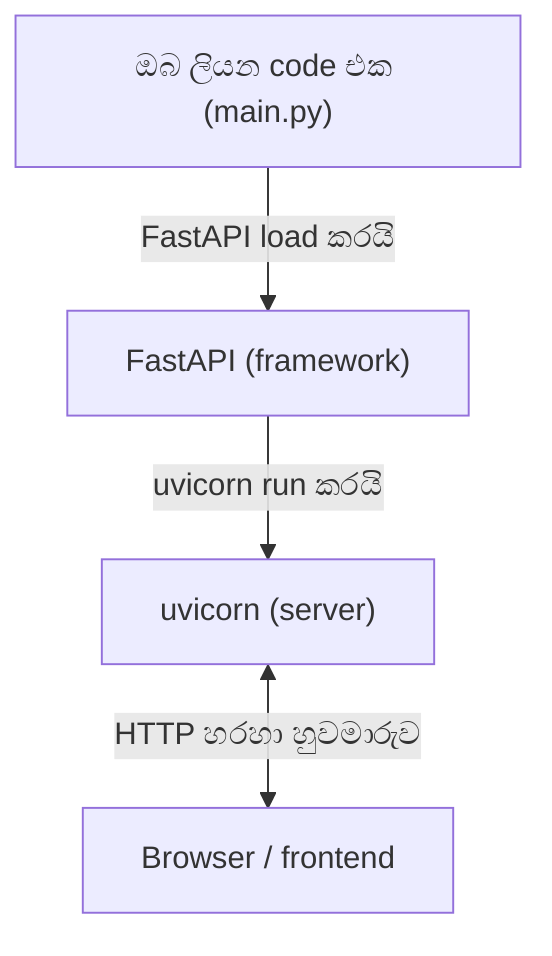
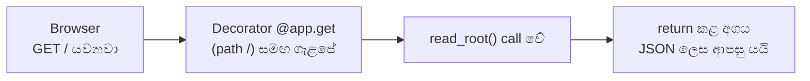

# FastAPI හැඳින්වීම

> 🇯🇵 මුල් පිටපත (ජපන් භාෂාවෙන්): [03_FastAPI入門.md](<../../1年生_前期_ITシステム基礎/番外編/03_FastAPI入門.md>) <!-- original-ja-link -->

## මෙම පාඩමේ ඉලක්ක
- FastAPI භාවිතයෙන් සරල API server එකක් ආරම්භ කිරීමට හැකි වීම
- `@app.get` වැනි decorator වල අර්ථය තේරුම් ගැනීම
- Swagger UI භාවිතයෙන් browser එකෙන් API test කිරීමට හැකි වීම

---

## 1. FastAPI යනු කුමක්ද?

**FastAPI = Python වලින් API server හදන්න භාවිත කරන framework එකක්**

Framework එකක් කියන්නේ "නිතර භාවිත වන විශේෂාංග එකට එකතු කරපු පහසු මෙවලම් පෙට්ටියක්".



---

## 2. Hello World හදමු

මුලින්ම සරලම API server එක හදලා බලමු.

### main.py

```python
from fastapi import FastAPI

# FastAPI instance එක හදනවා (app එකේ මූලික කොටස)
app = FastAPI()

# "/" වෙත පිවිසුණු විට කරන ක්‍රියාවලිය
@app.get("/")
def read_root():
    return {"message": "Hello, World!"}
```

### ආරම්භ කිරීම

**Windows / Mac දෙකටම පොදුයි:**
```bash
uvicorn main:app --reload
```

```
INFO:     Uvicorn running on http://127.0.0.1:8000
INFO:     Application startup complete.
```

Browser එකේ `http://localhost:8000` විවෘත කළාම:
```json
{"message": "Hello, World!"}
```

---

## 3. Decorator තේරුම් ගනිමු

Code එකේ තියෙන `@app.get("/")` එකට **decorator** කියලා කියනවා.

```python
@app.get("/")          # ← Decorator
def read_root():       # ← මේ function එකට "/ වෙත GET request එකක් ආවොත් call කරන්න" කියන සැකසුම දීලා තියෙනවා
    return {...}
```

Request එකක් ලැබුණු මොහොතේ සිට response එක ආපසු යවන තෙක් සිදුවන ක්‍රියාවලිය පහත පරිදියි.



### HTTP method සහ decorator අතර සම්බන්ධය

| කරන්න ඕනෑ දේ | HTTP method | Decorator |
|------------|-------------|-----------|
| දත්ත ලබා ගැනීම | GET | `@app.get(...)` |
| අලුත් දත්ත සෑදීම | POST | `@app.post(...)` |
| දත්ත යාවත්කාලීන කිරීම | PUT | `@app.put(...)` |
| දත්ත මකා දැමීම | DELETE | `@app.delete(...)` |

---

## 4. Path parameter (URL එකට අගයක් ඇතුළත් කිරීම)

```python
@app.get("/tasks/{task_id}")
def get_task(task_id: int):  # URL එකේ {task_id} argument එකක් ලෙස ලැබේ
    return {"task_id": task_id, "title": "サンプルタスク"}
```

`http://localhost:8000/tasks/3` වෙත පිවිසුණාම:
```json
{"task_id": 3, "title": "サンプルタスク"}
```

---

## 5. Swagger UI — API test කරන තිරය

FastAPI හි පහසු විශේෂාංගවලින් එකක් තමයි **Swagger UI**.
Code එක ලිවීමෙන් පමණක්, **browser එකෙන් API test කරන්න පුළුවන් තිරයක් ස්වයංක්‍රීයව හැදෙනවා**.

`http://localhost:8000/docs` විවෘත කළාම, මේ වගේ තිරයක් පෙන්වනවා:

```
┌────────────────────────────────────────────┐
│  FastAPI                                   │
│                                            │
│  GET  /        Hello World ආපසු දෙයි        │
│  ▼ Try it out                              │
│    [Execute]                               │
│                                            │
│  Response:                                 │
│  {"message": "Hello, World!"}              │
└────────────────────────────────────────────┘
```

**Develop කරන අතරතුර Swagger UI එකෙන් ක්‍රියාකාරිත්වය පරීක්ෂා කරන එක පහසුයි.**

---

## 6. Task කළමනාකරණ API එකේ ඇටසැකිල්ල හදමු

සැබෑ පද්ධතිය සඳහා, task කළමනාකරණ API එකේ ඇටසැකිල්ල හදනවා.

```python
# main.py
from fastapi import FastAPI
from fastapi.staticfiles import StaticFiles

app = FastAPI()

# static folder එකේ HTML file ලබා දෙන සැකසුම
app.mount("/static", StaticFiles(directory="static"), name="static")

# Root (/) වෙත පිවිසුණොත් index.html පෙන්වනවා
from fastapi.responses import FileResponse

@app.get("/")
def read_index():
    return FileResponse("static/index.html")


# --- Task සම්බන්ධ API (පසු පියවරවලදී සම්පූර්ණ කරනවා) ---

@app.get("/tasks")
def get_tasks():
    # Task ලැයිස්තුව ආපසු දෙනවා (පසුව DB සමඟ සම්බන්ධ කරනවා)
    return []

@app.post("/tasks")
def create_task():
    # Task එකක් හදනවා (පසුව DB සමඟ සම්බන්ධ කරනවා)
    return {"message": "タスクを作成しました"}

@app.put("/tasks/{task_id}")
def toggle_task(task_id: int):
    # Task එකේ සම්පූර්ණ කළ / නොකළ තත්ත්වය මාරු කරනවා (පසුව DB සමඟ සම්බන්ධ කරනවා)
    return {"message": f"タスク {task_id} を更新しました"}

@app.delete("/tasks/{task_id}")
def delete_task(task_id: int):
    # Task එක මකා දමනවා (පසුව DB සමඟ සම්බන්ධ කරනවා)
    return {"message": f"タスク {task_id} を削除しました"}
```

### ආරම්භ කර පරීක්ෂා කිරීම

**Windows / Mac දෙකටම පොදුයි:**
```bash
uvicorn main:app --reload
```

`http://localhost:8000/docs` විවෘත කරලා, endpoint 4 ම පෙන්වනවාද කියලා පරීක්ෂා කරමු.

```
GET    /tasks      Task ලැයිස්තුව ලබා ගැනීම
POST   /tasks      Task එකක් සෑදීම
PUT    /tasks/{id} සම්පූර්ණ කළ තත්ත්වය මාරු කිරීම
DELETE /tasks/{id} Task එකක් මකා දැමීම
```

---

## 7. මෙතෙක් ඉගෙන ගත් වැදගත් කරුණු

```
① FastAPI instance එක හදනවා
   app = FastAPI()

② Decorator එකෙන් URL එක සහ method එක නියම කරනවා
   @app.get("/tasks")

③ ඊට යටින් තියෙන function එක තමයි සැබෑ ක්‍රියාවලිය
   def get_tasks():
       return [...]

④ Function එක return කරන අගය JSON ලෙස response එක බවට පත් වෙනවා
   return [{"id": 1, "title": "買い物"}]
   → Browser එකට [{"id": 1, "title": "買い物"}] ආපසු යනවා
```

---

> පෙර පියවර → [02_Python_OOP入門.md](./02_Python_OOP入門.md)
> ඊළඟ පියවර → [04_データベース連携.md](./04_データベース連携.md)
