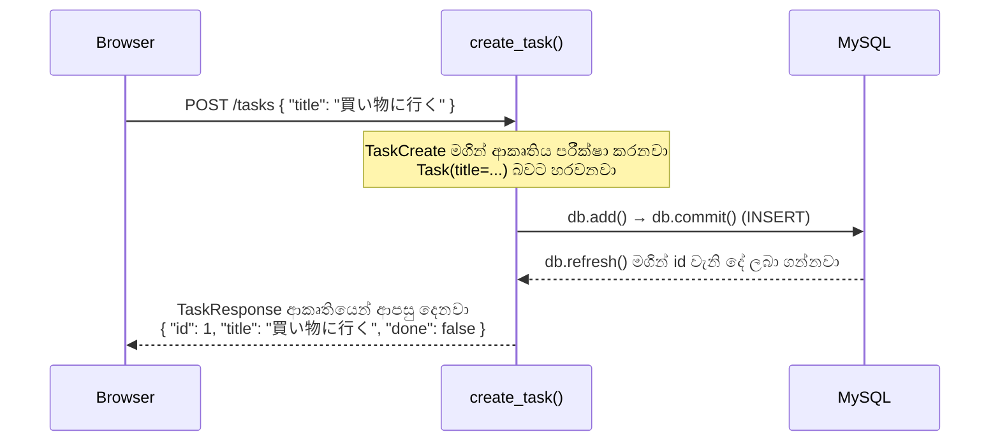

# CRUD API implement කිරීම

> 🇯🇵 මුල් පිටපත (ජපන් භාෂාවෙන්): [05_CRUD_API実装.md](<../../1年生_前期_ITシステム基礎/番外編/05_CRUD_API実装.md>) <!-- original-ja-link -->

## මෙම පාඩමේ ඉලක්ක
- Pydantic schema class භාවිතයෙන් දත්ත ආකෘති අර්ථ දැක්වීමට හැකි වීම
- GET / POST / PUT / DELETE යන API 4 implement කිරීමට හැකි වීම
- Swagger UI එකෙන් එක් එක් API එක වැඩ කරන ආකාරය පරීක්ෂා කිරීමට හැකි වීම

---

## 1. CRUD යනු කුමක්ද?

**CRUD** = දත්ත මෙහෙයවීමේ මූලික රටා 4 හි මුල් අකුරු

| අකුර | ක්‍රියාව | SQL | HTTP method |
|------|------|-----|-------------|
| C | Create (සෑදීම) | INSERT | POST |
| R | Read (ලබා ගැනීම) | SELECT | GET |
| U | Update (යාවත්කාලීන කිරීම) | UPDATE | PUT |
| D | Delete (මකා දැමීම) | DELETE | DELETE |

---

## 2. schemas.py — API දත්ත ආකෘති අර්ථ දැක්වීම

**Pydantic** යනු class භාවිතයෙන් දත්ත ආකෘති අර්ථ දක්වන library එකකි.
FastAPI සමඟ භාවිත කරන විට, **request/response දත්ත ස්වයංක්‍රීයව validate කරයි**.

```python
# schemas.py

from pydantic import BaseModel

# Task එකක් හදන විට ලබා ගන්නා දත්ත
class TaskCreate(BaseModel):
    title: str  # මාතෘකාව විතරක් ලබා ගන්නවා (id සහ done තීරණය කරන්නේ server එක)

# API response එකේ ආපසු යවන දත්ත
class TaskResponse(BaseModel):
    id: int
    title: str
    done: bool

    # SQLAlchemy model object එක එහෙමම දෙන්න පුළුවන් වෙන්න කරන සැකසුම
    class Config:
        from_attributes = True
```

### Schema වෙනම file එකක ලියන්නේ ඇයි?

```
models.py  → Database එකේ ආකෘතිය (කොහොමද save කරන්නේ)
schemas.py → API එකේ ආකෘතිය (මොන දත්තද ලබා ගන්නේ / ආපසු දෙන්නේ)

උදා: Task එකක් හදන විට
  ලබා ගන්නේ (TaskCreate): title විතරයි
  ආපසු දෙන්නේ (TaskResponse): id + title + done
  Save කරන්නේ (Task model):  id + title + done (id ස්වයංක්‍රීයව ලබා දේ)
```

---

## 3. routers/tasks.py — API 4 implement කිරීම

```python
# routers/tasks.py

from fastapi import APIRouter, Depends, HTTPException
from sqlalchemy.orm import Session
from database import get_db
from models import Task
from schemas import TaskCreate, TaskResponse

# Router = URL එකතුවක් (මෙහි /tasks සම්බන්ධ API එකට ගොනු කරයි)
router = APIRouter(prefix="/tasks", tags=["tasks"])
```

---

### R — Task ලැයිස්තුව ලබා ගැනීම (GET /tasks)

```python
# ⚠️ "/" නොවෙයි "" දාන්න ("/" දැම්මොත් /tasks → /tasks/ වෙත redirect එකක් සිදු වෙනවා)
@router.get("", response_model=list[TaskResponse])
def get_tasks(db: Session = Depends(get_db)):
    """සියලු task ලබාගෙන ආපසු දෙනවා"""
    tasks = db.query(Task).all()  # SELECT * FROM tasks
    return tasks
```

**`Depends(get_db)` යනු කුමක්ද?**
```
db: Session = Depends(get_db)
↑
"get_db function එකේ ප්‍රතිඵලය (DB session එක) db ට ලබා දෙන්න"
කියන අර්ථයයි. API එක call වන හැම වතාවකම DB සම්බන්ධතාව සූදානම් කරලා දෙනවා.
```

---

### C — Task එකක් සෑදීම (POST /tasks)

```python
@router.post("", response_model=TaskResponse)
def create_task(task_in: TaskCreate, db: Session = Depends(get_db)):
    """අලුත් task එකක් හදනවා"""
    # ලැබුණු දත්ත (TaskCreate) Task model instance එකක් බවට හරවනවා
    new_task = Task(title=task_in.title)

    db.add(new_task)    # DB එකට එකතු කරන්න සූදානම් කරනවා
    db.commit()         # DB එකේ save කරනවා (INSERT run වේ)
    db.refresh(new_task)  # DB එක ස්වයංක්‍රීයව සැකසූ id වැනි දේ ලබා ගන්නවා
    return new_task
```

POST /tasks call වූ විට සිදු වන ගලායාම රූප සටහනකින් පෙන්නුවොත් මෙහෙමයි.



---

### U — සම්පූර්ණ කළ තත්ත්වය මාරු කිරීම (PUT /tasks/{task_id})

```python
@router.put("/{task_id}", response_model=TaskResponse)
def toggle_task(task_id: int, db: Session = Depends(get_db)):
    """Task එකේ සම්පූර්ණ කළ / නොකළ තත්ත්වය මාරු කරනවා"""
    # අදාළ task එක ලබා ගන්නවා
    task = db.query(Task).filter(Task.id == task_id).first()

    # Task එක හම්බ වුණේ නැත්නම් 404 error එකක්
    if task is None:
        raise HTTPException(status_code=404, detail="タスクが見つかりません")

    # done අගය පෙරළනවා (True → False, False → True)
    task.done = not task.done

    db.commit()         # DB එකේ save කරනවා (UPDATE run වේ)
    db.refresh(task)
    return task
```

---

### D — Task එකක් මකා දැමීම (DELETE /tasks/{task_id})

```python
@router.delete("/{task_id}")
def delete_task(task_id: int, db: Session = Depends(get_db)):
    """Task එක මකා දමනවා"""
    task = db.query(Task).filter(Task.id == task_id).first()

    if task is None:
        raise HTTPException(status_code=404, detail="タスクが見つかりません")

    db.delete(task)     # මකා දැමීමට සූදානම් කරනවා
    db.commit()         # DB එකෙන් මකා දමනවා (DELETE run වේ)
    return {"message": f"タスク '{task.title}' を削除しました"}
```

---

## 4. main.py එකේ router එක ලියාපදිංචි කිරීම

```python
# main.py (සම්පූර්ණ කළ අනුවාදය)

from fastapi import FastAPI
from fastapi.staticfiles import StaticFiles
from fastapi.responses import FileResponse
from database import engine, Base
import models
from routers import tasks  # ← එකතු කළා

# Table එක ස්වයංක්‍රීයව සාදනවා
Base.metadata.create_all(bind=engine)

app = FastAPI()

# Router එක ලියාපදිංචි කරනවා (/tasks යටතේ ඇති API ක්‍රියාත්මක වේ)
app.include_router(tasks.router)  # ← එකතු කළා

app.mount("/static", StaticFiles(directory="static"), name="static")

@app.get("/")
def read_index():
    return FileResponse("static/index.html")
```

---

## 5. File ව්‍යුහය (මේ මොහොතේ)

```
my_todo_app/
├── main.py         ← Router ලියාපදිංචිය එකතු කර ඇත
├── database.py     ← DB සම්බන්ධතා සැකසුම්
├── models.py       ← Task table අර්ථ දැක්වීම
├── schemas.py      ← ★ මේ පාර හැදුවා: දත්ත ආකෘති අර්ථ දැක්වීම
├── routers/
│   ├── __init__.py ← හිස් file එකක් (folder එක Python package එකක් ලෙස හඳුනා ගැනීමට)
│   └── tasks.py    ← ★ මේ පාර හැදුවා: CRUD API
└── static/
    └── index.html  ← ඊළඟ පියවරේදී හදනවා
```

`routers/__init__.py` හිස් file එකක් වුණාට කමක් නැහැ:

**Windows:**
```cmd
type nul > routers\__init__.py
```

**Mac:**
```bash
touch routers/__init__.py
```

---

## 6. Swagger UI එකෙන් ක්‍රියාකාරිත්වය පරීක්ෂා කිරීම

**Windows / Mac දෙකටම පොදුයි:**
```bash
uvicorn main:app --reload
```

`http://localhost:8000/docs` විවෘත කරලා පරීක්ෂා කරනවා.

**පරීක්ෂා කරන පියවර (POST → GET → PUT → DELETE පිළිවෙළට):**

1. **POST /tasks** click කරන්න → `Try it out` → Request body එකේ ඇතුළත් කරන්න:
   ```json
   {"title": "買い物に行く"}
   ```
   → `Execute` → Response එකේ `{"id": 1, "title": "買い物に行く", "done": false}` ආපසු ලැබිය යුතුයි

2. **GET /tasks** click කරන්න → `Try it out` → `Execute`
   → හදපු task එක ආපසු ලැබෙන ලැයිස්තුවේ තිබිය යුතුයි

3. **PUT /tasks/{task_id}** click කරන්න → `task_id` එකට `1` ඇතුළත් කරන්න → `Execute`
   → `"done": true` බවට වෙනස් විය යුතුයි

4. **DELETE /tasks/{task_id}** click කරන්න → `task_id` එකට `1` ඇතුළත් කරන්න → `Execute`
   → මකා දැමූ බව කියන message එක ආපසු ලැබිය යුතුයි

---

> පෙර පියවර → [04_データベース連携.md](./04_データベース連携.md)
> ඊළඟ පියවර → [06_フロントエンド連携.md](./06_フロントエンド連携.md)
