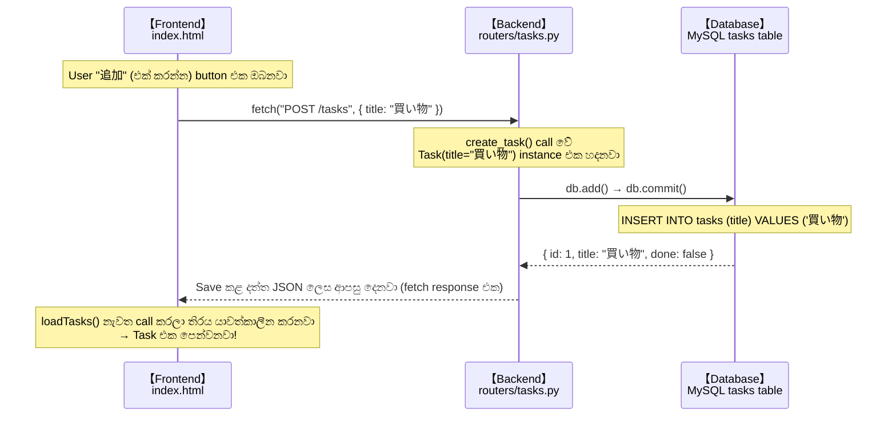

# Frontend සම්බන්ධ කිරීම (HTML + JavaScript)

> 🇯🇵 මුල් පිටපත (ජපන් භාෂාවෙන්): [06_フロントエンド連携.md](<../../1年生_前期_ITシステム基礎/番外編/06_フロントエンド連携.md>) <!-- original-ja-link -->

## මෙම පාඩමේ ඉලක්ක
- `fetch()` භාවිතයෙන් Python API එක call කිරීමට හැකි වීම
- API response එක තිරයේ පෙන්වීමට (DOM මෙහෙයවීම) හැකි වීම
- Task එක් කිරීම, සම්පූර්ණ කළ / නොකළ තත්ත්වය මාරු කිරීම සහ මකා දැමීම තිරයෙන්ම කිරීමට හැකි වීම

---

## 1. SPA (Single Page Application) යනු කුමක්ද?

මේ පාර හදන frontend එක **SPA** කියන ක්‍රමය භාවිතා කරනවා.

```
සාම්ප්‍රදායික Web අඩවිය (පිටු මාරු වීම් සහිතයි)
  ක්‍රියාවක් කරන හැම වතාවකම මුළු පිටුවම නැවත load වෙනවා
  පිටුව A → පිටුව B → පිටුව C ...

SPA (Single Page Application)
  එක HTML file එකක් තුළ, JavaScript මගින් තිරය ගතිකව වෙනස් කරනවා
  පිටුව නැවත load වෙන්නේ නැහැ → වේගයෙන් ක්‍රියාත්මක වන බවක් දැනෙනවා
```

මේ පාර **index.html කියන එකම file එකෙන්** සියල්ල සම්පූර්ණ වෙනවා.

---

## 2. Folder සූදානම් කිරීම

**Windows:**
```cmd
mkdir static
type nul > static\index.html
```

**Mac:**
```bash
mkdir static
touch static/index.html
```

---

## 3. index.html — සම්පූර්ණ code එක

```html
<!DOCTYPE html>
<html lang="ja">
<head>
  <meta charset="UTF-8">
  <meta name="viewport" content="width=device-width, initial-scale=1.0">
  <title>タスク管理アプリ</title>
  <style>
    body {
      font-family: Arial, sans-serif;
      max-width: 600px;
      margin: 40px auto;
      padding: 0 20px;
      background: #f5f5f5;
    }
    h1 { color: #333; }

    /* Task එක් කරන form එක */
    .add-form {
      display: flex;
      gap: 8px;
      margin-bottom: 20px;
    }
    .add-form input {
      flex: 1;
      padding: 8px;
      font-size: 16px;
      border: 1px solid #ccc;
      border-radius: 4px;
    }
    .add-form button {
      padding: 8px 16px;
      background: #4CAF50;
      color: white;
      border: none;
      border-radius: 4px;
      cursor: pointer;
      font-size: 16px;
    }

    /* Task ලැයිස්තුව */
    .task-list { list-style: none; padding: 0; }
    .task-item {
      display: flex;
      align-items: center;
      gap: 8px;
      background: white;
      padding: 12px;
      margin-bottom: 8px;
      border-radius: 4px;
      box-shadow: 0 1px 3px rgba(0,0,0,0.1);
    }
    .task-title { flex: 1; font-size: 16px; }
    .task-title.done {
      text-decoration: line-through;
      color: #999;
    }
    .btn-done {
      padding: 4px 12px;
      background: #2196F3;
      color: white;
      border: none;
      border-radius: 4px;
      cursor: pointer;
    }
    .btn-delete {
      padding: 4px 12px;
      background: #f44336;
      color: white;
      border: none;
      border-radius: 4px;
      cursor: pointer;
    }
  </style>
</head>
<body>

  <h1>タスク管理アプリ</h1>

  <!-- Task එක් කරන form එක -->
  <div class="add-form">
    <input type="text" id="newTaskInput" placeholder="新しいタスクを入力...">
    <button onclick="addTask()">追加</button>
  </div>

  <!-- Task ලැයිස්තුව (JavaScript මගින් වෙනස් කරනවා) -->
  <ul class="task-list" id="taskList">
    <!-- Task මෙතන පෙන්වනවා -->
  </ul>

  <script>
    // ============================================================
    // API එකේ base URL එක (Python server එකේ ලිපිනය)
    // ============================================================
    const API_URL = "http://localhost:8000";

    // ============================================================
    // R — Task ලැයිස්තුව ලබාගෙන තිරයේ පෙන්වනවා
    // ============================================================
    async function loadTasks() {
      // fetch() මගින් GET request එකක් යවනවා
      const response = await fetch(`${API_URL}/tasks`);
      const tasks = await response.json();  // Response එක JSON බවට හරවනවා

      // Task ලැයිස්තුව මුලින් හිස් කරනවා
      const taskList = document.getElementById("taskList");
      taskList.innerHTML = "";

      // එක් එක් task එක සඳහා <li> එකක් හදලා එකතු කරනවා
      tasks.forEach(task => {
        const li = document.createElement("li");
        li.className = "task-item";
        li.innerHTML = `
          <span class="task-title ${task.done ? 'done' : ''}">${task.title}</span>
          <button class="btn-done" onclick="toggleTask(${task.id})">
            ${task.done ? '未完了に戻す' : '完了'}
          </button>
          <button class="btn-delete" onclick="deleteTask(${task.id})">削除</button>
        `;
        taskList.appendChild(li);
      });
    }

    // ============================================================
    // C — Task එකක් එක් කරනවා
    // ============================================================
    async function addTask() {
      const input = document.getElementById("newTaskInput");
      const title = input.value.trim();

      // කිසිවක් ඇතුළත් කර නැත්නම් කිසිවක් කරන්නේ නැහැ
      if (!title) return;

      // fetch() මගින් POST request එකක් යවනවා
      await fetch(`${API_URL}/tasks`, {
        method: "POST",
        headers: {
          "Content-Type": "application/json"  // JSON යවන බව දන්වනවා
        },
        body: JSON.stringify({ title: title })  // JavaScript object → JSON string
      });

      // ඇතුළත් කරන කොටුව හිස් කරලා, ලැයිස්තුව නැවත load කරනවා
      input.value = "";
      loadTasks();
    }

    // ============================================================
    // U — Task එකේ සම්පූර්ණ කළ / නොකළ තත්ත්වය මාරු කරනවා
    // ============================================================
    async function toggleTask(taskId) {
      // fetch() මගින් PUT request එකක් යවනවා
      await fetch(`${API_URL}/tasks/${taskId}`, {
        method: "PUT"
      });

      loadTasks();  // ලැයිස්තුව නැවත load කරනවා
    }

    // ============================================================
    // D — Task එක මකා දමනවා
    // ============================================================
    async function deleteTask(taskId) {
      // fetch() මගින් DELETE request එකක් යවනවා
      await fetch(`${API_URL}/tasks/${taskId}`, {
        method: "DELETE"
      });

      loadTasks();  // ලැයිස්තුව නැවත load කරනවා
    }

    // ============================================================
    // Enter key එකෙනුත් task එක් කරන්න පුළුවන් කරනවා
    // ============================================================
    document.getElementById("newTaskInput").addEventListener("keydown", function(e) {
      if (e.key === "Enter") {
        addTask();
      }
    });

    // පිටුව විවෘත කළ විට task ලැයිස්තුව load කරනවා
    loadTasks();
  </script>

</body>
</html>
```

---

## 4. Code එකේ වැදගත් කරුණු පැහැදිලි කිරීම

### `fetch()` හි මූලික රටාව

```javascript
// GET (දත්ත ලබා ගැනීම)
const response = await fetch("http://localhost:8000/tasks");
const data = await response.json();

// POST (දත්ත යැවීම)
await fetch("http://localhost:8000/tasks", {
  method: "POST",
  headers: { "Content-Type": "application/json" },
  body: JSON.stringify({ title: "買い物" })
});

// PUT (යාවත්කාලීන කිරීම)
await fetch("http://localhost:8000/tasks/1", {
  method: "PUT"
});

// DELETE (මකා දැමීම)
await fetch("http://localhost:8000/tasks/1", {
  method: "DELETE"
});
```

### `async / await` යනු කුමක්ද?

```javascript
// API සන්නිවේදනය "කාලය ගතවන ක්‍රියාවලියක්" නිසා,
// ප්‍රතිඵලය ලැබෙනකම් බලා සිටිය යුතුයි

async function loadTasks() {         // async = මේ function එකේ asynchronous ක්‍රියාවලි ඇත
  const response = await fetch(...); // await = ප්‍රතිඵලය එනකම් මෙතන බලා සිටිනවා
  const tasks = await response.json();
  // ↑ response.json() ක්‍රියාවලියටත් කාලය ගතවන නිසා await අවශ්‍යයි
}
```

### DOM මෙහෙයවීම (තිරය වෙනස් කිරීම)

```javascript
// DOM = HTML element JavaScript මගින් මෙහෙයවන ක්‍රමය

// id="taskList" element එක ලබා ගන්නවා
const taskList = document.getElementById("taskList");

// ඇතුළත ඇති දේ හිස් කරනවා
taskList.innerHTML = "";

// අලුත් element එකක් හදලා එකතු කරනවා
const li = document.createElement("li");
li.innerHTML = `<span>${task.title}</span>`;
taskList.appendChild(li);
```

---

## 5. ක්‍රියාකාරිත්වය පරීක්ෂා කිරීම

### ආරම්භ කිරීම

**Windows / Mac දෙකටම පොදුයි:**
```bash
uvicorn main:app --reload
```

Browser එකේ `http://localhost:8000` විවෘත කරන්න.

### පරීක්ෂා කරන පියවර

1. **Task එකක් එක් කරන්න**
   - ඇතුළත් කරන කොටුවේ "買い物に行く" (සාප්පු යන්න) ලියලා "追加" (එක් කරන්න) button එක click කරන්න
   - ලැයිස්තුවේ පෙන්විය යුතුයි

2. **අවසන් කරන්න**
   - "完了" (අවසන්) button එක click කරන්න
   - මාතෘකාව මැදින් ඉරක් ඇඳිය යුතුයි

3. **මකා දමන්න**
   - "削除" (මකන්න) button එක click කරන්න
   - ලැයිස්තුවෙන් අතුරුදහන් විය යුතුයි

4. **පිටුව නැවත load කරන්න (F5)**
   - දත්ත ඉතිරිව තිබිය යුතුයි (MySQL එකේ save වෙලා තියෙන නිසා)

---

## 6. පද්ධතිය සම්පූර්ණයි! සමස්ත ගලායාමේ සාරාංශය



---

> පෙර පියවර → [05_CRUD_API実装.md](./05_CRUD_API実装.md)
> ඊළඟ පියවර → [07_コードリーディング.md](./07_コードリーディング.md)
> මුල සිට බලන්න → [00_概要とシステム設計.md](./00_概要とシステム設計.md)
