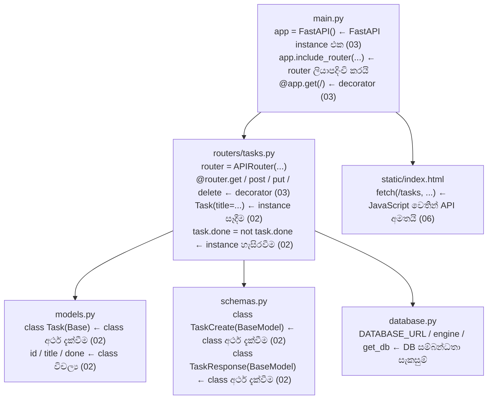

# කේත කියවීම — පරීක්ෂණ කේතය හරහා ඉගෙනගත් දේ තහවුරු කරගැනීම

> 🇯🇵 මුල් පිටපත (ජපන් භාෂාවෙන්): [07_コードリーディング.md](<../../1年生_前期_ITシステム基礎/番外編/07_コードリーディング.md>) <!-- original-ja-link -->

## මෙම පාඩමේ ඉලක්ක
- `02_Python_OOP入門` හි ඉගෙනගත් class සැබෑ කේතයේ කොතැනද භාවිත වී ඇත්තේ දැයි පැහැදිලි කළ හැකි වීම
- `03_FastAPI入門` හි ඉගෙනගත් decorator සැබෑ කේතයේ කොතැනද භාවිත වී ඇත්තේ දැයි පැහැදිලි කළ හැකි වීම
- ගොනු 5 එකිනෙකට සම්බන්ධ වන්නේ කෙසේදැයි තේරුම් ගැනීම

---

## ගොනු කියවන අනුපිළිවෙල

```
① models.py     ← OOP (class) ගැන ඉගෙනගත් දේ එක්තැන් වන තැන
② schemas.py    ← OOP (class) ගැන ඉගෙනගත් දේ එක්තැන් වන තැන
③ main.py       ← FastAPI (decorator) ගැන ඉගෙනගත් දේ එක්තැන් වන තැන
④ routers/tasks.py ← OOP + FastAPI දෙකම මෙහි ඇත
⑤ database.py   ← සම්බන්ධතා සැකසුම් (යොමුවක් ලෙස)
```

---

## ① models.py කියවමු

```python
from sqlalchemy import Column, Integer, String, Boolean
from database import Base

class Task(Base):
    __tablename__ = "tasks"

    id    = Column(Integer, primary_key=True, index=True)
    title = Column(String(200), nullable=False)
    done  = Column(Boolean, default=False)
```

### 02_OOP入門 සමඟ සැසඳීම

**`class Task` → class එකක් අර්ථ දැක්වීම (02 පියවර 1 හි ඉගෙනගත්තා)**

```
02 හි ඉගෙනගත් ලිවීමේ ක්‍රමය    සැබෑ කේතය
─────────────────────    ──────────────────────
class Task:              class Task(Base):
    pass                     __tablename__ = "tasks"
```

`(Base)` යන්න **inheritance (උරුමය)** ලෙස හැඳින්වේ. `Base` නම් class එකේ හැකියාවන් උරුම කරගෙන `Task` class එක සාදා ඇත.
"SQLAlchemy හි සියලුම හැකියාවන් භාවිත කළ හැකි වන ලෙස කරන සැකසුමක්" ලෙස තේරුම් ගන්න.

---

**`id / title / done` → class විචල්‍ය (instance එකක් සතු දත්ත)**

02 හි `Task` class එකේ `self.title` සහ `self.done` constructor එක තුළ අර්ථ දැක්වූවා.
`models.py` හි SQLAlchemy හි `Column()` භාවිත කර එම දේම කරයි.

```
02 හි ඉගෙනගත් ලිවීමේ ක්‍රමය          සැබෑ කේතය (models.py)
─────────────────────────    ──────────────────────────────────
class Task:                  class Task(Base):
    def __init__(self):
        self.title = ...         title = Column(String(200))
        self.done = False        done  = Column(Boolean, default=False)
```

ලියන ආකාරය වෙනස් වුවත්, "**class එක සතු දත්ත මොනවාද**" යන්න අර්ථ දැක්වීම යන කරුණ සමානයි.

---

**Instance එකක් සාදන අවස්ථාව (routers/tasks.py වෙතින්)**

```python
# Task class එකෙන් instance එකක් සාදයි (02 හි පියවර 2 හා සමානයි!)
new_task = Task(title=task_in.title)
#          ↑ Task class   ↑ title වෙත අගයක් ලබාදෙයි
```

02 හි අභ්‍යාසය සමඟ සැසඳීම:
```python
# 02 හි අභ්‍යාසය                    සැබෑ කේතය
task1 = Task("買い物に行く")   new_task = Task(title="買い物に行く")
```

කරන දේ සම්පූර්ණයෙන්ම සමානයි.

---

## ② schemas.py කියවමු

```python
from pydantic import BaseModel

class TaskCreate(BaseModel):
    title: str

class TaskResponse(BaseModel):
    id: int
    title: str
    done: bool

    class Config:
        from_attributes = True
```

### 02_OOP入門 සමඟ සැසඳීම

**Class 2ක් අර්ථ දක්වා ඇත → ඒවායේ භාවිතය වෙනස්**

```
Class නාමය        කාර්යභාරය                  Instance එක සෑදෙන අවස්ථාව
────────────    ─────────────────────    ──────────────────────────────
TaskCreate      POST ඉල්ලීම ලබාගනී        බ්‍රවුසරයෙන් "එකතු කරන්න" එබූ විට
TaskResponse    ප්‍රතිචාරය ආපසු යවයි        API ප්‍රතිඵලය ආපසු යවන විට
```

**`title: str` → type annotation සහිත class විචල්‍යයක්**

02 හි `self.title = title` ලෙස ලිව්වා,
නමුත් Pydantic class එකක `title: str` ලෙස ලිවීමෙන් පමණක් "title යනු string එකකි" ලෙස අර්ථ දැක්විය හැකිය.

```python
# 02 හි ලිවීමේ ක්‍රමය (සාමාන්‍ය class)       schemas.py හි ලිවීමේ ක්‍රමය (Pydantic class)
def __init__(self, title):         class TaskCreate(BaseModel):
    self.title = title                 title: str   ← පේළි 1කින් ලිවිය හැකියි!
```

**`class Config` → class එකක් තුළ class එකක්**

Class එකක් තුළ වෙනත් class එකක් ලිවිය හැකිය.
මෙහිදී SQLAlchemy model object එක එලෙසම ලබාදිය හැකි වන ලෙස සැකසුමක් ලියා ඇත.

---

## ③ main.py කියවමු

```python
from fastapi import FastAPI
from fastapi.staticfiles import StaticFiles
from fastapi.responses import FileResponse
from database import engine, Base
import models
from routers import tasks

Base.metadata.create_all(bind=engine)

app = FastAPI()

app.include_router(tasks.router)

app.mount("/static", StaticFiles(directory="static"), name="static")

@app.get("/")
def read_index():
    return FileResponse("static/index.html")
```

### 03_FastAPI入門 සමඟ සැසඳීම

**`app = FastAPI()` → FastAPI instance එකක් සාදයි (03 හි ඉගෙනගත්තා)**

```
03 හි ඉගෙනගත් දේ              සැබෑ කේතය
─────────────────────    ──────────────────────
app = FastAPI()           app = FastAPI()   ← සම්පූර්ණයෙන්ම සමානයි!
```

---

**`@app.get("/")` → decorator (03 හි ඉගෙනගත්තා)**

```python
@app.get("/")          # ← "/ වෙත GET ඉල්ලීමක් පැමිණි විට මෙම function එක අමතන්න"
def read_index():
    return FileResponse("static/index.html")
```

03 හි Hello World සමඟ සැසඳීම:
```
03 හි අභ්‍යාසය                          සැබෑ කේතය
─────────────────────────────────   ──────────────────────────────────
@app.get("/")                        @app.get("/")
def read_root():                     def read_index():
    return {"message": "Hello!"}         return FileResponse("static/index.html")
```

වෙනස් වන්නේ `return` හි අන්තර්ගතය පමණි, decorator භාවිත කරන ආකාරය සම්පූර්ණයෙන්ම සමානයි.

---

**`app.include_router(tasks.router)` → අලුතින් හමුවන දෙයක්: router**

03 හි සියලුම endpoint `main.py` තුළ ලිව්වා.
සැබෑ පද්ධතියක, කාර්ය සම්බන්ධ API `routers/tasks.py` තුළ එකට ලියා,
`main.py` තුළ "මෙම router එක භාවිත කරනවා" ලෙස ලියාපදිංචි කරයි.

```
03 හි ව්‍යුහය (සියල්ල main.py හි ලියයි)       සැබෑ පද්ධතිය (ගොනු වෙන් කරයි)
─────────────────────────────────   ──────────────────────────────────
@app.get("/tasks")                   routers/tasks.py හි ලියයි
@app.post("/tasks")                       ↓
@app.put("/tasks/{id}")              main.py හි ලියාපදිංචි කරයි
@app.delete("/tasks/{id}")           app.include_router(tasks.router)
```

**ගොනු වෙන් කරන්නේ ඇයි?**
→ කාර්ය, පරිශීලකයන්, නිෂ්පාදන වැනි කාර්යයන් වැඩි වන විට, සියල්ල ගොනු 1ක ලිව්වොත් කියවීමට අපහසු වන නිසා.

---

**`Base.metadata.create_all(bind=engine)` → වගු ස්වයංක්‍රීයව සෑදීම**

යෙදුම ආරම්භ වන සෑම වාරයකම "tasks වගුව නොමැති නම් එය සාදන්න" යන්න ස්වයංක්‍රීයව සිදු කරයි.
`models.py` හි `Task` class එක පදනම් කරගෙන වගුව සාදයි.

---

## ④ routers/tasks.py කියවමු

OOP (02) සහ FastAPI (03) දෙකම භාවිත වන වැදගත්ම ගොනුව මෙයයි.

```python
from fastapi import APIRouter, Depends, HTTPException
from sqlalchemy.orm import Session
from database import get_db
from models import Task
from schemas import TaskCreate, TaskResponse

router = APIRouter(prefix="/tasks", tags=["tasks"])
```

**`router = APIRouter(...)` → app හා සමාන, router සඳහාම වූ instance එකක්**

```
main.py             routers/tasks.py
────────────────    ──────────────────────────────
app = FastAPI()     router = APIRouter(prefix="/tasks")
@app.get("/")       @router.get("")
```

`prefix="/tasks"` හි අර්ථය: මෙම router එකේ decorator තුළ ලියන URL එකට ඉදිරියෙන් `/tasks` ස්වයංක්‍රීයව එකතු වේ.

```
@router.get("")   →  සැබෑ URL එක /tasks
@router.get("/{task_id}")  →  සැබෑ URL එක /tasks/{task_id}
```

---

### GET /tasks — ලැයිස්තුව ලබාගැනීම

```python
@router.get("", response_model=list[TaskResponse])
def get_tasks(db: Session = Depends(get_db)):
    return db.query(Task).all()
```

**`@router.get("")` → decorator (03 හි ඉගෙනගත්තා)**
`router` එකට යෙදීමෙන් `/tasks` වෙත එන GET ඉල්ලීම් හසුරුවයි.

**`response_model=list[TaskResponse]` → ප්‍රතිචාරයේ ආකෘතිය නියම කරයි**
`schemas.py` හි `TaskResponse` class එකේ instance ලැයිස්තුවක් ආපසු යවන බව ප්‍රකාශ කරයි.

**`Depends(get_db)` → අලුතින් හමුවන දෙයක්: dependency injection**
"`get_db` function එකේ ප්‍රතිඵලය (DB සම්බන්ධතාවය) `db` වෙත ලබාදෙන්න" යන FastAPI ක්‍රමයකි.
API අමතන සෑම වාරයකම DB සම්බන්ධතාවය ස්වයංක්‍රීයව සූදානම් කර දෙයි.

**`db.query(Task).all()` → Task class එකේ instance සියල්ල ලබාගනී**
```
db.query(Task).all()
             ↑
         OOP හි Task class එක නියම කරයි
         → tasks වගුවේ සියලුම පේළි Task instance ලැයිස්තුවක් ලෙස ලබාගනී
```

---

### POST /tasks — කාර්යයක් සෑදීම

```python
@router.post("", response_model=TaskResponse)
def create_task(task_in: TaskCreate, db: Session = Depends(get_db)):
    new_task = Task(title=task_in.title)  # ← OOP! instance එකක් සාදයි
    db.add(new_task)
    db.commit()
    db.refresh(new_task)
    return new_task
```

**`task_in: TaskCreate` → schemas.py හි class එක මෙතැනදී භාවිත වේ**
බ්‍රවුසරයෙන් එවන JSON ස්වයංක්‍රීයව `TaskCreate` instance එකක් බවට පරිවර්තනය වේ.

```
බ්‍රවුසරය එවන දත්ත        FastAPI ස්වයංක්‍රීයව පරිවර්තනය කරයි
────────────────────    ──────────────────────────────
{"title": "買い物"}  →  task_in = TaskCreate(title="買い物")
                                             ↑ task_in.title මගින් ලබාගත හැකිය
```

**`new_task = Task(title=task_in.title)` → OOP (02 පියවර 2 හා සමානයි)**

```
02 හි අභ්‍යාසය                         සැබෑ කේතය
─────────────────────────────    ──────────────────────────────
task1 = Task("買い物に行く")       new_task = Task(title=task_in.title)
```

Instance එකක් සාදා එහි දත්ත රඳවා ගැනීම OOP සඳහා හොඳම උදාහරණයකි.

---

### PUT /tasks/{task_id} — සම්පූර්ණ කළ තත්ත්වය මාරු කිරීම

```python
@router.put("/{task_id}", response_model=TaskResponse)
def toggle_task(task_id: int, db: Session = Depends(get_db)):
    task = db.query(Task).filter(Task.id == task_id).first()

    if task is None:
        raise HTTPException(status_code=404, detail="タスクが見つかりません")

    task.done = not task.done   # ← OOP! instance එකේ දත්ත වෙනස් කරයි
    db.commit()
    db.refresh(task)
    return task
```

**`/{task_id}` → path parameter (03 හි ඉගෙනගත්තා)**

```
03 හි අභ්‍යාසය                          සැබෑ කේතය
─────────────────────────────     ──────────────────────────────
@app.get("/tasks/{task_id}")       @router.put("/{task_id}")
def get_task(task_id: int):        def toggle_task(task_id: int, ...):
```

URL එකේ ඇති අංකය (උදා: `/tasks/3`) `task_id = 3` ලෙස ලැබේ.

**`task.done = not task.done` → instance එකේ දත්ත කෙලින්ම වෙනස් කරයි**

```
ලබාගත් task instance එකේ done අගය ප්‍රතිවිරුද්ධ කරයි
task.done False නම් → not False → True  (අසම්පූර්ණ → සම්පූර්ණ)
task.done True නම්  → not True  → False (සම්පූර්ණ → අසම්පූර්ණ)
```

---

### DELETE /tasks/{task_id} — මකා දැමීම

```python
@router.delete("/{task_id}")
def delete_task(task_id: int, db: Session = Depends(get_db)):
    task = db.query(Task).filter(Task.id == task_id).first()

    if task is None:
        raise HTTPException(status_code=404, detail="タスクが見つかりません")

    db.delete(task)
    db.commit()
    return {"message": f"タスク '{task.title}' を削除しました"}
```

**`raise HTTPException(status_code=404, ...)` → දෝෂයක් ආපසු යවයි**

`task` හමු නොවූ විට (`is None`), 404 දෝෂයක් බ්‍රවුසරයට ආපසු යවයි.
`raise` යනු "මෙම දෝෂය දැන්ම ඇති කරන්න" යන Python වාක්‍ය රීතියකි.

---

## ⑤ සමස්ත සම්බන්ධතාවය



---

## සාරාංශය: 02 සහ 03 හි ඉගෙනගත් දේ භාවිත වන ආකාරය

| ඉගෙනගත් දේ | පාඩම | සැබෑ කේතය |
|-----------|------|-------------|
| `class ClassName:` මගින් class එකක් අර්ථ දැක්වීම | 02 | `models.py` හි `Task`, `schemas.py` හි `TaskCreate` ආදිය |
| `instance = ClassName(arguments)` | 02 | `new_task = Task(title=...)` |
| Instance එකේ දත්ත වෙනස් කිරීම | 02 | `task.done = not task.done` |
| `app = FastAPI()` | 03 | `main.py` හි පළමු පේළිය |
| `@app.get(...)` decorator | 03 | `@router.get("") / @router.post("") ආදිය` |
| `/{parameter}` path parameter | 03 | `@router.put("/{task_id}")` |

---

> පෙර පියවර → [06_フロントエンド連携.md](./06_フロントエンド連携.md)
> පරීක්ෂණ කේතය → [検証/todo_app/](./検証/todo_app/)
