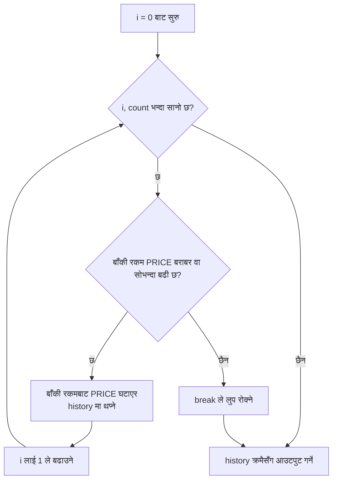
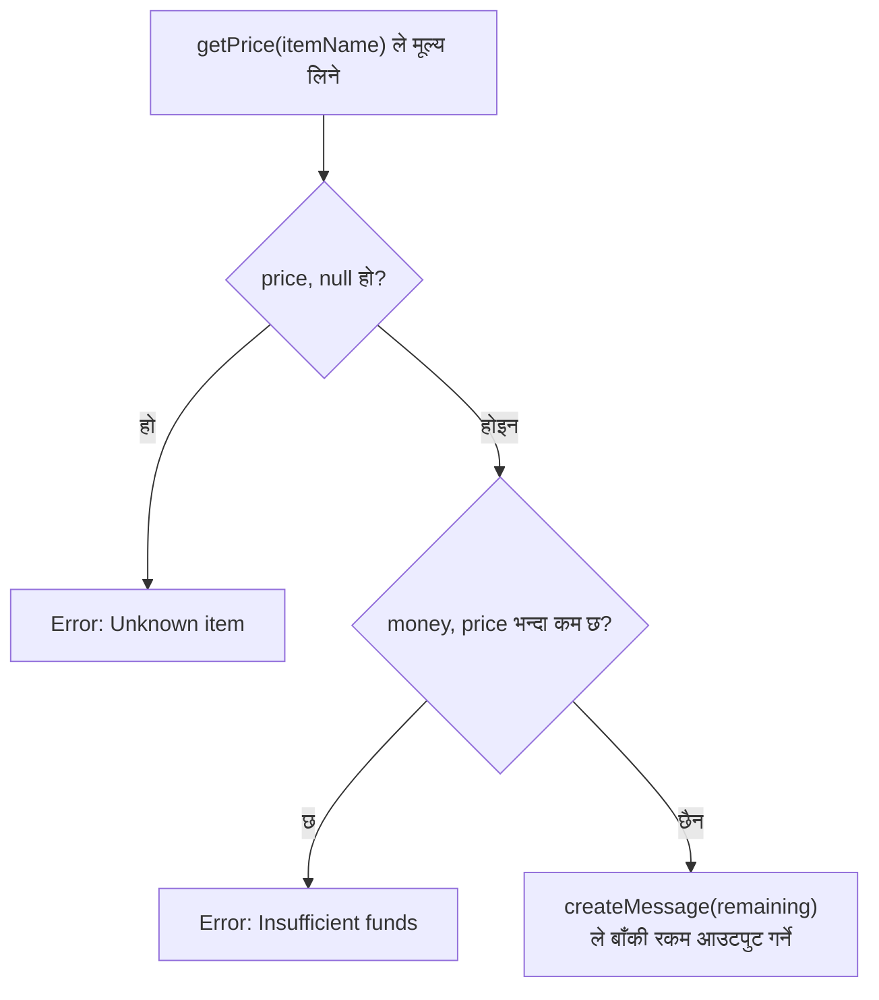

> 🇯🇵 मूल प्रति (जापानी भाषामा): [2026_04_21_演習.md](<../../1年生_前期_ITシステム基礎/2026_04_21/2026_04_21_演習.md>) <!-- original-ja-link -->


---

## समग्र अभ्यास: भेन्डिङ मेसिन प्रोग्रामको विकास

### [STEP 1] भेरिएबल र कन्स्ट्यान्टको आधारभूत कुरा

**आवश्यकता:**
- सामानको मूल्यलाई कन्स्ट्यान्ट `PRICE` (150) मा परिभाषित गर्ने।
- स्ट्यान्डर्ड इनपुटबाट "हालेको रकम" लाई सङ्ख्याको रूपमा लिने।
- हालेको रकमबाट मूल्य घटाएर "बाँकी रकम" हिसाब गरी, `Remaining: [सङ्ख्या]` भनेर आउटपुट गर्ने।

JavaScript

```
const reader = require('readline').createInterface({
  input: process.stdin,
  output: process.stdout
});

const lines = [];
reader.on('line', (line) => {
  lines.push(line);
});

reader.on('close', () => {
  const PRICE = 150;
  let money = Number(lines[0]); // पहिलो लाइनको इनपुट
  
  let remaining = money - PRICE;
  console.log(`Remaining: ${remaining}`);
});
```

---

### [STEP 2] if स्टेटमेन्टद्वारा सर्तअनुसार शाखा छुट्याउने

**आवश्यकता:**
- हालेको रकम `PRICE` भन्दा कम भएमा, `Error: Insufficient funds` आउटपुट गरेर अन्त्य गर्ने।
- रकम पुगेको अवस्थामा मात्र फिर्ता रकम आउटपुट गर्ने।

JavaScript

```
reader.on('close', () => {
  const PRICE = 150;
  let money = Number(lines[0]);

  if (money < PRICE) {
    console.log("Error: Insufficient funds");
  } else {
    let remaining = money - PRICE;
    console.log(`Remaining: ${remaining}`);
  }
});
```

---

### [STEP 3] एरे र for स्टेटमेन्ट (धेरै वटा किन्ने)

**आवश्यकता:**
- इनपुटको पहिलो लाइनमा "हालेको रकम", दोस्रो लाइनमा "किन्न चाहेको बोतल सङ्ख्या" दिइन्छ।
- एउटा बोतल किन्दा पिच्छे बाँकी रकम हिसाब गरी, त्यसको इतिहास एरे `history` मा थप्दै जाने।
- किन्दै गर्दा बीचमा बाँकी रकम नपुगेमा, त्यहीँ लुप रोक्ने।
- अन्त्यमा एरेका एलिमेन्टहरू लुप प्रयोग गरी क्रमैसँग आउटपुट गर्ने।

किन्ने प्रक्रियाको लुपको प्रवाह यस्तो छ।



JavaScript

```
reader.on('close', () => {
  let money = Number(lines[0]);
  const count = Number(lines[1]);
  const PRICE = 150;
  const history = [];

  // किन्ने प्रक्रियाको लुप
  for (let i = 0; i < count; i++) {
    if (money >= PRICE) {
      money -= PRICE;
      history.push(money);
    } else {
      break;
    }
  }

  // एरेका एलिमेन्टहरू लुप प्रयोग गरी आउटपुट गर्ने
 (for स्टेटमेन्ट संस्करण)
  for (let i = 0; i < history.length; i++) {
    // history[i] ले एरेको हरेक एलिमेन्टमा पहुँच गर्छ
    console.log(`Step ${i + 1}: ${history[i]}`);
  }
});
```


```
reader.on('close', () => {
  let money = Number(lines[0]);
  const count = Number(lines[1]);
  const PRICE = 150;
  const history = [];

  for (let i = 0; i < count; i++) {
    if (money >= PRICE) {
      money -= PRICE;
      history.push(money);
    } else {
      break;
    }
  }

  // एरेका एलिमेन्टहरू लुप प्रयोग गरी आउटपुट गर्ने

  history.forEach((rem, index) => {
    console.log(`Step ${index + 1}: ${rem}`);
  });
});
```

---

### [STEP 4] रिफ्याक्टरिङ: switch स्टेटमेन्टद्वारा धेरै शाखा

**आवश्यकता:**

- इनपुटको पहिलो लाइनमा "हालेको रकम", दोस्रो लाइनमा "सामानको नाम (Coke, Water, Coffee)" दिइन्छ।
- `switch` स्टेटमेन्ट प्रयोग गरी, सामानको नामअनुसार मूल्य बदल्ने।
    - Coke: 150, Water: 100, Coffee: 120
    - अरू कुनै भए: `Error: Unknown item` आउटपुट गर्ने।

JavaScript

```
reader.on('close', () => {
  let money = Number(lines[0]);
  const itemName = lines[1]; // सामानको नाम
  let price = 0;

  // if / else if प्रयोग गरेर धेरै शाखा
  if (itemName === "Coke") {
    price = 150;
  } else if (itemName === "Water") {
    price = 100;
  } else if (itemName === "Coffee") {
    price = 120;
  } else {
    // कुनै पनि सर्तमा नमिलेमा (switch को default जस्तै)
    console.log("Error: Unknown item");
    return; 
  }

  // किन्न सकिन्छ कि जाँच्ने
  if (money >= price) {
    console.log(`Remaining: ${money - price}`);
  } else {
    console.log("Error: Insufficient funds");
  }
});
```

```
reader.on('close', () => {
  let money = Number(lines[0]);
  const itemName = lines[1]; // दोस्रो लाइन: सामानको नाम
  let price = 0;

  switch (itemName) {
    case "Coke":
      price = 150;
      break;
    case "Water":
      price = 100;
      break;
    case "Coffee":
      price = 120;
      break;
    default:
      console.log("Error: Unknown item");
      return; // प्रक्रिया अन्त्य गर्ने
  }

  if (money >= price) {
    console.log(`Remaining: ${money - price}`);
  } else {
    console.log("Error: Insufficient funds");
  }
});
```

---

### [STEP 5] अन्तिम रिफ्याक्टरिङ: फङ्सनमा छुट्याउने

### [STEP 5] रिफ्याक्टरिङ: फङ्सनमा छुट्याउने र टेम्प्लेट लिटरल

**आवश्यकता:**
- सामानको नामबाट मूल्य फर्काउने फङ्सन `getPrice(name)` बनाउने।
- किनेपछिको बाँकी रकम हिसाब गरी स्ट्रिङ फर्काउने फङ्सन `createMessage(remaining)` बनाउने।
- मुख्य प्रक्रियालाई यी फङ्सनहरू प्रयोग गरेर व्यवस्थित गर्ने।

मुख्य प्रक्रियाको जाँचको प्रवाह यस्तो छ।



JavaScript

```
// मूल्य निर्धारण गर्ने फङ्सन
const getPrice = (name) => {
  switch (name) {
    case "Coke":   return 150;
    case "Water":  return 100;
    case "Coffee": return 120;
    default:       return null;
  }
};

// सन्देश बनाउने फङ्सन (टेम्प्लेट लिटरल)
const createMessage = (remaining) => `Result: Remaining balance is ${remaining} yen.`;

reader.on('close', () => {
  const money = Number(lines[0]);
  const itemName = lines[1];
  
  const price = getPrice(itemName);

  if (price === null) {
    console.log("Error: Unknown item");
  } else if (money < price) {
    console.log("Error: Insufficient funds");
  } else {
    const remaining = money - price;
    console.log(createMessage(remaining));
  }
});
```

---

### 💡 कक्षामा पढाउँदा ध्यान दिनुपर्ने कुरा

- **एसिन्क्रोनस प्रक्रियाप्रति सचेत हुने:** `reader.on('close', ...)` को बाहिर प्रक्रिया लेख्यो भने, इनपुट पूरा हुनुअघि नै चल्छ र त्रुटि आउँछ भन्ने कुरा बताउनुहोस्।
    
- **एरेको इन्डेक्स:** `lines[0]` वा `lines[1]` जस्तै, इनपुट कुन क्रममा आउँछ भन्नेमा ध्यान दिन लगाउनु महत्त्वपूर्ण छ।
    
- **trim() को आवश्यकता:** यस पटकको कोडमा राखिएको छैन, तर इनपुटमा अनावश्यक खाली ठाउँ (space) हुन सक्ने भएकाले, व्यवहारमा `lines.push(line.trim());` गर्नुपर्छ भनेर सिकाउनु झन् उपयोगी हुन्छ।