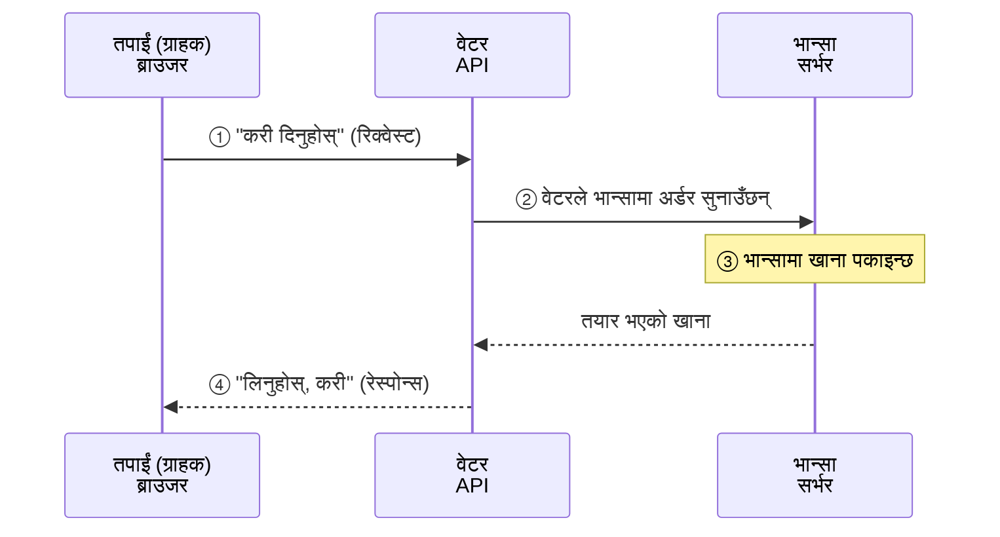
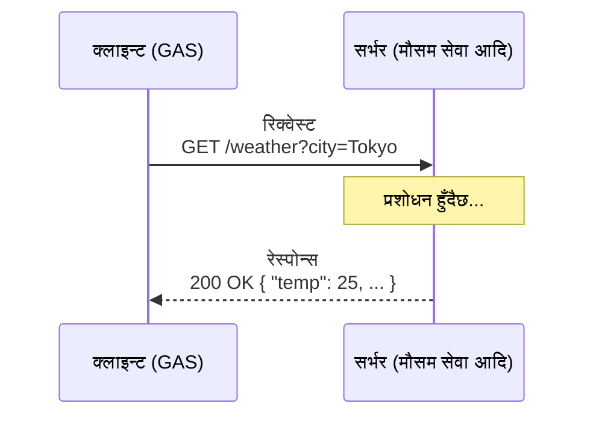
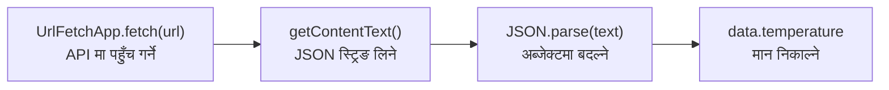

# API भनेको के हो — रिक्वेस्ट, रेस्पोन्स, JSON

> 🇯🇵 मूल प्रति (जापानी भाषामा): [20260512_API説明資料.md](<../../1年生_前期_ITシステム基礎/2026_05_12/20260512_API説明資料.md>) <!-- original-ja-link -->

## आजको लक्ष्य
- API भनेको के हो, आफ्नै शब्दमा बताउन सक्ने
- HTTP को रिक्वेस्ट र रेस्पोन्सको अवधारणा बुझ्ने
- JSON डेटा पढेर बुझ्न सक्ने
- GAS को `UrlFetchApp` ले बाहिरी API कल गर्न सक्ने

---

## 1. API भनेको के हो?

**API (Application Programming Interface) = एपहरूबीच कुराकानी गर्ने माध्यम**

### दैनिक जीवनको उदाहरणबाट बुझौं

रेस्टुरेन्टको उदाहरणबाट सोच्दा, यस्तो हुन्छ।



तपाईंलाई भान्सा (सर्भर) भित्र कसरी काम हुन्छ भन्ने थाहा नभए पनि हुन्छ।  
वेटर (API) मार्फत अर्डर गरे मात्र पुग्छ।

---

## 2. HTTP रिक्वेस्ट र रेस्पोन्स



**रिक्वेस्टका प्रकार:**
| मेथड | अर्थ | उदाहरण |
|---------|------|-----|
| GET | डेटा लिन चाहँदा | मौसमको जानकारी लिने |
| POST | डेटा पठाउन वा बनाउन चाहँदा | फारम पठाउने |
| PUT | डेटा अपडेट गर्न चाहँदा | प्रोफाइल परिवर्तन गर्ने |
| DELETE | डेटा मेटाउन चाहँदा | पोस्ट मेटाउने |

**रेस्पोन्सको स्टेटस कोड:**
| कोड | अर्थ |
|--------|------|
| 200 | OK (सफल) |
| 404 | Not Found (भेटिएन) |
| 500 | Internal Server Error (सर्भर त्रुटि) |

---

## 3. JSON — डेटा आदानप्रदानको ढाँचा

API को डेटा प्रायः **JSON (JavaScript Object Notation)** ढाँचामा आउँछ।

```json
{
  "city": "Tokyo",
  "weather": "晴れ",
  "temperature": 25.5,
  "humidity": 60,
  "forecast": [
    { "date": "2024-01-15", "temp": 24 },
    { "date": "2024-01-16", "temp": 22 },
    { "date": "2024-01-17", "temp": 27 }
  ]
}
```

JavaScript को अब्जेक्ट लेख्ने तरिकासँग यो लगभग उस्तै छ। कक्षा 08 मा सिकेको ज्ञान जस्ताको तस्तै प्रयोग गर्न सकिन्छ!

---

## 4. GAS बाट बाहिरी API कल गर्ने

डेटा निकाल्ने प्रक्रिया निम्न 4 चरणमा पूरा हुन्छ।



```javascript
function callApi() {
  // UrlFetchApp.fetch(URL) = तोकिएको URL मा पहुँच गरेर डेटा लिन्छ
  const url = "https://api.example.com/data";
  
  const response = UrlFetchApp.fetch(url);
  
  // रेस्पोन्सको सामग्री स्ट्रिङको रूपमा लिने
  const text = response.getContentText();
  console.log(text);  // JSON स्ट्रिङ देखिन्छ
  
  // JSON स्ट्रिङलाई अब्जेक्टमा बदल्ने (कक्षा 08 मा सिकेको!)
  const data = JSON.parse(text);
  console.log(data.temperature);  // → 25.5
}
```

---

## 5. सार्वजनिक API प्रयोग गरेर हेरौं

### उदाहरण: Open-Meteo (निःशुल्क मौसम API, API की चाहिँदैन)

```javascript
function getWeather() {
  // टोकियोको अक्षांश र देशान्तर तोकेर मौसम डेटा लिने
  const url = "https://api.open-meteo.com/v1/forecast?latitude=35.6762&longitude=139.6503&current_weather=true";
  
  // API मा रिक्वेस्ट पठाउने
  const response = UrlFetchApp.fetch(url);
  
  // रेस्पोन्सलाई JSON ढाँचामा लिने
  const json = JSON.parse(response.getContentText());
  
  // current_weather भित्र हालको मौसम डेटा हुन्छ
  const weather = json.current_weather;
  
  console.log("気温: " + weather.temperature + "℃");
  console.log("風速: " + weather.windspeed + " km/h");
  
  // मौसम कोडलाई जापानी भाषामा बदल्ने (केही मात्र)
  const weatherCodes = {
    0: "快晴",
    1: "晴れ",
    2: "一部曇り",
    3: "曇り",
    61: "弱い雨",
    63: "適度な雨",
    65: "強い雨",
  };
  
  const weatherText = weatherCodes[weather.weathercode] || "不明";
  console.log("天気: " + weatherText);
}
```

---

## 6. API को रेस्पोन्स शीटमा लेख्ने

```javascript
function weatherToSheet() {
  const sheet = SpreadsheetApp.getActiveSpreadsheet().getActiveSheet();
  
  // API बाट मौसम डेटा लिने
  const url = "https://api.open-meteo.com/v1/forecast?latitude=35.6762&longitude=139.6503&current_weather=true";
  const response = UrlFetchApp.fetch(url);
  const data = JSON.parse(response.getContentText());
  const weather = data.current_weather;
  
  // हालको समय लिने
  const now = new Date();
  const timeStr = Utilities.formatDate(now, "Asia/Tokyo", "yyyy/MM/dd HH:mm");
  
  // अन्तिम पङ्क्तिको अर्को पङ्क्तिमा लेख्ने
  const nextRow = sheet.getLastRow() + 1;
  sheet.getRange(nextRow, 1).setValue(timeStr);
  sheet.getRange(nextRow, 2).setValue(weather.temperature);
  sheet.getRange(nextRow, 3).setValue(weather.windspeed);
  
  console.log("天気データを記録しました！");
}
```

---

## सारांश

| शब्द                       | अर्थ                |
| ------------------------ | ----------------- |
| API                      | एपहरूबीच कुराकानी गर्ने माध्यम      |
| रिक्वेस्ट                    | क्लाइन्टबाट सर्भरलाई गरिने अनुरोध  |
| रेस्पोन्स                    | सर्भरबाट क्लाइन्टलाई दिइने जवाफ  |
| JSON                     | डेटा आदानप्रदानमा प्रयोग हुने ढाँचा     |
| `UrlFetchApp.fetch(url)` | GAS बाट URL मा पहुँच गर्ने |
| `JSON.parse(str)`        | JSON स्ट्रिङलाई अब्जेक्टमा बदल्ने |

---

## अर्को कक्षा (कक्षा 14) मा के सिक्ने?

मौसम र विदेशी मुद्रा विनिमय दर जस्ता जानकारी दिने सार्वजनिक API प्रयोग गरेर डेटा
 स्प्रेडसिटमा स्वचालित रूपमा रेकर्ड गर्ने अभ्यास गर्छौं।
