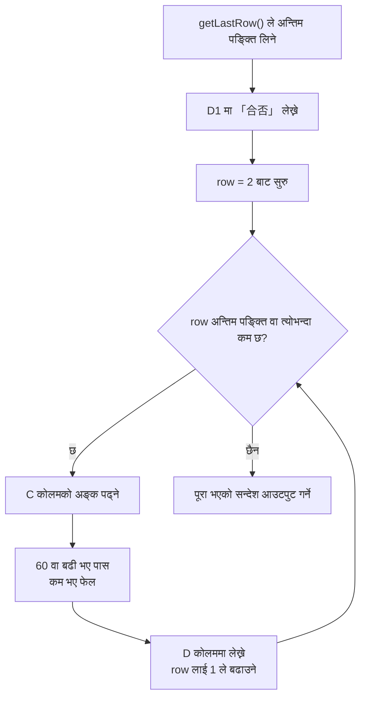

# अभ्यास कार्य

> 🇯🇵 मूल प्रति (जापानी भाषामा): [20260512_演習回答.md](<../../1年生_前期_ITシステム基礎/2026_05_12/20260512_演習回答.md>) <!-- original-ja-link -->

## तयारी: स्प्रेडसिट बनाउने

1. नयाँ Google स्प्रेडसिट बनाउने
2. स्प्रेडसिटको नाम "GAS演習" (GAS अभ्यास) राख्ने
3. "拡張機能" (एक्सटेन्सन) → "Apps Script" खोल्ने

---

## अभ्यास 1: सेलमा जानकारी लेख्ने

### प्रश्न

> **अनुमानित समय: 10–15 मिनेट**

GAS प्रयोग गरेर, आफ्नो परिचय स्प्रेडसिटमा लेख्ने फङ्सन बनाऔं।

**गर्नुपर्ने कुरा:**

1. `jikoshokaSheet` नामको फङ्सन बनाउने
2. हालको शीटलाई `sheet` भन्ने भेरिएबलमा लिने (सामग्रीको अध्याय 3 हेरेर)
3. तलको तालिकाअनुसार, हरेक सेलमा मान लेख्ने

| सेल | लेख्ने कुरा |
|------|------------|
| A1 | `"自己紹介"` (आत्मपरिचय) भन्ने स्ट्रिङ |
| B1 | **आफ्नो नाम** (उदाहरण: `"田中太郎"`) |
| A2 | `"年齢"` (उमेर) भन्ने स्ट्रिङ |
| B2 | **आफ्नो उमेर** (सङ्ख्या। उद्धरण चिह्न बिना) |

4. **त्यसमाथि**, A3–B4 प्रयोग गरेर, आफूलाई मन पर्ने जानकारी (रुचि, आफू आएको ठाउँ आदि) आफैं थपेर हेरौं

> **सङ्केत:** सेलमा लेख्न `getRange("A1").setValue(मान)` प्रयोग गर्छौं (सामग्रीको अध्याय 3)

**चलाएर शीटमा लेखिएको छ कि जाँचौं**

### उत्तर

```javascript
function jikoshokaSheet() {
  const sheet = SpreadsheetApp.getActiveSpreadsheet().getActiveSheet();
  
  // A1 मा "自己紹介" (आत्मपरिचय) लेख्ने
  sheet.getRange("A1").setValue("自己紹介");
  
  // B1 मा आफ्नो नाम लेख्ने (← बदल्नुहोस्)
  sheet.getRange("B1").setValue("田中太郎");
  
  // A2 मा "年齢" (उमेर), B2 मा उमेरको सङ्ख्या लेख्ने
  sheet.getRange("A2").setValue("年齢");
  sheet.getRange("B2").setValue(18);
  
  // A3, B3, A4, B4 पनि आफैं थपेर हेरौं
}
```

---

## अभ्यास 2: अङ्कतालिका एकैपटक लेख्ने

### प्रश्न

> **अनुमानित समय: 20–30 मिनेट**

एउटा-एउटा सेल लेख्नु झन्झटिलो हुन्छ। अब **2-आयामी एरे र `setValues()`** प्रयोग गरेर, अङ्कतालिका एकैपटक लेख्ने फङ्सन बनाऔं।

**गर्नुपर्ने कुरा:**

1. `seisekiTable` नामको फङ्सन बनाउने
2. सुरुमा शीटलाई **पूरै खाली** गर्ने (`clearContents()` प्रयोग गर्ने)
3. पहिलो पङ्क्तिमा `"番号"`, `"名前"`, `"点数"` (नम्बर, नाम, अङ्क) को हेडर लेख्ने
   - **2-आयामी एरे** `[["番号", "名前", "点数"]]` लाई `setValues()` ले लेख्ने
   - `getRange(1, 1, 1, 3)` ले "पहिलो पङ्क्ति, पहिलो कोलमबाट, 1 पङ्क्ति × 3 कोलम" तोक्ने (सामग्रीको अध्याय 5)
4. दोस्रो पङ्क्तिदेखि, तलका 5 जनाको डेटा लेख्ने

| नम्बर | नाम | अङ्क |
|------|------|------|
| 1 | 田中太郎 | 85 |
| 2 | 鈴木花子 | 72 |
| 3 | 山田次郎 | 91 |
| 4 | 佐藤三郎 | 68 |
| 5 | 伊藤美咲 | 78 |

   - डेटालाई 2-आयामी एरेमा तयार गरी, `getRange(2, 1, डेटाको पङ्क्ति सङ्ख्या, डेटाको कोलम सङ्ख्या)` ले लेख्ने
5. हेडर पङ्क्ति (पहिलो पङ्क्ति) लाई **बोल्ड** गरी **खरानी रङको ब्याकग्राउन्ड**
 (`"#CCCCCC"`) बनाउने (सामग्रीको अध्याय 7)

> **सङ्केत:** `data.length` ले पङ्क्ति सङ्ख्या, `data[0].length` ले कोलम सङ्ख्या लिन सकिन्छ

### उत्तर

```javascript
function seisekiTable() {
  const sheet = SpreadsheetApp.getActiveSpreadsheet().getActiveSheet();
  
  // शीट खाली गर्ने (पहिलेको डेटा मेटाउने)
  sheet.clearContents();
  
  // हेडर पङ्क्ति
  const header = [["番号", "名前", "点数"]];
  sheet.getRange(1, 1, 1, 3).setValues(header);
  
  // डेटा पङ्क्ति (5 जनाको)
  const data = [
    [1, "田中太郎", 85],
    [2, "鈴木花子", 72],
    [3, "山田次郎", 91],
    [4, "佐藤三郎", 68],
    [5, "伊藤美咲", 78],
  ];
  
  // दोस्रो पङ्क्तिदेखि लेख्ने
  sheet.getRange(2, 1, data.length, data[0].length).setValues(data);
  
  // हेडरलाई बोल्ड बनाउने
  sheet.getRange(1, 1, 1, 3).setFontWeight("bold");
  sheet.getRange(1, 1, 1, 3).setBackground("#CCCCCC");
}
```

---

## अभ्यास 3: सेल पढेर प्रशोधन गर्ने

### प्रश्न

> **अनुमानित समय: 30–40 मिनेट**

**अभ्यास 2 चलाइसकेपछि यो गर्नुहोस्।**

अभ्यास 2 मा बनाएको अङ्कतालिकाका अङ्क पढेर, D कोलममा "合否" (पास/फेल) स्वचालित रूपमा निर्धारण गरी लेख्ने फङ्सन बनाऔं।

**गर्नुपर्ने कुरा:**

1. `readAndProcess` नामको फङ्सन बनाउने

2. `getLastRow()` ले डेटा भएको अन्तिम पङ्क्तिको नम्बर लिने (सामग्रीको अध्याय 6)

3. D कोलम (चौथो कोलम) को पहिलो पङ्क्तिमा, हेडर `"合否"` (पास/फेल) लेख्ने
   - `getRange(1, 4)` ले "पहिलो पङ्क्ति, चौथो कोलम" तोक्ने

4. `for` लुपले दोस्रो पङ्क्तिदेखि अन्तिम पङ्क्तिसम्म दोहोर्‍याउने
   - हरेक पङ्क्तिको C कोलम (तेस्रो कोलम) को अङ्क `getValue()` ले पढ्ने
   - अङ्क **60 वा बढी भए `"合格"` (पास)**, **कम भए `"不合格"` (फेल)** भनेर निर्धारण गर्ने
     - टर्नरी अपरेटर `score >= 60 ? "合格" : "不合格"` प्रयोग गर्ने
   - निर्धारणको नतिजा D कोलम (चौथो कोलम) मा `setValue()` ले लेख्ने

5. लुप सकिएपछि `console.log("合否判定が完了しました！")` (पास/फेल निर्धारण पूरा भयो!) आउटपुट गर्ने

> **सङ्केत:** `getRange(पङ्क्ति नम्बर, कोलम नम्बर)` ले पङ्क्ति र कोलमलाई सङ्ख्याले तोक्न सकिन्छ (सामग्रीको अध्याय 4)

प्रक्रियाको प्रवाहलाई चित्रमा देखाउँदा यस्तो हुन्छ।



**चलाएपछि, D कोलममा पास/फेल देखियो कि जाँचौं**

### उत्तर

```javascript
function readAndProcess() {
  const sheet = SpreadsheetApp.getActiveSpreadsheet().getActiveSheet();
  
  // अभ्यास 2 चलाइसकेपछि, यो कोड चलाउनुहोस्
  
  // दोस्रो पङ्क्तिदेखि अन्तिम पङ्क्तिसम्मको डेटा पढ्ने
  const lastRow = sheet.getLastRow();
  
  // D कोलम (चौथो कोलम) मा "合否" (पास/फेल) लेख्ने
  // हेडर
  sheet.getRange(1, 4).setValue("合否");
  
  for (let row = 2; row <= lastRow; row++) {
    // C कोलम (तेस्रो कोलम) को अङ्क पढ्ने
    const score = sheet.getRange(row, 3).getValue();
    
    // 60 वा बढी भए पास, कम भए फेल
    const result = score >= 60 ? "合格" : "不合格";
    
    // D कोलममा लेख्ने
    sheet.getRange(row, 4).setValue(result);
  }
  
  console.log("合否判定が完了しました！");
}
```

---

## अभ्यास 4: फर्म्याट मिलाऔं

### प्रश्न

> **अनुमानित समय: 15–20 मिनेट**

**अभ्यास 3 चलाइसकेपछि यो गर्नुहोस्।**

अभ्यास 3 मा लेखेको "合否" (पास/फेल) कोलम पढेर, पास र फेल भएका पङ्क्तिमा **ब्याकग्राउन्ड रङ** लगाई, नतिजा एकै नजरमा थाहा हुने अङ्कतालिका तयार पारौं।

**गर्नुपर्ने कुरा:**

1. `colorFormat` नामको फङ्सन बनाउने
2. `getLastRow()` ले अन्तिम पङ्क्तिको नम्बर लिने
3. `for` लुपले दोस्रो पङ्क्तिदेखि अन्तिम पङ्क्तिसम्म दोहोर्‍याउने
   - D कोलम (चौथो कोलम) को मान `getValue()` ले पढ्ने
   - मान `"合格"` (पास) भए, त्यो पङ्क्ति (पहिलोदेखि चौथो कोलमसम्म) को ब्याकग्राउन्ड रङ **हल्का नीलो** `"#CCE5FF"` बनाउने
   - मान `"不合格"` (फेल) भए, त्यो पङ्क्तिको ब्याकग्राउन्ड रङ **हल्का सुन्तला** `"#FFE5CC"` बनाउने
   - एउटा पङ्क्तिको चौडाइ तोक्न `getRange(पङ्क्ति नम्बर, 1, 1, 4)` प्रयोग गर्ने ("पङ्क्ति नम्बर भएको पङ्क्ति, पहिलो कोलमबाट, 1 पङ्क्ति × 4 कोलम")

> **जाँच्ने बुँदा:** चलाएपछि, पास भएका पङ्क्ति नीलो र फेल भएका पङ्क्ति सुन्तला भए सफल भयो

### उत्तर

```javascript
function colorFormat() {
  const sheet = SpreadsheetApp.getActiveSpreadsheet().getActiveSheet();
  const lastRow = sheet.getLastRow();
  
  for (let row = 2; row <= lastRow; row++) {
    const result = sheet.getRange(row, 4).getValue();
    
    if (result === "合格") {
      // पास भएको पङ्क्तिलाई हल्का नीलो बनाउने
      sheet.getRange(row, 1, 1, 4).setBackground("#CCE5FF");
    } else {
      // फेल भएको पङ्क्तिलाई हल्का सुन्तला बनाउने
      sheet.getRange(row, 1, 1, 4).setBackground("#FFE5CC");
    }
  }
}
```
