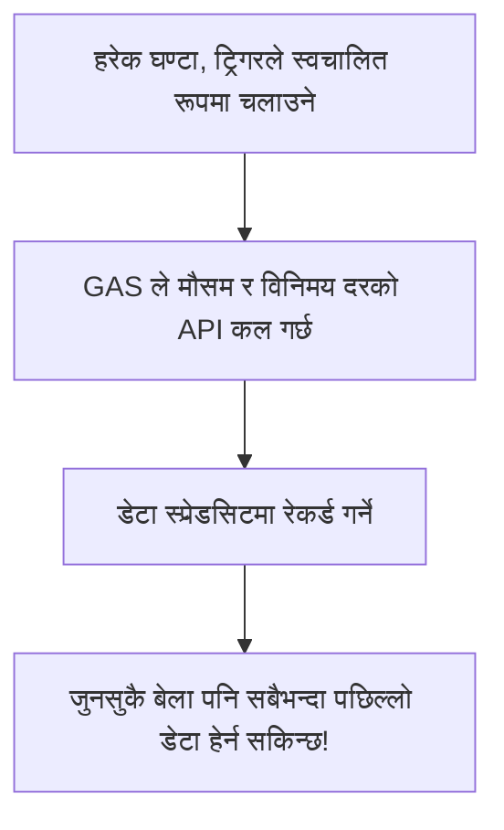

# GAS + API अभ्यास — मौसम र विदेशी मुद्रा विनिमय दरको डेटा शीटमा स्वचालित रूपमा देखाउने

> 🇯🇵 मूल प्रति (जापानी भाषामा): [20260519.md](<../../1年生_前期_ITシステム基礎/2026_05_19/20260519.md>) <!-- original-ja-link -->

## आजको लक्ष्य
- सार्वजनिक API कल गरेर डेटा लिन सक्ने
- लिएको डेटा स्प्रेडसिटमा स्वचालित रूपमा रेकर्ड गर्न सक्ने
- ट्रिगरसँग जोडेर स्वचालित टुल पूरा गर्ने

---

## 1. आज बनाउने कुरा



---

## 2. विनिमय दर API (ExchangeRate-API)

निःशुल्क प्रयोग गर्न सकिने विनिमय दर API हो।

```javascript
function getExchangeRate() {
  // डलरबाट हरेक मुद्रामा बदल्दाको विनिमय दर लिने
  // base=USD → 1 डलर बराबर कति येन, कति युरो आदि
  const url = "https://open.er-api.com/v6/latest/USD";
  
  const response = UrlFetchApp.fetch(url);
  const data = JSON.parse(response.getContentText());
  
  // data.rates भित्र हरेक मुद्राको दर हुन्छ
  const jpyRate = data.rates.JPY;   // डलर→येन
  const eurRate = data.rates.EUR;   // डलर→युरो
  const gbpRate = data.rates.GBP;   // डलर→पाउन्ड
  
  console.log(`1ドル = ${jpyRate}円`);
  console.log(`1ドル = ${eurRate}ユーロ`);
  console.log(`1ドル = ${gbpRate}ポンド`);
  
  return { JPY: jpyRate, EUR: eurRate, GBP: gbpRate };
}
```

---

## 3. मौसम API (Open-Meteo)

```javascript
function getWeatherData() {
  // टोकियोको मौसम (कक्षा 13 को पुनरावलोकन)
  const url = "https://api.open-meteo.com/v1/forecast"
    + "?latitude=35.6762"
    + "&longitude=139.6503"
    + "&current_weather=true"
    + "&hourly=temperature_2m,precipitation_probability";
  
  const response = UrlFetchApp.fetch(url);
  const data = JSON.parse(response.getContentText());
  
  const current = data.current_weather;
  return {
    temperature: current.temperature,
    windspeed: current.windspeed,
    weathercode: current.weathercode
  };
}
```

---

## 4. सबै कुरा एकसाथ: स्प्रेडसिटमा स्वचालित रूपमा डेटा रेकर्ड गर्ने सिस्टम

```javascript
// शीटको पहिलो पङ्क्तिमा हेडर लेख्ने (सुरुमा 1 पटक मात्र चलाउने)
function setupHeader() {
  const sheet = SpreadsheetApp.getActiveSpreadsheet().getActiveSheet();
  sheet.clearContents();
  
  const headers = [["記録日時", "気温(℃)", "風速(km/h)", "1ドル(円)", "1ドル(ユーロ)"]];
  sheet.getRange(1, 1, 1, headers[0].length).setValues(headers);
  sheet.getRange(1, 1, 1, headers[0].length).setFontWeight("bold");
  sheet.getRange(1, 1, 1, headers[0].length).setBackground("#4A90D9");
  sheet.getRange(1, 1, 1, headers[0].length).setFontColor("#FFFFFF");
  
  console.log("ヘッダーを設定しました");
}

// नियमित रूपमा चलाउने मुख्य फङ्सन (ट्रिगरमा सेट गर्ने)
function recordData() {
  const sheet = SpreadsheetApp.getActiveSpreadsheet().getActiveSheet();
  
  // हालको समय
  const now = new Date();
  const timeStr = Utilities.formatDate(now, "Asia/Tokyo", "yyyy/MM/dd HH:mm");
  
  // मौसम डेटा लिने
  let temperature = "取得失敗";
  let windspeed = "取得失敗";
  
  try {
    const weatherUrl = "https://api.open-meteo.com/v1/forecast?latitude=35.6762&longitude=139.6503&current_weather=true";
    const weatherRes = UrlFetchApp.fetch(weatherUrl);
    const weatherData = JSON.parse(weatherRes.getContentText());
    temperature = weatherData.current_weather.temperature;
    windspeed = weatherData.current_weather.windspeed;
  } catch (e) {
    // त्रुटि आए पनि प्रोग्राम नरोक्ने
    console.log("天気取得エラー: " + e.message);
  }
  
  // विनिमय दरको डेटा लिने
  let jpyRate = "取得失敗";
  let eurRate = "取得失敗";
  
  try {
    const fxUrl = "https://open.er-api.com/v6/latest/USD";
    const fxRes = UrlFetchApp.fetch(fxUrl);
    const fxData = JSON.parse(fxRes.getContentText());
    jpyRate = Math.round(fxData.rates.JPY * 100) / 100;  // दशमलवपछि 2 अङ्कसम्म
    eurRate = Math.round(fxData.rates.EUR * 10000) / 10000;
  } catch (e) {
    console.log("為替取得エラー: " + e.message);
  }
  
  // अन्तिम पङ्क्तिपछि थप्ने
  const nextRow = sheet.getLastRow() + 1;
  const newData = [[timeStr, temperature, windspeed, jpyRate, eurRate]];
  sheet.getRange(nextRow, 1, 1, newData[0].length).setValues(newData);
  
  console.log(`データを記録しました: ${timeStr}`);
}
```

---

## 5. प्रयोग गर्ने तरिकाको सारांश

**पहिलो पटकको सेटअप:**
1. `setupHeader()` लाई 1 पटक चलाउने
2. ट्रिगर सेट गर्ने
3. त्यसपछि डेटा आफैं जम्मा हुँदै जान्छ!

**सञ्चालन जाँच:**

- `recordData()` लाई हातैले केही पटक चलाएर डेटा बढ्छ कि जाँच्ने

---

## सारांश, फेज 3 समाप्त!

| सिकेको कुरा | सारांश |
|-----------|-------|
| SpreadsheetApp | सेल पढ्ने र लेख्ने |
| for लुप | सबै पङ्क्तिलाई स्वचालित रूपमा प्रशोधन गर्ने |
| ट्रिगर | समय वा घटनाअनुसार स्वचालित रूपमा चलाउने |
| GmailApp | इमेल स्वचालित रूपमा पठाउने |
| UrlFetchApp | बाहिरी API बाट डेटा लिने |
| JSON.parse | JSON स्ट्रिङलाई अब्जेक्टमा बदल्ने |

---