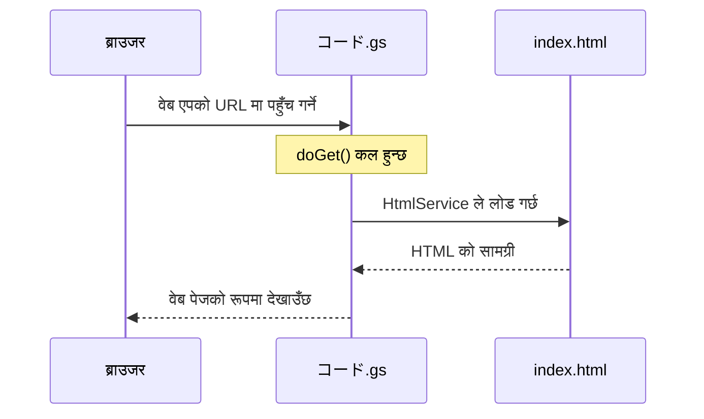

# HTML का आधारभूत कुरा — ट्याग, संरचना र फर्म

> 🇯🇵 मूल प्रति (जापानी भाषामा): [20260519_html.md](<../../1年生_前期_ITシステム基礎/2026_05_19/20260519_html.md>) <!-- original-ja-link -->

## आजको लक्ष्य
- HTML को आधारभूत संरचना लेख्न सक्ने
- धेरै प्रयोग हुने ट्यागहरू राम्ररी प्रयोग गर्न सक्ने
- फर्म बनाउन सक्ने
- GAS को HTML सर्भिस प्रयोग गरेर वेब पेज देखाउन सक्ने

---

## 1. HTML भनेको के हो?

**HTML（HyperText Markup Language）= वेब पेजको "ढाँचा (कंकाल)" बनाउने भाषा**

```
वेब पेजका भागहरू:
├── HTML → संरचना र सामग्री (हाड र मासु)
├── CSS  → रूपरंग (लुगा र मेकअप)
└── JS   → चाल (मांसपेशी)
```

---

## 2. आधारभूत संरचना

```html
<!DOCTYPE html>
<html lang="ja">
<head>
  <!-- head भित्र ब्राउजरका लागि सेटिङ जानकारी हुन्छ। स्क्रिनमा देखिँदैन -->
  <meta charset="UTF-8">
  <title>ページタイトル</title>  <!-- ट्याबमा देखिन्छ -->
</head>
<body>
  <!-- body भित्र लेखेको कुरा स्क्रिनमा देखिन्छ -->
  <h1>見出し1</h1>
  <p>段落テキスト</p>
</body>
</html>
```

---

## 3. धेरै प्रयोग हुने ट्यागहरू

### शीर्षक र अनुच्छेद

```html
<h1>大見出し（一番大きい）</h1>
<h2>中見出し</h2>
<h3>小見出し</h3>
<p>段落テキスト。改行は自動。</p>
<br>  <!-- बाध्यकारी लाइन ब्रेक -->
<hr>  <!-- तेर्सो रेखा -->
```

### लिंक र तस्बिर

```html
<!-- लिंक -->
<a href="https://google.com">Google へ</a>
<a href="page2.html">次のページ</a>          <!-- एउटै साइटभित्र -->
<a href="https://google.com" target="_blank">新しいタブで開く</a>

<!-- तस्बिर -->

<!-- alt = तस्बिर देखाउन नसकिएको बेला देखिने वैकल्पिक टेक्स्ट -->
```

### सूची

```html
<!-- नम्बर नभएको सूची (ul = unordered list) -->
<ul>
  <li>りんご</li>
  <li>みかん</li>
  <li>ぶどう</li>
</ul>

<!-- नम्बर भएको सूची (ol = ordered list) -->
<ol>
  <li>手を洗う</li>
  <li>野菜を切る</li>
  <li>炒める</li>
</ol>
```

### टेबल (तालिका)

```html
<table border="1">
  <thead>
    <tr>
      <th>名前</th>   <!-- th = हेडर सेल (बोल्ड र बीचमा मिलाइएको) -->
      <th>点数</th>
    </tr>
  </thead>
  <tbody>
    <tr>
      <td>田中太郎</td>   <!-- td = डेटा सेल -->
      <td>85</td>
    </tr>
    <tr>
      <td>鈴木花子</td>
      <td>72</td>
    </tr>
  </tbody>
</table>
```

### div र span (समूह बनाउने)

```html
<!-- div = ब्लक एलिमेन्टको समूह (एकपछि अर्को गर्दै ठाडो रूपमा राखिन्छन्) -->
<div class="box">
  <h2>タイトル</h2>
  <p>内容</p>
</div>

<!-- span = इनलाइन एलिमेन्टको समूह (तेर्सो रूपमा एउटै लाइनमा रहन्छ) -->
<p>テキストの<span style="color: red;">一部だけ</span>を変える</p>
```

---

## 4. फर्म

यो प्रयोगकर्ताबाट इनपुट लिने एउटा भाग हो।

```html
<form action="" method="post">
  <!-- टेक्स्ट इनपुट -->
  <label for="namae">名前：</label>
  <input type="text" id="namae" name="namae" placeholder="名前を入力">
  
  <br>
  
  <!-- इमेल इनपुट -->
  <label for="email">メール：</label>
  <input type="email" id="email" name="email">
  
  <br>
  
  <!-- संख्या इनपुट -->
  <label for="age">年齢：</label>
  <input type="number" id="age" name="age" min="0" max="150">
  
  <br>
  
  <!-- सेलेक्ट बक्स -->
  <label for="grade">学年：</label>
  <select id="grade" name="grade">
    <option value="1">1年生</option>
    <option value="2">2年生</option>
    <option value="3">3年生</option>
  </select>
  
  <br>
  
  <!-- टेक्स्ट एरिया (धेरै लाइन) -->
  <label for="comment">コメント：</label>
  <textarea id="comment" name="comment" rows="4" cols="40"></textarea>
  
  <br>
  
  <!-- पठाउने बटन -->
  <button type="submit">送信する</button>
</form>
```

---

## 5. GAS को HTML सर्भिस प्रयोग गरेर वेब पेज देखाउने

GAS प्रयोग गरेर वेब पेज सार्वजनिक गर्न सकिन्छ!

**फाइल संरचना (GAS एडिटरमा बनाउने):**
- `コード.gs` (GAS को मुख्य फाइल)
- `index.html` (देखाउने HTML फाइल)

**コード.gs:**
```javascript
// वेब एपको रूपमा सार्वजनिक गर्नका लागि फङ्सन
// URL मा पहुँच गर्दा कल हुन्छ
function doGet() {
  // index.html लोड गरेर देखाउने
  return HtmlService.createHtmlOutputFromFile("index")
    .setTitle("私のWebページ");
}
```

**index.html:**
```html
<!DOCTYPE html>
<html lang="ja">
<head>
  <meta charset="UTF-8">
  <title>GASのWebページ</title>
</head>
<body>
  <h1>こんにちは！GAS HTML サービス</h1>
  <p>これはGASで表示したWebページです。</p>
  
  <ul>
    <li>スプレッドシートのデータを表示できる</li>
    <li>フォームの送信を受け取れる</li>
    <li>インターネットで公開できる</li>
  </ul>
</body>
</html>
```

सार्वजनिक गरिएको URL मा पहुँच गर्दा, पेज यस क्रममा देखिन्छ।



**वेब एपको रूपमा सार्वजनिक गर्ने तरिका:**
1. 「デプロイ」(डिप्लोय) → 「新しいデプロイ」(नयाँ डिप्लोयमेन्ट)
2. प्रकार: 「Webアプリ」(वेब एप) छान्ने
3. पहुँच गर्न सक्ने प्रयोगकर्ता: 「全員」(सबैजना)
4. 「デプロイ」(डिप्लोय) → URL
 जारी हुन्छ!

---

## सारांश

| ट्याग | प्रयोग |
|------|------|
| `<h1>`〜`<h6>` | शीर्षक |
| `<p>` | अनुच्छेद |
| `<a href="">` | लिंक |
| `` | तस्बिर |
| `<ul>` / `<ol>` / `<li>` | सूची |
| `<table>` / `<tr>` / `<td>` | तालिका |
| `<form>` | फर्म (इनपुट लिने) |
| `<input>` / `<button>` | इनपुट भाग र बटन |
| `<div>` / `<span>` | समूह बनाउने |

---
