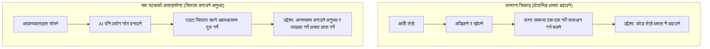
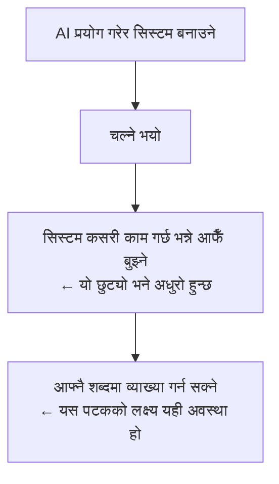

# कक्षाको उद्देश्यको सारांश — अन्तिम असाइनमेन्टलाई फर्केर हेर्दा

> 🇯🇵 मूल प्रति (जापानी भाषामा): [授業の趣旨_まとめ.md](<../1年生_前期_ITシステム基礎/授業の趣旨_まとめ.md>) <!-- original-ja-link -->

प्रस्तुति (प्रेजेन्टेसन) सकिइसकेको छ, तर यो असाइनमेन्टबाट के सिकाउन खोजिएको थियो भन्ने कुरा फेरि एकपटक मिलाएर राख्छु।
प्रस्तुति सुनेर "AI प्रयोग गर्न मिल्छ र?" "आफैँ कोड लेख्नु पर्दैन र?" भनेर अलमलमा परेका साथीहरू पनि होलान्, त्यसैले ती प्रश्नहरूको जवाफ पनि यहाँ समेटिएको छ।

---

## 1. यो कक्षामा सबैभन्दा बढी भन्न चाहेको कुरा

प्रोग्रामिङसम्बन्धी व्याख्या पढेर वा सुनेर मात्र प्रोग्रामिङ सिकिँदैन। **आफैँ हात चलाएर, वास्तवमै कोड बनाउँदै जानु बाहेक सिक्ने अर्को उपाय छैन** भन्ने मेरो विचार छ।

यसका लागि ठोस सिक्ने तरिकाको रूपमा, शैक्षिक साइट **paiza** को स्किल चेक प्रयोग गरेर

```
[ D समस्या ]  ──── धेरै अभ्यास गर्ने ────▶ [ C समस्या ]
 आधारभूत सिन्ट्याक्स र सोच्ने तरिका      अलि जटिल समस्यामा
 हातले लेखेर सम्झने                     चुनौती सामना गर्दै सिकेको कुरा लागू गर्ने क्षमता बढाउने
```

यस क्रममा अगाडि बढ्न सिफारिस गर्छु। यो असाइनमेन्ट सकिएपछि पनि, प्रोग्रामिङ क्षमता नै बढाउन चाहनेहरूका लागि यो सधैँ मुख्य र सही बाटो हो।

---

## 2. यस पटकको असाइनमेन्टको उद्देश्य

यस पटकको अन्तिम असाइनमेन्टको लक्ष्य माथिको सिक्ने तरिकाभन्दा अलि फरक राखिएको छ।



- **AI प्रयोग गर्न अनुमति दिइएको छ**
- मुख्य कुरा "सही कोड आफ्नै हातले मात्र लेख्न सकिन्छ कि सकिँदैन" होइन, **"शून्यबाट एउटा सिस्टम वास्तवमै बनाएर हेर्ने" अनुभव नै** हो

अर्थात् यस पटकको असाइनमेन्टमा कोडको प्रत्येक लाइन आफैँ लेख्ने अभ्यासभन्दा आवश्यकताहरू व्यवस्थित गरी AI पनि प्रयोग गर्दै चल्ने सिस्टम तयार पार्ने अनुभवलाई प्राथमिकता दिइएको छ।

---

## 3. प्रस्तुतिमा व्याख्या अनिवार्य हुनुको कारण

असाइनमेन्ट बुझाउने नियममा भएको "प्रस्तुतिमा व्याख्या गर्नुपर्ने सर्त" यो असाइनमेन्टको सबैभन्दा महत्त्वपूर्ण भाग हो।



AI प्रयोग गरेर बनाएको सिस्टम भए पनि,

- के को लागि बनाएको हो
- सिस्टम कसरी काम गर्छ
- कोडको कुन भागमा आफैँले नयाँ उपाय अपनाएको वा समायोजन गरेको हो

यी कुरा **आफ्नै शब्दमा व्याख्या गर्न सक्नु** पर्छ। AI लाई बनाउन लगाएर मात्र पुग्दैन; बनेको सिस्टम कसरी काम गर्छ भन्ने राम्ररी बुझेर त्यसलाई व्याख्या गर्न सक्ने अवस्थामा पुग्नुहोस् भन्ने नै यो सर्तको उद्देश्य हो।

---

## 4. "आफैँ कोड लेख्न चाहन्छु" भन्नेहरूका लागि

यस पटक AI प्रयोग गर्न अनुमति दिएकाले, "AI प्रयोग गर्नैपर्छ कि?" भनेर अलमलमा परेका साथीहरू पनि थिए जस्तो छ।

त्यस्तो होइन। **आफ्नै क्षमताले कोड लेख्न चाहनेहरूले लेखे पनि हुन्छ।** मूल्याङ्कन "के गर्न सक्छ" भन्ने आधारमा गरिन्छ, त्यसैले आफैँ लेखेको कोड होस् वा AI प्रयोग गरेको कोड, आवश्यकता पूरा गर्छ र आफैँ व्याख्या गर्न सक्छ भने दुवैलाई एउटै तरिकाले मूल्याङ्कन गरिन्छ।

बरु प्रोग्रामिङ क्षमता साँच्चै बढाउन चाहनुहुन्छ भने, पहिलो खण्डमा उल्लेख गरिएको paiza को D→C समस्या अभ्यासजस्तै, आफैँ लेख्ने, अड्किने र खोज्ने अनुभव आगामी दिनमा पनि आवश्यक हुन्छ। यस पटक AI लाई अनुमति दिनुको अर्थ त्यो सिक्ने तरिका छोडे पनि हुन्छ भन्ने होइन।

---

## 5. AI र डेभलपमेन्टको वास्तविकता

यस पटकको असाइनमेन्टको तरिका वास्तविक कार्यक्षेत्रमा हुने डेभलपमेन्टको तरिकासँग नजिक बनाइएको पनि हो।

```
┌────────────────────────────┐
│  सुरुको मोटामोटी इम्प्लिमेन्टेसन   │ ← धेरैजसो AI ले गर्छ
└──────────────┬─────────────┘
               ▼
┌────────────────────────────┐
│  बगको खोजी र साना सुधारहरू     │
│  काम गर्ने तरिका बुझ्ने र व्याख्या   │ ← मानिस (तपाईं) ले गर्छ
└────────────────────────────┘
```

हालको डेभलपमेन्ट कार्यक्षेत्रमा पनि,

- सुरुको मोटामोटी इम्प्लिमेन्टेसन AI लाई सुम्पनु सामान्य बन्दै गएको छ
- अर्कोतर्फ, बगको खोजी, साना सुधार, सिस्टम कसरी काम गर्छ भन्ने बुझ्ने र व्याख्या गर्ने काम मानिसले गर्छ

यस्तो कामको बाँडफाँड फैलिँदै गएको छ। यस पटक "AI प्रयोग गरेर बनाउने, अन्त्यमा आफैँ व्याख्या गर्ने" प्रक्रियालाई असाइनमेन्ट बनाउनुमा, आजको डेभलपमेन्टको यस्तो तरिका अनुभव गराउने उद्देश्य पनि छ।

---

## सारांश

- प्रोग्रामिङ क्षमता बढाउने मुख्य बाटो आफैँ लेख्ने, अड्किने र खोज्ने हो (paiza D→C)
- यस पटकको असाइनमेन्ट त्यो मुख्य बाटोभन्दा फरक दृष्टिकोणबाट, "AI प्रयोग गरेर भए पनि एउटा सिस्टम अन्त्यसम्म बनाउने अनुभव" लाई उद्देश्य बनाइएको हो
- AI ले बनाए पनि, आफैँ लेखे पनि मूल्याङ्कन एउटै हुन्छ। महत्त्वपूर्ण कुरा अन्त्यमा आफ्नै शब्दमा व्याख्या गर्न सक्नु हो
- यो आजको वास्तविक डेभलपमेन्ट कार्यक्षेत्रमा काम गर्दाको अनुभवसँग पनि मिल्दोजुल्दो छ

