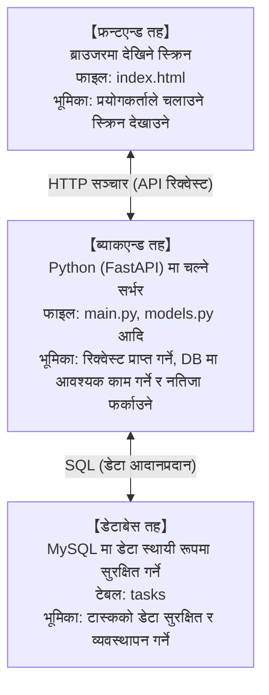
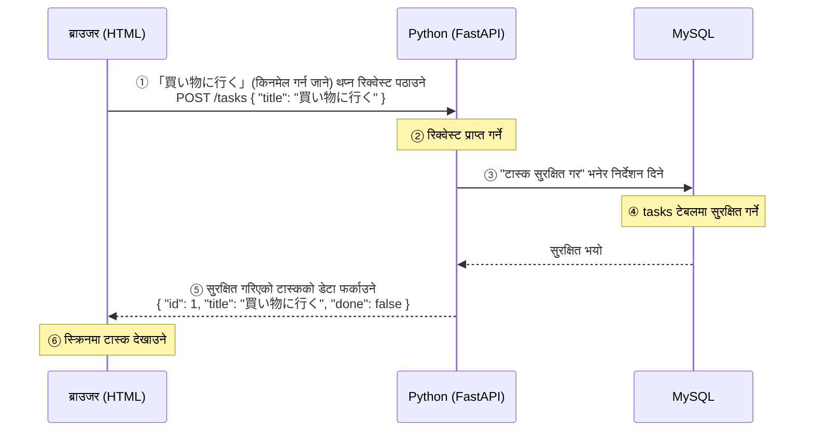

# विशेष अध्याय: टास्क व्यवस्थापन सिस्टम बनाऔँ

> 🇯🇵 मूल प्रति (जापानी भाषामा): [00_概要とシステム設計.md](<../../1年生_前期_ITシステム基礎/番外編/00_概要とシステム設計.md>) <!-- original-ja-link -->

## यस पटकको लक्ष्य
- HTML + Python + MySQL को 3 तहको संरचना भएको सिस्टम बुझ्ने
- Python मा ब्याकएन्ड बनाउन सक्ने
- फ्रन्टएन्ड (HTML) र ब्याकएन्ड (Python) ले API मार्फत कसरी काम गर्छन् भन्ने प्रक्रिया बुझ्ने

---

## 1. के बनाउने?

**टास्क व्यवस्थापन एप (Todo एप)**

```
┌─────────────────────────────────────────┐
│           टास्क व्यवस्थापन एप              │
│                                         │
│  [ गर्नुपर्ने कामको सूची ]                    │
│  □ किनमेल गर्न जाने   [पूरा] [मेटाउने]     │
│  ☑ गृहकार्य सक्ने      [पूरा] [मेटाउने]     │
│  □ कोठा सफा गर्ने      [पूरा] [मेटाउने]     │
│                                         │
│  नयाँ टास्क: [____________] [थप्ने]       │
└─────────────────────────────────────────┘
```

गर्न सकिने कुराहरू:
- टास्कहरूको सूची देखाउने
- नयाँ टास्क थप्ने
- टास्कलाई पूरा भएको / पूरा नभएको भनेर बदल्ने
- टास्क मेटाउने

---

## 2. सिस्टमको समग्र रूप

यस पटक बनाउने सिस्टम **3 वटा तह** मिलेर बनेको हुन्छ।



### सञ्चारको प्रवाह (उदाहरण: टास्क थप्दा)



---

## 3. प्रयोग हुने प्रविधि

| भूमिका | प्रविधि | व्याख्या |
|------|------|------|
| फ्रन्टएन्ड | HTML + JavaScript | ब्राउजरमा देखिने स्क्रिन |
| ब्याकएन्ड | Python + FastAPI | API सर्भर |
| DB जडान | SQLAlchemy | Python बाट MySQL मा डेटा सम्बन्धी काम गर्ने लाइब्रेरी |
| डेटाबेस | MySQL | डेटा सुरक्षित गर्ने सफ्टवेयर |

### FastAPI रोज्नुको कारण

- सरल छ, सुरुवाती विद्यार्थीले पनि पढ्न सजिलो कोड लेख्न सकिन्छ
- `http://localhost:8000/docs` खोल्नेबित्तिकै API परीक्षण गर्ने स्क्रिन आफैँ बन्छ
- Python को क्लास (OOP) स्वाभाविक रूपमा प्रयोग हुने डिजाइन छ

---

## 4. फोल्डर संरचना

```
my_todo_app/
├── main.py          ← एप सुरु गर्ने फाइल (एन्ट्री पोइन्ट)
├── database.py      ← MySQL सँग जडानको सेटिङ
├── models.py        ← डेटाबेस टेबलको परिभाषा (क्लासमा लेख्ने)
├── schemas.py       ← API को डेटा ढाँचाको परिभाषा (क्लासमा लेख्ने)
├── routers/
│   └── tasks.py     ← टास्कसम्बन्धी API राउटिङ
└── static/
    └── index.html   ← फ्रन्टएन्डको HTML फाइल
```

---

## 5. वातावरण तयारी

### MySQL को तयारी

MySQL इन्स्टल गर्ने र डेटाबेस बनाउने तरिका OS अनुसार फरक हुन्छ।
→ **[01_MySQL環境構築.md](./01_MySQL環境構築.md)** हेर्नुहोस्।

### Python प्याकेज इन्स्टल गर्ने

#### Mac

Mac मा `pip3 install` सिधै चलाउँदा तलको एरर आउँछ:
```
error: externally-managed-environment
```

**भर्चुअल वातावरण (venv)** बनाएपछि मात्र इन्स्टल गर्नुहोस्।

```bash
# प्रोजेक्ट फोल्डरभित्र चलाउने
python3 -m venv venv

# भर्चुअल वातावरण सक्रिय गर्ने (प्रम्प्टमा (venv) देखियो भने ठीक छ)
source venv/bin/activate

# सक्रिय गरेपछि इन्स्टल गर्ने
pip install fastapi uvicorn sqlalchemy pymysql
```

#### Windows

Windows मा सिधै इन्स्टल गर्न सकिन्छ।

```cmd
pip install fastapi uvicorn sqlalchemy pymysql
```

भर्चुअल वातावरण प्रयोग गर्न चाहनुहुन्छ भने (सिफारिस गरिएको):

```cmd
python -m venv venv
venv\Scripts\activate
pip install fastapi uvicorn sqlalchemy pymysql
```

| प्याकेज | भूमिका |
|-----------|------|
| `fastapi` | Web API फ्रेमवर्क |
| `uvicorn` | FastAPI चलाउने सर्भर |
| `sqlalchemy` | Python बाट DB मा डेटा सम्बन्धी काम गर्ने लाइब्रेरी |
| `pymysql` | Python बाट MySQL मा जोडिने ड्राइभर |

### भर्चुअल वातावरण भनेको के हो?

```
भर्चुअल वातावरण = कुनै प्रोजेक्टका लागि छुट्टै बनाइएको Python वातावरण

पूरै सिस्टमको Python           प्रोजेक्टको लागि मात्र Python
(छुनु हुँदैन)                  (चाहेजति प्याकेज राख्न सकिन्छ)
      │                              │
      │  python3 -m venv venv（Mac） │
      │  python -m venv venv（Win）  │
      └──────────────────────────→  venv/
                                      ├── bin/      （Mac）
                                      ├── Scripts/  （Windows）
                                      └── lib/...
```

एकपटक बनाएपछि **टर्मिनल खोल्ने हरेक पटक सक्रिय गर्नु** पर्छ:

```bash
source venv/bin/activate   # Mac
```
```cmd
venv\Scripts\activate      # Windows
```

### सर्भर सुरु गर्ने तरिका

**Mac (भर्चुअल वातावरण सक्रिय गरेपछि सुरु गर्ने):**
```bash
source venv/bin/activate
uvicorn main:app --reload
```

**Windows (भर्चुअल वातावरण प्रयोग नगर्दा):**
```cmd
uvicorn main:app --reload
```

सुरु गरेपछि, ब्राउजरमा तलका ठेगाना खोल्नुहोस्:
- एपको स्क्रिन: `http://localhost:8000`
- API डकुमेन्टेसन: `http://localhost:8000/docs`

---

## 6. सिक्ने क्रम

| चरण | सामग्री | विषयवस्तु |
|---------|------|------|
| 1 | 01_MySQL環境構築 | MySQL इन्स्टल गर्ने र DB बनाउने |
| 2 | 02_Python_OOP入門 | क्लास भनेको के हो, किन प्रयोग गर्ने |
| 3 | 03_FastAPI入門 | API सर्भरको आधार बनाउने |
| 4 | 04_データベース連携 | MySQL सँग जोडेर डेटा सुरक्षित गर्ने |
| 5 | 05_CRUD_API実装 | सूची देखाउने, थप्ने, अपडेट गर्ने र मेटाउने कार्यहरू बनाउने |

| 6 | 06_フロントエンド連携 | HTML स्क्रिनबाट API कल गर्ने |

---

> अर्को चरण → [01_MySQL環境構築.md](./01_MySQL環境構築.md)
