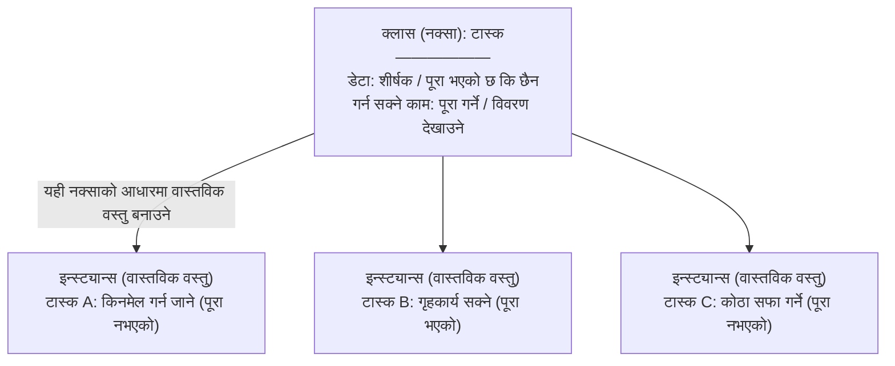

# Python अब्जेक्ट ओरिएन्टेड प्रोग्रामिङ परिचय

> 🇯🇵 मूल प्रति (जापानी भाषामा): [02_Python_OOP入門.md](<../../1年生_前期_ITシステム基礎/番外編/02_Python_OOP入門.md>) <!-- original-ja-link -->

## यस पटकको लक्ष्य
- "क्लास" र "इन्स्ट्यान्स" को फरक व्याख्या गर्न सक्ने
- `__init__` मेथडको भूमिका बुझ्ने
- क्लास प्रयोग गरेर डेटा र प्रक्रियालाई एकै ठाउँमा समेट्न सक्ने

---

## 1. अब्जेक्ट ओरिएन्टेड भनेको के हो?

प्रोग्राम लेख्दा **सम्बन्धित डेटा र प्रक्रियालाई एकै ठाउँमा समेट्ने** सोच हो।

### उपमाबाट बुझौँ: "नक्सा (डिजाइन)" र "वास्तविक वस्तु"



**क्लास** = नक्सा (एउटा मात्र हुन्छ)
**इन्स्ट्यान्स** = नक्साबाट बनाइएको वास्तविक वस्तु (जतिवटा पनि बनाउन सकिन्छ)

---

## 2. क्लास लेखेर हेरौँ

### चरण 1: सबैभन्दा सरल क्लास

```python
# क्लासको परिभाषा
class Task:
    pass  # अहिलेसम्म केही छैन
```

```python
# इन्स्ट्यान्स बनाउने
task1 = Task()  # Task क्लासबाट इन्स्ट्यान्स बनाउने
task2 = Task()  # अर्को पनि बनाउन सकिन्छ

print(task1)  # <__main__.Task object at 0x...>
print(task2)  # <__main__.Task object at 0x...> ← अर्कै इन्स्ट्यान्स
```

---

### चरण 2: डेटा राख्ने (`__init__`)

`__init__` **इन्स्ट्यान्स बनाउँदा आफैँ कल हुने विशेष मेथड** हो।
यसलाई "कन्स्ट्रक्टर" पनि भनिन्छ।

```python
class Task:
    # इन्स्ट्यान्स बनाउँदा आफैँ कल हुन्छ
    def __init__(self, title):
        # self = "यही इन्स्ट्यान्स आफैँ" लाई जनाउँछ
        self.title = title       # शीर्षक सुरक्षित गर्ने
        self.done = False        # सुरुमा पूरा नभएको

# इन्स्ट्यान्स बनाउने (यही बेला __init__ कल हुन्छ)
task1 = Task("買い物に行く")
task2 = Task("宿題を終わらせる")

# इन्स्ट्यान्सको डेटा एक्सेस गर्ने
print(task1.title)  # 買い物に行く
print(task1.done)   # False
print(task2.title)  # 宿題を終わらせる
```

**मुख्य कुरा: `self` भनेको के हो?**
```
task1 = Task("買い物に行く")
          ↑
    यो इन्स्ट्यान्स (task1) नै self बन्छ

self.title = title
→ यसको अर्थ task1.title = "買い物に行く" लेख्नु बराबर हो
```

---

### चरण 3: मेथड थप्ने

मेथड भनेको **क्लासभित्र परिभाषित गरिएको फङ्सन** हो।

```python
class Task:
    def __init__(self, title):
        self.title = title
        self.done = False

    # पूरा भएको रूपमा चिन्ह लगाउने मेथड
    def complete(self):
        self.done = True
        print(f"「{self.title}」を完了にしました！")

    # विवरण देखाउने मेथड
    def show(self):
        status = "☑" if self.done else "□"
        print(f"{status} {self.title}")
```

```python
# प्रयोग गरेर हेर्ने
task1 = Task("買い物に行く")
task2 = Task("宿題を終わらせる")

task1.show()      # □ 買い物に行く
task2.show()      # □ 宿題を終わらせる

task2.complete()  # 「宿題を終わらせる」を完了にしました！

task1.show()      # □ 買い物に行く
task2.show()      # ☑ 宿題を終わらせる
```

---

## 3. क्लास प्रयोग नगरेको अवस्थासँग तुलना

**क्लास प्रयोग नगर्दा:**

```python
# डेटा छरिएको हुन्छ, व्यवस्थापन गर्न गाह्रो
title1 = "買い物に行く"
done1 = False

title2 = "宿題を終わらせる"
done2 = False

# पूरा गर्ने प्रक्रिया पनि छुट्टाछुट्टै लेख्नुपर्छ
done2 = True
print(f"「{title2}」を完了にしました！")

# टास्क बढ्दै गयो भने... title3, done3, title4, done4... अन्त्य नै हुँदैन
```

**क्लास प्रयोग गर्दा:**

```python
# डेटा र प्रक्रिया एकै ठाउँमा! टास्क बढे पनि व्यवस्थापन गर्न सजिलो
tasks = [
    Task("買い物に行く"),
    Task("宿題を終わらせる"),
    Task("部屋を掃除する"),
]

# सबै देखाउने
for task in tasks:
    task.show()
```

---

## 4. यस पटकको सिस्टममा OOP प्रयोग हुने ठाउँहरू

OOP (अब्जेक्ट ओरिएन्टेड प्रोग्रामिङ) यस पटकको सिस्टमका **2 वटा महत्त्वपूर्ण ठाउँ** मा प्रयोग हुन्छ।

### ① डेटाबेस टेबलको परिभाषा (models.py)

```python
# टेबल = क्लास, डेटाको 1 पङ्क्ति (row) = इन्स्ट्यान्स
class Task(Base):
    __tablename__ = "tasks"

    id = Column(Integer, primary_key=True)
    title = Column(String(200))
    done = Column(Boolean, default=False)
```

### ② API को डेटा ढाँचाको परिभाषा (schemas.py)

```python
# रिक्वेस्ट/रेस्पोन्सको डेटा ढाँचालाई क्लासद्वारा प्रस्तुत गर्ने
class TaskCreate(BaseModel):
    title: str  # लिने डेटा: शीर्षक मात्र

class TaskResponse(BaseModel):
    id: int
    title: str
    done: bool  # फर्काउने डेटा: id, शीर्षक र पूरा भएको फ्ल्याग
```

क्लास प्रयोग गर्दा, **कस्तो डेटा प्रयोग हुन्छ भन्ने कुरा एकै नजरमा थाहा हुने** कोड बन्छ।

---

## 5. अभ्यास गरौँ

तलको क्लास पूरा गर्नुहोस्।

```python
class Task:
    def __init__(self, title):
        self.title = title
        self.done = False

    def complete(self):
        # यहाँ "पूरा भएको रूपमा चिन्ह लगाउने" प्रक्रिया लेख्नुहोस्

        pass

    def show(self):
        # यहाँ "विवरण देखाउने" प्रक्रिया लेख्नुहोस्
        pass

# परीक्षण
t = Task("テスト用タスク")
t.show()     # □ テスト用タスク  देखिनुपर्छ
t.complete()
t.show()     # ☑ テスト用タスク  देखिनुपर्छ
```

---

> अघिल्लो चरण → [01_MySQL環境構築.md](./01_MySQL環境構築.md)
> अर्को चरण → [03_FastAPI入門.md](./03_FastAPI入門.md)
