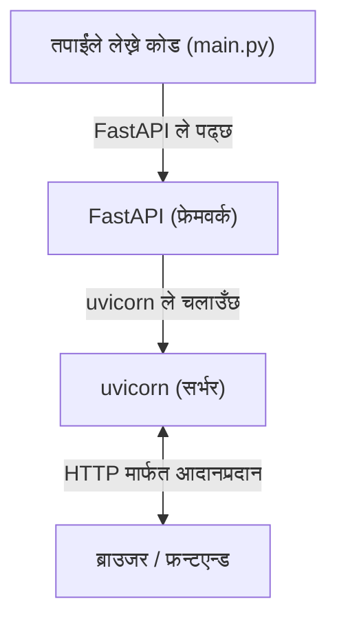
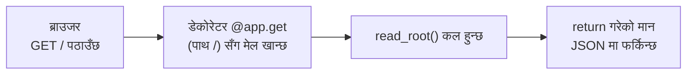

# FastAPI परिचय

> 🇯🇵 मूल प्रति (जापानी भाषामा): [03_FastAPI入門.md](<../../1年生_前期_ITシステム基礎/番外編/03_FastAPI入門.md>) <!-- original-ja-link -->

## यस पटकको लक्ष्य
- FastAPI प्रयोग गरेर सरल API सर्भर सुरु गर्न सक्ने
- `@app.get` जस्ता डेकोरेटरको अर्थ बुझ्ने
- Swagger UI प्रयोग गरेर ब्राउजरबाट API परीक्षण गर्न सक्ने

---

## 1. FastAPI भनेको के हो?

**FastAPI = Python मा API सर्भर बनाउनका लागि फ्रेमवर्क**

फ्रेमवर्क भनेको "प्रायः प्रयोग हुने सुविधाहरू एकै ठाउँमा राखिएको उपयोगी औजारको बाकस" हो।



---

## 2. Hello World बनाउने

सुरुमा सबैभन्दा सरल API सर्भर बनाएर हेरौँ।

### main.py

```python
from fastapi import FastAPI

# FastAPI को इन्स्ट्यान्स बनाउने (एपको मुख्य भाग)
app = FastAPI()

# "/" मा पहुँच गर्दा हुने प्रक्रिया
@app.get("/")
def read_root():
    return {"message": "Hello, World!"}
```

### सुरु गर्ने

**Windows / Mac दुवैमा एउटै:**
```bash
uvicorn main:app --reload
```

```
INFO:     Uvicorn running on http://127.0.0.1:8000
INFO:     Application startup complete.
```

ब्राउजरमा `http://localhost:8000` खोल्दा:
```json
{"message": "Hello, World!"}
```

---

## 3. डेकोरेटर बुझौँ

कोडमा आएको `@app.get("/")` लाई **डेकोरेटर** भनिन्छ।

```python
@app.get("/")          # ← डेकोरेटर
def read_root():       # ← यो फङ्सनलाई "/ मा GET रिक्वेस्ट आएमा कल गर्ने" गरी सेट गरिएको छ
    return {...}
```

रिक्वेस्ट आइपुगेदेखि रेस्पोन्स फर्किनेसम्मको प्रवाह यस्तो हुन्छ।



### HTTP मेथड र डेकोरेटरको सम्बन्ध

| गर्न चाहेको काम | HTTP मेथड | डेकोरेटर |
|------------|-------------|-----------|
| डेटा प्राप्त गर्ने | GET | `@app.get(...)` |
| नयाँ डेटा बनाउने | POST | `@app.post(...)` |
| डेटा अपडेट गर्ने | PUT | `@app.put(...)` |
| डेटा मेटाउने | DELETE | `@app.delete(...)` |

---

## 4. पाथ प्यारामिटर (URL मा मान राख्ने)

```python
@app.get("/tasks/{task_id}")
def get_task(task_id: int):  # URL को {task_id} आर्गुमेन्टको रूपमा आउँछ
    return {"task_id": task_id, "title": "サンプルタスク"}
```

`http://localhost:8000/tasks/3` मा पहुँच गर्दा:
```json
{"task_id": 3, "title": "サンプルタスク"}
```

---

## 5. Swagger UI — API परीक्षण गर्ने स्क्रिन

FastAPI को काम लाग्ने सुविधाहरूमध्ये एउटा **Swagger UI** हो।
कोड लेखेपछि **ब्राउजरमा API परीक्षण गर्न सकिने स्क्रिन स्वतः तयार हुन्छ**।

`http://localhost:8000/docs` खोल्दा, यस्तो स्क्रिन देखिन्छ:

```
┌────────────────────────────────────────────┐
│  FastAPI                                   │
│                                            │
│  GET  /        Hello World फर्काउँछ         │
│  ▼ Try it out                              │
│    [Execute]                               │
│                                            │
│  Response:                                 │
│  {"message": "Hello, World!"}              │
└────────────────────────────────────────────┘
```

**डेभलपमेन्टको बेला Swagger UI प्रयोग गरेर API ले सही काम गरिरहेको छ कि छैन जाँच्न सजिलो हुन्छ।**

---

## 6. टास्क व्यवस्थापन API को ढाँचा बनाउने

वास्तविक सिस्टम बनाउनका लागि टास्क व्यवस्थापन API को आधारभूत ढाँचा तयार गर्छौँ।


```python
# main.py
from fastapi import FastAPI
from fastapi.staticfiles import StaticFiles

app = FastAPI()

# static फोल्डरका HTML फाइलहरू उपलब्ध गराउने सेटिङ
app.mount("/static", StaticFiles(directory="static"), name="static")

# रुट (/) मा पहुँच गर्दा index.html देखाउने
from fastapi.responses import FileResponse

@app.get("/")
def read_index():
    return FileResponse("static/index.html")


# --- टास्कसम्बन्धी API (पछिका चरणमा पूरा गर्ने) ---

@app.get("/tasks")
def get_tasks():
    # टास्कहरूको सूची फर्काउने (पछि DB सँग जोड्ने)
    return []

@app.post("/tasks")
def create_task():
    # टास्क बनाउने (पछि DB सँग जोड्ने)
    return {"message": "タスクを作成しました"}

@app.put("/tasks/{task_id}")
def toggle_task(task_id: int):
    # टास्कको अवस्था पूरा भएको र पूरा नभएको बीच बदल्ने
 (पछि DB सँग जोड्ने)
    return {"message": f"タスク {task_id} を更新しました"}

@app.delete("/tasks/{task_id}")
def delete_task(task_id: int):
    # टास्क मेटाउने (पछि DB सँग जोड्ने)
    return {"message": f"タスク {task_id} を削除しました"}
```

### सुरु गरेर जाँच्ने

**Windows / Mac दुवैमा एउटै:**
```bash
uvicorn main:app --reload
```

`http://localhost:8000/docs` खोलेर, 4 वटा एन्डपोइन्ट देखिन्छन् कि देखिँदैनन् जाँचौँ।

```
GET    /tasks      टास्कको सूची प्राप्त गर्ने
POST   /tasks      टास्क बनाउने
PUT    /tasks/{id} पूरा भएको अवस्था बदल्ने
DELETE /tasks/{id} टास्क मेटाउने
```

---

## 7. अहिलेसम्मका मुख्य कुराहरू

```
① FastAPI को इन्स्ट्यान्स बनाउने
   app = FastAPI()

② डेकोरेटरले URL र मेथड तोक्ने
   @app.get("/tasks")

③ त्यसको तलको फङ्सन नै वास्तविक प्रक्रिया हो
   def get_tasks():
       return [...]

④ फङ्सनले return गरेको मान JSON को रूपमा रेस्पोन्स बन्छ
   return [{"id": 1, "title": "買い物"}]
   → ब्राउजरमा [{"id": 1, "title": "買い物"}] फर्किन्छ
```

---

> अघिल्लो चरण → [02_Python_OOP入門.md](./02_Python_OOP入門.md)
> अर्को चरण → [04_データベース連携.md](./04_データベース連携.md)
