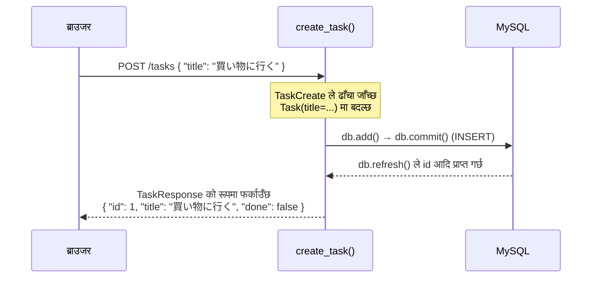

# CRUD API को इम्प्लिमेन्टेसन

> 🇯🇵 मूल प्रति (जापानी भाषामा): [05_CRUD_API実装.md](<../../1年生_前期_ITシステム基礎/番外編/05_CRUD_API実装.md>) <!-- original-ja-link -->

## यस पटकको लक्ष्य
- Pydantic स्किमा क्लास प्रयोग गरेर डेटा ढाँचा परिभाषित गर्न सक्ने
- GET / POST / PUT / DELETE का 4 वटा API बनाउन सक्ने
- Swagger UI मा हरेक API ले काम गर्छ कि गर्दैन जाँच्न सक्ने

---

## 1. CRUD भनेको के हो?

**CRUD** = डेटा सञ्चालनका 4 आधारभूत कार्यहरूको नामका पहिलो अक्षरहरू

| अक्षर | काम | SQL | HTTP मेथड |
|------|------|-----|-------------|
| C | Create (बनाउने) | INSERT | POST |
| R | Read (प्राप्त गर्ने) | SELECT | GET |
| U | Update (अपडेट गर्ने) | UPDATE | PUT |
| D | Delete (मेटाउने) | DELETE | DELETE |

---

## 2. schemas.py — API को डेटा ढाँचा परिभाषित गर्ने

**Pydantic (पाइड्यान्टिक)** क्लास प्रयोग गरेर डेटाको ढाँचा परिभाषित गर्ने लाइब्रेरी हो।
FastAPI सँग मिलाएर प्रयोग गर्दा, **रिक्वेस्ट/रेस्पोन्सको डेटा आफैँ जाँच (भ्यालिडेसन)** गरिदिन्छ।

```python
# schemas.py

from pydantic import BaseModel

# टास्क बनाउँदा लिने डेटा
class TaskCreate(BaseModel):
    title: str  # शीर्षक मात्र लिने (id र done सर्भरले तय गर्छ)

# API को रेस्पोन्समा फर्काउने डेटा
class TaskResponse(BaseModel):
    id: int
    title: str
    done: bool

    # SQLAlchemy को मोडेल अब्जेक्ट सिधै दिन सकिने बनाउने सेटिङ
    class Config:
        from_attributes = True
```

### स्किमा किन छुट्टै फाइलमा लेख्ने?

```
models.py  → डेटाबेसको रूप (कसरी भण्डारण गर्ने)
schemas.py → API को रूप (कुन डेटा लिने/फर्काउने)

उदाहरण: टास्क बनाउँदा
  लिने (TaskCreate): title मात्र
  फर्काउने (TaskResponse):   id + title + done
  भण्डारण गर्ने (Task मोडेल):    id + title + done (id स्वचालित रूपमा दिइन्छ)
```

---

## 3. routers/tasks.py — 4 वटा API बनाउने

```python
# routers/tasks.py

from fastapi import APIRouter, Depends, HTTPException
from sqlalchemy.orm import Session
from database import get_db
from models import Task
from schemas import TaskCreate, TaskResponse

# राउटर = URL हरूको समूह (यहाँ /tasks सम्बन्धी API हरू एकै ठाउँमा राख्ने)
router = APIRouter(prefix="/tasks", tags=["tasks"])
```

---

### R — टास्कको सूची प्राप्त गर्ने (GET /tasks)

```python
# ⚠️ "/" होइन "" राख्ने ("/" राखे /tasks → /tasks/ मा रिडाइरेक्ट हुन्छ)
@router.get("", response_model=list[TaskResponse])
def get_tasks(db: Session = Depends(get_db)):
    """सबै टास्क प्राप्त गरेर फर्काउने"""
    tasks = db.query(Task).all()  # SELECT * FROM tasks
    return tasks
```

**`Depends(get_db)` भनेको के हो?**
```
db: Session = Depends(get_db)
↑
"get_db फङ्सनको नतिजा (DB सेसन) db मा दिनुहोस्"
भन्ने अर्थ हो। API कल हुने हरेक पटक DB सँगको जडान तयार गरिदिन्छ।
```

---

### C — टास्क बनाउने (POST /tasks)

```python
@router.post("", response_model=TaskResponse)
def create_task(task_in: TaskCreate, db: Session = Depends(get_db)):
    """नयाँ टास्क बनाउने"""
    # प्राप्त डेटा (TaskCreate) लाई Task मोडेलको इन्स्ट्यान्समा बदल्ने
    new_task = Task(title=task_in.title)

    db.add(new_task)    # DB मा थप्ने तयारी
    db.commit()         # DB मा सुरक्षित गर्ने (INSERT चलाउने)
    db.refresh(new_task)  # DB ले आफैँ सेट गरेको id आदि प्राप्त गर्ने
    return new_task
```

POST /tasks कल हुँदाको प्रवाहलाई चित्रमा देखाउँदा यस्तो हुन्छ।



---

### U — पूरा भएको अवस्था बदल्ने (PUT /tasks/{task_id})

```python
@router.put("/{task_id}", response_model=TaskResponse)
def toggle_task(task_id: int, db: Session = Depends(get_db)):
    """टास्कको अवस्था पूरा भएको/पूरा नभएको बीचमा बदल्ने"""
    # सम्बन्धित टास्क प्राप्त गर्ने
    task = db.query(Task).filter(Task.id == task_id).first()

    # टास्क भेटिएन भने 404 एरर
    if task is None:
        raise HTTPException(status_code=404, detail="タスクが見つかりません")

    # done उल्टाउने (True → False, False → True)
    task.done = not task.done

    db.commit()         # DB मा सुरक्षित गर्ने (UPDATE चलाउने)
    db.refresh(task)
    return task
```

---

### D — टास्क मेटाउने (DELETE /tasks/{task_id})

```python
@router.delete("/{task_id}")
def delete_task(task_id: int, db: Session = Depends(get_db)):
    """टास्क मेटाउने"""
    task = db.query(Task).filter(Task.id == task_id).first()

    if task is None:
        raise HTTPException(status_code=404, detail="タスクが見つかりません")

    db.delete(task)     # मेटाउने तयारी
    db.commit()         # DB बाट मेटाउने (DELETE चलाउने)
    return {"message": f"タスク '{task.title}' を削除しました"}
```

---

## 4. main.py मा राउटर दर्ता गर्ने

```python
# main.py (पूरा भएको संस्करण)

from fastapi import FastAPI
from fastapi.staticfiles import StaticFiles
from fastapi.responses import FileResponse
from database import engine, Base
import models
from routers import tasks  # ← थपिएको

# टेबल आफैँ बनाउने
Base.metadata.create_all(bind=engine)

app = FastAPI()

# राउटर दर्ता गर्ने (/tasks अन्तर्गतका API सक्रिय हुन्छन्)
app.include_router(tasks.router)  # ← थपिएको

app.mount("/static", StaticFiles(directory="static"), name="static")

@app.get("/")
def read_index():
    return FileResponse("static/index.html")
```

---

## 5. फाइल संरचना (हालसम्म)

```
my_todo_app/
├── main.py         ← राउटर दर्ता थपिसकिएको
├── database.py     ← DB जडान सेटिङ
├── models.py       ← Task टेबल परिभाषा
├── schemas.py      ← ★ यस पटक बनाएको: डेटा ढाँचा परिभाषा
├── routers/
│   ├── __init__.py ← खाली फाइल (फोल्डरलाई Python प्याकेजको रूपमा चिनाउने)
│   └── tasks.py    ← ★ यस पटक बनाएको: CRUD API
└── static/
    └── index.html  ← अर्को चरणमा बनाउने
```

`routers/__init__.py` खाली फाइल भए पुग्छ:

**Windows:**
```cmd
type nul > routers\__init__.py
```

**Mac:**
```bash
touch routers/__init__.py
```

---

## 6. Swagger UI मा चलाएर जाँच्ने

**Windows / Mac दुवैमा एउटै:**
```bash
uvicorn main:app --reload
```

`http://localhost:8000/docs` खोलेर जाँच्नुहोस्।

**जाँच्ने तरिका (POST → GET → PUT → DELETE को क्रममा):**

1. **POST /tasks** क्लिक गर्ने → `Try it out` → Request body मा लेख्ने:
   ```json
   {"title": "買い物に行く"}
   ```
   → `Execute` → Response मा `{"id": 1, "title": "買い物に行く", "done": false}` फर्किनुपर्छ

2. **GET /tasks** क्लिक गर्ने → `Try it out` → `Execute`
   → बनाएको टास्क सूचीमा फर्किनुपर्छ

3. **PUT /tasks/{task_id}** क्लिक गर्ने → `task_id` मा `1` लेख्ने → `Execute`
   → `"done": true` मा बदलिनुपर्छ

4. **DELETE /tasks/{task_id}** क्लिक गर्ने → `task_id` मा `1` लेख्ने → `Execute`
   → टास्क मेटाइएको जानकारी दिने सन्देश फर्किनुपर्छ


---

> अघिल्लो चरण → [04_データベース連携.md](./04_データベース連携.md)
> अर्को चरण → [06_フロントエンド連携.md](./06_フロントエンド連携.md)
