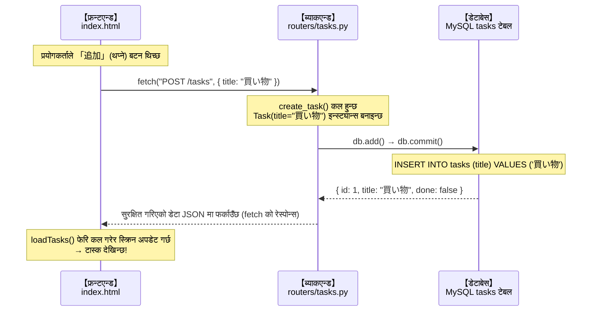

# फ्रन्टएन्डसँग जोड्ने (HTML + JavaScript)

> 🇯🇵 मूल प्रति (जापानी भाषामा): [06_フロントエンド連携.md](<../../1年生_前期_ITシステム基礎/番外編/06_フロントエンド連携.md>) <!-- original-ja-link -->

## यस पटकको लक्ष्य
- `fetch()` प्रयोग गरेर Python API कल गर्न सक्ने
- API को रेस्पोन्स स्क्रिनमा देखाउन सक्ने (DOM सञ्चालन)
- टास्क थप्ने, पूरा भएको अवस्था बदल्ने र मेटाउने काम स्क्रिनबाटै गर्न सक्ने

---

## 1. SPA (सिंगल पेज एप्लिकेसन) भनेको के हो?

यस पटक बनाउने फ्रन्टएन्ड **SPA** भन्ने तरिकाको हो।

```
परम्परागत वेबसाइट (पेज परिवर्तन हुने)
  हरेक पटक केही गर्दा पूरै पेज फेरि लोड हुन्छ
  पेज A → पेज B → पेज C ...

SPA (सिंगल पेज एप्लिकेसन)
  1 वटा HTML फाइलमा, JavaScript ले स्क्रिनलाई डाइनामिक रूपमा बदल्छ
  पेज फेरि लोड हुँदैन → छिटो चल्ने अनुभव
```

यस पटक **index.html को 1 फाइलमा मात्र** सबै काम पूरा हुन्छ।

---

## 2. फोल्डर तयारी

**Windows:**
```cmd
mkdir static
type nul > static\index.html
```

**Mac:**
```bash
mkdir static
touch static/index.html
```

---

## 3. index.html — पूरा कोड

```html
<!DOCTYPE html>
<html lang="ja">
<head>
  <meta charset="UTF-8">
  <meta name="viewport" content="width=device-width, initial-scale=1.0">
  <title>タスク管理アプリ</title>
  <style>
    body {
      font-family: Arial, sans-serif;
      max-width: 600px;
      margin: 40px auto;
      padding: 0 20px;
      background: #f5f5f5;
    }
    h1 { color: #333; }

    /* टास्क थप्ने फर्म */
    .add-form {
      display: flex;
      gap: 8px;
      margin-bottom: 20px;
    }
    .add-form input {
      flex: 1;
      padding: 8px;
      font-size: 16px;
      border: 1px solid #ccc;
      border-radius: 4px;
    }
    .add-form button {
      padding: 8px 16px;
      background: #4CAF50;
      color: white;
      border: none;
      border-radius: 4px;
      cursor: pointer;
      font-size: 16px;
    }

    /* टास्क सूची */
    .task-list { list-style: none; padding: 0; }
    .task-item {
      display: flex;
      align-items: center;
      gap: 8px;
      background: white;
      padding: 12px;
      margin-bottom: 8px;
      border-radius: 4px;
      box-shadow: 0 1px 3px rgba(0,0,0,0.1);
    }
    .task-title { flex: 1; font-size: 16px; }
    .task-title.done {
      text-decoration: line-through;
      color: #999;
    }
    .btn-done {
      padding: 4px 12px;
      background: #2196F3;
      color: white;
      border: none;
      border-radius: 4px;
      cursor: pointer;
    }
    .btn-delete {
      padding: 4px 12px;
      background: #f44336;
      color: white;
      border: none;
      border-radius: 4px;
      cursor: pointer;
    }
  </style>
</head>
<body>

  <h1>タスク管理アプリ</h1>

  <!-- टास्क थप्ने फर्म -->
  <div class="add-form">
    <input type="text" id="newTaskInput" placeholder="新しいタスクを入力...">
    <button onclick="addTask()">追加</button>
  </div>

  <!-- टास्कको सूची (JavaScript ले बदल्छ) -->
  <ul class="task-list" id="taskList">
    <!-- यहाँ टास्कहरू देखिन्छन् -->
  </ul>

  <script>
    // ============================================================
    // API को बेस URL (Python सर्भरको ठेगाना)
    // ============================================================
    const API_URL = "http://localhost:8000";

    // ============================================================
    // R — टास्कको सूची प्राप्त गरेर स्क्रिनमा देखाउने
    // ============================================================
    async function loadTasks() {
      // fetch() ले GET रिक्वेस्ट पठाउने
      const response = await fetch(`${API_URL}/tasks`);
      const tasks = await response.json();  // रेस्पोन्सलाई JSON मा बदल्ने

      // टास्क सूची एकपटक खाली गर्ने
      const taskList = document.getElementById("taskList");
      taskList.innerHTML = "";

      // जतिवटा टास्क छन् त्यतिवटै <li> बनाएर थप्ने
      tasks.forEach(task => {
        const li = document.createElement("li");
        li.className = "task-item";
        li.innerHTML = `
          <span class="task-title ${task.done ? 'done' : ''}">${task.title}</span>
          <button class="btn-done" onclick="toggleTask(${task.id})">
            ${task.done ? '未完了に戻す' : '完了'}
          </button>
          <button class="btn-delete" onclick="deleteTask(${task.id})">削除</button>
        `;
        taskList.appendChild(li);
      });
    }

    // ============================================================
    // C — टास्क थप्ने
    // ============================================================
    async function addTask() {
      const input = document.getElementById("newTaskInput");
      const title = input.value.trim();

      // केही पनि लेखिएको छैन भने केही नगर्ने
      if (!title) return;

      // fetch() ले POST रिक्वेस्ट पठाउने
      await fetch(`${API_URL}/tasks`, {
        method: "POST",
        headers: {
          "Content-Type": "application/json"  // JSON पठाइँदै छ भनेर जानकारी दिने
        },
        body: JSON.stringify({ title: title })  // JavaScript अब्जेक्ट → JSON स्ट्रिङ
      });

      // इनपुट बक्स खाली गरेर, सूची फेरि लोड गर्ने
      input.value = "";
      loadTasks();
    }

    // ============================================================
    // U — टास्कको अवस्था पूरा भएको/पूरा नभएकोमा बदल्ने
    // ============================================================
    async function toggleTask(taskId) {
      // fetch() ले PUT रिक्वेस्ट पठाउने
      await fetch(`${API_URL}/tasks/${taskId}`, {
        method: "PUT"
      });

      loadTasks();  // सूची फेरि लोड गर्ने
    }

    // ============================================================
    // D — टास्क मेटाउने
    // ============================================================
    async function deleteTask(taskId) {
      // fetch() ले DELETE रिक्वेस्ट पठाउने
      await fetch(`${API_URL}/tasks/${taskId}`, {
        method: "DELETE"
      });

      loadTasks();  // सूची फेरि लोड गर्ने
    }

    // ============================================================
    // Enter की थिचेर पनि टास्क थप्न सकिने बनाउने
    // ============================================================
    document.getElementById("newTaskInput").addEventListener("keydown", function(e) {
      if (e.key === "Enter") {
        addTask();
      }
    });

    // पेज खोल्दा टास्कको सूची लोड गर्ने
    loadTasks();
  </script>

</body>
</html>
```

---

## 4. कोडका महत्त्वपूर्ण बुँदाहरूको व्याख्या

### `fetch()` को आधारभूत ढाँचा

```javascript
// GET (डेटा प्राप्त गर्ने)
const response = await fetch("http://localhost:8000/tasks");
const data = await response.json();

// POST (डेटा पठाउने)
await fetch("http://localhost:8000/tasks", {
  method: "POST",
  headers: { "Content-Type": "application/json" },
  body: JSON.stringify({ title: "買い物" })
});

// PUT (अपडेट गर्ने)
await fetch("http://localhost:8000/tasks/1", {
  method: "PUT"
});

// DELETE (मेटाउने)
await fetch("http://localhost:8000/tasks/1", {
  method: "DELETE"
});
```

### `async / await` भनेको के हो?

```javascript
// API को सञ्चार "समय लाग्ने प्रक्रिया" भएकाले,
// नतिजा नआउँदासम्म पर्खनुपर्छ

async function loadTasks() {         // async = यो फङ्सनमा एसिन्क्रोनस (asynchronous) प्रक्रिया छ
  const response = await fetch(...); // await = नतिजा नआउँदासम्म यहीँ पर्खने
  const tasks = await response.json();
  // ↑ response.json() मा पनि समय लाग्ने भएकाले await चाहिन्छ
}
```

### DOM सञ्चालन (स्क्रिन बदल्ने)

```javascript
// DOM = HTML का एलिमेन्टलाई JavaScript ले चलाउने संरचना

// id="taskList" भएको एलिमेन्ट प्राप्त गर्ने
const taskList = document.getElementById("taskList");

// भित्रको सामग्री खाली गर्ने
taskList.innerHTML = "";

// नयाँ एलिमेन्ट बनाएर थप्ने
const li = document.createElement("li");
li.innerHTML = `<span>${task.title}</span>`;
taskList.appendChild(li);
```

---

## 5. चलाएर जाँच्ने

### सुरु गर्ने

**Windows / Mac दुवैमा एउटै:**
```bash
uvicorn main:app --reload
```

`http://localhost:8000` ब्राउजरमा खोल्नुहोस्।

### जाँच्ने तरिका

1. **टास्क थप्ने**
   - इनपुट बक्समा 「買い物に行く」(किनमेल गर्न जाने) लेखेर 「追加」(थप्ने) बटन क्लिक गर्ने
   - सूचीमा देखिनुपर्छ

2. **पूरा भएको बनाउने**
   - 「完了」(पूरा) बटन क्लिक गर्ने
   - शीर्षकमा काट्ने रेखा (strikethrough) देखिनुपर्छ

3. **मेटाउने**
   - 「削除」(मेटाउने) बटन क्लिक गर्ने
   - सूचीबाट हराउनुपर्छ

4. **पेज फेरि लोड गर्ने (F5)**
   - डेटा बाँकी रहनुपर्छ (MySQL मा सुरक्षित भएकाले)

---

## 6. सिस्टम पूरा भयो! समग्र प्रवाहको सारांश



---

> अघिल्लो चरण → [05_CRUD_API実装.md](./05_CRUD_API実装.md)
> अर्को चरण → [07_コードリーディング.md](./07_コードリーディング.md)
> सुरुदेखि हेर्ने → [00_概要とシステム設計.md](./00_概要とシステム設計.md)
